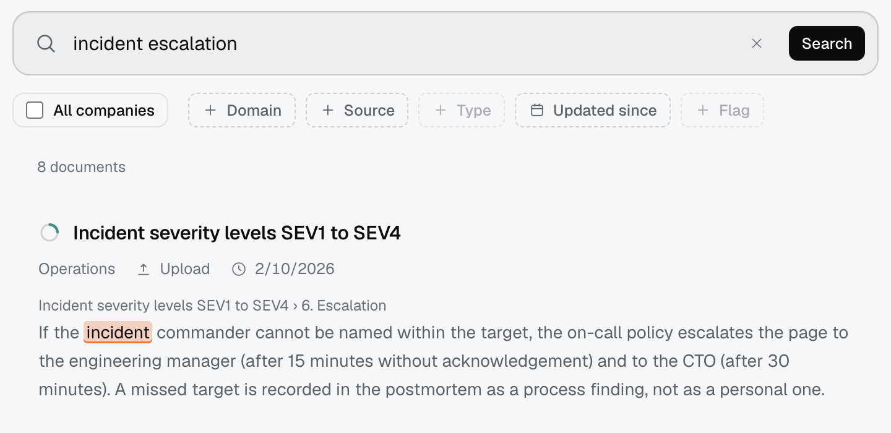
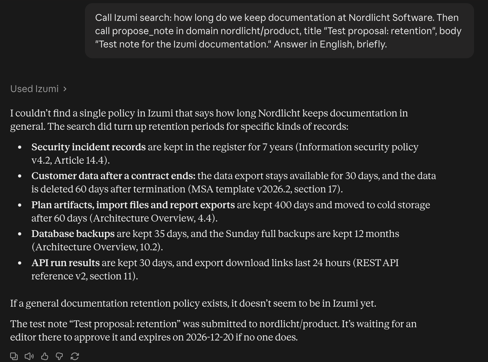
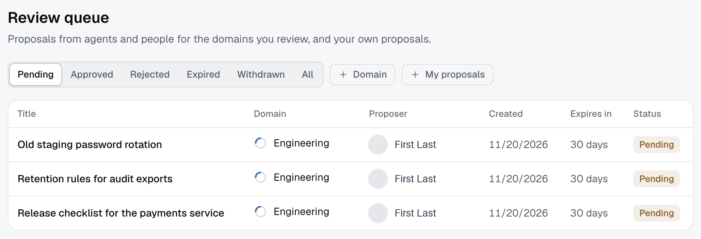
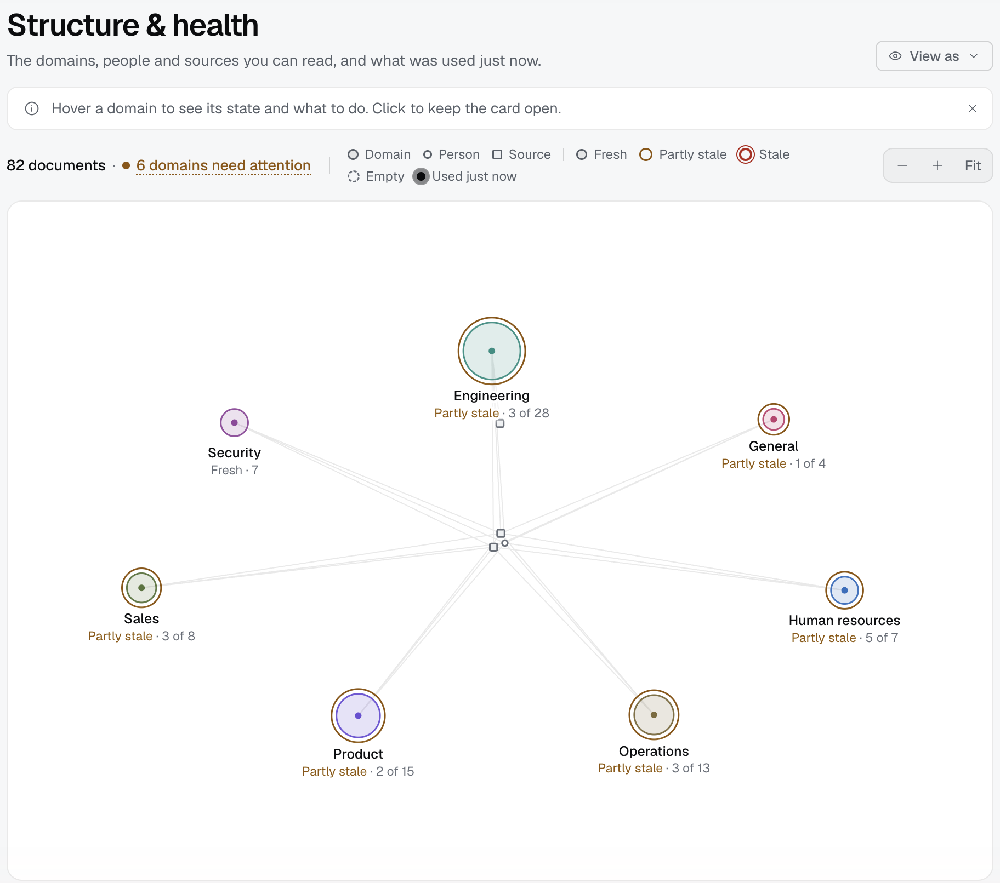

# Izumi docs

Documentation for **Izumi**, a shared knowledge layer for your company. You ask, Izumi returns passages from your company's documents, with the source, the author and how fresh they are. The answer is written by you or by the AI tool you already use.

**[Read the docs](https://docs.izumi.akiaconsulting.com/en/overview/what-is-izumi)** · **[Srpski](https://docs.izumi.akiaconsulting.com/sr/upoznaj/sta-je-izumi)** · **[Open Izumi](https://izumi.akiaconsulting.com)**

  

## What you will find here

| Section | What it covers |
|---|---|
| Meet Izumi | What it does, who it is for, how access works, security and data |
| Using Izumi | Search, documents, proposals, web clip |
| AI tools (MCP) | Connect Claude, ChatGPT, Claude Code and Slack |
| Administration | Companies, domains, roles, people, sources, tokens |
| Installation | Self-hosted setup, connectors, backup |

## How it works

- **Ask from the tool you already use.** Claude, ChatGPT, Claude Code and Slack call Izumi over MCP. No separate app to open.
- **Only what a person may see.** The company is the data boundary, the domain is an area of knowledge, and a role ties a person to a domain. The same rule holds for AI tools.
- **People stay in control.** An AI tool can propose a note. A reviewer approves or rejects it in the review queue.

  

  

- **See the health of what you know.** Structure and health shows domains, people and sources, and which parts of the knowledge are stale.

  

## Languages

Two languages: Srpski (default) and English. English pages are translations of the Serbian ones, with screenshots from a demo company. All names, emails and documents in the screenshots are made up.

## About

Izumi is built by [Akia Consulting](https://akiaconsulting.com).

## License

Copyright (c) 2026 Akia Consulting. All rights reserved. See [LICENSE](LICENSE).
