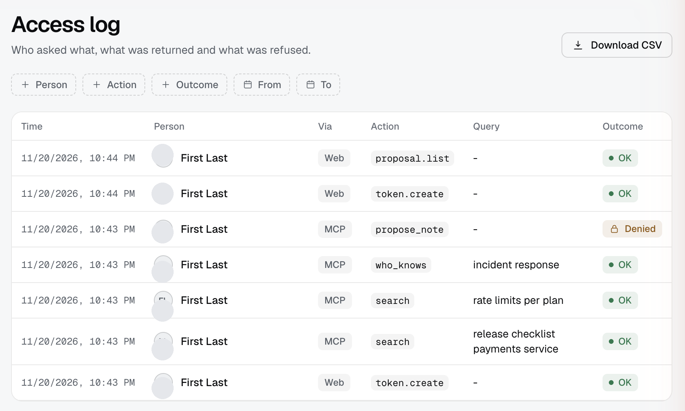
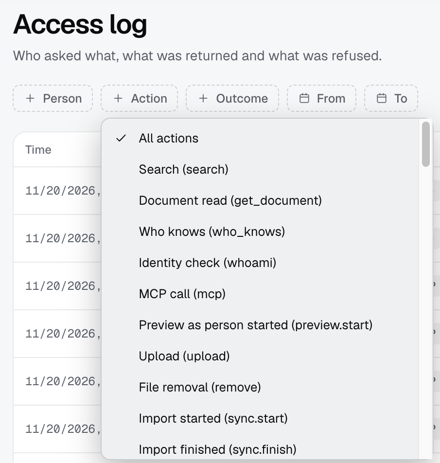

Checked on Izumi 0.5.7, 2026-11-21.

The **Access log** records who asked what, what was returned and what was refused. Every call, from the web, from AI tools, from the web clip extension and through the push API, writes one row. A company admin sees here everything that happens in their company, and every member sees only their own.

## Before you start

- All members see the **Access log** item in the left menu. A company admin sees the entries of all people in the company, a member only their own (checked live: a member sees only their own rows, has no **Person** filter, and **Download CSV** gives only those rows).
- A row with no company is seen by nobody on the web, not even the person it belongs to. Only the server operator sees it (from the code).
- You set how long entries are kept in **Company settings**.

## Review the entries

<Steps>
  <Step title="Open the log">
    Click **Access log**. The columns are **Time**, **Person**, **Via**, **Action**, **Query**, **Results**, **Outcome** and **Duration**. **Via** says where the request came from: **MCP**, **Web**, **Preview**, **Web clip**, **Connected app (OAuth)**, **Push**, **Worker**, **System** or **Maintenance**. **Outcome** is **OK**, **Denied** or **Error**. The last column, **Actions**, opens the details of a row. The newest row is first. The screenshot leaves out the **Results** and **Duration** columns and the last column, so it stays readable.

    <Frame>
      
    </Frame>
  </Step>
  <Step title="Narrow the entries">
    The filters are **Person** (company admin only), **Action**, **Outcome**, **From** and **To**. **Download CSV** downloads the entries with the same filters, all pages, as one UTF-8 file with a byte order mark so Excel opens it correctly. It has 16 columns with English technical names (`id`, `at`, `company`, `person`, `acting_person`, `previewed_by`, `via`, `client`, `agent`, `action`, `query`, `result_count`, `outcome`, `error_code`, `duration_ms`, `hidden_refs`), and the values are technical too (for example `web`, `worker`, `ok`, `denied`). **Load more** brings the next page on the screen (50 rows per page).

    <Frame>
      
    </Frame>
  </Step>
  <Step title="Open the details">
    The arrow at the end of a row opens **Details**. For a search it says **Documents in the answer**: the titles the AI tool received. For a refused call it says **Error code**. You see a title only for a document you may read yourself. For the others it shows a count, for example "2 documents outside your access".
  </Step>
</Steps>

## Set the retention

Entries are not kept forever. You set the period in **Companies and members**, section **Settings**, field **Audit retention (days)**.

- The allowed range is 30 to 3650 days. The default is 365.
- The worker deletes entries older than the period once a day (from the install guide).
- Entries of a deleted company or person stay until their period ends.
- A change of the period is logged as a change of audit retention.

The field and the button **Save settings** are described on the page [Companies, domains, roles](/en/admin/companies-domains-roles).

## What is not written

- The title and text of a document sent through the push API are never written. The external id, the domain, the source and the number of bytes are (see [Push API](/en/admin/push-api)).
- The details on the web do not show the name of a token or the path of a removed file, only identifiers and fixed words (from the code).

## Limits

- The **Action** column shows the technical name of an action (for example `search`), while the **Action** filter offers names in the language of the screen.
- An admin sees the entries of the company, not the entries of other companies where they are not an admin.
- Removing documents and deleting sources write their own rows. What is deleted and when is on the page [Deletion and retention](/en/admin/deletion).
- Izumi sends no notifications based on the log. The log is for review and export.

## Troubleshooting

- _"The log did not load."_ Refresh the page.
- _"No entries."_ Widen the filters **From** and **To**. If that does not help, the retention period may be too short and the entries are already deleted.
- You do not see a colleague's entry. You are not a company admin.
- You do not see a document title in the details. The document is outside your access or was removed. Only a count is shown.
- The entry of an old call is gone. The period from **Audit retention (days)** has passed. Increase the period for future entries.
