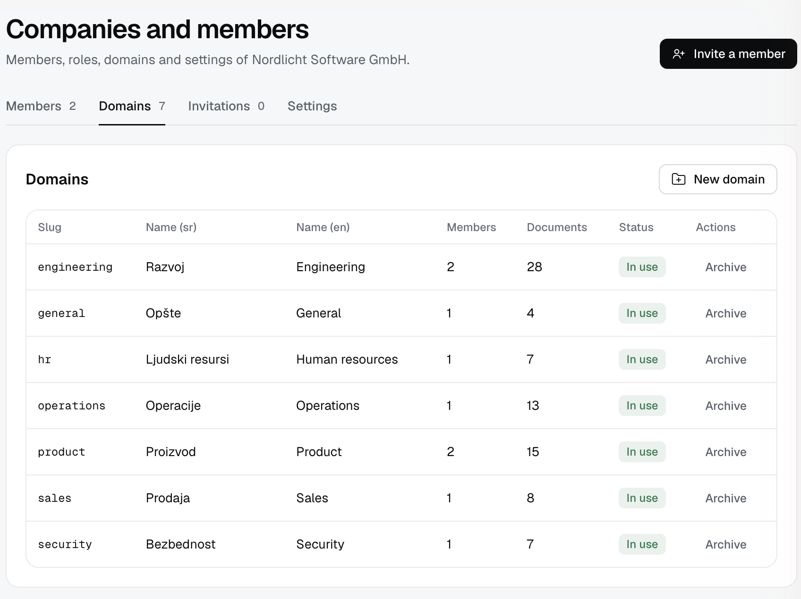
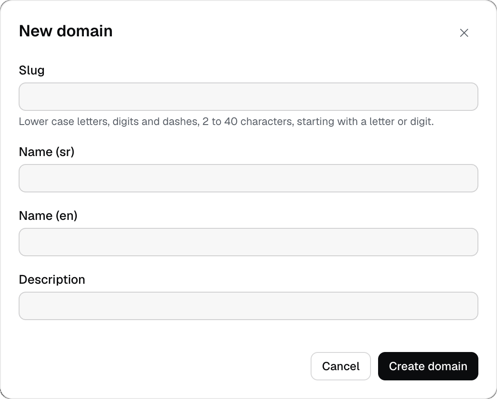
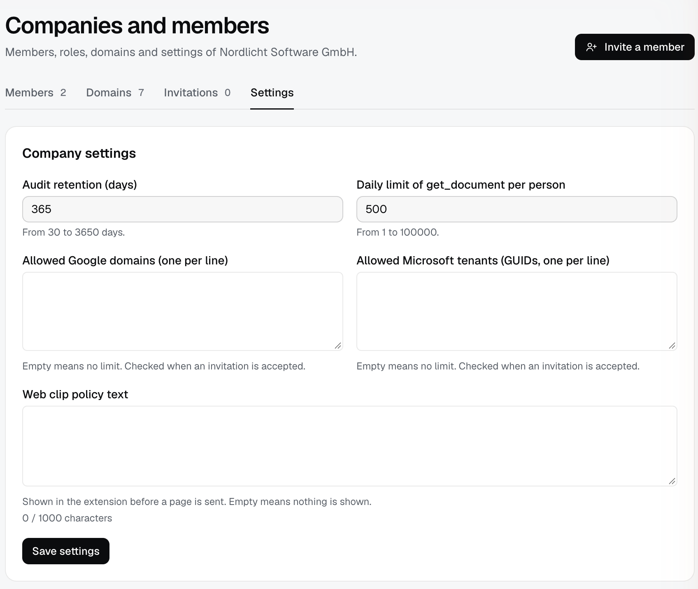
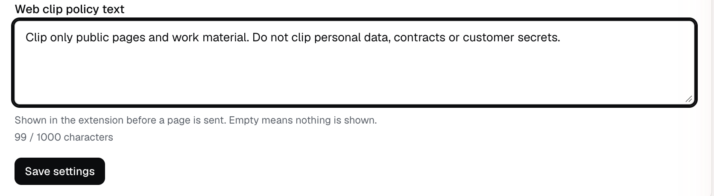

Checked on Izumi 0.5.7, 2026-11-21.

In Izumi, a company is the boundary of the data. Inside a company are domains, areas of knowledge such as Finance or HR. A role ties a person to one domain. Everything is set on the **Companies and members** page, in the **Domains** and **Settings** sections.

## How it fits together

- A company has members. A member sees only the documents of the domains where they have a role.
- A **Reader** reads and searches the documents of the domain.
- An **Editor** reads the same as a reader, sends web clips to the domain and approves or rejects proposed notes of that domain (see [Review queue](/en/admin/review-queue)).
- A **Company admin** manages members, domains, sources and settings. An admin is not automatically an editor of any domain. You give them the editor role like any other member.
- Documents, sources and access log entries belong to the company. Another company does not see them.

Companies are created only with an operator command on the server, not from the web page (from the install guide). This page works on the company chosen in the header.

## Domains

<Steps>
  <Step title="Open the Domains section">
    The table has the columns **Slug**, **Name (sr)**, **Name (en)**, **Description**, **Members**, **Documents**, **Status** and **Actions**. The status is **In use** or **Archived**. The **Documents** count includes only domains where you also have a role. For the others it says _"You have no role in this domain, so its documents are not counted for you."_ The picture leaves out the **Description** column so it stays readable.

    <Frame>
      
    </Frame>
  </Step>
  <Step title="Create a domain">
    Click **New domain**. The fields are **Slug**, **Name (sr)**, **Name (en)** and **Description**. The slug has lower case letters, digits and dashes, 2 to 40 characters, starts with a letter or a digit, does not end with a dash or contain two dashes in a row, and must be unique in the company. A name has at most 120 characters. Click **Create domain**.

    <Frame>
      
    </Frame>
  </Step>
  <Step title="Archive or restore a domain">
    **Archive** in the **Actions** column takes a domain out of use, **Restore** brings it back. An archived domain does not delete documents, but roles in it no longer give access and new imports do not go into it (from the code).
  </Step>
  <Step title="Give roles">
    Roles are given in the **Members** section or in the invitation dialog. The steps are on the page [People and invitations](/en/admin/people).
  </Step>
</Steps>

## Company settings

The **Settings** section saves all values with one click on **Save settings**.

<Steps>
  <Step title="Look at the settings">
    - **Audit retention (days)**: from 30 to 3650 days. After that period old entries are deleted, see [Deletion and retention](/en/admin/deletion).
    - **Daily limit of get_document per person**: from 1 to 100000. This many `get_document` calls per UTC day are allowed per token or connected app. Each page of a document is one call (from the code).
    - **Allowed Google domains (one per line)** and **Allowed Microsoft tenants (GUIDs, one per line)**: at most 20 entries in each field.
    - **Web clip policy text**: up to 1000 characters, the counter is next to the field.

    <Frame>
      
    </Frame>
  </Step>
  <Step title="Restrict sign-in by organization (optional)">
    When at least one of the two fields is filled in, a person who accepts an invitation must sign in with an account from that list: a Google account with an allowed domain, or a Microsoft account from an allowed tenant. Empty fields mean no restriction. The check is done only when an invitation is accepted. Checked live on 0.5.8 with a Microsoft tenant: with a wrong tenant GUID the accept was refused, and after the list was fixed the same invitation link worked (a refused accept does not use up the invitation).
  </Step>
  <Step title="Enter a web clip policy text (optional)">
    Everyone who uses the web clip extension sees the text before sending a page. An empty field means nothing is shown. How the text looks in the extension is on the page [Source: upload](/en/admin/sources-upload).

    <Frame>
      
    </Frame>
  </Step>
</Steps>

## Limits

- You cannot create or delete a company from the web page.
- The slug of a domain does not change after creation (from the code: editing a domain changes names and description).
- At most 20 Google domains and 20 Microsoft tenants per company.
- If you fill in only Google domains, Microsoft accounts cannot accept an invitation, and the other way round. Enter both if you need both (from the code).
- The restriction by domain or tenant does not check members who already have an account, only the acceptance of a new invitation (from the code).

## Troubleshooting

- _"A domain with this slug already exists."_ Slugs are unique in a company. Choose another one.
- _"Use lower case letters, digits and dashes (2 to 40 characters)."_ The slug must not have spaces, capital letters or diacritics.
- _"Not a valid domain name: …"_ or _"Not a valid GUID: …"_ One of the entries in the Google domains or Microsoft tenants is not valid. Fix it or delete it.
- _"At most … entries."_ Cut the list down to 20 entries.
- An invited person sees _"This company does not allow sign-in from this account (its allowed domains or tenants). Ask a company admin."_ (checked live) Check whether their Google domain or Microsoft tenant is on the list. With empty lists there is no restriction.
