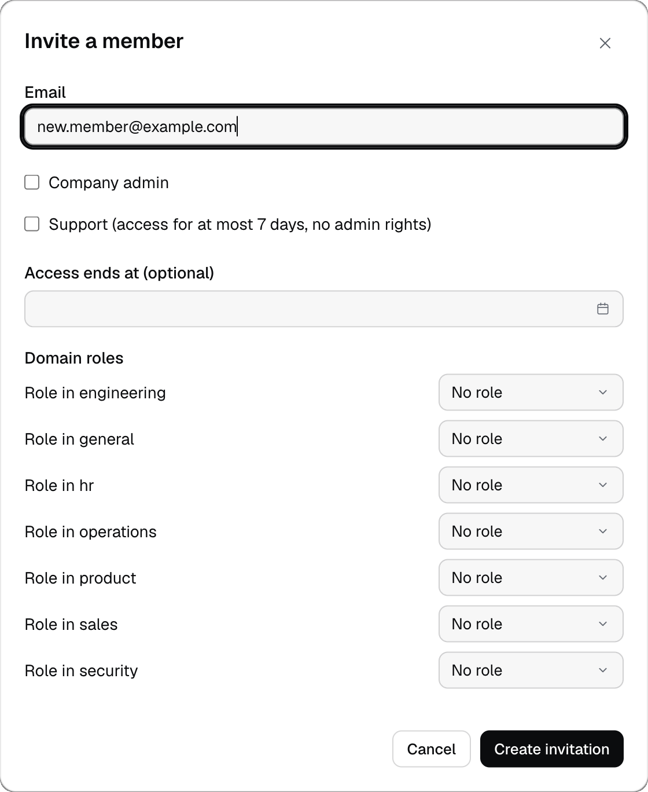
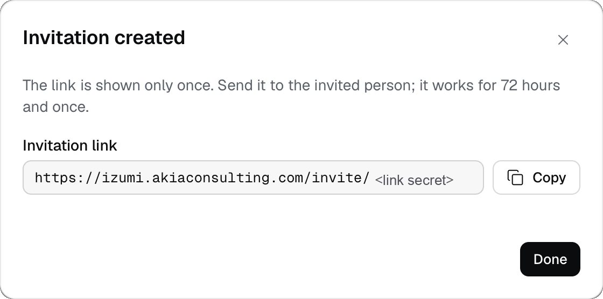
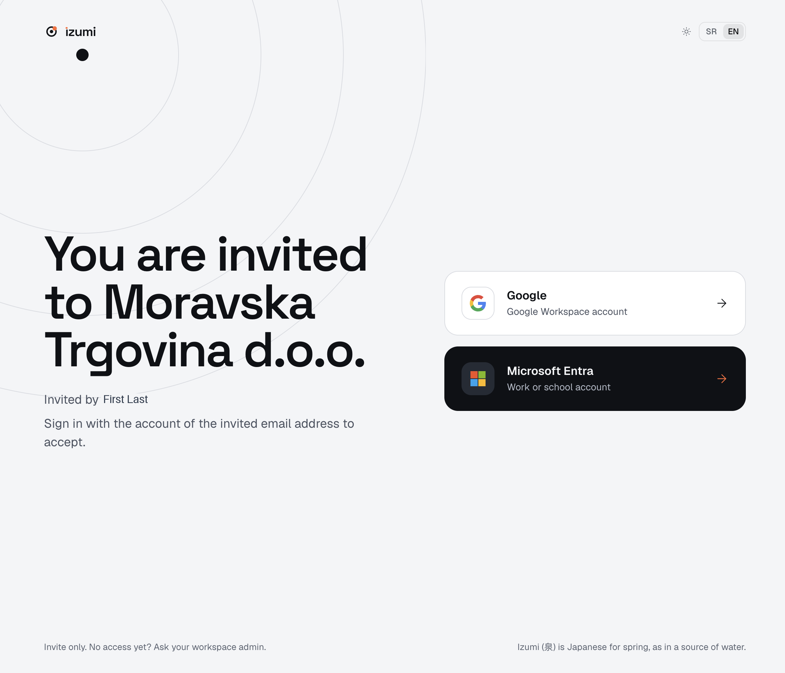
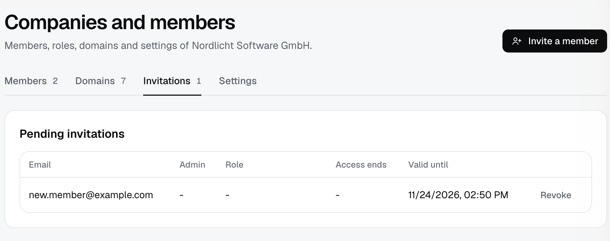
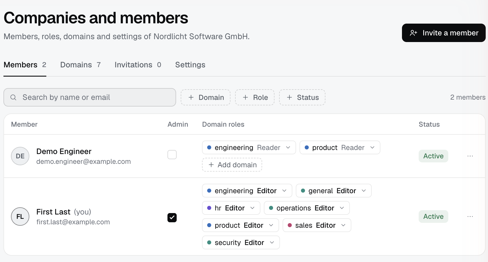
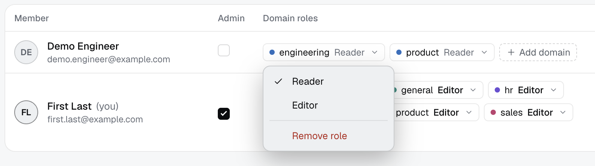
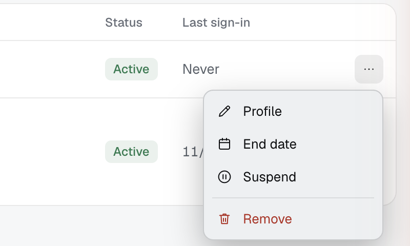
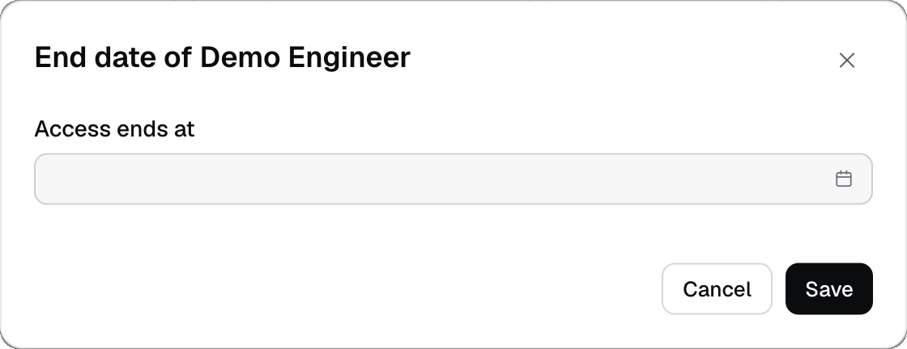
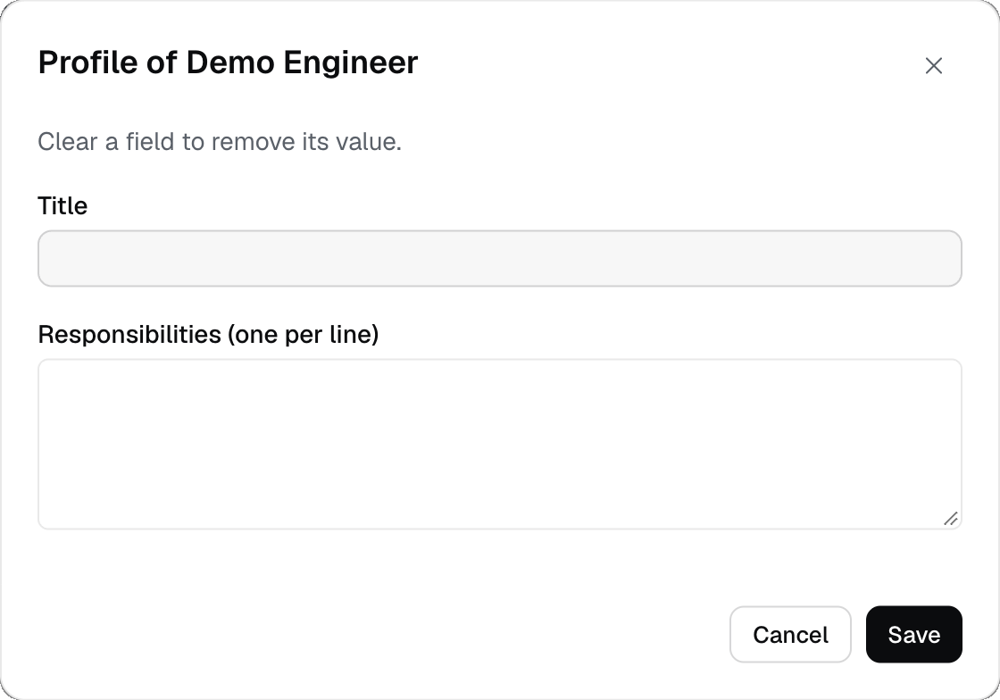
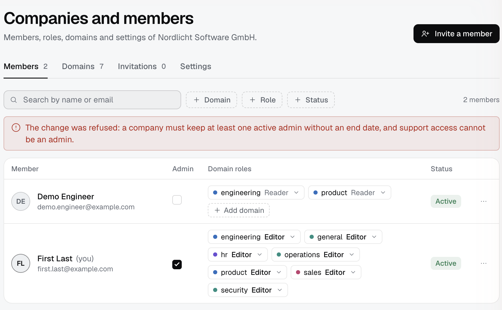

Checked on Izumi 0.5.7, 2026-11-21.

You invite and manage people on the **Companies and members** page. Its sections are **Members**, **Domains**, **Invitations** and **Settings**. This page covers **Members** and **Invitations**. Domains and settings are on the page [Companies, domains, roles](/en/admin/companies-domains-roles).

## Before you start

- You must be a company admin. The menu items **Companies and members**, **Sources** and **Import report** are visible only to admins (from the code).
- The company must exist. Companies are created only with an operator command on the server (from the install guide), not from this page. The page works on the company chosen in the header.
- Create at least one domain before you give roles. Without a domain the invitation dialog says _"There are no domains yet. Create one first to give roles."_

## Invite a new member

<Steps>
  <Step title="Open the dialog">
    Click **Invite a member** at the top right. The dialog has the fields **Email**, **Company admin**, **Support (access for at most 7 days, no admin rights)** and **Access ends at (optional)**. Below them is one row "Role in" plus the domain name for each domain, with the choice **No role**, **Reader** or **Editor**.

    <Frame>
      
    </Frame>
  </Step>
  <Step title="Create the invitation">
    Enter the address, choose the roles and click **Create invitation**. Izumi shows the **Invitation link** only once: _"The link is shown only once. Send it to the invited person; it works for 72 hours and once."_ Click **Copy**, then **Done**.

    <Frame>
      
    </Frame>
  </Step>
  <Step title="Send the link yourself">
    Izumi does not send email (from the code). You send the link through a channel you trust. The person opens the link, sees "You are invited to" followed by the company name and the name of the person who invited them, and signs in with the account that has the address from the invitation. Checked live on 0.5.8 with a Microsoft account.
  <Frame>
    
  </Frame>
  </Step>
  <Step title="Follow pending invitations">
    The **Invitations** section (the count is next to the title) shows **Pending invitations**: **Email**, **Admin**, **Role**, **Access ends** and **Valid until**. **Revoke** cancels the invitation and says _"The invitation was revoked."_

    <Frame>
      
    </Frame>
  </Step>
</Steps>

## Manage members

<Steps>
  <Step title="See the list">
    The **Members** section is a table with the columns **Member**, **Admin**, **Domain roles**, **Status** and **Last sign-in**. Above it are a search by name or email and the filters **Domain**, **Role** and **Status**. The picture leaves out the **Last sign-in** column so it stays readable.

    <Frame>
      
    </Frame>
  </Step>
  <Step title="Change a role in a domain">
    Each role is a chip of the form `domain Role`. Clicking the chip opens a menu with **Reader**, **Editor** and **Remove role**. **Add domain** adds a role in one more domain.

    <Frame>
      
    </Frame>
  </Step>
  <Step title="Open the member menu">
    The menu at the end of the row has **Profile**, **End date**, **Suspend** (afterwards **Activate**) and **Remove**.

    <Frame>
      
    </Frame>
  </Step>
  <Step title="Set an end date">
    **End date** opens a dialog with the field **Access ends at**. After that date the member no longer has access. The date must be in the future and at most 365 days ahead (from the code).

    <Frame>
      
    </Frame>
  </Step>
  <Step title="Fill in the profile">
    **Profile** opens the fields **Title** and **Responsibilities (one per line)**: up to 200 characters per line and up to 20 lines. The data is stored with the member (from the code). Where exactly it is shown was not checked live.

    <Frame>
      
    </Frame>
  </Step>
  <Step title="Set or remove admin">
    The **Admin** box in the row gives or removes the admin right. A company must keep at least one active admin without an end date. If you try to break that, the server refuses the change and nothing changes.

    <Frame>
      
    </Frame>
  </Step>
</Steps>

**Suspend** pauses access and **Activate** brings it back. A suspended person who signs in sees on the sign-in page _"This account hasn't been invited yet."_ with the hint to ask the workspace admin (checked live), the same notice as for an account that was never invited. **Remove** asks _"Remove …?"_ The dialog says _"The person loses access to this company and their roles here are deleted. Their account stays."_ Checked live: after **Remove** the member left the list, and a new invitation for the same address (with the Reader role) was accepted afterwards, the person came back as a new member with only the roles of the new invitation.

## Limits

- A company admin is not automatically an editor of any domain. You give the editor role separately, per domain.
- An invitation is valid for 72 hours and can be used once. The link is shown only once.
- A new invitation for the same address replaces the pending one (from the code).
- Support access lasts at most 7 days and cannot be admin. **Clear the support preset (allows an end date after 7 days)** in the end-date dialog lifts that limit (from the code).
- The account the invited person uses must have the address from the invitation. A restriction by Google domain or Microsoft tenant is checked when the invitation is accepted (from the code, see [Companies, domains, roles](/en/admin/companies-domains-roles)).

## Troubleshooting

- _"The change was refused: a company must keep at least one active admin without an end date, and support access cannot be an admin."_ You are removing admin from the only admin, or giving admin to a support account. Make another admin first.
- _"The invitation could not be created."_ The address is not valid or the server refused the request. Check **Email** and the end date.
- The invited person says the link does not work. The page shows one of four messages: _"The invitation has expired. Ask a company admin for a new one."_ (72 hours passed), _"The invitation was already used."_, _"The invitation was revoked. Ask a company admin for a new one."_ (you revoked it, or you created a newer one for the same address) or _"The invitation is not valid."_ (the link is not complete or was never issued). Create a new invitation. Revoked, replaced and invalid links were checked live; the other two are from the code.
- The invited person signs in with the wrong account. They see _"This account does not match the invitation. Sign in with the account for the invited address, then open the invitation link again."_ (checked live). The invitation is not used up, so the same link works after they sign in with the right account.
- _"There are no domains yet. Create one first to give roles."_ Create a domain in the **Domains** section.
