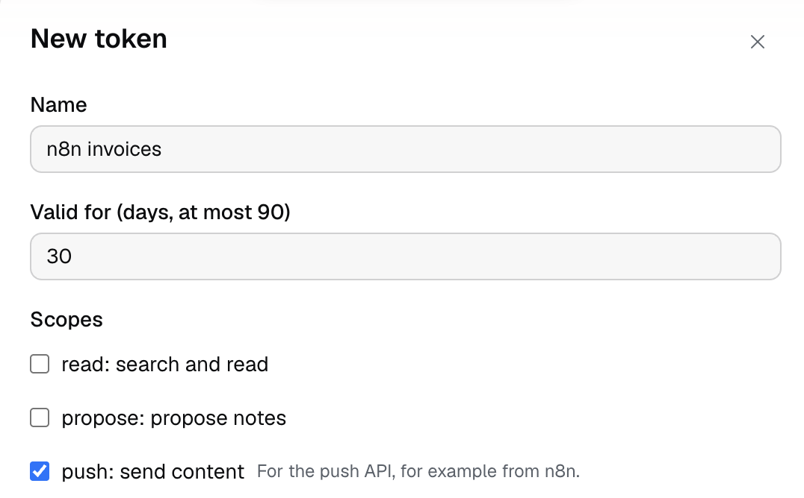
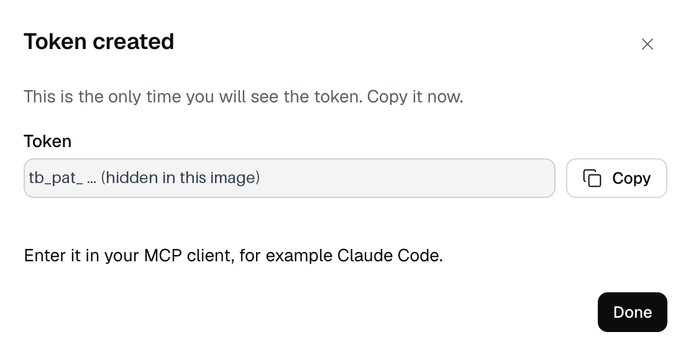
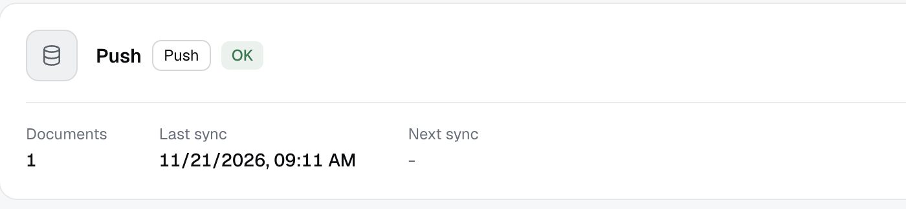

Checked on Izumi 0.5.7, 2026-11-21.

The push API is for a system or a person that sends their own Markdown documents to Izumi from outside, for example from an n8n flow. The document skips the review queue. The worker indexes it within seconds, the author is the owner of the token, it is never marked as reviewed and has no note label. Whoever wants a reviewed note uses the MCP tool `propose_note` (see [Review queue](/en/admin/review-queue)).

This page is more technical than the others: it has calls you send from your own system.

## Before you start

- An Izumi account and the **Editor** role in the domain you send documents to.
- You do not create the **Push** source yourself. It appears by itself on the first push call in the company, exactly one per company (from the code).
- You create a token in **My tokens and profile**. The value of the token is shown only once, when it is created.

## Create a push token

<Steps>
  <Step title="Open the dialog">
    Open **My tokens and profile**, section **Tokens**, and click **New token**. The dialog has **Name**, **Valid for (days, at most 90)** (30 by default) and **Scopes**: `read` (search and read), `propose` (propose notes) and `push` (send content).

    By default read and propose are checked, and push is not. For a push token check only `push`.

    <Frame>
      
    </Frame>
  </Step>
  <Step title="Narrow the token (optional)">
    **Narrow the token (optional)** limits the token to the chosen companies and domains. With no choice the token is valid for all your companies and domains.
  </Step>
  <Step title="Create and copy the token">
    Click **Create token**. The dialog says: "This is the only time you will see the token. Copy it now." The token starts with `tb_pat_`.

    <Frame>
      
    </Frame>
  </Step>
</Steps>

Do not put the token in code or in messages. You revoke it in the token list, **Revoke** in the token row. There is no confirmation: the token stops working at once and says _"The token was revoked."_

## Send a document

<Steps>
  <Step title="Send a POST">
    `POST /v1/push/documents` with the header `Authorization: Bearer <token>` and a JSON body (`Content-Type: application/json`). The required fields are `company` (company slug), `domain` (domain slug, you must be an editor of that domain), `external_id` (your document id, 1 to 500 visible ASCII characters without spaces), `title` (1 to 300 characters) and `markdown` (at least 1 character, at most 1 MiB UTF-8). The optional fields are `url` (http or https, up to 2048 characters), `updated_at` (ISO 8601 with a zone) and `language` (`sr`, `en` or `other`).

    ```
    curl -sS https://izumi.example.com/v1/push/documents \
      -H "Authorization: Bearer $IZUMI_TOKEN" -H "Content-Type: application/json" \
      -d '{"company":"nordlicht","domain":"engineering","external_id":"n8n:invoices:2026-11","title":"Invoices for November","markdown":"# Invoices for November\n","language":"en"}'
    ```

    The address and the slugs in the example are placeholders.
  </Step>
  <Step title="Read the answer">
    Success is `202 Accepted`. `status` is `queued`, and `landing` is `created` (a new id in the company), `updated` (same id and domain, the document changes) or `moved` (same id, another domain where you are also an editor). `document_id` is `null` until the worker indexes the document, a few seconds.
  </Step>
  <Step title="Check in Izumi">
    After the first call the **Push** source appears on the **Sources** page: the card has the name "Push", the state **OK**, the number of documents and the time of the last call. The document is in the **Documents** list.

    <Frame>
      
    </Frame>
  </Step>
</Steps>

The external id belongs to the person who sent it first, per company. The same id again is an update, there is no separate route for changes. The same title and text are not indexed again. Izumi itself writes the document header (title, language, author, time, no labels) before your Markdown. If your Markdown starts with a `---` block, it stays plain text and cannot set labels or another author.

## Remove a document

`DELETE /v1/push/documents/<external_id>?company=<company slug>` with no body. The id is URL-encoded in the path (`drive:abc/123` becomes `drive%3Aabc%2F123`). The answer is `202` with `status` `queued`. Only the owner of the id can remove it, while they are still an editor of the domain where the document is.

## n8n

In n8n use the HTTP Request node (from the install guide, not checked live).

- A credential of type `Header Auth`: `Name` `Authorization`, `Value` `Bearer tb_pat_...`.
- Push: `Method` `POST`, `URL` `https://<Izumi address>/v1/push/documents`, `Send Body` on, JSON with the fields above. Leave out `url`, `updated_at` and `language` when they have no value, because an empty string is refused.
- Delete: `Method` `DELETE`, URL `.../v1/push/documents/{{ encodeURIComponent($json.external_id) }}?company=<slug>`, no body.
- By default the node stops the flow on status 400 or higher. To branch on the status set `On Error` to "Continue (using error output)", then use IF or Switch.
- Keep the external id stable for the same item (for example the id of a Drive file), so a second run updates the document instead of making a copy.

## What is logged

Every accepted call writes one row in the **Access log**: the action `push.upsert` or `push.delete`, **Via** `push`, the external id, `landing`, the domain slug, the Push source and the number of bytes of Markdown. The title and the text are never written. A call refused after the token check writes a row as refused. See [Access log](/en/admin/access-log).

## Limits

- At most 60 calls per minute per token (in total for all routes).
- At most 1 MiB of Markdown per document, the whole body at most 1.5 MiB.
- Any other key in the body (for example `flags`, `reviewed_at`, `approved_by`, `author`) gives `400 invalid_input`.
- A web clip token (`tb_clip_`) and a token without the push scope do not work for push. A browser session never opens push routes.
- A token is valid for at most 90 days. After that, create a new one.
- Deleting the "Push" source deletes all pushed documents of the company.

## Troubleshooting

The error body is `{"error": {"code": "...", "message": "..."}}`.

- `400 invalid_input`: the body is not JSON, a field is missing or out of bounds, or a key is unknown. For DELETE the id is not visible ASCII or `company` is missing.
- `401 unauthenticated`, `token_expired` or `token_revoked`: there is no token, it is unknown, expired, revoked, or a session was sent instead of a token. Create a new token.
- `403 forbidden_scope`: the token has no `push` scope (it is a web clip token or a read-only token).
- `404 not_found`: the same message for every target you may not use, for example the company does not exist or you are not in it, the domain does not exist or is archived, you only have the reader role, or the token is narrowed away from the domain. For DELETE also an id that does not exist or is not yours. Izumi does not tell the cases apart. Fix the slug or the role.
- `409 push_conflict`: the id already exists in the company and you may not change it (someone else sent it, or it is in a domain where you are not an editor). Nothing was queued. Do not repeat the call, use another id or ask an admin.
- `413 too_large`: more than 1 MiB of Markdown or a body over 1.5 MiB.
- `429 rate_limited`: more than 60 calls per minute. Wait `retry_after_s` from the answer.
- The source card shows the raw key `sources.kind.push` instead of "Push". This is a display bug in Izumi up to 0.5.7, the source works normally. From 0.5.8 the card shows "Push" (notes and AIOS app sources also have their own names).
