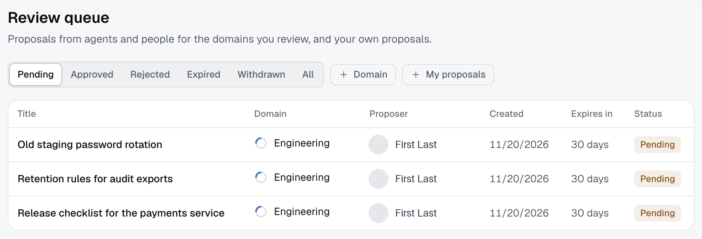
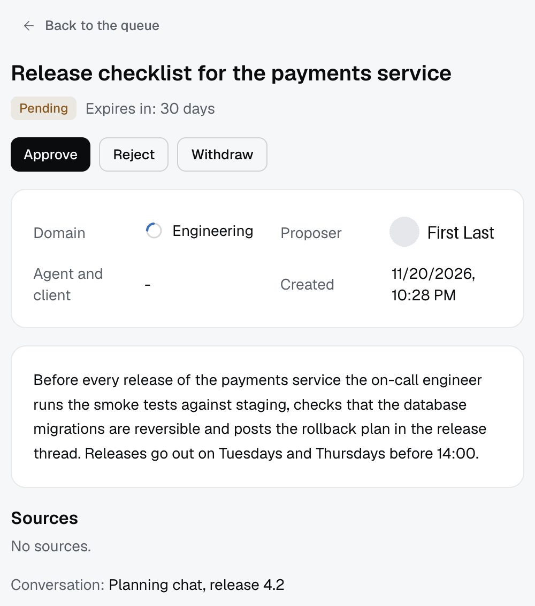

Checked on Izumi 0.5.7, 2026-11-21.

A proposal is a note that an AI tool (or a person through their token) proposes for one domain. Until an editor of that domain approves it, the note is not searchable. This page is for the admin: who decides, how to set that up and what happens to proposals. The step-by-step for the editor is on the page [Proposals and review](/en/using/proposals).

## Who decides

- The editor of the domain a proposal belongs to decides. In the **Review queue** they see the proposals of their domains and their own proposals, and have the buttons **Approve** and **Reject**.
- A company admin is not automatically an editor. Only someone with the **Editor** role in that domain sees and decides its proposals (from the code: the review looks only at the editor role).
- A proposer who is not an editor sees only their own proposals and can only withdraw them (**Withdraw**), not approve them (from the code).
- A member without the editor role and without their own proposals sees an empty queue. Another person's proposal opens **Proposal not found**.

<Warning>
A company admin who is not an editor does not see proposals. If a domain has no editor, its proposals wait until they expire. Give the **Editor** role to at least one person in every domain where AI tools may propose.
</Warning>

## Set up the review

<Steps>
  <Step title="Choose the editors">
    For each domain choose a person who knows the content and give them the **Editor** role. The steps are on the page [People and invitations](/en/admin/people), and roles and domains are explained on the page [Companies, domains, roles](/en/admin/companies-domains-roles).
  </Step>
  <Step title="Look at the queue as an editor">
    Click **Review queue** in the left menu, which all company members see. The number next to the item shows how many proposals wait for your decision. The columns are **Title**, **Domain**, **Proposer**, **Created**, **Expires in** and **Status**.

    <Frame>
      
    </Frame>
  </Step>
  <Step title="Approve or reject">
    Open a proposal. You see **Domain**, **Proposer**, **Agent and client**, **Created**, then the proposal text, **Sources** and **Conversation**. **Approve** opens a dialog with the fields **Title** and **Text (Markdown)** that the editor may change. **Reject** asks for a reason, which the proposer sees.

    <Frame>
      
    </Frame>
  </Step>
</Steps>

## What happens to a proposal

- An approved proposal gets the status **Approved**. The note appears in **Documents** within a few minutes with the label **Note**, and the author is the proposer. Izumi keeps it in the notes source of the company.
- A rejected proposal: no note is created and it does not appear in search. The proposer sees the reason.
- A withdrawn proposal: the proposer gave up. Nobody can approve it any more.
- An expired proposal: a proposal is valid for 30 days. The worker checks once an hour, sets the status **Expired** on every proposal past its deadline and writes one `proposal.expire` row per proposal in the [Access log](/en/admin/access-log) (from the code).

Approved and rejected proposals stay visible in the queue under the statuses **Approved**, **Rejected** and **All**.

## Limits

- A proposal is valid for 30 days, the deadline is visible in the **Expires in** column.
- Izumi does not send email about proposals. The editor sees only the number next to **Review queue**, and the proposer sees the outcome when they open their proposal (there is no mail sending in the code).
- An approved note cannot be deleted from the **Documents** list or from the document page. Only the whole notes source can be deleted on the **Sources** page, which deletes all approved notes of the company (from the code, see [Deletion and retention](/en/admin/deletion)).
- Proposals are created by an AI tool through the MCP tool `propose_note`, there is no other way to create a proposal.

## Troubleshooting

- A proposal was sent and I do not see it in the **Review queue**. You are not an editor of that domain. A company admin is not automatically an editor, so they need the **Editor** role in that domain.
- _"There are no proposals for your domains."_ Nothing is waiting, or you are not an editor of any domain and have no proposals of your own. Try **All** and **My proposals**.
- _"This proposal can no longer be decided. It may already be decided, withdrawn or expired."_ Someone already decided or the proposer withdrew it while your dialog was open. Refresh the list.
- Proposals of one domain keep expiring. The domain has no editor. Give the **Editor** role.
- An approved note is not found right away. Wait a few minutes and search by words from the text.
