Checked on Izumi 0.5.7, 2026-11-21.

A **Google Drive** source reads folders and files from Drive and imports them into the domains of the company. Izumi only reads (`drive.readonly`) and never changes files. You choose what is read, what is imported and into which domain it goes, and what is left out. Before the first import, the **Dry run** shows what would be imported, without any change in Izumi.

## Before you start

- You must be a company admin. The **Sources** and **Import report** pages are visible only to admins.
- The company must have at least one domain. Without a domain, **Import rules** says: _"The company has no live domain. Create one on the Companies and members screen."_
- The Google account you connect with must see the folders you want. The rules tree shows the whole **My Drive** of that account, not only what you will import. Connect an account that sees only what it is allowed to see.
- Changing sharing in Drive does not change access in Izumi. Access is decided by domains and roles.
- This installation has its own Google client, so you create nothing in Google Cloud. If your company wants its own client, enter it under **OAuth client of your own (advanced)** (from the code).

## Connect Drive

<Steps>
  <Step title="Add a source">
    Open **Sources** and click **Add source**. The types offered are **Upload**, **Google Drive** and **SharePoint/OneDrive**.

    <Frame>
      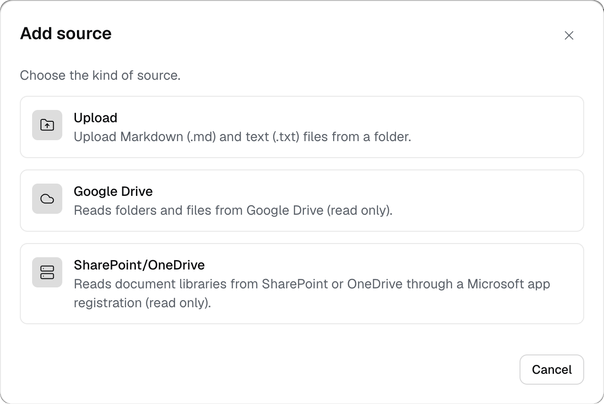
    </Frame>
  </Step>
  <Step title="Choose Google Drive">
    The dialog **Connect Google Drive** has the field **Source name** and the folded section **OAuth client of your own (advanced)**. Enter a name and click **Connect Google Drive**.

    <Frame>
      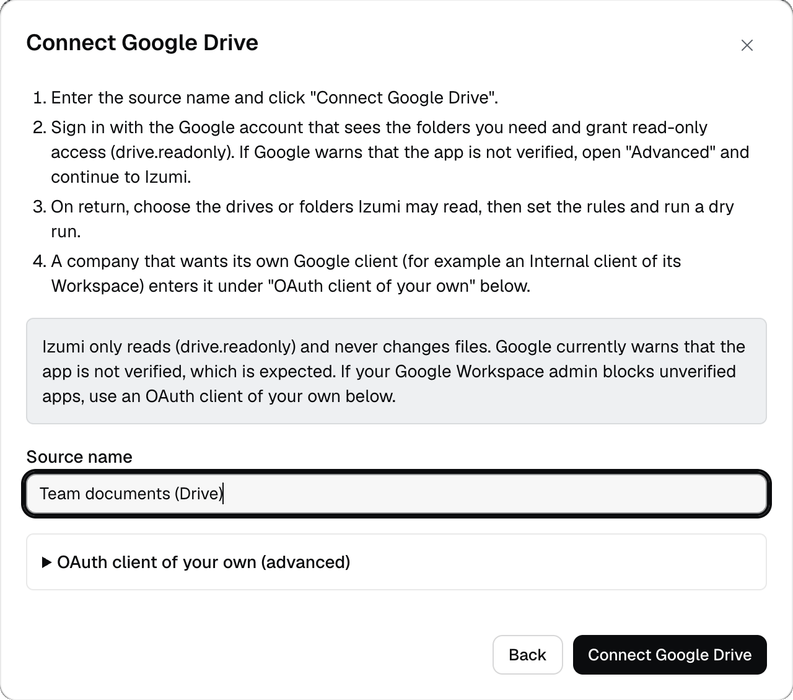
    </Frame>
  </Step>
  <Step title="Grant read access in Google">
    Google asks you to choose an account and grant read-only access. For now Google shows a warning that the app is not verified. That is expected: click "Advanced" and continue to Izumi. We did not capture these Google screens.
  </Step>
  <Step title="Choose what Izumi may read">
    After approval you return to **Sources**. The new card has the label **New** and a **Connected** row with the account address. Under **What Izumi may read** select **My Drive** and click **Save scope**. If nothing is selected, it says _"Choose at least one root."_

    <Frame>
      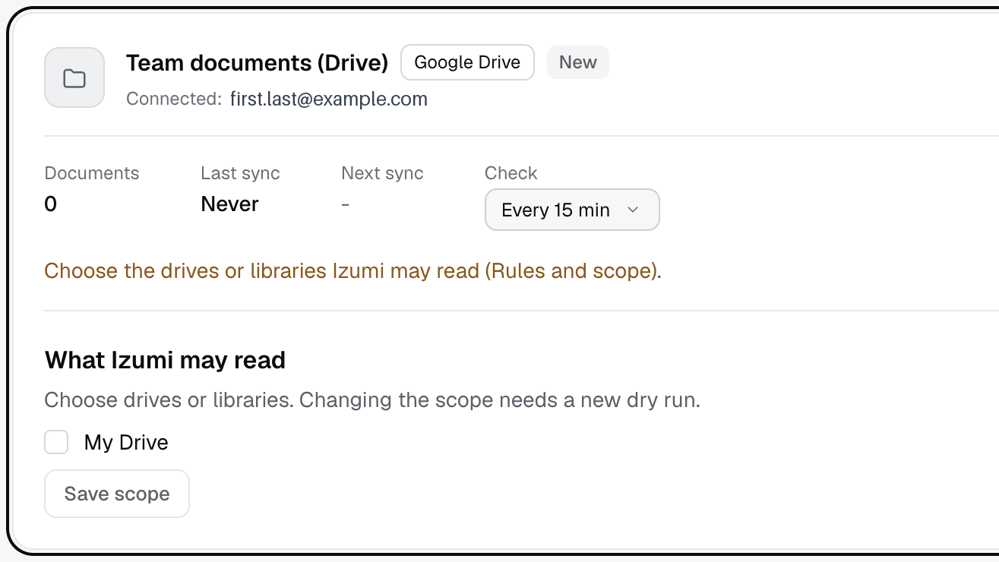
    </Frame>
  </Step>
</Steps>

## Set the import rules

<Steps>
  <Step title="Choose folders and domains">
    Under **Import rules** open **My Drive** and go down through the folders. Each folder or file has a checkbox (include), a domain menu (required, only live domains of the company are offered), **With subfolders** and **Exclude**. Below the tree is the list **Selected** with **Remove**.

    <Frame>
      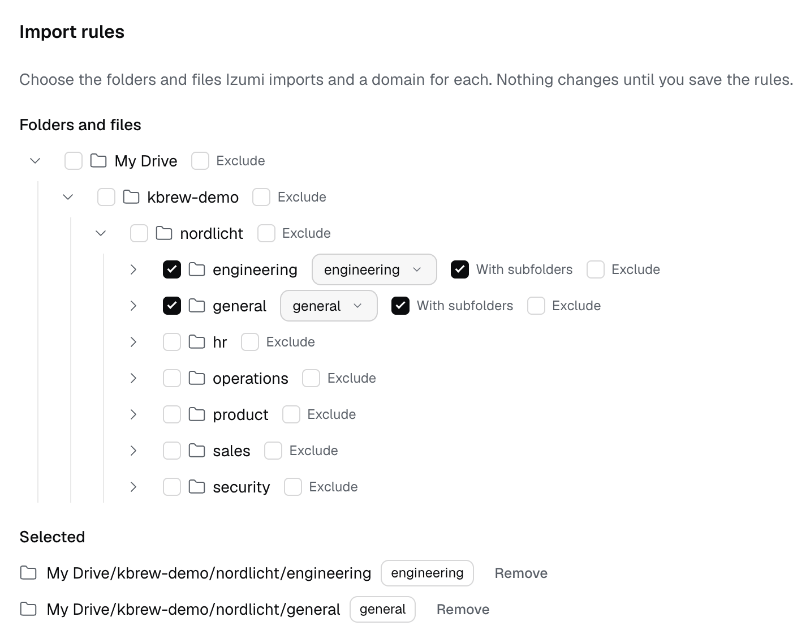
    </Frame>
  </Step>
  <Step title="Add filters (optional)">
    - **File types**: `doc`, `sheet`, `slides`, `docx`, `xlsx`, `csv`, `pdf`, `md`, `txt`. If nothing is selected, all supported types are imported.
    - **Include names (patterns)** and **Exclude names (patterns)**: one pattern per line, up to 200 characters, for example `*.md`.
    - **Modified from (inclusive)** and **Modified until (exclusive)**. An empty date means no limit.
  </Step>
  <Step title="Save the rules">
    **Save rules** opens the confirmation **Save the rules?** with a number: _"The next sync removes 0 documents from Izumi and adds 6."_ After saving it says _"Rules saved. A new dry run checks them before the import."_

    <Frame>
      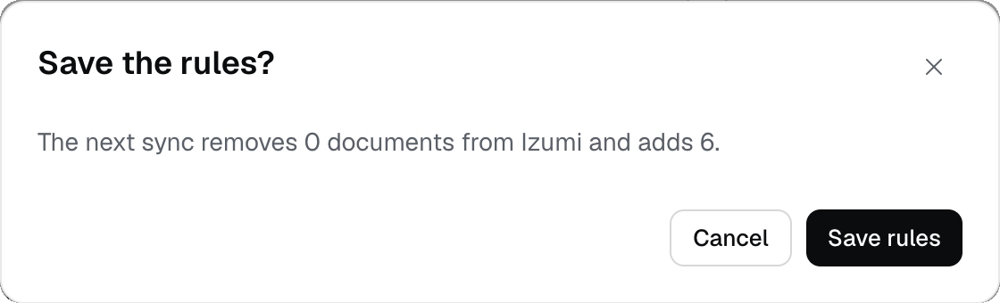
    </Frame>
  </Step>
</Steps>

Messages you may see when saving:

- _"Nothing is selected, so nothing is imported."_ Select at least one folder or file.
- _"Choose a domain for every selected folder and file."_ Every selected item needs a domain.
- _"The start date must be before the end date."_ Fix the dates.

## Dry run and first import

<Steps>
  <Step title="Wait for the dry run">
    As soon as you save the scope or the rules, the dry run starts by itself. The card says **Dry run in progress**: _"The dry run reads the source. Nothing changes in Izumi."_ The tree fills in only when the dry run ends.

    <Frame>
      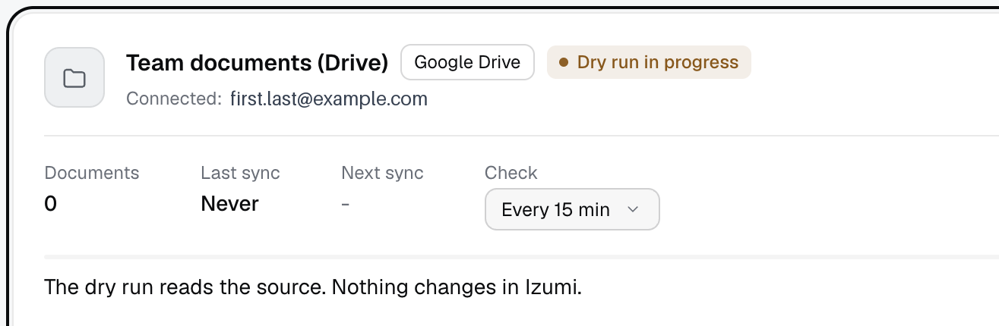
    </Frame>
  </Step>
  <Step title="Read the result">
    The **Dry run** section shows the time of the last dry run, the line "To import" (number of files and size), the tables **By domain** and **By type**, then the counts of unsupported files, files that are too large, files excluded by the rules and the estimated import time. The card says **Dry run ready**.

    <Frame>
      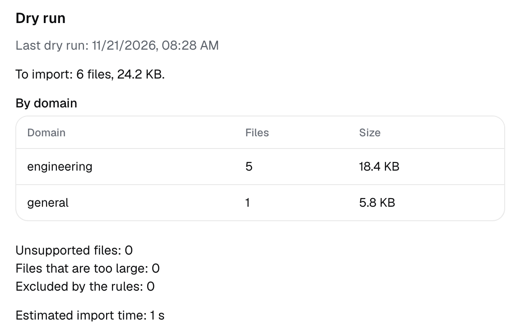
    </Frame>

    <Frame>
      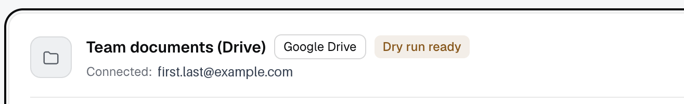
    </Frame>
  </Step>
  <Step title="Start the import">
    **Start import** is off until the dry run on the current rules has ended. After every change of the rules or the scope the section says _"The rules or the scope changed after this dry run. Run a new one before the import."_ The card shows **Sync in progress**, then **OK** and the number of **Documents**. In our tests 5 to 6 documents took about a minute.

    <Frame>
      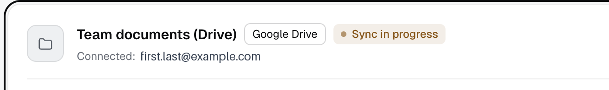
    </Frame>

    <Frame>
      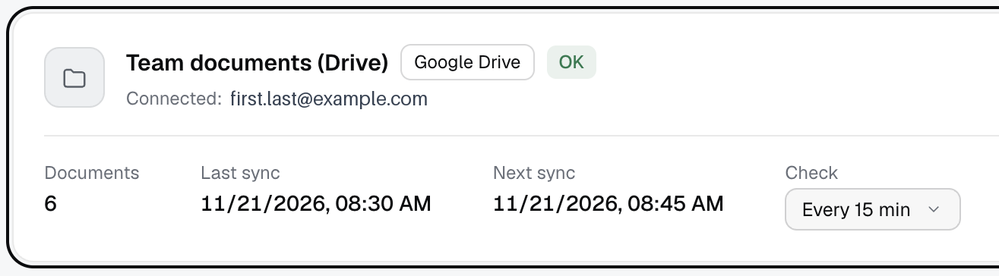
    </Frame>
  </Step>
  <Step title="Set the check">
    After the first import the button becomes **Import now**, and the **Check** field sets how often Izumi checks Drive: 5, 15, 30, 60 minutes, 6 hours or 24 hours, 15 minutes by default (from the code). **Next sync** shows when the next check is.
  </Step>
</Steps>

## Actions on the card

<Steps>
  <Step title="Buttons on the card">
    The card has **Dry run**, **Import now**, **Pause**, **Rules and scope** (opens and closes the rules, **Close rules**) and the three-dot menu.

    <Frame>
      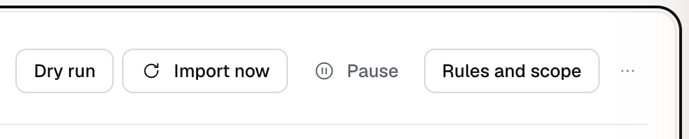
    </Frame>
  </Step>
  <Step title="Pause a source">
    **Pause** adds the label **Paused**. **Dry run** and **Import now** turn off, **Next sync** is empty and the button becomes **Resume**. **Resume** brings back the state **OK**.

    <Frame>
      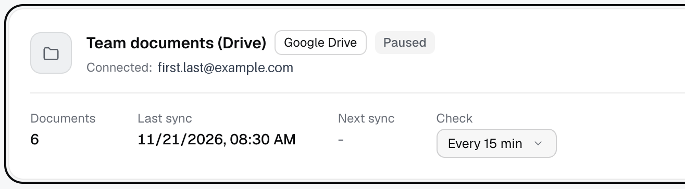
    </Frame>
  </Step>
  <Step title="Delete a source">
    The three-dot menu has **Delete source**. The confirmation **Delete the source?** says: _"The source "…" and all the documents it imported (N documents) will be removed from Izumi. This cannot be undone."_ Click **Delete**. The message is _"The source was deleted."_ Deleting also removes the source's rows from **Import report**. While an import is running, the delete is refused (from the code). The files in Drive stay untouched.

    <Frame>
      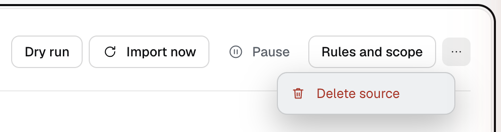
    </Frame>

    <Frame>
      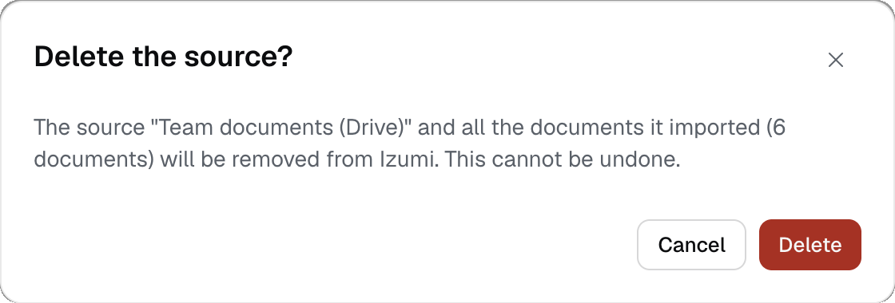
    </Frame>
  </Step>
</Steps>

## Import report

<Steps>
  <Step title="Open the list of imports">
    Choose **Import report** in the left menu. The table has the columns **Source**, **Kind** (**Scheduled**, **Manual**, **Dry run**, **Upload**), **Start**, **Duration**, **Counts**, **Status** (**Finished**, **Running**, **Failed**) and **Actions**. When nothing changed, it says **Nothing to import**. A scheduled check adds one row each time. The screenshot leaves out the **Duration** and **Actions** columns so it stays readable.

    <Frame>
      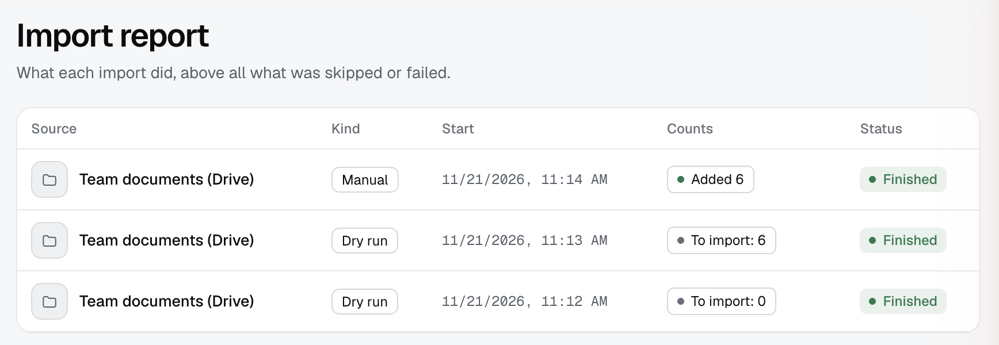
    </Frame>
  </Step>
  <Step title="Open one import">
    **Open** gives the totals per outcome, the filter **Outcome**, **Download CSV** and the table **Path**, **Type**, **Size**, **Domain**, **Outcome**, **Reason**. The outcomes are **Added**, **Updated**, **Unchanged**, **Removed**, **Excluded**, **Skipped: unsupported type**, **Skipped: no text**, **Skipped: too large** and **Failed**. Only **Added** was seen live, the other outcomes are from the code. **Back to imports** returns to the list. The screenshot leaves out the **Reason** column.

    <Frame>
      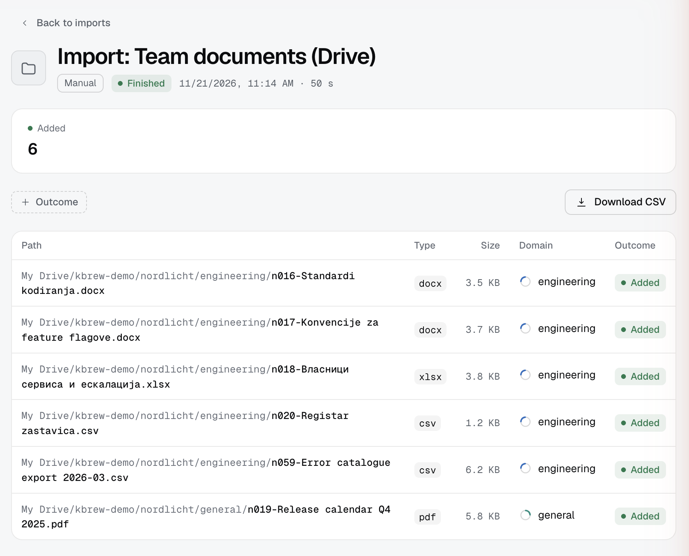
    </Frame>
  </Step>
</Steps>

## Limits

- Read-only. Izumi never changes files in Drive.
- A file larger than 50 MB is skipped as too large (from the code).
- Only the types in the **File types** list are imported. Everything else is counted as unsupported.
- Only **My Drive** was checked. Shared drives were not checked.
- Sources in a company can share the same Google account. Revoking access on the Google account switches off the tokens of all sources that share the client and the account (Google behavior, not checked live).
- While an import or a dry run is in progress, the scope, the rules and the connection cannot change: _"A sync or dry run of this source is already in progress. The card shows when it ends."_ (from the code)

## Troubleshooting

- _"The connection attempt expired. Try again."_ The approval window was open too long. Repeat **Connect Google Drive** (from the code).
- _"Access was denied on the Google screen."_ You declined or closed the Google screen. Repeat and grant read access (from the code).
- _"Read access to Drive was not granted. Grant it and try again."_ The Drive read access was left unchecked on the Google screen (from the code).
- _"Google did not return a lasting permission. Try again."_ Repeat the connection (from the code).
- _"Connecting failed. Try again."_ A general error. If it repeats, the most common cause is the Drive API switched off in the Google Cloud project of your own OAuth client (from the code and the install guide).
- The label **Reconnect required** with the message _"Reconnect to resume the sync."_ Google refused the stored token (revoked, expired, password change). Click **Reconnect** (from the code).
- The label **Error** with _Last error: …_ and _Next attempt: …_ A temporary error, for example Google is unavailable. Izumi retries by itself (from the code).
- **Start import** is gray. The dry run on the current rules is not finished. Wait for it or click **Dry run**.
- The dry run reports 0 files. The rules are empty, or the types and patterns exclude everything.
