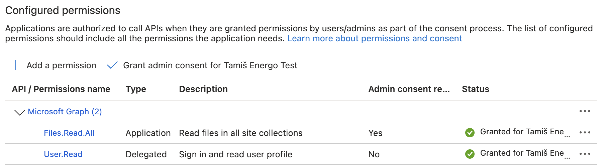
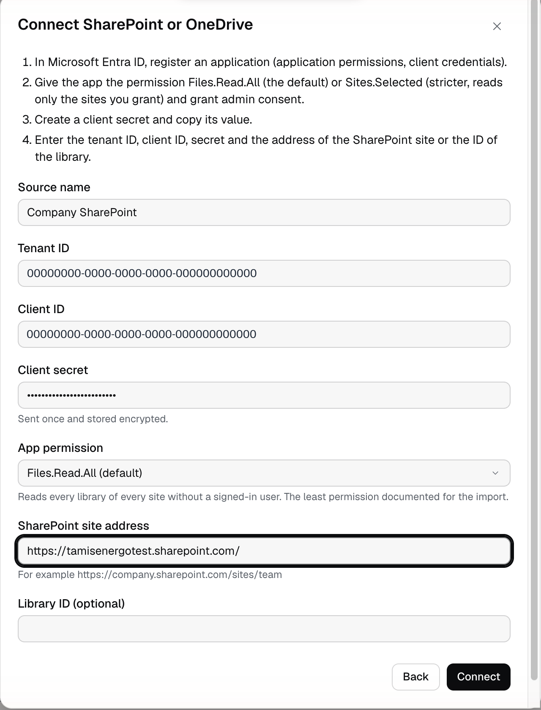
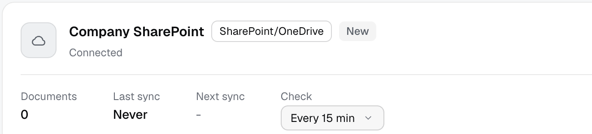
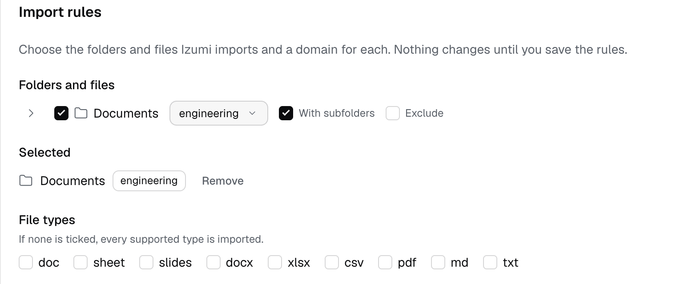
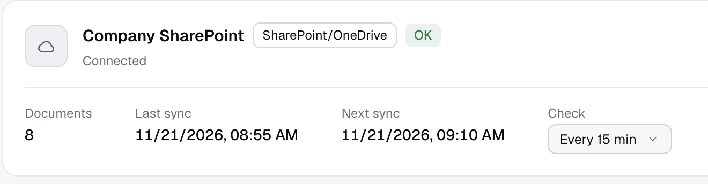
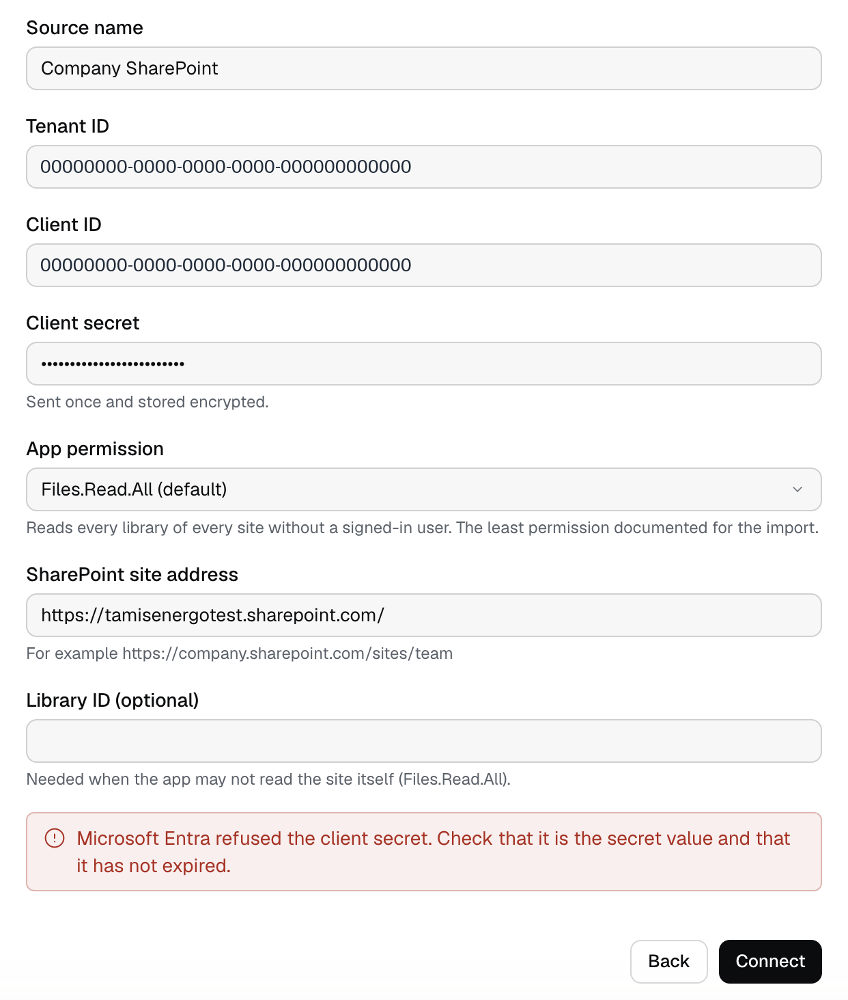

Checked on Izumi 0.5.7, 2026-11-21.

A **SharePoint/OneDrive** source reads document libraries from SharePoint through a Microsoft app registration, read-only. Izumi signs in as an app, not as a user. Access is decided by the permission of the app in your tenant, not by membership in sites. The flow in Izumi is the same as for a [Google Drive](/en/admin/sources-drive) source: **Dry run**, **Import rules**, **Start import**, then **Import now**.

## Before you start

- You must be a company admin in Izumi.
- You need a Microsoft account that may register an app and give admin consent for Microsoft Graph (the roles needed are from the Microsoft documentation, not checked).
- The company must have at least one domain in Izumi.
- With the permission `Files.Read.All` the app sees the libraries of all sites in the tenant. So in Izumi you choose only the library and the folders you want and map them to domains. Everything outside that is not imported.
- The permission `Sites.Selected` (stricter, only sites that the SharePoint administrator approves for the app) is offered in the form, but the form itself says: _"That the import works under this permission is not verified yet."_ We did not try it live.
- Changing sharing in SharePoint does not change access in Izumi. Access is decided by domains and roles.

## Register the app in Microsoft Entra ID

These steps are done in the Microsoft portal, in English. The permissions screen was captured live. The other steps are from the install guide and the notes from our test tenant.

<Steps>
  <Step title="Create the registration">
    In Microsoft Entra ID open `App registrations`, then `New registration`. The name is your choice, the account type is `My organization only` (single tenant). A redirect URI is not needed.
  </Step>
  <Step title="Add the permission and consent">
    In `API permissions` add `Microsoft Graph`, type `Application permissions`, permission `Files.Read.All`. Click `Grant admin consent for <your tenant>`. Afterwards you see `Files.Read.All`, type `Application`, `Admin consent required: Yes` and status `Granted`. The permission `User.Read` comes by itself with a new registration and is not used.

    <Frame>
      
    </Frame>
  </Step>
  <Step title="Create a client secret">
    In `Certificates & secrets` create `New client secret` and copy the `Value` right away, not the `Secret ID`. After you close the screen the value cannot be seen again. A secret expires: write down the expiry date, because after it the import stops until you enter a new secret.
  </Step>
  <Step title="Copy the identifiers">
    On the `Overview` screen copy `Application (client) ID` and `Directory (tenant) ID`.
  </Step>
</Steps>

If `Granted` does not appear at once, wait a few minutes and try again. In our test tenant the first attempt failed because of propagation and the second one passed.

## Connect the source in Izumi

<Steps>
  <Step title="Choose the source type">
    Open **Sources** and click **Add source**. Choose **SharePoint/OneDrive**. The dialog with the three types looks like the one on the page about the [Google Drive](/en/admin/sources-drive) source.
  </Step>
  <Step title="Fill in the form">
    The dialog **Connect SharePoint or OneDrive** has the fields **Source name**, **Tenant ID**, **Client ID**, **Client secret** (under it: _"Sent once and stored encrypted."_), **App permission**, **SharePoint site address** and **Library ID (optional)**. **App permission** has two values, **Files.Read.All (default)** and **Sites.Selected (stricter)**. Choose the one you gave the app in Entra. For the tenant root the address looks like `https://company.sharepoint.com/`, and for a site below the root like `https://company.sharepoint.com/sites/team`. For a site below the root Izumi will likely ask for the library ID (from the code, not checked live).

    <Frame>
      
    </Frame>
  </Step>
  <Step title="Connect">
    Click **Connect**. Izumi asks Microsoft for a token and reads the list of libraries. Success says _"Connected. Choose what is read under Rules and scope."_ The card has the label **New** and a **Connected** row. The secret is sent once and stored encrypted. Izumi cannot read it back, so you do not see it anywhere after sending.

    <Frame>
      
    </Frame>
  </Step>
</Steps>

## Scope, rules and import

<Steps>
  <Step title="Choose libraries">
    Click **Rules and scope**. Under **What Izumi may read** are the libraries of the site (in our test one, `Documents`, already selected). **Save scope** is off until you change the selection. Changing the scope requires a new dry run.
  </Step>
  <Step title="Run the dry run">
    Click **Dry run**. The card says **Dry run in progress**, then **Dry run ready**. In the test that took about 10 seconds. The dry run changes nothing in Izumi.
  </Step>
  <Step title="Map the library to a domain">
    Under **Import rules** select the library, choose a domain from the menu and leave **With subfolders**. Under **Selected** you see the library with the domain and the button **Remove**. **File types**, **Include names (patterns)**, **Exclude names (patterns)**, **Modified from (inclusive)** and **Modified until (exclusive)** work the same as for Drive.

    <Frame>
      
    </Frame>
  </Step>
  <Step title="Save the rules and start the import">
    **Save rules** asks for a confirmation with the number of documents the next import will add. After saving, the dry run starts again by itself. When it is ready, **Start import** is on. During the import the card shows the running counts. At the end the card shows **OK**, the number of **Documents**, **Last sync** and **Next sync**.

    <Frame>
      
    </Frame>
  </Step>
  <Step title="The rest is the same as for Drive">
    The button becomes **Import now**, the **Check** field is 15 minutes by default (from the code), and **Pause**, **Delete source** and **Import report** work as for Drive. Deleting removes the source and everything that was imported.
  </Step>
</Steps>

## If the app may not read the site (from the code)

If the app may not read the site itself, Izumi does not connect the source and saves nothing. By the code and the install guide this is expected with `Files.Read.All` alone (it has no `Sites.Read.All`), especially for a site below the root. For the tenant root it worked without a library ID in our test. It says: _"The app may not read the site data. Find the library ID with the Graph calls below, enter it and send again."_ Under the message are two calls:

- `GET https://graph.microsoft.com/v1.0/sites/<company>.sharepoint.com:/sites/<name>?$select=id` returns the `id` of the site.
- `GET https://graph.microsoft.com/v1.0/sites/{site-id}/drives?$select=id,name` returns the list of libraries with their `id`.

Enter the library `id` in the field **Library ID (optional)** and click **Connect** again.

## Limits

- Read-only.
- Izumi sees only what the permission of the app allows. With `Files.Read.All` that is all sites of the tenant, so the scope and the rules in Izumi decide what is imported.
- The client secret expires. The form does not show the expiry date or a warning before expiry (from the code). Write the date down yourself.
- For the tenant root with `Files.Read.All` the library ID was not needed (checked live).

## Troubleshooting

- _"Microsoft Entra refused the client secret. Check that it is the secret value and that it has not expired."_ The most common cause is a copied `Secret ID` instead of the `Value`, or the secret expired. The error shows in the dialog and nothing is saved until connecting succeeds.

    <Frame>
      
    </Frame>

- _"Enter a GUID (for example 00000000-0000-0000-0000-000000000000)."_ **Tenant ID** or **Client ID** is not a GUID.
- _"Enter the client secret."_ The **Client secret** field is empty.
- _"Enter the site address or the library ID."_ Fill in **SharePoint site address** or **Library ID (optional)**.
- _"Microsoft Entra does not know this tenant. Check the tenant ID."_ (checked live)
- _"The tenant has no application with this client ID."_ (checked live)
- _"Microsoft Entra refused the credentials."_ (from the code)
- _"Microsoft Graph found no SharePoint site at this address."_ Check **SharePoint site address** (checked live, with a good secret and a site that does not exist).
- _"Microsoft Graph found no document library with this ID."_ Check **Library ID (optional)** (checked live).
- _"The app may not read this library. Grant it Files.Read.All, or Sites.Selected with read access to the site."_ (from the code)
- _"Microsoft Graph is not reachable now. Try again later."_ (from the code)
- The label **Reconnect required** on the source card, with the button **Reconnect** and the red line _"Last error: reconnect_required: the Entra token endpoint refused the client credentials (invalid_client) Reconnect to resume the sync."_ The same error shows under **Installation status**, **Last error per source**. The secret expired or was deleted after connecting. Checked live: we connected with a temporary secret, deleted it in Entra, and the state appeared after the next **Dry run** (the first time Izumi used the secret again). **Reconnect** opens the dialog **Reconnect** with _"Enter the app credentials again. The old secret can never be read back."_ The **Tenant ID** and **Client ID** are already filled in, you enter the new **Client secret** (and the site address). The message on **Structure & health** (_"SharePoint sync failing. Microsoft refused the access token."_) is from the code, not seen live.
