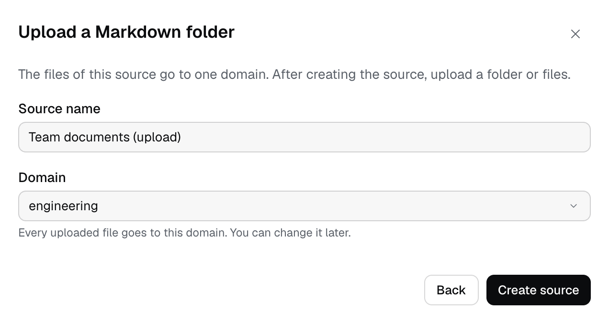
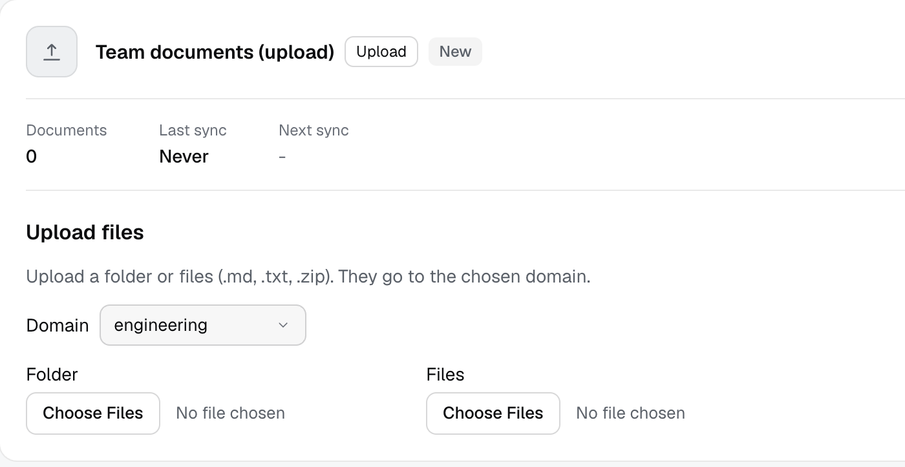
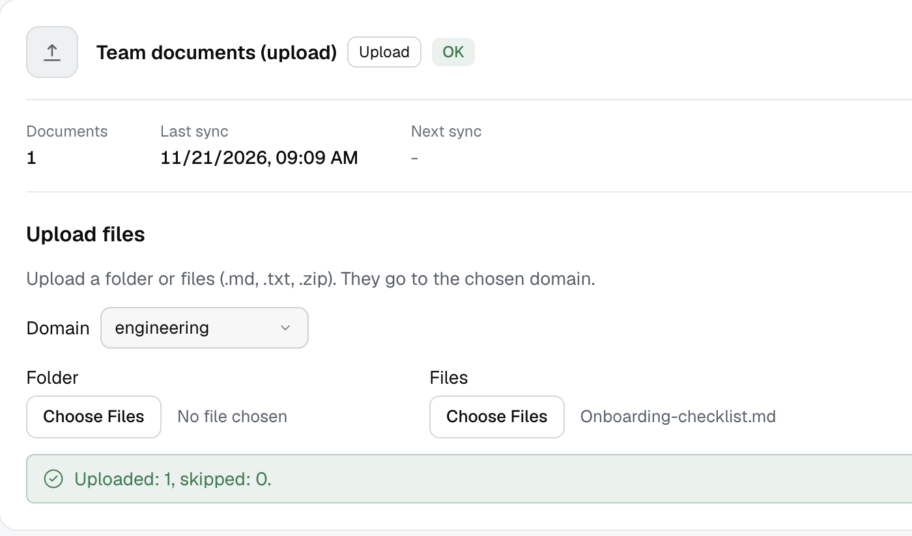
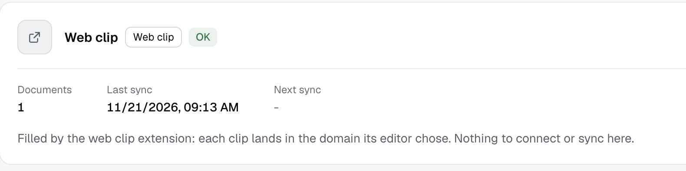
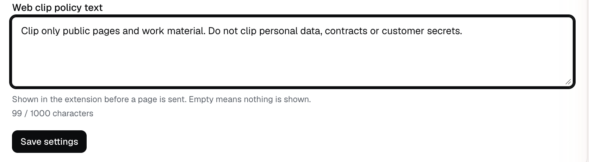

Checked on Izumi 0.5.7, 2026-11-21.

An **Upload** source is for documents you upload by hand, from a folder or as files, with no connection to an outside system. This page also covers the **Web clip** source, installing the web clip extension and the policy text your people see in the extension.

## Before you start

- You must be a company admin.
- The company must have at least one domain. Every uploaded file goes into the domain you choose.
- `.md` and `.txt` files are accepted, or a `.zip` that contains them (from the code).

## Create an Upload source

<Steps>
  <Step title="Add a source">
    Open **Sources** and click **Add source**. Choose the card **Upload** ("Upload Markdown (.md) and text (.txt) files from a folder."). The dialog **Upload a Markdown folder** opens.

    <Frame>
      
    </Frame>
  </Step>
  <Step title="Enter a name and choose a domain">
    **Source name** has up to 120 characters, otherwise it says _"Enter a name (up to 120 characters)."_ The **Domain** list offers the domains of the company: "Every uploaded file goes to this domain. You can change it later." Click **Create source**. The message is _"The source was created. Add files under Rules and scope."_ The new card has the label **New**.
  </Step>
  <Step title="Open Upload files">
    Click **Rules and scope**. The section **Upload files** has the fields **Domain**, **Folder** and **Files**. The buttons for choosing a file are drawn by the browser, so their text follows the browser language, not the Izumi language.

    <Frame>
      
    </Frame>
  </Step>
  <Step title="Upload">
    Choose a folder or files. The upload starts at once. The message is for example _"Uploaded: 1, skipped: 0."_ After a few seconds the card shows the number of **Documents** and the state **OK**.

    <Frame>
      
    </Frame>
  </Step>
</Steps>

The same file with the same path and changed content updates the existing document, it does not create a new one (checked live: the number of documents stayed the same). You change the domain of the source in the **Domain** list in the **Upload files** section: _"Domain saved. New files go there."_ Files that were already uploaded stay in the old domain (from the code).

### Deleting an Upload source

The three-dot menu on the card has **Delete source**. The dialog **Delete the source?** says that the source and all its documents are removed and that this cannot be undone. Click **Delete**. The message is _"The source was deleted."_ The source and the documents are gone (checked live).

## The Web clip source

The **Web clip** source is not created by hand. It appears by itself when the first web clip arrives in the company, and then the card shows up.

<Steps>
  <Step title="Look at the card">
    The card has the name **Web clip**, the kind label **Web clip** and the state **OK**, with the number of documents. The text on the card says the extension fills it and that nothing is connected or imported here. There is no **Rules and scope**, only the three-dot menu.

    <Frame>
      
    </Frame>
  </Step>
  <Step title="Delete the source (if needed)">
    **Delete source** deletes all clips of the company, and the dialog lists the number of documents. A single clip is not deleted from the document list.
  </Step>
</Steps>

How people send clips is on the page [Web clip](/en/using/web-clip).

## Web clip policy text

The policy text is a short company rule that the extension shows before a page is sent, for example what may be sent.

<Steps>
  <Step title="Enter the text">
    Open **Companies and members**, section **Settings**. The field **Web clip policy text** takes up to 1000 characters, and the counter is next to the field. Click **Save settings**. An empty field means nothing is shown.

    <Frame>
      
    </Frame>
  </Step>
  <Step title="Example text">
    "Send only pages that your team may keep and that are not confidential. Do not clip pages that show personal data, client passwords, or internal systems. A clip is readable by everyone who can read the domain you choose."
  </Step>
</Steps>

The text is shown as plain text above the choice of domain, every time a person selects that company in the extension (from the install guide, not checked live). Remind people that a clip is a copy of the page as text, that it is kept as an untrusted source, and that search results mark it as a web clip.

## Install the web clip extension

The extension is not in the extension store. The administrator sets it up, and each person creates their own token.

- The operator packages the extension (CRX and `updates.xml`) and puts it on any https static host the computers can reach. The Izumi server does not host it. The files contain no token and no server address.
- The extension reads a page only when you press its button. From Izumi it reads only the list of domains where you are an editor and the policy text of the company.
- Forced installation outside the store works only on managed computers: Chrome on Windows in an Active Directory domain, Azure AD or Chrome Enterprise Core, Chrome on macOS through MDM or Chrome Enterprise Core, Edge on macOS through MDM, Edge on Windows only in an Active Directory domain (outside a domain only Edge Add-ons). A personal computer without management ignores the policy.
- Chrome: the policy `ExtensionSettings` with `installation_mode` `force_installed`, `update_url` and `override_update_url` `true`. Check on the computer: `chrome://policy` and `chrome://extensions`. Edge: the same structure, check `edge://policy` and `edge://extensions`.
- Fallback for unmanaged computers: the Chrome Web Store with visibility Unlisted. Each person installs from a link.
- Per person: create a web clip token (see [Web clip](/en/using/web-clip)) and in the extension settings enter **Server address** (https, http only for `localhost`) and the token. The server address is not pre-filled by policy, so everyone enters it once. The token is valid for at most 90 days.
- Removal: revoke the person's token. The extension stays, but every send is refused. A web clip token stops working for a domain as soon as the person loses the editor role there.

## Limits

- Upload accepts `.md`, `.txt` and a `.zip` that contains them. Other kinds are skipped and counted in "skipped" (from the code).
- At most 50 MB per file, 1000 files per upload, 10000 entries from zip files and 256 MiB in total in one upload (from the code).
- The path of a file is its outside id in the source. The same name with the same path updates the document.
- A web clip is not deleted one by one. The whole **Web clip** source is deleted.

## Troubleshooting

- _"The upload is too large. Send fewer or smaller files."_ Send fewer files at once (from the code).
- _"The files could not be read. Send .md, .txt or .zip files."_ The file is not in a supported format (from the code).
- _"The upload failed. Try again."_ A general error. Repeat the upload.
- The card still says **New** and 0 documents after the first upload. Once we saw a card not refreshing for almost half a minute, and only the second uploaded file helped. We did not check whether reloading the page is enough.
- The **Web clip** source does not exist. It appears only after the first clip in the company.
