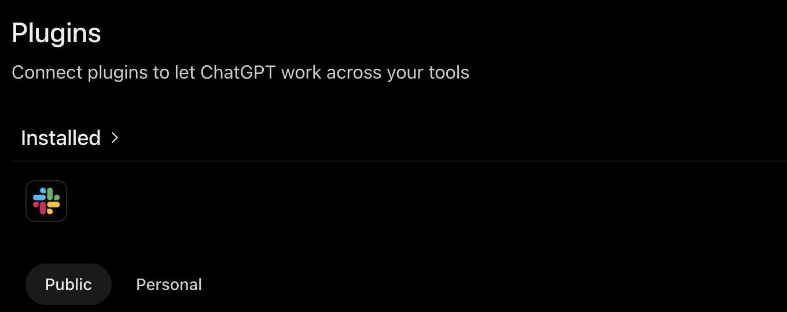
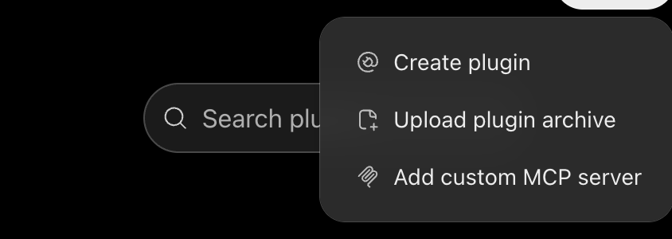
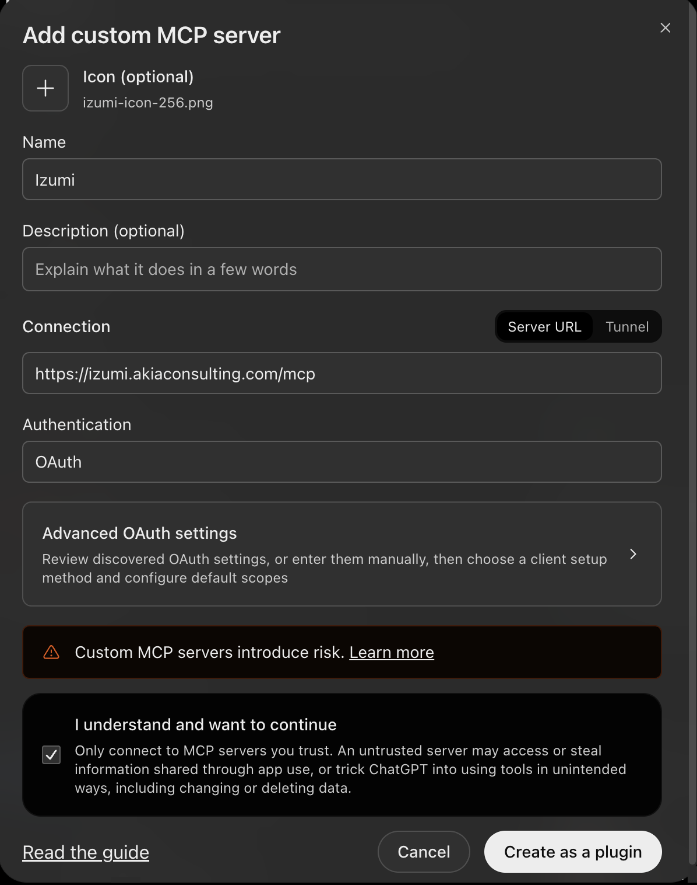
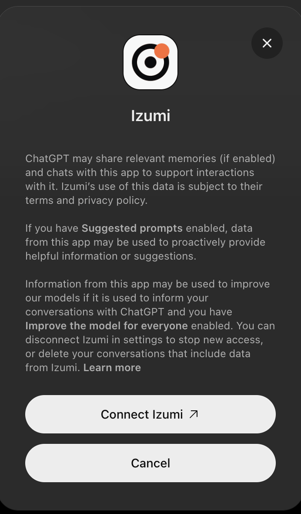
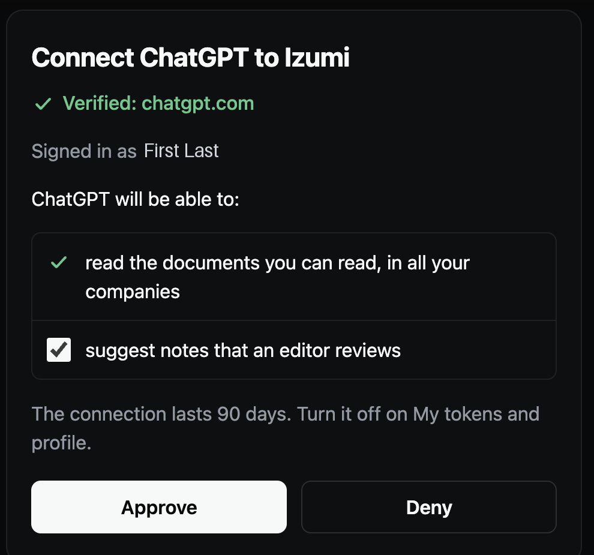
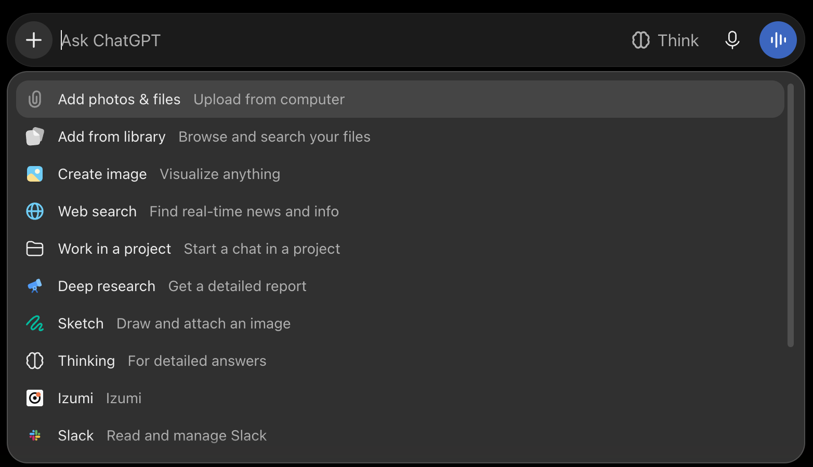
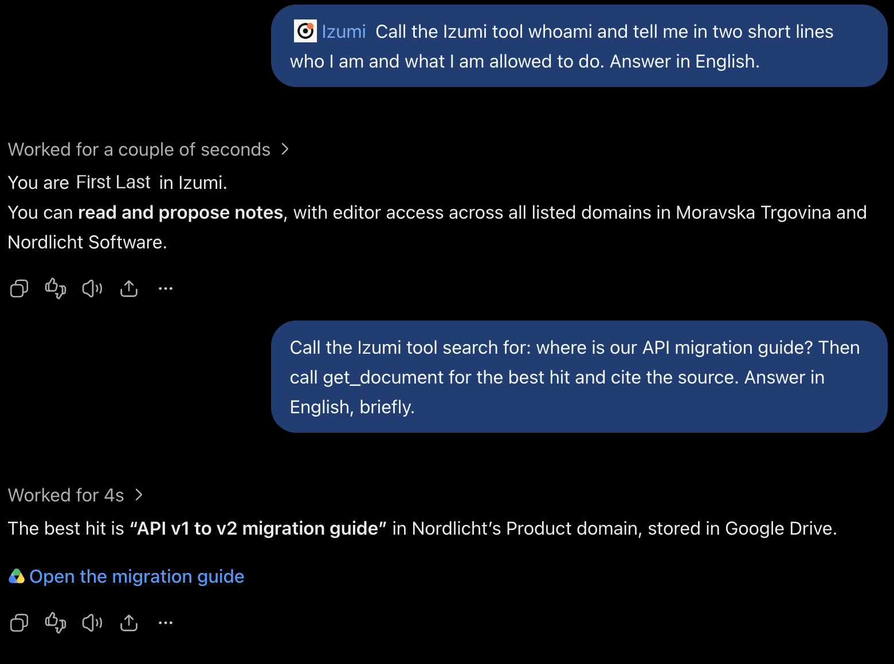
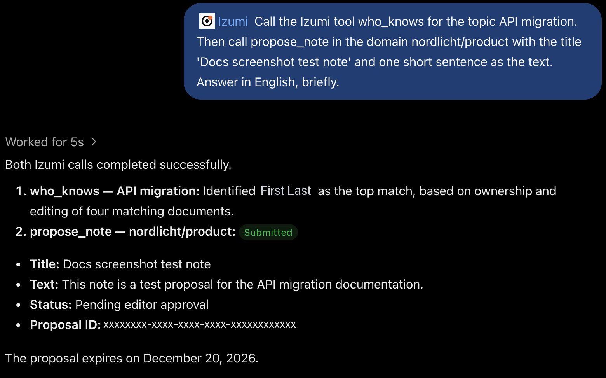
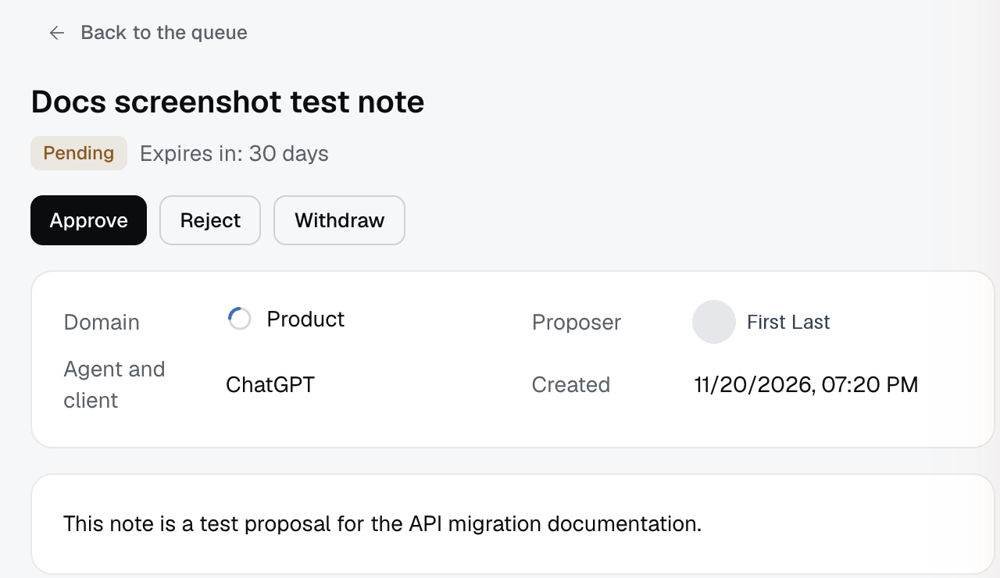
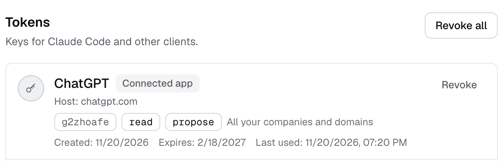

Checked on Izumi 0.5.7, 2026-11-20 (ChatGPT plan Free, web).

You connect ChatGPT to Izumi over OAuth. You copy no token and enter no client ID.

## What you get

- You ask Izumi from ChatGPT. ChatGPT calls Izumi tools and answers with a source and a link to the document.
- You see only what you may see in Izumi, in all your companies.
- Optional: ChatGPT can propose a note. The note goes to the **Review queue**, and an editor of the domain approves or rejects it.
- The connection lasts 90 days. You revoke it yourself on **My tokens and profile**.

## Before you start

- An Izumi account, invited with the address you sign in with.
- A ChatGPT account. The plan **Free** was checked.
- The server address: `https://izumi.akiaconsulting.com/mcp`. For a company with its own installation, it is the address of their Izumi with `/mcp` at the end.

## Connect

<Info>
ChatGPT renames its menus often. On the day of the check (2026-11-20) connectors are called **Plugins**. If your menu looks different, look for the entry that adds your own MCP server.
</Info>

<Steps>
  <Step title="Add the MCP server">
    In the left menu of ChatGPT click **Plugins**. At the top right click **Add**, then **Add custom MCP server**. The same path leads through **Settings**, **Plugins**, **Browse directory**.

    <Frame>
      
    </Frame>
    <Frame>
      
    </Frame>
  </Step>
  <Step title="Fill in the form">
    - **Name**: `Izumi`.
    - **Server URL**: `https://izumi.akiaconsulting.com/mcp`.
    - **Authentication**: **OAuth**. Do not open **Advanced OAuth settings**, the fields stay empty.
    - Tick **I understand and want to continue** and click **Create as a plugin**.

    <Frame>
      
    </Frame>
  </Step>
  <Step title="Click Connect Izumi">
    ChatGPT creates the plugin and opens a window named Izumi. Click **Connect Izumi**.

    <Frame>
      
    </Frame>
  </Step>
  <Step title="Approve the connection in Izumi">
    Izumi opens. If you are not signed in, sign in first. Then the page "Connect ChatGPT to Izumi" appears.

    - Check that it says **Verified: chatgpt.com**. If it says anything else, do not approve.
    - The first permission, **read the documents you can read, in all your companies**, is always on.
    - The second permission, **suggest notes that an editor reviews**, is ticked by default. Untick it if ChatGPT should not propose notes.
    - Click **Approve**.

    <Frame>
      
    </Frame>
  </Step>
  <Step title="Turn Izumi on in a chat">
    You return to ChatGPT and the plugin is in the **Installed** list. Open a new chat, click **+** in the message box and choose **Izumi**. This turns Izumi on for that chat.

    <Frame>
      
    </Frame>
  </Step>
  <Step title="Check the connection and ask about your documents">
    Ask: "Call the Izumi tool whoami and tell me who I am and what I may do." ChatGPT returns your name, the name of the connection (`ChatGPT`), the scopes (`read`, `propose`), the expiry (90 days from approval) and the domains where you are an editor.

    Then ask something from your documents, for example: "Call the Izumi tool search: where is the API migration guide? Then call get_document for the best hit and name the source." ChatGPT calls `search`, then `get_document`, answers and gives a link to the source document.

    <Frame>
      
    </Frame>
  </Step>
  <Step title="Propose a note (optional)">
    For example: "Call the Izumi tool who_knows for the topic …. Then call propose_note in the domain …". The answer returns the proposal ID and the 30-day deadline.

    For tools that write, ChatGPT may ask "Allow ChatGPT to use Izumi?" with **Always allow**, **Deny** and **Allow once**. Choose as you see fit.

    <Frame>
      
    </Frame>
  </Step>
  <Step title="Check the proposal in Izumi">
    Open the **Review queue**, tab **Pending**. The row shows who proposed it and the client (**ChatGPT**). An editor of the domain chooses **Approve** or **Reject**. If the proposal is yours, you can withdraw it with **Withdraw**.

    <Frame>
      
    </Frame>
  </Step>
</Steps>

## See and revoke the connection

In Izumi open **My tokens and profile**. The connection is a row marked **Connected app**, with the name **ChatGPT**, the address `chatgpt.com`, scopes, companies and dates. Click **Revoke**. The connection ends at once, without a confirmation.

<Frame>
  
</Frame>

After a revoke, on the next call ChatGPT shows "Reconnect Izumi: Your Izumi connection has expired. Reconnect it before ChatGPT can use it for this request." with **Not now** and **Reconnect**. **Reconnect** opens the same **Connect Izumi** window and the same approval page. After you approve again, `whoami` works with no other setup.

## Remove the connector from ChatGPT

1. Revoke the connection in Izumi (above).
2. In ChatGPT: **Plugins**, **Installed**, open **Izumi**, the **...** menu (three dots), **Delete plugin**, and confirm ("Permanently delete Izumi and its connections? This can't be undone").

## Limits

- The plan **Free** was checked. Everything works on it: `whoami`, `search`, `get_document`, `who_knows` and `propose_note`.
- Permission for tools that write: in one run ChatGPT called `propose_note` without asking, in another it asked for **Allow once**. ChatGPT asks by its own risk judgment. Do not rely on either behavior.
- A connection lasts 90 days from the last approval. After that ChatGPT asks for **Reconnect**.
- The rate limit is 60 calls per minute (`rate_limited`).
- The approval page shows the name you are signed in as in Izumi. If it is not your account, do not approve.

## Troubleshooting

- **Verified: chatgpt.com** is missing, or the page says the client is not verified: the server cannot confirm the client's identity. Approve only if the name and address match what you expect.
- "Reconnect Izumi" in the middle of a chat: the connection was revoked, expired or ended in Izumi. Click **Reconnect**, then **Approve**.
- There is no **Izumi** entry in the **+** menu: the plugin is off or deleted. Check **Plugins**, **Installed**.
- `forbidden_scope` on `propose_note`: the connection was made without the `propose` scope. Revoke it and connect again with **suggest notes that an editor reviews** ticked. This error was checked live only in Claude Code, not in ChatGPT.
- `search` does not find a document: ChatGPT sees only what you may see. Check that you can see the document in **Documents**.
- After you delete the plugin in ChatGPT, check **My tokens and profile** and revoke what is left of the connection.
