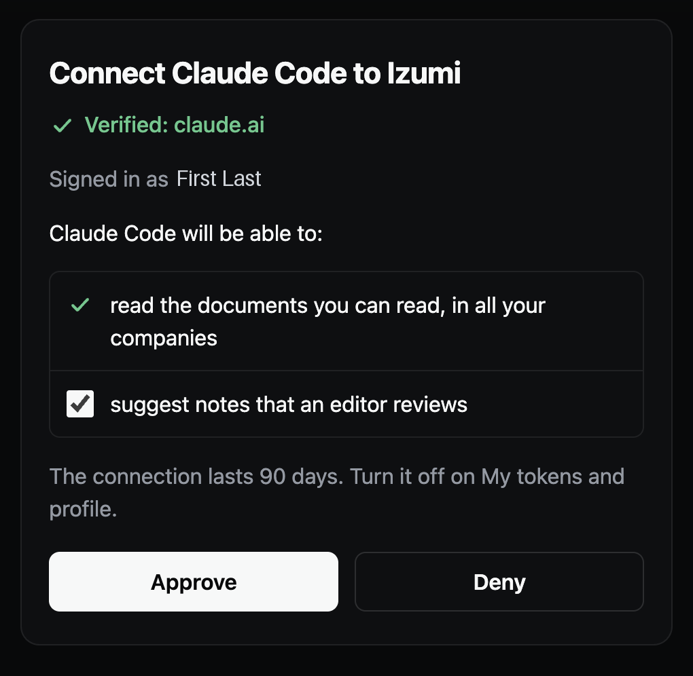
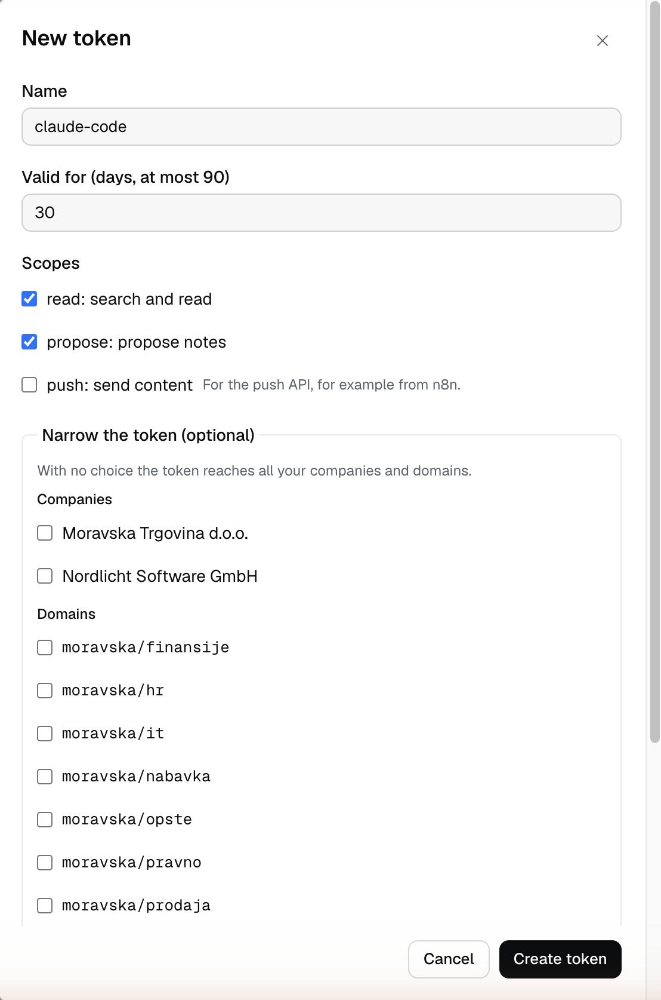

Checked on Izumi 0.5.7, 2026-11-20 (Claude Code 2.1.287, macOS).

Claude Code connects in two ways. Both were checked to the end.

- OAuth: only the server address, sign-in in the browser. The connection lasts 90 days.
- Personal token: the header `Authorization: Bearer <token>`. You choose the expiry and the scopes, at most 90 days.

## What you get

- You ask Izumi from Claude Code, in the terminal or in an editor. Claude Code calls Izumi tools and answers with a source.
- You see only what you may see in Izumi, in all your companies. You can narrow a personal token to some companies and domains.

## Before you start

- An Izumi account, invited with the address you sign in with.
- Claude Code (the command `claude`). Version 2.1.287 was checked.
- The server address: `https://izumi.akiaconsulting.com/mcp`.

## Path 1: OAuth

<Steps>
  <Step title="Add the server">
    In the terminal:

    ```
    claude mcp add --transport http izumi https://izumi.akiaconsulting.com/mcp
    ```

    `claude mcp list` shows **Needs authentication** next to the server.
  </Step>
  <Step title="Sign in through /mcp">
    Run `claude`, enter `/mcp` and choose `izumi` (marked "needs authentication"). Choose sign-in (**Authenticate**). Claude Code says "A browser window will open for authentication" and prints an address you can copy if the browser does not open.
  </Step>
  <Step title="Approve the connection in Izumi">
    The browser opens Izumi (sign-in if you are not signed in), then the page "Connect Claude Code to Izumi".

    - It says **Verified: claude.ai**. Claude Code uses a published identity, so there is no warning that the client is not verified.
    - The permission **read the documents you can read, in all your companies** is always on. **suggest notes that an editor reviews** is on by default.
    - Click **Approve** once.

    <Frame>
      
    </Frame>
  </Step>
  <Step title="Close the tab">
    The browser goes back to an address on your computer (`localhost`, the port changes) and says **Authentication successful**, "You can close this tab and return to Claude Code." Close the tab.
  </Step>
  <Step title="Check the connection">
    In the terminal `/mcp` says "Authentication successful. Connected to izumi." `claude mcp list` shows **Connected**. Ask: "Call the tool whoami from the server izumi." The answer has `token.kind` `oauth`, `name` `Claude Code`, `expires_at` (90 days from approval), `scopes` (`read`, `propose`) and companies and domains with your role.
  </Step>
  <Step title="Revoke the connection when you no longer need it">
    In Izumi open **My tokens and profile**. The connection is a row **Claude Code** marked **Connected app**, with the address `claude.ai`, a prefix and scopes. Click **Revoke**.

    After that `claude mcp list` shows **Needs authentication**, and a tool call fails with a message that sign-in is needed. For a new connection repeat step 2.
  </Step>
  <Step title="Remove the server from Claude Code">
    ```
    claude mcp remove izumi
    ```
  </Step>
</Steps>

## Path 2: personal token

<Steps>
  <Step title="Make a token">
    In Izumi open **My tokens and profile**, section **Tokens**, button **New token**.

    <Frame>
      
    </Frame>
  </Step>
  <Step title="Fill in the New token window">
    - **Name**: for example `claude-code`.
    - **Valid for (days, at most 90)**: the default is 30.
    - **Scopes**: **read: search and read** is on. **propose: propose notes** is on by default. Untick it if Claude Code should only read. **push: send content** is for the push API and is not needed here.
    - **Narrow the token (optional)**: with no choice the token covers all your companies and domains. You can pick companies and domains.
    - Click **Create token**.
  </Step>
  <Step title="Save the token">
    Izumi shows the token once: "This is the only time you will see the token. Copy it now." Click **Copy** and store it somewhere safe. Do not send it in a chat and do not put it in a repository.
  </Step>
  <Step title="Add the server">
    In the terminal (replace `<token>`):

    ```
    claude mcp add --scope user --transport http izumi https://izumi.akiaconsulting.com/mcp --header "Authorization: Bearer <token>"
    ```

    Claude Code answers "Added HTTP MCP server izumi ... to user config" and prints the header with the value `[REDACTED]`.

    - `--scope user` applies in all folders. Without it the server applies only to the folder you are in.
    - Do not use `--scope project` with a token: according to the Claude Code documentation it writes `.mcp.json` into the repository (not checked).
  </Step>
  <Step title="Check the connection">
    ```
    claude mcp list
    ```

    It shows **Connected** next to the server. Then ask Claude Code: "Call the tool whoami from the server izumi." The answer is JSON with your name, the token (`kind` `pat`, `name`, `prefix`, `expires_at`, `scopes`) and companies and domains with your role. For a token with the scope `read`, `scopes` shows only `read`.
  </Step>
  <Step title="Remove the server and revoke the token">
    ```
    claude mcp remove izumi --scope user
    ```

    Then in Izumi, on **My tokens and profile**, click **Revoke** next to the token. A revoke works at once, without a confirmation.
  </Step>
</Steps>

## What a token without the propose scope does

- `propose_note` with invalid input (a title shorter than 3 characters) returns `invalid_input`, "The title field is missing or invalid." The input is checked before the scope.
- `propose_note` with a valid title and text returns `forbidden_scope`, "The token does not have the scope for this call." No proposal is made.

## Limits

- The token is shown only once, when you make it. A lost token cannot be recovered: revoke it and make a new one.
- The token expires at the expiry you chose (at most 90 days). An OAuth connection lasts 90 days from approval.
- A token with the scope `read` cannot propose notes. `propose_note` returns `forbidden_scope`.
- Calls are limited to 60 per minute (`rate_limited`).
- Whether Claude Code asks for permission before a tool call depends on its own settings and is not part of connecting to Izumi.

## Troubleshooting

- `claude mcp list` does not show **Connected**: check the address (`/mcp` at the end), that the token has not expired or been revoked, and that the header is exactly `Authorization: Bearer <token>`.
- `forbidden_scope`: the connection lacks the needed scope (for example `propose`). Make a new token with that scope, or connect with OAuth with **suggest notes that an editor reviews** ticked.
- `invalid_input`: the tool input does not satisfy the schema (for example a title that is too short). The message names the field.
- A revoked OAuth connection: the call fails, and `claude mcp list` shows **Needs authentication**. Sign in again through `/mcp`.
- A revoked token: the call no longer works. Make a new token. What `claude mcp list` then shows was not checked.
