Checked on Izumi 0.5.7, 2026-11-20 (claude.ai plan Pro, web; Claude Desktop 6.6395.1 on macOS, plan Pro).

claude.ai and Claude Desktop are the same account and the same connector. You add it once in claude.ai and Desktop sees it by itself. You connect over OAuth, with no token.

## What you get

- You ask Izumi from a Claude chat. Claude calls Izumi tools and answers with a source.
- You see only what you may see in Izumi, in all your companies.
- Optional: Claude can propose a note. The note goes to the **Review queue**, and an editor of the domain approves or rejects it.
- The connection lasts 90 days. You revoke it yourself on **My tokens and profile**.

## Before you start

- An Izumi account, invited with the address you sign in with.
- A Claude account. The plan **Pro** was checked.
- The server address: `https://izumi.akiaconsulting.com/mcp`.

## Connect in claude.ai

<Info>
The claude.ai menus change often. On the day of the check (2026-11-20) connectors are under **Plugins**, with the filter **Connectors**. This place used to be called **Customize**.
</Info>

<Steps>
  <Step title="Add a custom connector">
    In the left menu click **Plugins**, then choose the filter **Connectors** above the list. At the top right click **Add**, then **Add custom connector**.

    <Frame>
      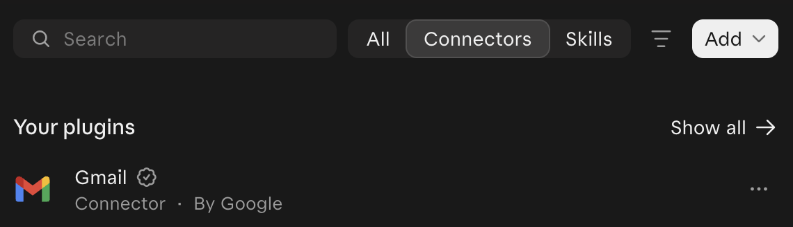
    </Frame>
    <Frame>
      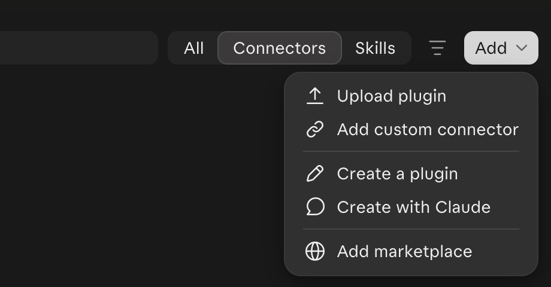
    </Frame>
  </Step>
  <Step title="Enter the name and the address">
    In the **Add custom connector** window enter **Name** `Izumi` and **MCP server URL** `https://izumi.akiaconsulting.com/mcp`, then click **Continue**.

    <Frame>
      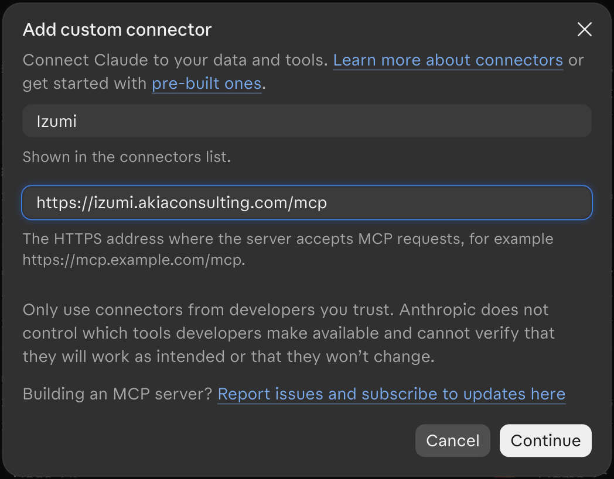
    </Frame>
  </Step>
  <Step title="Keep the detected settings">
    Claude checks the server and detects the settings by itself. Leave them as they are:

    - **Authentication**: **Sign in now** (label **Detected**).
    - **OAuth client**: **Use Claude's published identity** (label **Detected**).
    - **Request headers** and **Advanced** stay empty.

    Click **Add**. Izumi opens at once, with no extra click on **Connect**.

    <Frame>
      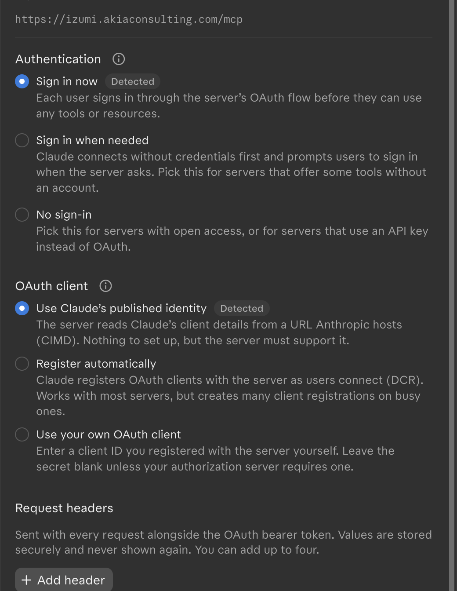
    </Frame>
  </Step>
  <Step title="Approve the connection in Izumi">
    Izumi opens. If you are not signed in, sign in first. Then the page "Connect Claude to Izumi" appears.

    - Check that it says **Verified: claude.ai**. If it says anything else, do not approve.
    - The first permission, **read the documents you can read, in all your companies**, is always on.
    - The second permission, **suggest notes that an editor reviews**, is ticked by default. Untick it if Claude should not propose notes.
    - Click **Approve**.

    <Frame>
      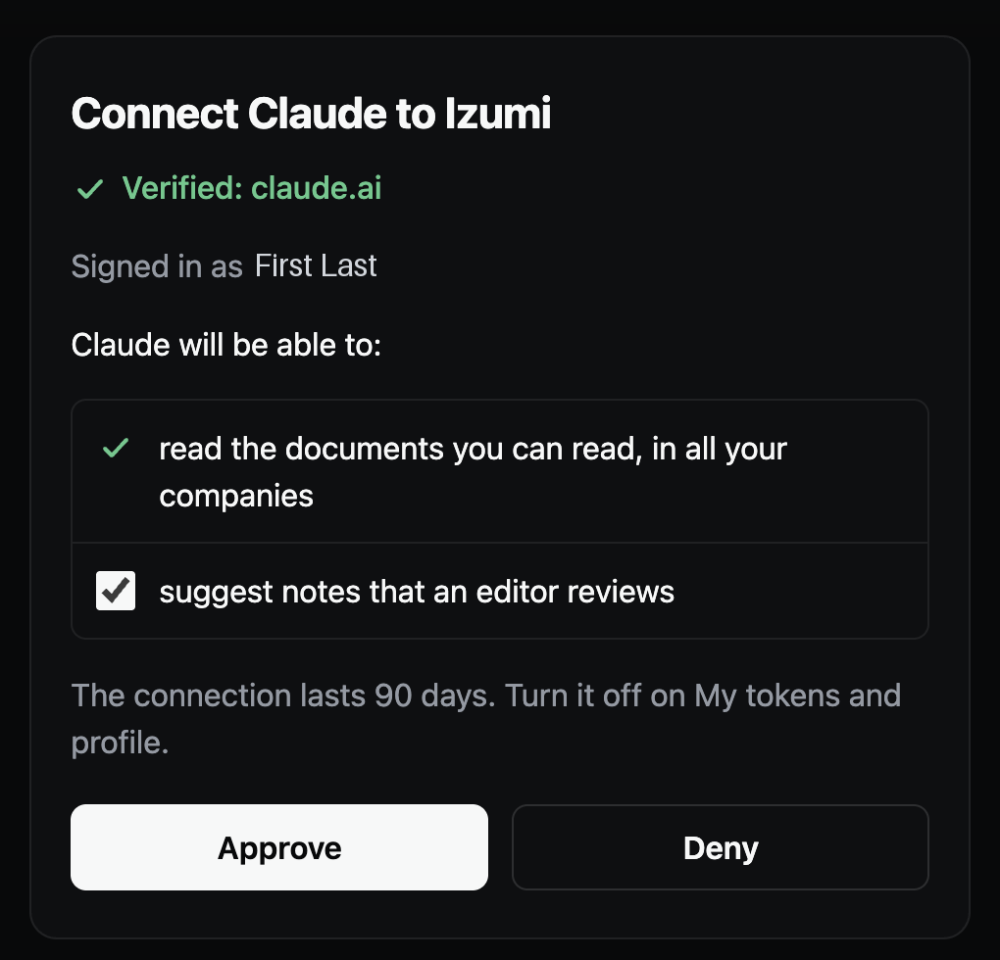
    </Frame>
  </Step>
  <Step title="Look at the tool permissions">
    You return to claude.ai with the message **Connected to Izumi.** Open the connector (**Plugins**, **Izumi**) and the **Permissions** tab (next to **Overview**). It lists the tools in two groups: **Read-only tools** (**Get document**, **Search**, **Who knows**, **Whoami**) and **Write/delete tools** (**Propose note**). Each group has a setting, **Needs approval** by default, and each tool has three choices: allow, ask for approval, block.

    <Frame>
      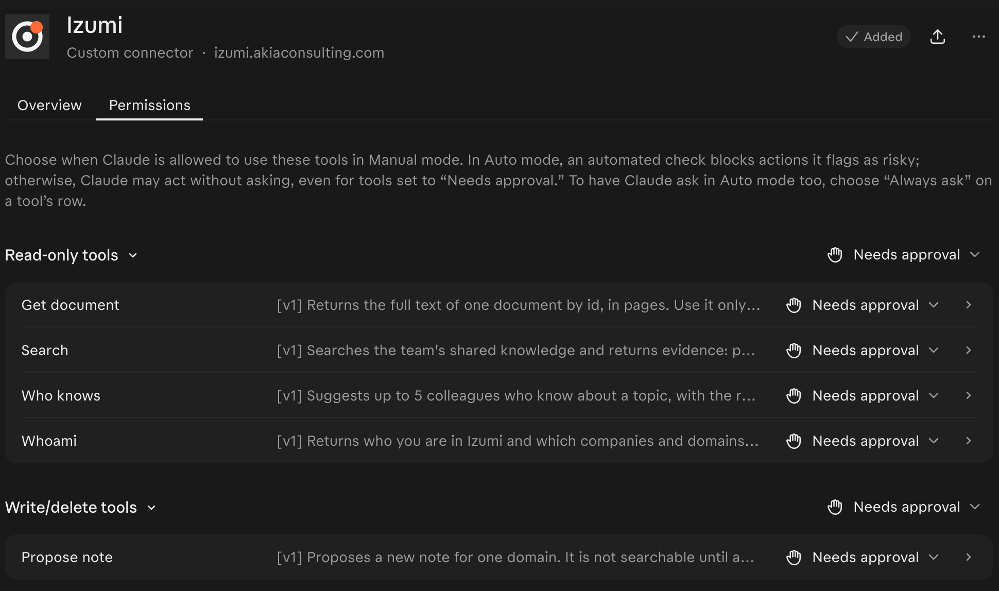
    </Frame>
  </Step>
  <Step title="Turn Izumi on in a chat">
    Open a new chat. Click **+** in the message box, then **Plugins**. A list with switches opens. **Izumi** is already on. If it is not, turn it on.

    <Frame>
      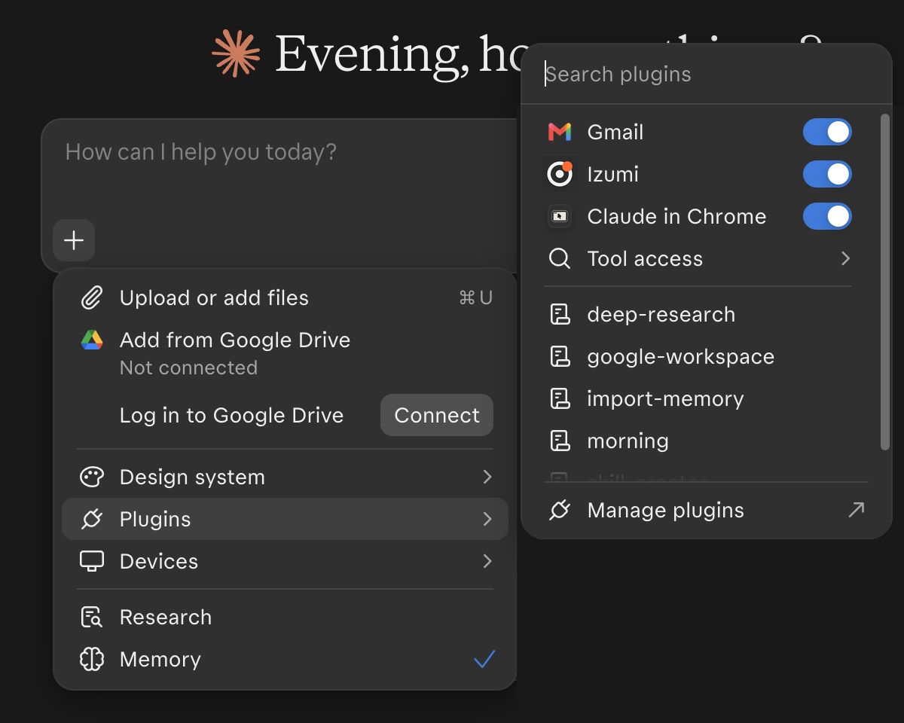
    </Frame>
  </Step>
  <Step title="Check the connection">
    Ask: "Call the Izumi tool whoami and tell me who I am." Before every call Claude asks "Claude wants to use Whoami from Izumi" with **Decline**, **Always allow** and **Allow once**. Choose **Allow once**. The answer returns your name, companies, the domains where you are an editor, the scopes (`read`, `propose`) and when the connection expires.

    <Frame>
      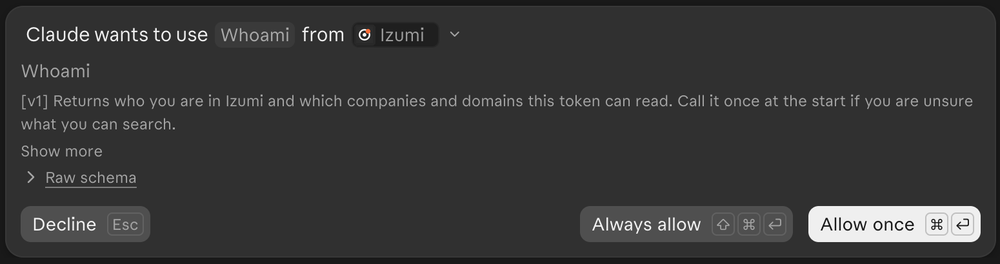
    </Frame>
  </Step>
  <Step title="Ask about your documents and propose a note (optional)">
    For example: "Call search: where is the API migration guide, then get_document for the best hit. Then who_knows for the topic API migration, then propose_note in the domain Product." Approve each call. For `propose_note`, review the domain, title and text before you click **Allow once**.

    <Frame>
      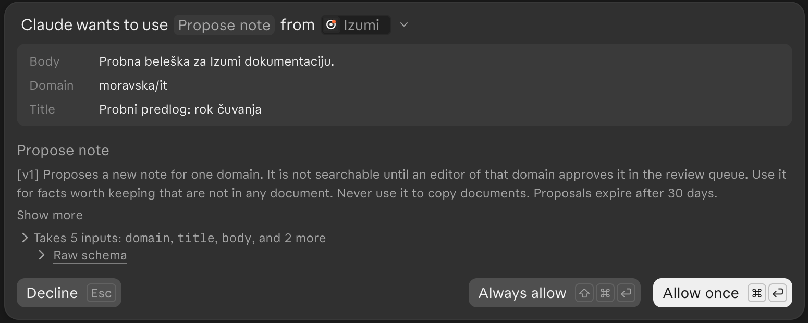
    </Frame>
    <Frame>
      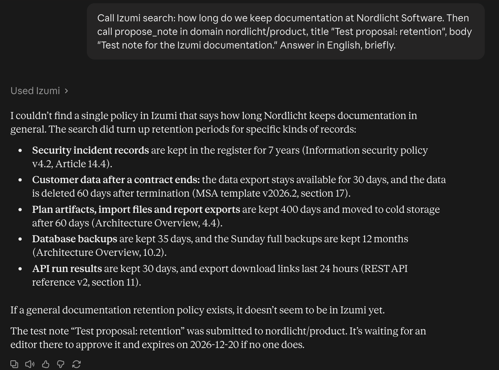
    </Frame>
  </Step>
  <Step title="Check the proposal in Izumi">
    Open the **Review queue**, tab **Pending**. The row shows who proposed it and the client (**Claude**). An editor of the domain chooses **Approve** or **Reject**. If the proposal is yours, you can withdraw it with **Withdraw**.

    <Frame>
      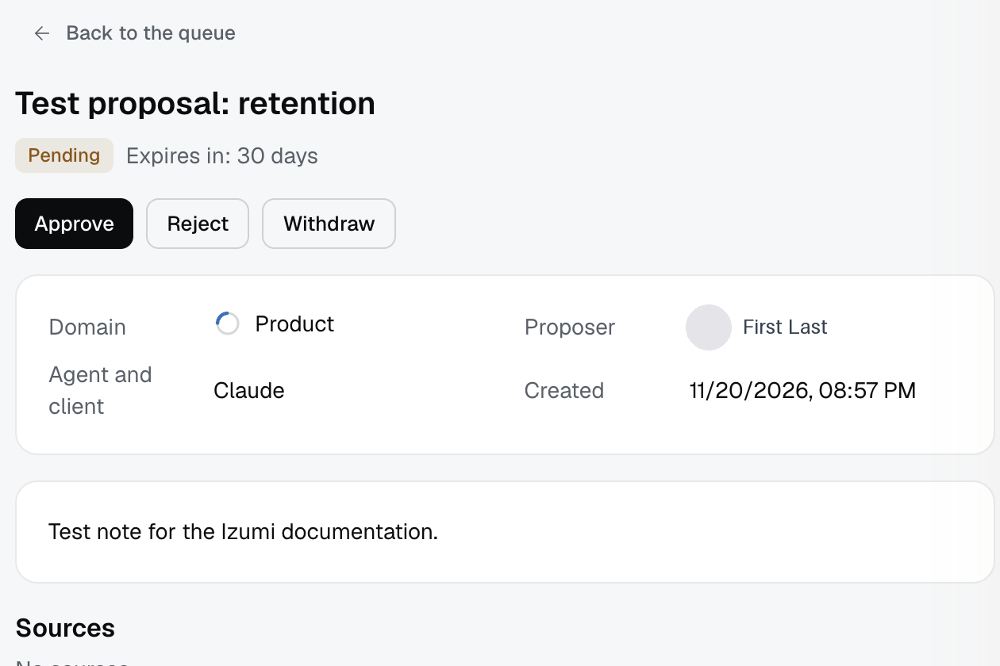
    </Frame>
  </Step>
</Steps>

<Info>
Some screenshots on this page show a chat in Serbian, because the check ran with Serbian questions. The Izumi tool texts in them are English.
</Info>

## Claude Desktop

Desktop is the same account and the same connector as claude.ai. You add nothing: the connector you added in claude.ai appeared in Desktop by itself, with your older chats. The Izumi tools, the approval page and the 90-day connection are the same.

<Info>
The Desktop screenshots in this section come from a run with the Serbian demo company, Moravska Trgovina. Claude Desktop itself is in English.
</Info>

### Where the connector is

1. In the left menu click **Plugins**.
2. **Izumi** is in the list **Your plugins**, marked **Custom connector**, with the address izumi.akiaconsulting.com.

   <Frame>
     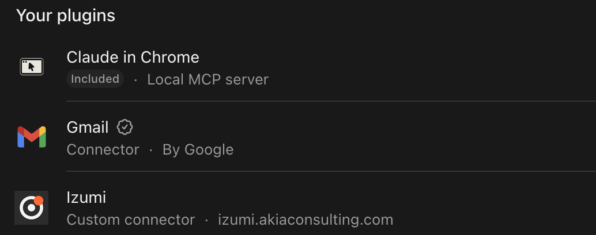
   </Frame>

3. A click on the **Izumi** row opens the details: the **Added** label and the **...** menu. The **Permissions** tab (next to **Overview**) explains the modes. In **Manual** mode you choose when Claude may use tools. In **Auto** mode an automatic check blocks actions it marks as risky, and otherwise Claude may work without asking, even for tools set to **Needs approval**. All Izumi tools are on **Needs approval** by default. In the screenshot **Whoami** is on **Always allow** and the group says **Mixed**: **Always allow** is remembered per tool, so it was left over from an earlier click in the permission question.

   <Frame>
     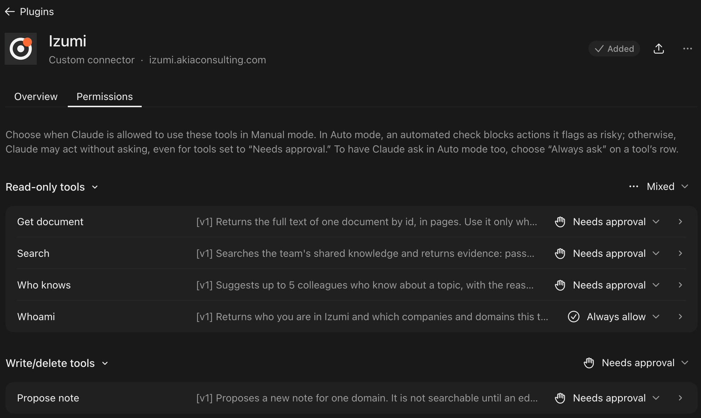
   </Frame>

### Call a tool in Desktop

1. Open a new chat (**New**) and check that Izumi is on (**+**, **Plugins**).
2. Ask, for example: "Call the Izumi tool whoami and tell me who I am. Then call search: how long do we keep documentation in Moravska Trgovina?"
3. In **Manual** mode Desktop asks for permission for every tool separately (except tools set to **Always allow**): "Claude wants to use Search from Izumi", with **Decline**, **Always allow** and **Allow once**. While it waits, the chat shows **Needs your input**.

   <Frame>
     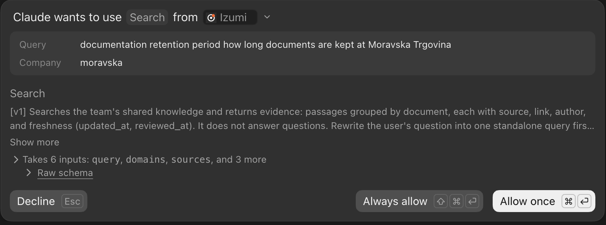
   </Frame>

4. `whoami` shows your name, the connection (scopes `read` and `propose`, expiry 90 days) and companies and domains with your role. `search` returns an answer with sources and links to documents.

   <Frame>
     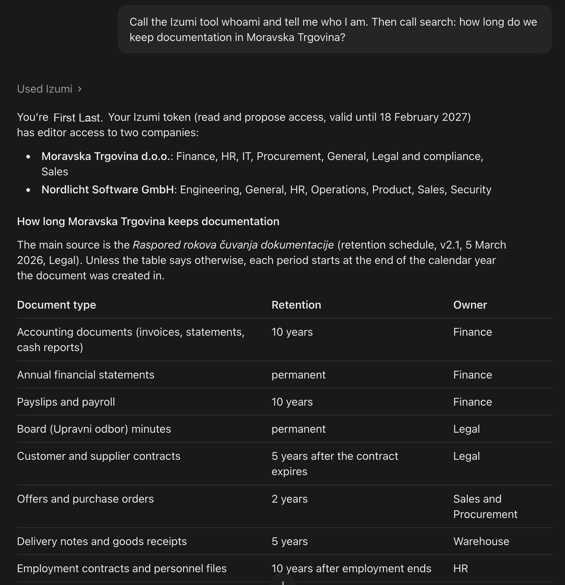
   </Frame>

## See and revoke the connection

In Izumi open **My tokens and profile**. The connection is a row marked **Connected app**, with the name **Claude** and the address `claude.ai`. Click **Revoke**. The connection ends at once, without a confirmation.

<Frame>
  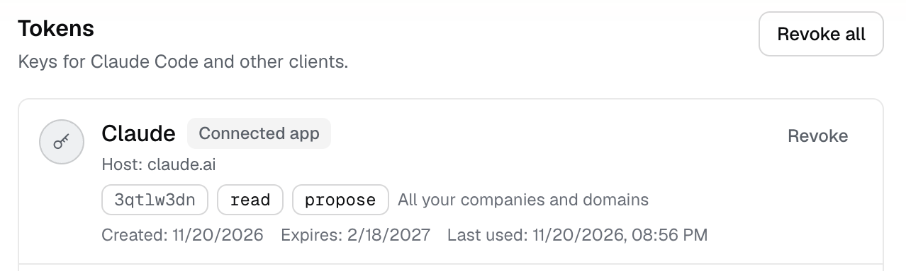
</Frame>

## Reconnect after a revoke

In claude.ai:

- On the next call Claude asks for tool approval again, then says it failed ("Couldn't use Izumi: Whoami"). Izumi asks for a new sign-in.
- Under the message box there is a card "Reconnect a connector to keep using it" with **Not now** and **Reconnect**.
- In **Plugins**, **Izumi** it says **Sign-in expired** and "Connection has expired. You can reconnect to re-authenticate." with a **Reconnect** button (top right and in the connector row). **Disconnect** is in the **...** menu. **Reconnect** leads to the same approval page. After you approve, all calls work again.

<Frame>
  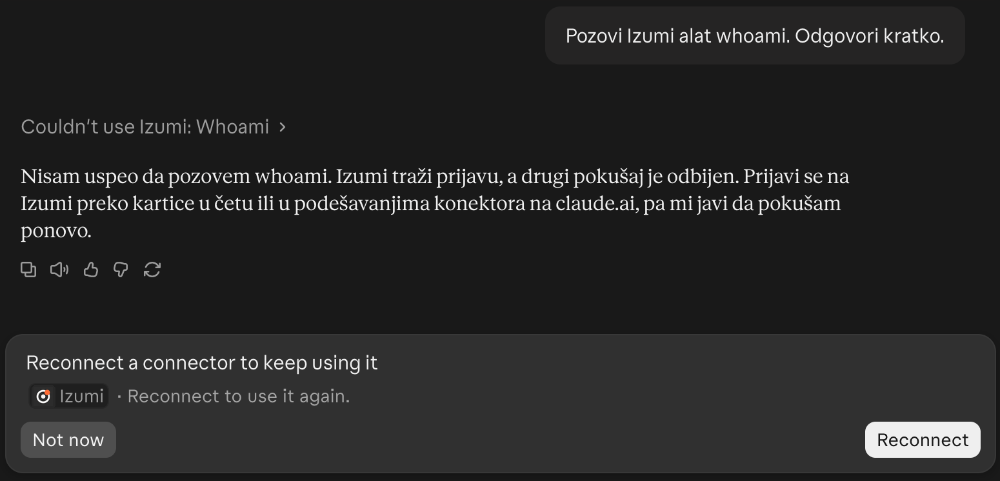
</Frame>
<Frame>
  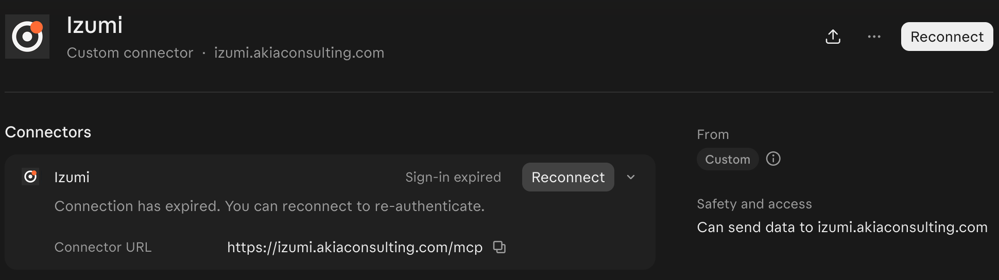
</Frame>

In Claude Desktop:

- The same call fails. Claude tries twice, says a new sign-in is needed, and the same card with **Reconnect** appears under the chat.

  <Frame>
    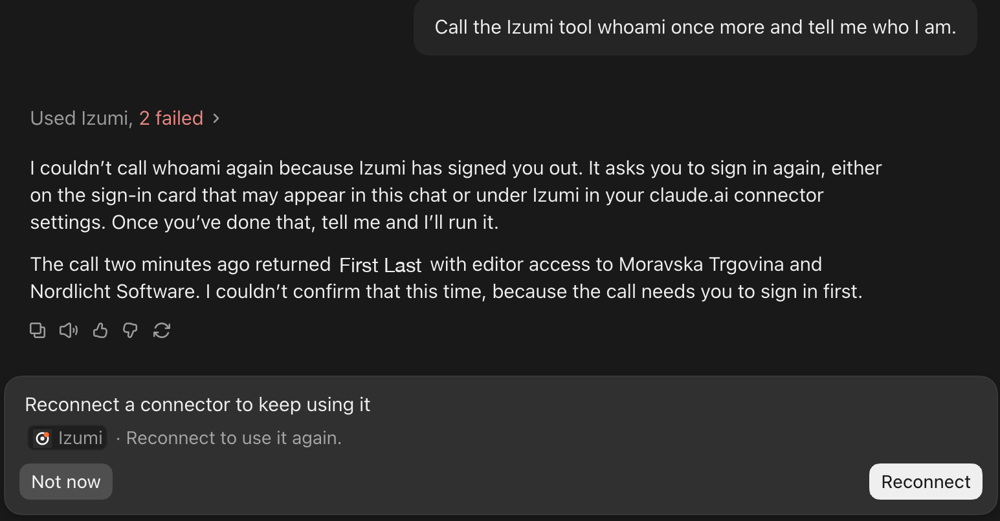
  </Frame>

- **Reconnect** opens the browser, not a window in the app. First the claude.ai page "Finish connecting a connector?" appears. Continue only if you started the connection from Claude Desktop. The **Continue connecting** button is grey at first.

  <Frame>
    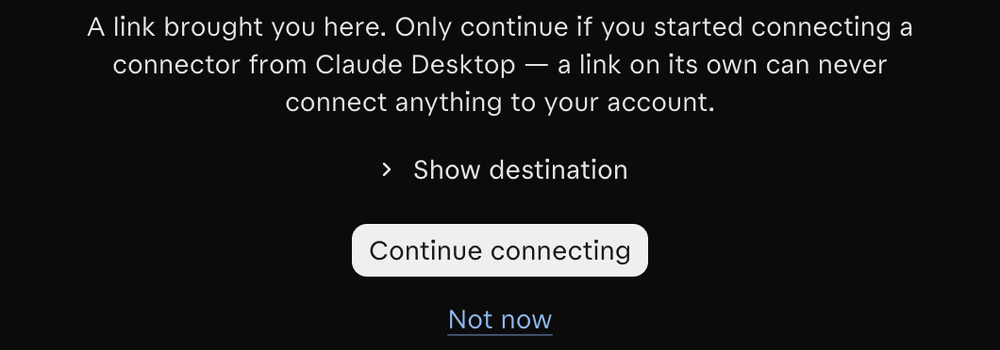
  </Frame>

- Then the Izumi page "Connect Claude to Izumi" appears with **Verified: claude.ai** and the buttons **Approve** and **Deny**.

  <Frame>
    
  </Frame>

- After **Approve** return to Desktop. In the same chat `whoami` works, with a new connection (a changed prefix and expiry).

## Remove the connector

1. Revoke the connection in Izumi (above).
2. In claude.ai: **Plugins**, **Izumi**, the **...** menu (it also has **Refresh tools list** and **Disconnect**), **Remove**, then confirm "Delete Izumi?" with the **Delete** button. The dialog reminds you that you need the server address to add it again.

Removing in Desktop was checked: afterwards Izumi is no longer in the connector list.

## Limits

- The plan **Pro** was checked. A custom connector is added with no extra steps and all five tools work, including `propose_note`.
- On the day of the check the mode was **Manual**: every tool call asks for approval (**Allow once**), except tools you set to **Always allow**. **Always allow** is remembered per tool.
- claude.ai sometimes offers "Switch to Auto mode?" (**Stay in Manual** or **Switch to Auto**). In **Auto** mode an automatic check blocks risky actions and Claude does the rest without asking. This changes a setting of your Claude account and is not part of connecting to Izumi.
- A connection lasts 90 days from the last approval. After that claude.ai shows **Sign-in expired** and asks for **Reconnect**.
- The approval page shows the name you are signed in as in Izumi. If it is not your account, do not approve.

## Troubleshooting

- **Verified: claude.ai** is missing, or the page says the client is not verified: the server cannot confirm the client's identity. Approve only if the name and address match what you expect.
- **Sign-in expired** or "Connection has expired": the connection was revoked, expired or ended in Izumi. Go to **Plugins**, **Izumi**, **Reconnect**, then **Approve**.
- After **Approve** it says "The request expired / Start connecting again from the app." Check before you start over: the connection probably already succeeded. In one check the server issued access, and a second submission of the same form was refused. The cause is not known.

  <Frame>
    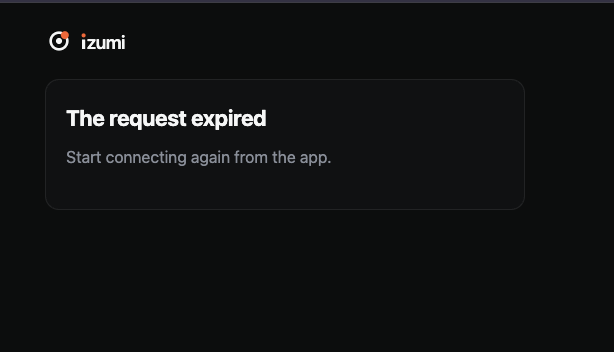
  </Frame>

- After a revoke the tool approval window appears twice before the message that the call failed. Click **Decline**, and the **Reconnect** card appears.
- The connector icon is the letter "A" instead of the Izumi mark. This is a known issue and the cause is not yet determined.
- Izumi is not in the list in **+**, **Plugins**: the connector was removed or switched off. Add it again or turn the switch on.
- `forbidden_scope` on `propose_note`: the connection was made without the `propose` scope. Revoke it and connect again with **suggest notes that an editor reviews** ticked. This error was checked live only in Claude Code.
- `search` does not find a document: Claude sees only what you may see. Check that you can see the document in **Documents**.
- After you remove the connector, check **My tokens and profile** and revoke what is left of the connection.
