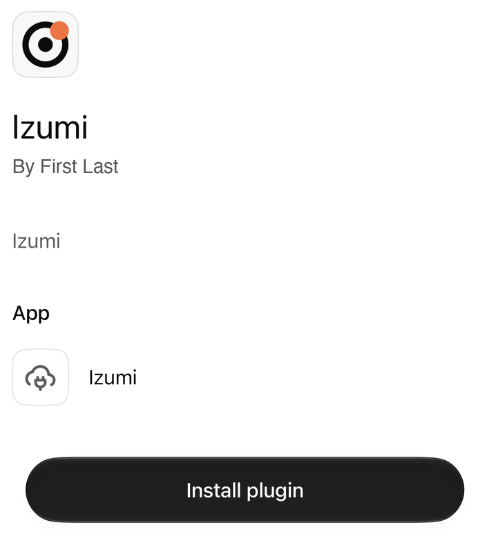
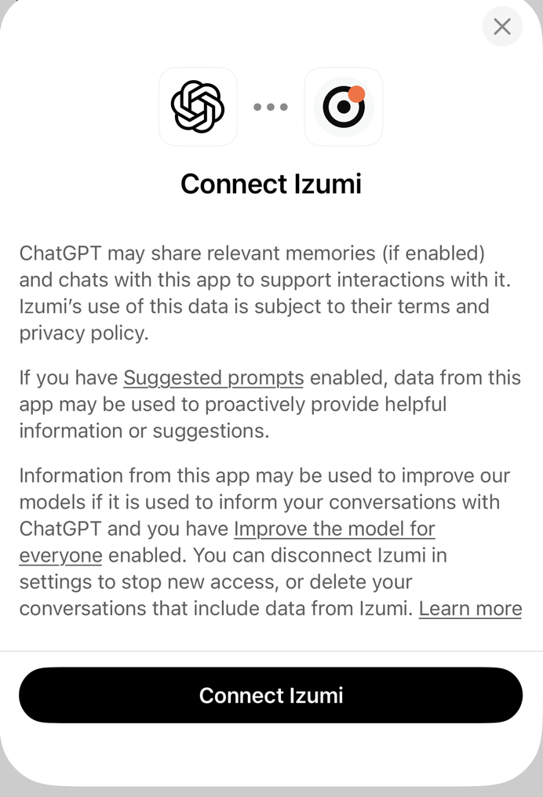

Checked on Izumi 0.5.7, 2026-11-20.

MCP (Model Context Protocol) is the way an AI tool calls Izumi. You still ask your own tool, for example ChatGPT or Claude. The tool calls Izumi, gets passages from your company's documents and answers with a source.

## What you get

- You ask Izumi from a tool you already use. You do not open a separate app.
- The tool sees only what you may see in Izumi, in all your companies. The connection carries your permissions, nothing more.
- Izumi does not write the answer for the tool. Izumi returns passages with source, link, author and freshness, and the AI tool writes the answer.
- Optional: the tool can propose a note. The note goes to the **Review queue**, and an editor of the domain approves or rejects it. Until then nobody can find it by search.

## Two ways to connect

| Way | What you enter | For which tools |
|---|---|---|
| OAuth | Only the server address. You sign in to Izumi in the browser and approve the connection. It lasts 90 days. | ChatGPT, Claude (claude.ai and Claude Desktop), Claude Code, Slackbot (for Slackbot an administrator registers the client first, see the Slack page) |
| Personal token | The server address and the header `Authorization: Bearer <token>`. You make the token yourself, at most 90 days. | Claude Code and any other client that speaks MCP over Streamable HTTP |

The server address is the address of your Izumi with `/mcp` at the end. On the demo installation (invitation only) it is `https://izumi.akiaconsulting.com/mcp`.

The mobile apps of ChatGPT and Claude use the connection you set up on the web. In Claude the connector appears by itself under **Connectors**. In ChatGPT it appears as a plugin: tap **Install plugin**, then **Connect Izumi**.

<Frame>
  
</Frame>
<Frame>
  
</Frame>

<Info>
OAuth needs an Izumi server with OAuth turned on. The administrator sets this up once, see the **Installation** tab.
</Info>

## Scopes

- `read`: search and read documents. Always on.
- `propose`: propose notes that an editor reviews. It is ticked by default on the approval page and you can untick it. A token with only `read` can search but cannot propose.
- `push` exists for the push API and is not used over MCP.

## Pick your tool

<CardGroup cols={2}>
  <Card title="ChatGPT" href="/en/ai-tools/chatgpt">
    Add Izumi as a plugin, OAuth, no token.
  </Card>
  <Card title="Claude" href="/en/ai-tools/claude">
    claude.ai and Claude Desktop, one connector, one account.
  </Card>
  <Card title="Slack" href="/en/ai-tools/slack">
    Izumi in Slackbot. The steps are split between the Izumi admin, the Slack admin and every user.
  </Card>
  <Card title="Claude Code" href="/en/ai-tools/claude-code">
    Terminal and editor. OAuth or a personal token.
  </Card>
  <Card title="Other clients" href="/en/ai-tools/other-clients">
    Address and header for any MCP client. Not checked live.
  </Card>
  <Card title="Tools and example questions" href="/en/ai-tools/tools">
    The five tools the AI sees, errors and example questions.
  </Card>
</CardGroup>

## Where you see and revoke connections

- In Izumi open **My tokens and profile**. All connections and tokens are in the **Tokens** section. An OAuth connection is a row marked **Connected app**, with the client name and address.
- **Revoke** ends the connection at once, without a confirmation. The client then asks you to connect again. The exception is Slackbot, see the Slack page.
- The client's calls show in the **Access log**.

## Limits

- 60 calls per minute per token. After that the tool returns the error `rate_limited`.
- Streamable HTTP only. A client that supports only local (stdio) servers does not work.
- A connection lasts at most 90 days. After that the client asks you to connect again.

## Troubleshooting

- The tool says it has no Izumi tools: the connection is not on in that chat or it expired. See the page for your tool.
- The tool returns an error: see the table of errors on the page **Tools and example questions**.
- The connection was revoked and the tool does not offer to reconnect: connect it again following the page for that tool.
