Checked on Izumi 0.5.2 (the Slackbot conversation, 2026-11-19) and on Izumi 0.5.7 (the Izumi screens, 2026-11-20). Slack workspace on the Free plan, Slackbot in Preview.

Slackbot can ask Izumi on a user's behalf. Every person connects their own Izumi account, so Slackbot sees only what that person may see.

## What you get

- Document search, reading a document and "who knows what" from Slackbot.
- Tools in Slackbot: **Whoami**, **Search**, **Get document** and **Who knows**, and with the `propose` scope also proposing a note (`propose_note`).
- A document uploaded to Izumi (upload, note) gets a link to its own page in Izumi. A document from Google Drive keeps the link to the original source.


## Who does what

| Role | Steps | How often |
|---|---|---|
| Izumi admin | Step 1 | Once per Izumi installation |
| Slack admin | Steps 2 to 5 | Once per workspace |
| Every user | Step 6 | Once per person |

## Before you start

- Izumi 0.5.2 or newer with OAuth turned on (the administrator sets this up on the server, see the **Installation** tab).
- An Izumi administrator with access to the server.
- A Slack workspace where you can create apps. The Free plan is enough. Slackbot MCP is in Preview.
- A Slack account that may install an app: a workspace owner or admin, or with an admin's approval.
- The Izumi address. In this guide it is `https://izumi.akiaconsulting.com`.

## Step 1: register Slack as a client in Izumi (Izumi admin)

Slack cannot register itself in Izumi (automatic registration does not work, see "Limits"). So the administrator makes a public client by hand, once. On the server, in the Izumi folder:

```
./tb admin oauth client add --label "Slackbot (your workspace name)" --redirect-uri https://oauth2.slack.com/external/auth/callback
```

- The command prints a `client_id`. Save it, you need it in step 3.
- This is a public client: there is no `client secret`. PKCE protects it.
- The redirect address must be exactly `https://oauth2.slack.com/external/auth/callback`.
- To check: `./tb admin oauth client list` shows the client. `./tb admin oauth client remove <client_id>` removes it.

## Steps 2 to 5 (Slack admin)

### Step 2: create a Slack app

Recommended: a separate app only for Izumi, so it does not share a bot token with other tools.

<Steps>
  <Step title="Open Create New App">
    Open `https://api.slack.com/apps` and click **Create New App**. In the window, under **From scratch**, choose **Pick features**.

    <Frame>
      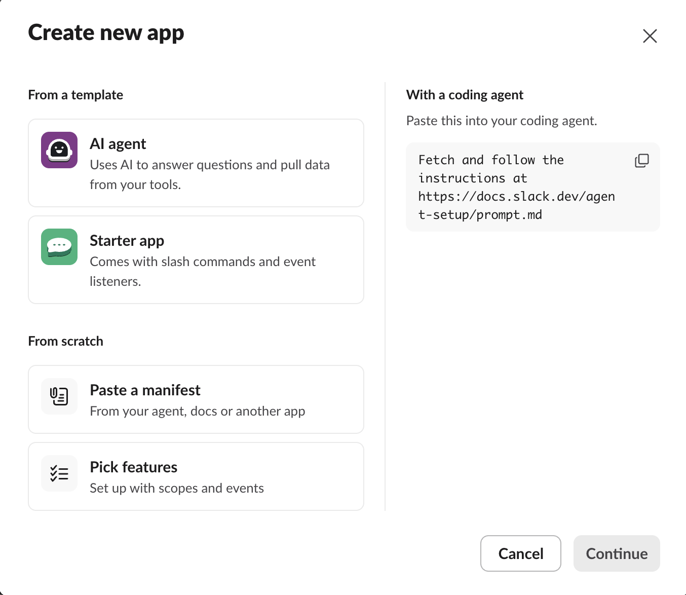
    </Frame>
  </Step>
  <Step title="Name and workspace">
    Enter a name (for example `Izumi`), choose the workspace and click **Continue**.

    <Frame>
      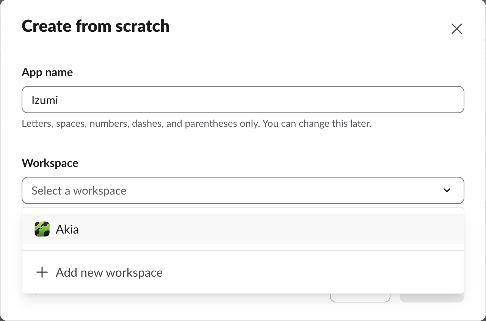
    </Frame>
  </Step>
  <Step title="Add the scope mcp:connect">
    In the step "What it can do in Slack" type `mcp:connect` in the search and choose it as a **bot scope**. It is the only scope you need.

    <Frame>
      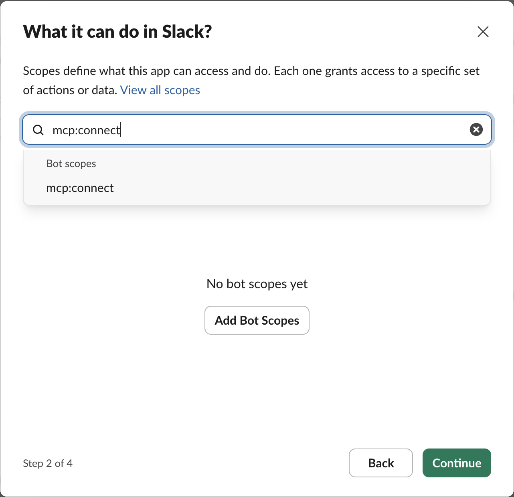
    </Frame>
    <Frame>
      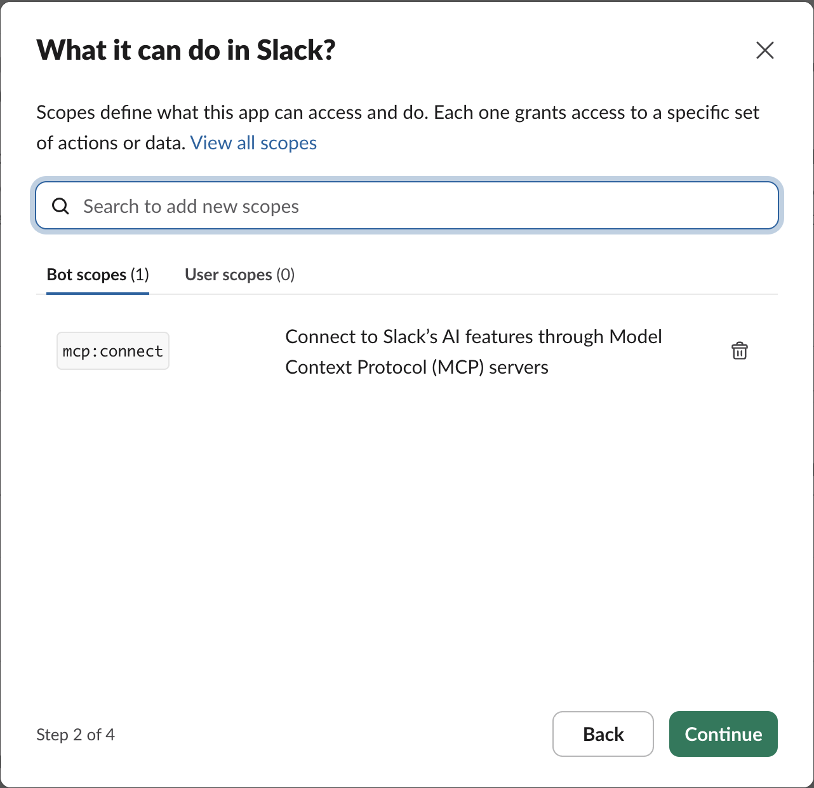
    </Frame>
  </Step>
  <Step title="Finish creating">
    In the step "What it can respond to" you add nothing, click **Continue**. The review says **What it can do in Slack (1)**. Click **Create and Install**.

    <Frame>
      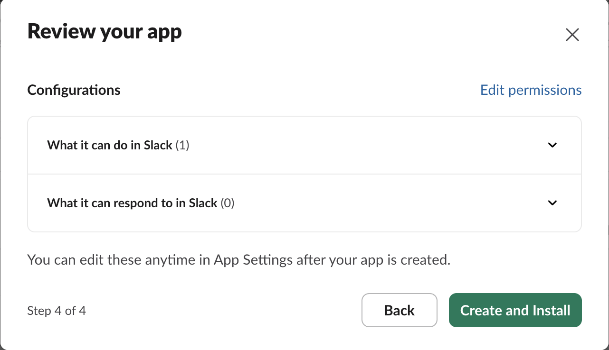
    </Frame>

    If the button stays grey longer than expected, open `https://api.slack.com/apps`. The app was probably already created.
  </Step>
</Steps>

### Step 3: add Izumi as an MCP server in the app

<Steps>
  <Step title="Open MCP Servers">
    In the app open **MCP Servers** in the left menu and click **Get Started** (or **Add MCP Server** if one exists already).

    <Frame>
      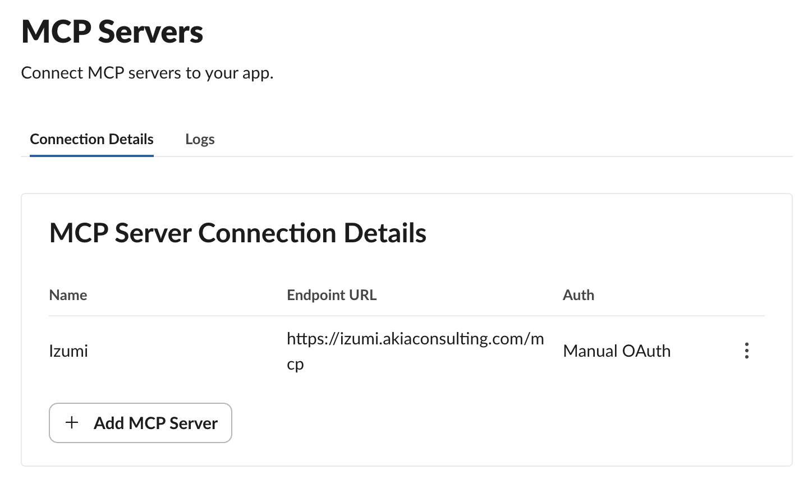
    </Frame>
  </Step>
  <Step title="Fill in the form">
    Slack adds the bot scope `mcp:connect` automatically.

    | Field | Value |
    |---|---|
    | Name | `Izumi` |
    | URL | `https://izumi.akiaconsulting.com/mcp` |
    | Auth type | **Manual OAuth** (not "Dynamic Client Registration") |
    | Client ID | the `client_id` from step 1 |
    | Client Secret | empty |
    | Authorization URL | `https://izumi.akiaconsulting.com/oauth/authorize` |
    | Token request URL | `https://izumi.akiaconsulting.com/oauth/token` |
    | Use HTTP Basic Authentication | off |
    | Use PKCE | on (required) |
    | OAuth scopes | `read` and `propose` (confirm each with Enter) |
    | Identity URL, Account Identifier, Custom headers | empty |

    <Frame>
      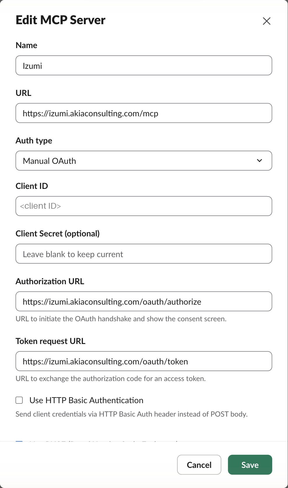
    </Frame>
    <Frame>
      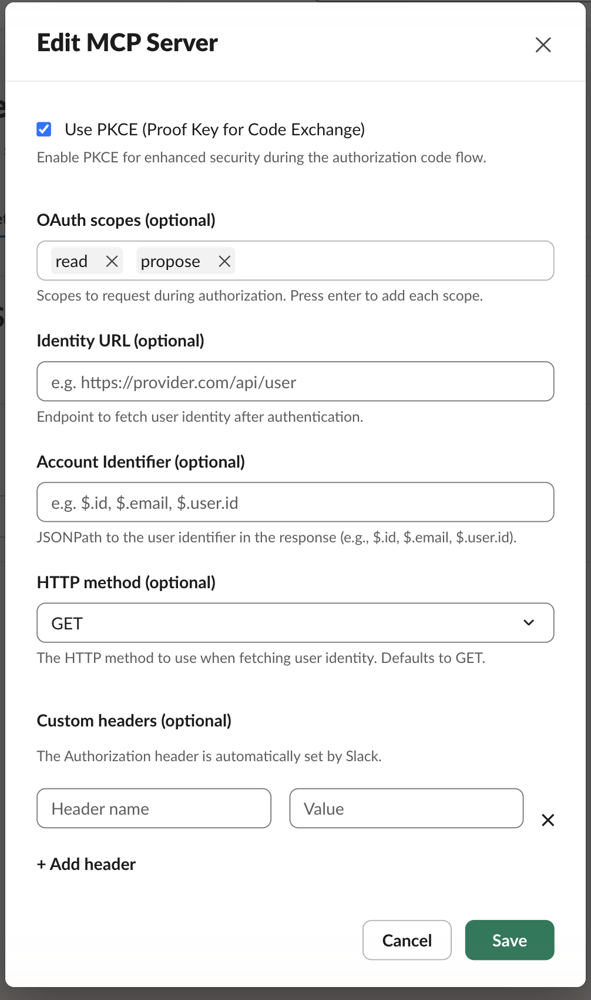
    </Frame>

    `read` is reading (search, documents). `propose` lets the app propose notes for review. If you do not need `propose`, keep only `read`.
  </Step>
  <Step title="Save">
    Click **Save**. A yellow bar "reinstall your app" appears. That is the next step.
  </Step>
</Steps>

### Step 4: (re)install the app in the workspace

<Steps>
  <Step title="Reinstall">
    Click **reinstall your app** in the yellow bar, or open **Install App** and click **Reinstall to** (the workspace name).
  </Step>
  <Step title="Allow">
    Slack shows "Allow Izumi to access Slack" with the message "Perform actions in your workspace". Click **Allow**. After that **Izumi** appears in Slack under **Apps** in the left menu.

    <Frame>
      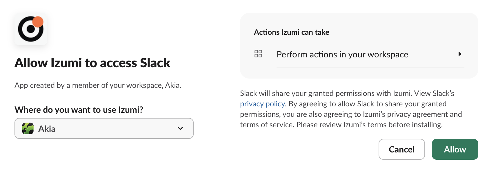
    </Frame>
  </Step>
</Steps>

Every change to the MCP server needs a new **Reinstall**. The **Install App** page shows the bot token (it starts with `xoxb`). It is a secret: do not share it and do not put it in images or guides. In the picture the token is covered.

<Frame>
  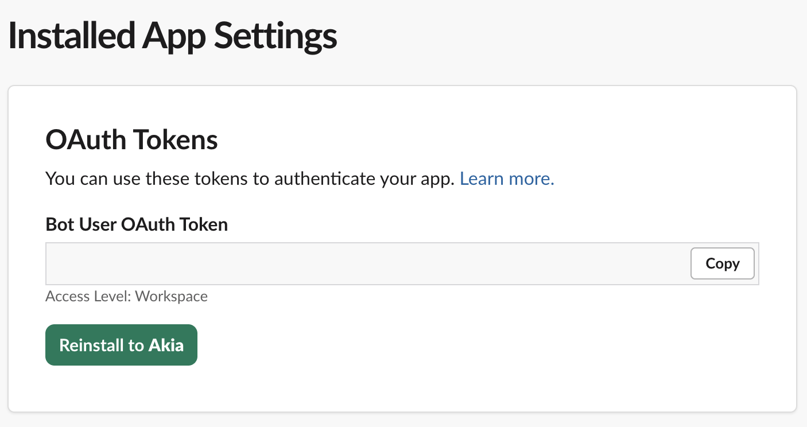
</Frame>

### Step 5: app appearance (optional)

In **Basic Information**, section **Display Information**: the name, a short description (for example "Izumi team knowledge base for Slackbot"), an icon (the orbit mark, PNG 512 px or larger) and a background color. The icon shows in Slackbot when it asks for permission.

<Frame>
  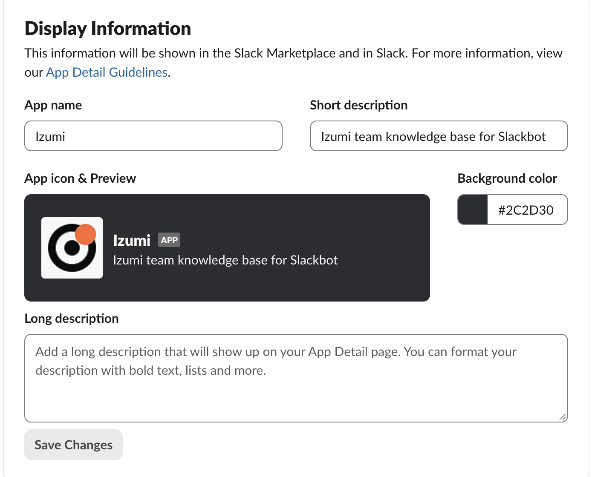
</Frame>

## Step 6: every user connects their Izumi account

Every person does this once.

<Steps>
  <Step title="Ask Slackbot something about Izumi">
    In the Slackbot panel ask a question that mentions Izumi, for example: "Via Izumi: who am I and which companies do I have access to?"
  </Step>
  <Step title="Click Connect">
    Slackbot shows the card "Connect your Izumi account to continue" with **Don't ask again**, **Not now** and **Connect**. Click **Connect**.

    <Frame>
      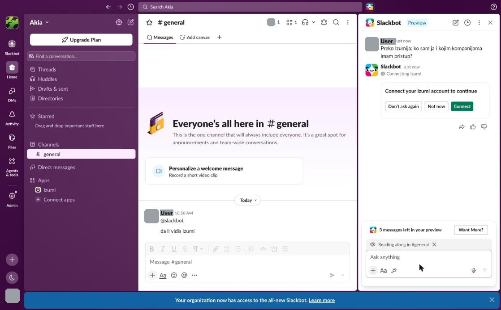
    </Frame>
  </Step>
  <Step title="Continue to Izumi">
    A new tab opens: "You are about to connect to an external service", with your Slack account. Click **Continue to Izumi**.

    <Frame>
      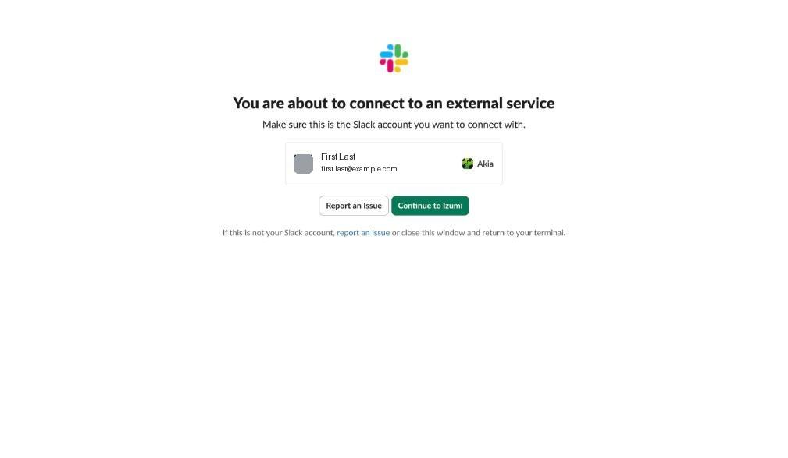
    </Frame>
  </Step>
  <Step title="Sign in to Izumi">
    If you are not signed in, Izumi shows the sign-in first. Sign in with the account you usually use.

    <Frame>
      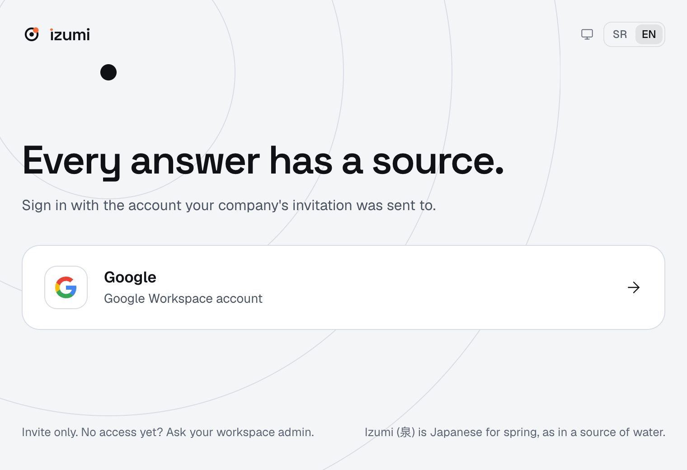
    </Frame>
  </Step>
  <Step title="Approve the connection">
    Izumi shows the page "Connect (client name) to Izumi". The name is the one the administrator gave the client in step 1.

    - A warning that the app's name comes from the app itself and is not verified, and that after you approve you go back to `oauth2.slack.com`.
    - **read the documents you can read, in all your companies** (always on) and **suggest notes that an editor reviews** (a tick, you can turn it off).
    - The connection lasts 90 days.
    - Click **Approve**.

    <Frame>
      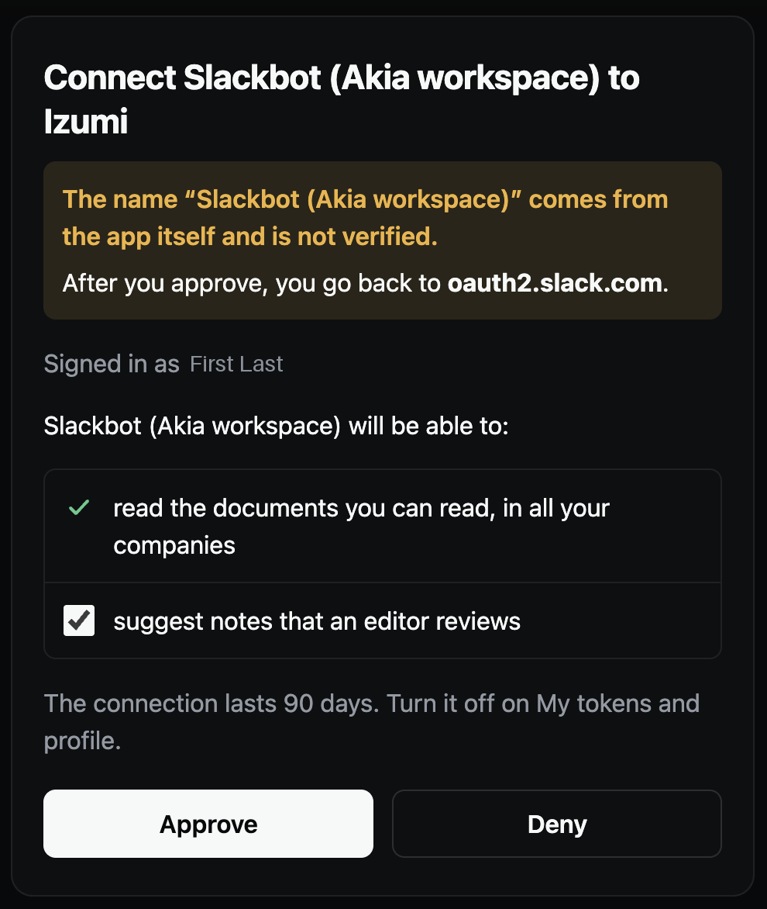
    </Frame>
  </Step>
  <Step title="Allow the tool">
    The tab closes, you return to Slack and the question continues. On the first tool call Slackbot asks for permission (**Whoami**, **Search**): **Allow Once** (this time only), **Always Allow** or **Don't Allow**. To start, choose **Allow Once**.

    <Frame>
      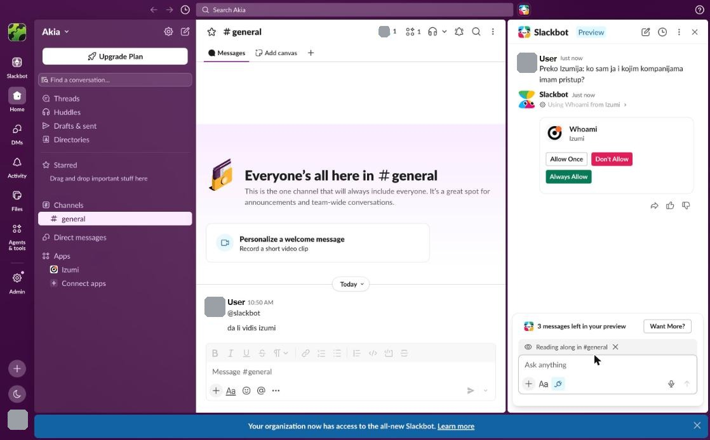
    </Frame>
  </Step>
  <Step title="Read the answer">
    Slackbot answers with a link to the document in Izumi.

    <Frame>
      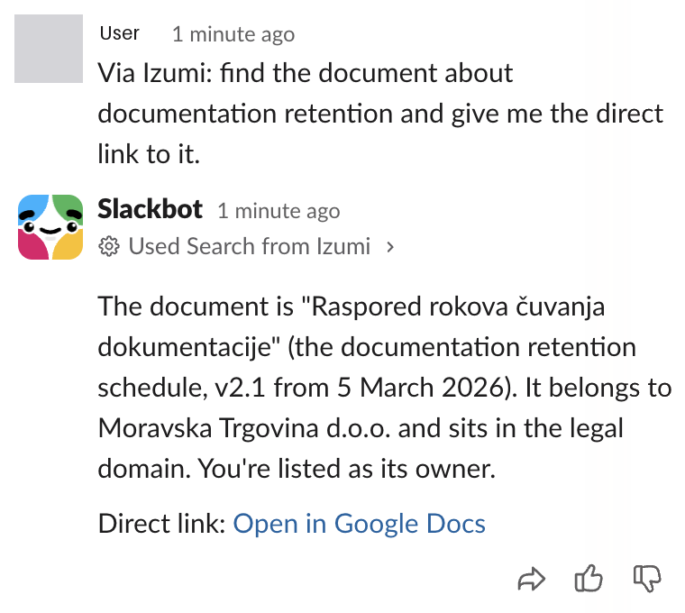
    </Frame>
  </Step>
</Steps>

<Info>
The Slackbot screenshots in step 6 show a question and an answer in Serbian, because the check ran with a Serbian question.
</Info>

Example questions:

- "Via Izumi: find the document about (topic) and give me the link."
- "Via Izumi: who in the company knows about (topic)?"
- "Via Izumi: propose a note in the domain (domain) with the title (title) and the text (text)."

### A note proposal from Slackbot

Proposing was checked live (Izumi 0.5.2, 2026-11-19). The proposal appeared in the **Review queue**, with the client name from step 1, and an editor of the domain rejected it with a reason. For approving and rejecting, see the ChatGPT page, the section about the proposal in Izumi.

## See and revoke

In Izumi open **My tokens and profile**, section **Tokens**. The connected app is a row marked **Connected app** with scopes (`read`, `propose`), expiry date and last use. **Revoke** ends the connection.

<Frame>
  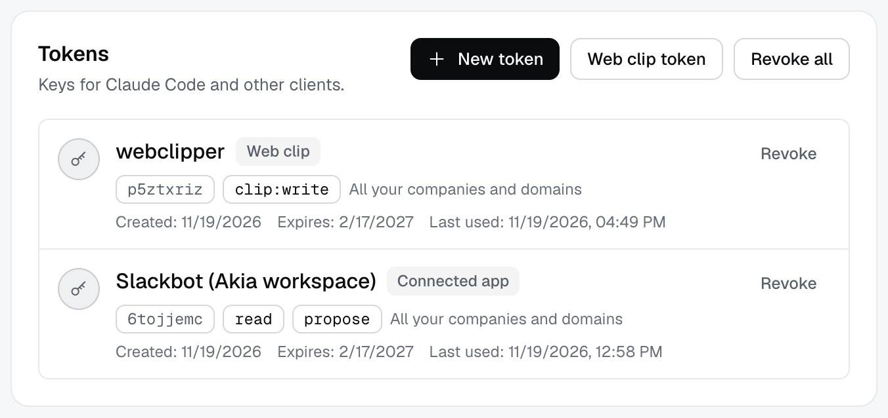
</Frame>

## Limits

| What | Details |
|---|---|
| Automatic registration does not work | Slack sends `token_endpoint_auth_method=client_secret_post`. Izumi accepts only `none` and `private_key_jwt`, so Slack reports "Automatic registration did not go through". That is why the client is registered by hand (step 1). |
| Slackbot Preview has a message limit | The panel shows "N messages left in your preview". An answered question uses one message, a connection request does not. What happens when they run out is not confirmed. |
| A link to an uploaded document asks you to sign in | The link opens in Izumi after sign-in. Slackbot cannot open it on the user's behalf. |
| Restricted documents | Slackbot sees only what the user may see. For a document with a restriction label (for example HR) the answer says who may read it. |
| A document with a source | The link is the source link (for example Drive). If the user has no access to the source, the link is no use. The Izumi page is then the alternative. |
| Every change to the MCP server | Needs a new **Reinstall**. |

## Troubleshooting

| Symptom | Cause and fix |
|---|---|
| Slackbot does not mention Izumi tools | The app was not reinstalled after the MCP server changed (step 4). Check that **Izumi** is under **Apps**. |
| "Connect" opens an error about the redirect address | The client's redirect in Izumi is not `https://oauth2.slack.com/external/auth/callback` (step 1). |
| Izumi refuses the `client_id` | A wrong or removed client. `./tb admin oauth client list`. |
| An error when the code is exchanged (token) | Turn off "Use HTTP Basic Authentication", turn on PKCE, leave Client Secret empty. |
| Tools work but there are no documents | The user has no access to a company or domain in Izumi. `whoami` shows companies and roles. |
| No answer for a long time | Check `https://izumi.akiaconsulting.com/readyz`. The administrator looks at the application log on the server. |
| Slack says "Something went wrong" while creating the app | Wait and try again. If it says "creating apps too quickly", wait. |
| Cancel on the screen "Allow Izumi to access Slack" | Slack shows "Something went wrong when authorizing". That is the normal behavior of declining, the existing installation does not change. |
