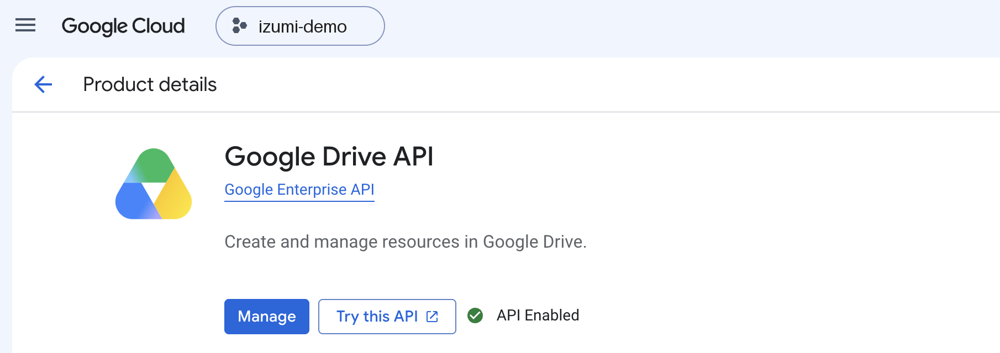
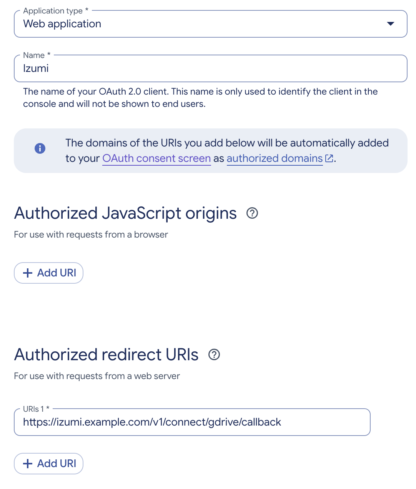
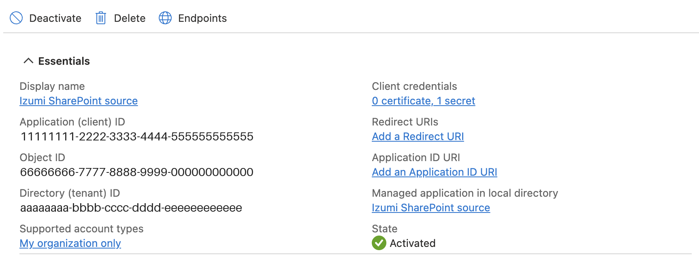
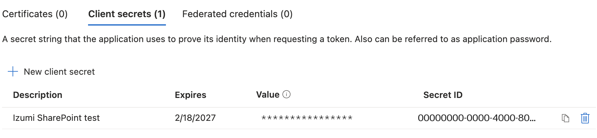
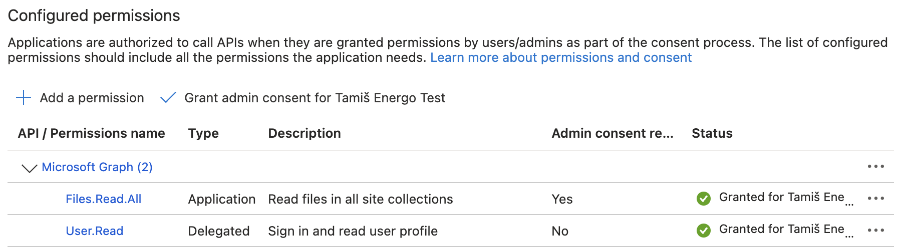

Checked on Izumi 0.5.7, 2026-11-21 (code and production, read only).

Connectors let Izumi read documents from Google Drive and SharePoint. This page describes the operator and server side: the Google Cloud client, the Microsoft app registration and the variables in `.env`. The dialog in Izumi where a company admin connects a source is in the Administration tab: [Google Drive](/en/admin/sources-drive) and [Microsoft 365](/en/admin/sources-microsoft).

## What applies to both connectors

- Izumi only reads. It never changes files.
- The connector credentials (refresh token, client secret) are stored encrypted with the company key, which is wrapped with `TB_MASTER_KEY`. They are never shown again.
- A source is connected in the app: it is created, connected, roots and rules are chosen, then a trial pass and the first sync are done.
- The server needs the external hosts of that connector, see the table in [Running offline](/en/install/offline).

## Google Drive

`drive.readonly` is a restricted scope. A server-side app that stores such data needs Google verification and an annual security assessment, unless it is internal to one organization. That is why there are two ways.

### Install client (default)

One OAuth client for the whole install. A company admin connects Drive with just the source name.

<Steps>
  <Step title="Put the client into .env">
    `TB_GDRIVE_CLIENT_ID` and `TB_GDRIVE_CLIENT_SECRET`, both or neither. Both `app` and `worker` read them.
  </Step>
  <Step title="Apply the change">
    ```
    docker compose up -d app worker
    ```
  </Step>
  <Step title="Check that the app sees it">
    The response of `GET /v1/status` has `connectors.gdrive_instance_client` as `true` or `false`, never the ID or the secret, but only a signed-in company admin sees it (everyone else gets 404), so a plain `curl` from the server does not help. The check in the app: without a client the Drive source form opens the section for an own client and asks for it.
  </Step>
</Steps>

What to expect while Google has not verified the app:

- The consent screen shows a warning that Google has not verified the app. The user chooses `Advanced`, then continues.
- At most 100 Google accounts can ever give consent.
- A Google Workspace administrator can block unverified apps. That company then uses its own client (below).
- Plan the verification and the annual security assessment before the third paying client or when you get close to the 100-account limit.
- Changing the client secret does not require reconnecting (the worker reads it at every refresh). Changing the client ID itself requires reconnecting every source on it.
- A source that was connected with an own `client_id` equal to the install ID stored that client's secret with the token: keep the old secret enabled until that source is reconnected.

### A company's own client (Internal, no warning)

For a company with Google Workspace, in a project that belongs to its organization. There is no verification, no 100-account limit.

<Steps>
  <Step title="Create a project">
    In the client's Workspace organization create a Google Cloud project (the client's administrator or someone allowed to create projects).
  </Step>
  <Step title="Turn on the Drive API">
    `APIs and Services`, `Library`, turn on `Google Drive API`.

    <Frame>
      
    </Frame>
  </Step>
  <Step title="Set up the consent screen">
    `OAuth consent screen`: user type `Internal`, scope `https://www.googleapis.com/auth/drive.readonly` and nothing else.
  </Step>
  <Step title="Create an OAuth client">
    `Credentials`, `Create credentials`, `OAuth client ID`, type `Web application`, redirect URI exactly `<TB_PUBLIC_URL>/v1/connect/gdrive/callback`.

    <Frame>
      
    </Frame>
  </Step>
  <Step title="Give the client to the company admin">
    The company admin in Izumi creates the source and enters the client ID in the **OAuth client of your own (advanced)** section. The client secret is entered once when connecting: it is stored encrypted with the token. The dialog is described in [Google Drive](/en/admin/sources-drive).
  </Step>
</Steps>

If connecting ends with an error and the access record row `source.connect` says `discovery_failed`, most likely the Drive API is not turned on in that client's project (step 2). The app log has the line `gdrive connect: discovery failed` with the HTTP status.

If an account revokes the app (`myaccount.google.com/permissions`), the source shows **Reconnect required**. Nothing is deleted and reconnecting continues without re-embedding everything. A source on the install client is reconnected with one click, and one with an own client asks for its secret again.

## SharePoint and OneDrive: Microsoft Graph

The company's IT registers an app in its own Entra tenant. The whole procedure with images is in [Microsoft 365](/en/admin/sources-microsoft). In short, for the operator:

- App type: single tenant, no redirect URI.
- Permission: `Microsoft Graph`, `Application permissions`, `Files.Read.All` (the default), then `Grant admin consent`.
- The client secret has an expiry: write it down. When it expires, the source shows **Reconnect required**.
- In Izumi the company admin enters the tenant ID, the app ID, the secret and the library (site address or drive ID).

<Frame>
  
</Frame>

<Frame>
  
</Frame>

<Frame>
  
</Frame>

- The image also shows `User.Read` (Delegated): Entra adds it to a new registration by itself and it can stay.
- With `Files.Read.All` the app sees the libraries of all sites in the tenant. Izumi imports only the library and folders the admin chooses.
- On the test tenant `Files.Read.All` found the site root even without a library ID. For a site below the root the form asks for the drive ID (from the code).
- The permission `Sites.Selected` has not been checked with an import. Use `Files.Read.All`.

## Limits

- Access in Izumi is decided by domains and roles, not by sharing in Drive or SharePoint.
- The install Google client has a limit of 100 accounts and a warning until it is verified.
- The Microsoft source form does not show the expiry of the client secret.

## Troubleshooting

| What you see | What to check |
|---|---|
| Connecting to Google fails, `source.connect` says `discovery_failed` | The Drive API is not turned on in the OAuth client's project. |
| The Drive source form asks for an own client | The response of `GET /v1/status` (company admin, signed in) says `gdrive_instance_client: false`: `TB_GDRIVE_CLIENT_ID` and `TB_GDRIVE_CLIENT_SECRET` are not set, or you did not run `docker compose up -d app worker`. |
| Google says the app is not verified | Expected for the install client. The user chooses `Advanced` and continues, or the company uses its own client. |
| A Microsoft source shows **Reconnect required** | The client secret expired or was revoked: create a new one and enter it in the source. |
| `Grant admin consent` does not go through right away | Wait a few minutes (propagation) and try again. |
