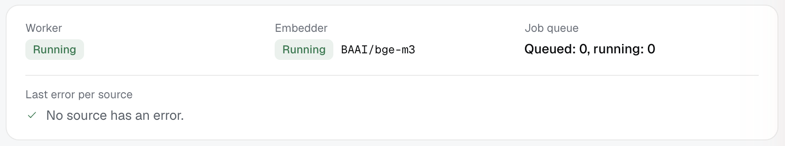

Checked on Izumi 0.5.7, 2026-11-21: `./tb status` and `/metrics` live on a throwaway stack, and `/healthz`, `/readyz` and `/metrics` without a token also on production.

Izumi has two public health checks, a list of metrics for Prometheus, the `./tb status` command and a status block in the app. Nothing is sent outside the server.

## Health checks

- `GET /healthz`: the process is running. Answers 200.
- `GET /readyz`: 200 when the database is reachable, the migrations are current, the embedder answers and the worker heartbeat is younger than 2 minutes. Otherwise 503. The body has `checks` for `db`, `schema`, `embedder` and `worker`.

```
curl -s https://brain.example.com/healthz
curl -s https://brain.example.com/readyz
```

On production: `/healthz` returns 200, and `/readyz` returns `{"ok":true,"checks":{"db":true,"schema":true,"embedder":true,"worker":true}}`.

## Metrics (/metrics)

`GET /metrics` returns Prometheus text with the header `Authorization: Bearer <TB_METRICS_TOKEN>`.

- Without `TB_METRICS_TOKEN` set: 404 (the same as an unknown address).
- Without the header or with a wrong token: 401, and it counts as a failed token check (`tb_auth_failures_total`). When the gate is full, the answer is 429.
- Production has a token: a call without the header returns 401.
- The response carries no company name, person, title or path.

Some of the metrics:

- `tb_http_request_duration_seconds`, `tb_mcp_tool_duration_seconds`, `tb_embed_duration_seconds`
- `tb_ingest_queue_depth`, `tb_jobs`, `tb_source_errors`
- `tb_auth_failures_total`, `tb_audit_rows_last_minute`
- `tb_oauth_cimd_fetch_total` (by host and outcome, see [OAuth](/en/install/oauth))

## The ./tb status command

```
./tb status
```

It shows the containers (`docker compose ps`), readiness (`readyz: ready` or `readyz: not ready`), the active embedder model (`active embed model: ...`) and the age of the last backup (`last backup: <file> (<n> h ago)`). Set an alarm for a backup older than one day.

## Status in the app

A company admin sees a status block at the top of the **Sources** page: whether the worker and the embedder are running, how many jobs are waiting and running, and the last error per source.

<Frame>
  
</Frame>

## Logs and disk

- `docker compose logs app worker`: logs are JSON lines, the level is set by `TB_LOG_LEVEL`. No secret is written to the log.
- Disk: `df -h` and `sudo du -sh backups`.

## Limits

- `/metrics` is not available without `TB_METRICS_TOKEN`.
- Izumi does not send alarms: you set up alarms in your own monitoring tool.

## Troubleshooting

| What you see | What to check |
|---|---|
| `/readyz` 503 | The body says which `checks` is `false`. `docker compose ps`, then `docker compose logs` of that service. |
| `/metrics` answers 404 | `TB_METRICS_TOKEN` is not set in `.env`. |
| `/metrics` answers 401 | The `Authorization: Bearer ...` header is missing or the token is wrong. |
| `worker` is `false` in `/readyz` | The worker heartbeat is older than 2 minutes: `docker compose logs worker`. |
