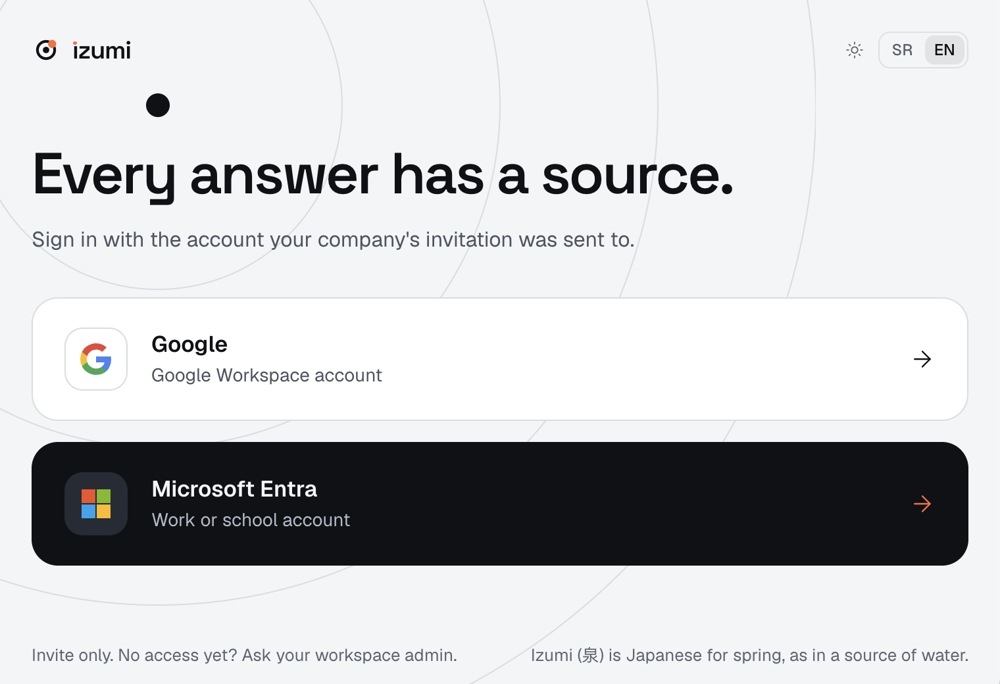
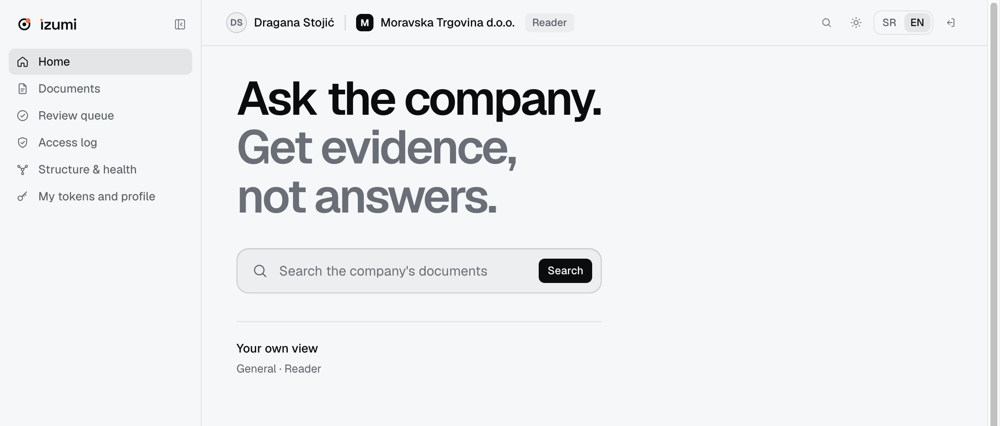
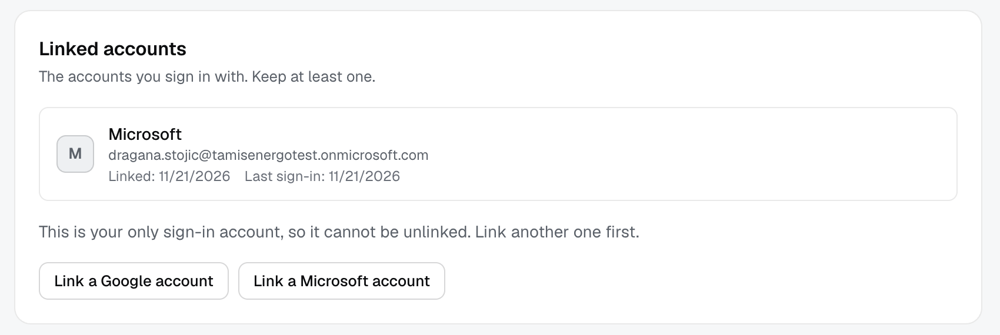

Checked on Izumi 0.5.7, 2026-11-21 (code and production, read only).

Izumi has no passwords. People sign in with a Google or Microsoft (Entra ID) account. Here you set up those two sign-ins on the server. Sign-in for reading documents from Drive or SharePoint is a different thing: you set that up in [Connectors](/en/install/connectors).

## How it works

- A provider shows up on the sign-in page only when both its client ID and its secret are set. An ID without a secret (or the other way round) stops the app at start.
- The redirect URIs are exactly `<TB_PUBLIC_URL>/v1/auth/google/callback` and `<TB_PUBLIC_URL>/v1/auth/entra/callback`, without a trailing slash.
- After every change to `.env` run `docker compose up -d app`.
- When no provider is set up, the sign-in page says _"Sign-in is not set up yet. Ask the operator of this installation."_

<Frame>
  
</Frame>

The image is the production sign-in page, where Google and Microsoft Entra are set up. The Microsoft tile is dark on purpose.

## Google

<Steps>
  <Step title="Create an OAuth client">
    In the Google Cloud console open `APIs and Services`, `Credentials`, `Create credentials`, `OAuth client ID`, type `Web application`.
  </Step>
  <Step title="Add the redirect URI">
    Under `Authorized redirect URIs` add `<TB_PUBLIC_URL>/v1/auth/google/callback`.
  </Step>
  <Step title="Put the ID and secret into .env">
    The client ID goes into `TB_OIDC_GOOGLE_CLIENT_ID` and the secret into `TB_OIDC_GOOGLE_CLIENT_SECRET`. Then `docker compose up -d app`.
  </Step>
</Steps>

- The scopes are `openid email profile`.
- Izumi trusts only addresses that Google has verified.

## Microsoft (Entra ID)

<Steps>
  <Step title="Create an app registration">
    In the Entra admin center open `App registrations`, `New registration`. For the default `TB_OIDC_ENTRA_TENANT=organizations` choose `Accounts in any organizational directory`. For a single tenant choose one tenant and put its GUID into `TB_OIDC_ENTRA_TENANT`. Personal Microsoft accounts are rejected.
  </Step>
  <Step title="Add the redirect URI">
    Under `Authentication` add the platform `Web` with the address `<TB_PUBLIC_URL>/v1/auth/entra/callback`.
  </Step>
  <Step title="Create a client secret">
    Under `Certificates & secrets` create a client secret. Its `Value` (not the `Secret ID`) goes into `TB_OIDC_ENTRA_CLIENT_SECRET`, and the `Application (client) ID` goes into `TB_OIDC_ENTRA_CLIENT_ID`. Write down the secret's expiry date.
  </Step>
  <Step title="Add the optional claim email">
    Under `Token configuration` add the optional claim `email` to the ID token. Without it Izumi compares `preferred_username` with the invitation, which can differ from the invited address.
  </Step>
  <Step title="Restart the app">
    `docker compose up -d app`. The Microsoft button appears on the sign-in page.
  </Step>
</Steps>

This app is only for signing people in. The app registration for reading SharePoint is separate and has different permissions: see [Connectors](/en/install/connectors).

## Who can sign in

- Sign-in needs an invitation. Invitations are created by a company admin in the app, see [People and invitations](/en/admin/people).
- Every company can restrict who may accept an invitation (allowed Google domains, allowed Microsoft tenants) in its settings, see [Companies, domains, roles](/en/admin/companies-domains-roles).

## What a Microsoft sign-in looks like
After the person signs in with the Microsoft account (and does the multi-factor step your tenant asks for), Izumi opens **Home** for that person. The images are from a test tenant with a member who has the role Reader in one domain.
<Frame>
  
</Frame>
On **My tokens and profile** the section **Linked accounts** shows the Microsoft account with the date it was linked and the last sign-in. A person with a single account cannot unlink it; they can link a Google or Microsoft account first.
<Frame>
  
</Frame>
## Limits

- Sign-in with a Microsoft account was checked live on Izumi 0.5.8 on 2026-11-21, on a test tenant with a single-tenant app registration: an admin and two members signed in from invitations, a later invitation worked, and sign-out returned to the sign-in page. Not checked live: the default `organizations` setting and the rejection of a personal Microsoft account (Microsoft's own rule for work accounts only). Go through the flow once on your own tenant before you offer it to a company.
- Signing out of Izumi does not sign you out of Microsoft. Since Izumi 0.5.9 the Microsoft button always opens Microsoft's account picker ("Pick an account"), so the last account is no longer signed in silently. Checked live on 0.5.9 on 2026-11-21: after signing out of Izumi, the button showed the picker with the account still marked "Signed in". On a shared computer the next person picks or adds their own account; to end the Microsoft session itself, sign out of Microsoft too, or use a private window.
- The app has no password sign-in and no other provider.

## Troubleshooting

| What you see | What to check |
|---|---|
| The app stops at start | An ID without a secret or a secret without an ID is set for Google or Entra. Both or neither. |
| A provider does not show on the sign-in page | Neither of the two fields is set, or you did not run `docker compose up -d app` after the change. |
| The provider returns an error about the redirect address (Google: `redirect_uri_mismatch`) | The address in the Google or Entra app is not exactly `<TB_PUBLIC_URL>/v1/auth/<provider>/callback`, without a trailing slash. |
| An invited person sees _"This company does not allow sign-in from this account (its allowed domains or tenants). Ask a company admin."_ | Their Google domain or Microsoft tenant is not on the list in the company settings. |
| An invited person sees _"This account does not match the invitation. Open the invitation link again and sign in with the invited account."_ (or the same with the address) | They signed in with an account whose address was not invited. With Microsoft also check whether the optional claim `email` is missing: add it under `Token configuration`. |
