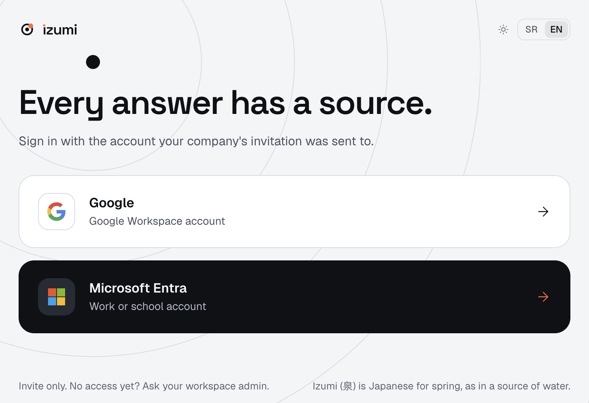
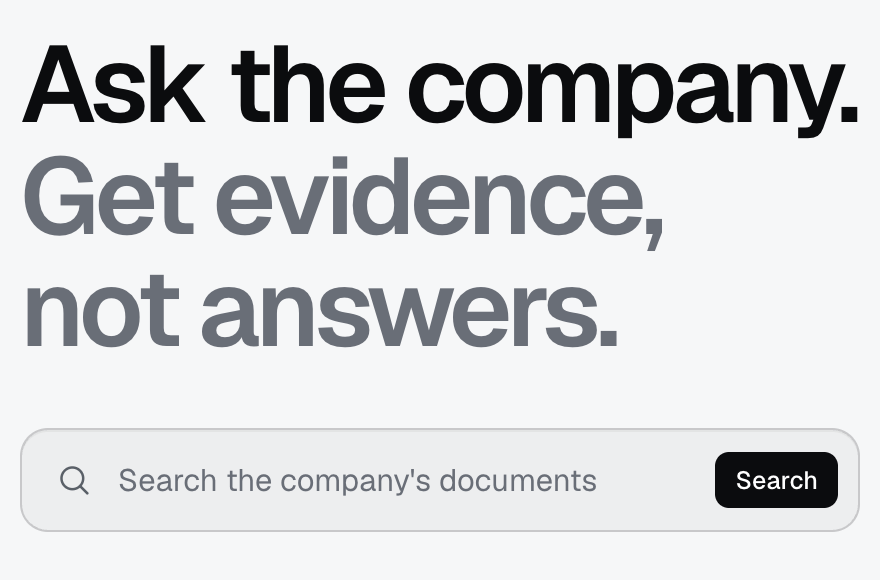

Checked on Izumi 0.5.7, 2026-11-21.

From invitation to your first answer in a few minutes. This is the path of a user in a company that already runs Izumi. Installation and the first admin sign-in are in the [Installation](/en/install/requirements) tab.

<Steps>
  <Step title="Get an invitation">
    A company admin creates the invitation and sends you the link. It is valid for 72 hours and works once.
  </Step>
  <Step title="Sign in">
    Open the link and sign in with the Google or Microsoft work account that has the invited address.

    <Frame>
      
    </Frame>
  </Step>
  <Step title="Search">
    On **Home**, type a question and press Enter. Open a result with the eye icon (**Preview**): you see the passage and the path to it, and **Copy citation** copies it. Details: [Search](/en/using/search).

    <Frame>
      
    </Frame>
  </Step>
  <Step title="Connect an AI tool">
    Pick ChatGPT, Claude, Claude Code or Slack on the [AI tools overview](/en/ai-tools/overview). For ChatGPT, Claude and Claude Code, you enter the server address (your Izumi address with `/mcp` at the end), sign in to Izumi and approve the connection. In ChatGPT and Claude, you then turn Izumi on in a chat. ChatGPT Free and Claude Pro have been checked. Slack is in Preview and has only been checked on a Free workspace. An Izumi server administrator and a Slack admin set it up once before you can connect.
  </Step>
  <Step title="Ask from the tool">
    You ask your AI tool, it calls Izumi and answers with the source. Example questions are on [Tools and example questions](/en/ai-tools/tools).
  </Step>
  <Step title="Check the log">
    Open the **Access log** and see what the AI tool asked on your behalf. Details: [My tokens and log](/en/using/tokens-and-log).
  </Step>
</Steps>

## Limits

- The AI tool picks which Izumi tool to call. The result is the closest, not proven: read the passage.
- An OAuth connection to an AI tool lasts 90 days, after which the tool asks you to connect again. A personal token lasts at most 90 days.
- Cursor, Windsurf, Cline, VS Code, Zed and Continue have not been tested.

## Troubleshooting

- The invitation link does not work. It has expired (72 hours), was already used or the admin revoked it or replaced it with a new invitation (from the code). Ask the admin for a new invitation.
- You know a document exists, but you do not see it. You have no role in its domain. Ask a company admin.
- The AI tool says it has no Izumi tools, or asks you to connect again. The connection is not turned on in that chat, has expired or was revoked. Follow the steps on that tool's page. After a revoke, Slackbot does not ask you to connect again, see [Slack](/en/ai-tools/slack).
- Problems in Izumi are on the [Troubleshooting](/en/using/troubleshooting) page, problems with an AI tool in the Troubleshooting section of that tool's page ([AI tools overview](/en/ai-tools/overview)).

## Next

- [Search](/en/using/search), [My tokens and log](/en/using/tokens-and-log) and [How access works](/en/overview/access).
