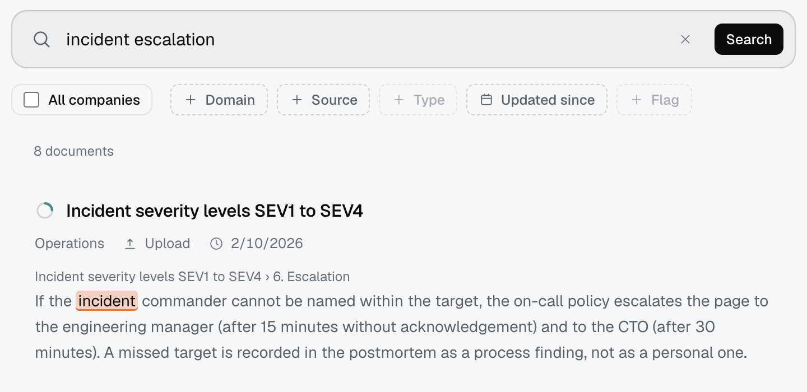

Checked on Izumi 0.5.7, 2026-11-21.

Izumi is a shared knowledge layer for a company. You ask, and Izumi returns passages from your company's documents, with the source, author and freshness. Izumi does not write the answer. You, or the AI tool you use, put the answer together.

<Frame>
  
</Frame>

## What you get

- Search on **Home**. You type a question in Serbian or English, in Latin or Cyrillic script. You get documents and passages, only from domains where you have a role.
- Questions from the AI tools you already use: ChatGPT, Claude (claude.ai and Claude Desktop), Claude Code and Slackbot. You do not open a separate app.
- Only what you may see. The company is the data boundary, a domain is an area of knowledge, and a role binds a person to a domain. The same holds for an AI tool you connect.
- Note proposals. An AI tool can propose a note, and the editor of the domain approves or rejects it in the **Review queue**. Until it is approved, nobody finds it by search.
- An overview of the knowledge: the **Documents** list and **Structure & health**, a map that shows where knowledge comes from and how fresh it is, not the content itself.
- "Who knows": you ask your AI tool who in the company knows a topic and get a list of colleagues. It is a suggestion of whom to ask, not a guarantee (described from the code).

## Where the knowledge comes from

- Google Drive and SharePoint, read only. Izumi does not change files in Drive or SharePoint.
- Upload of Markdown (.md) and text (.txt) files, and a .zip of them. Other types are skipped (from the code).
- The push API, to send documents from other systems.
- Web clip: a Chrome or Edge extension saves the page you are reading, only when you press the button, and only into a domain where you are an editor.

## Who it is for

- Users search and connect an AI tool. Start with the [Quickstart](/en/overview/quickstart).
- Domain editors approve proposed notes.
- Company admins manage members, domains, sources and settings.
- Decision makers: [How access works](/en/overview/access) and [Security and data](/en/overview/security).

## Limits

- Search always returns the closest results, even for a nonsense query. The top result does not mean it matches: read the passage.
- Izumi does not write answers. From the code, it does not send email and does not delete documents by age.
- Cursor, Windsurf, Cline, VS Code, Zed and Continue have not been tested. For them there is a general page, [Other clients](/en/ai-tools/other-clients).

## Next

- [Search](/en/using/search), [Proposals and review](/en/using/proposals), [Who knows](/en/using/who-knows) and [Web clip](/en/using/web-clip) describe everyday work.
- The [AI tools overview](/en/ai-tools/overview) leads to connecting ChatGPT, Claude, Claude Code and Slack.
- Sources: [Google Drive](/en/admin/sources-drive), [Microsoft 365](/en/admin/sources-microsoft), [Upload](/en/admin/sources-upload) and [Push API](/en/admin/push-api).
