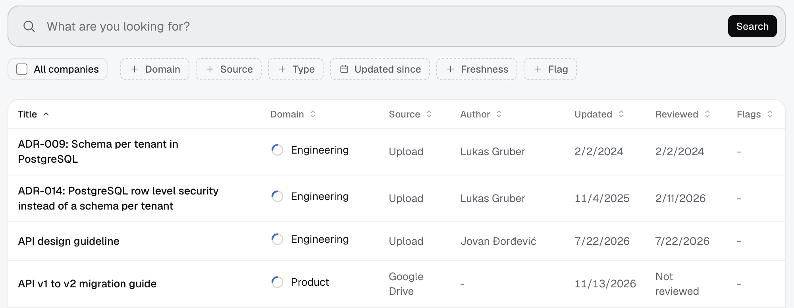
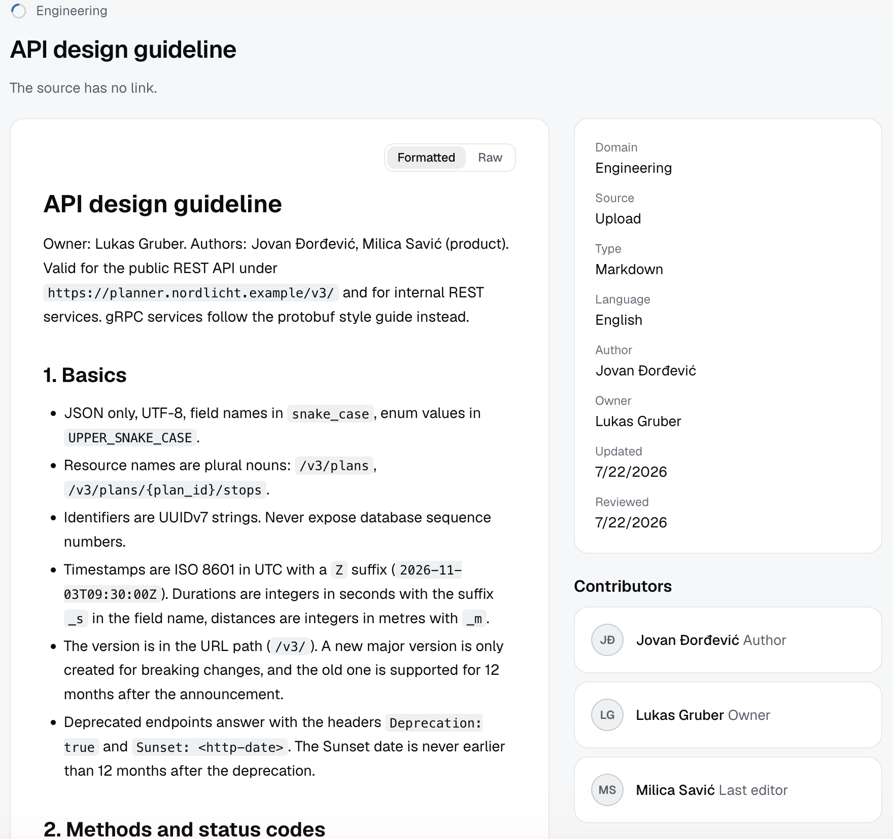
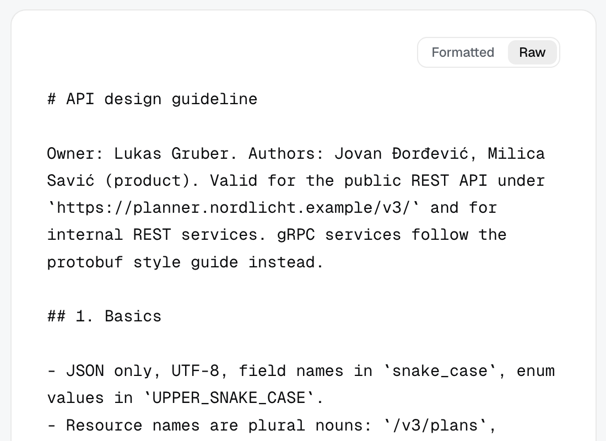

Checked on Izumi 0.5.7, 2026-11-20.

**Documents** is the list of every document you may see, with filters and sorting. From here you open a document and read its text.

## Browse the list

<Steps>
  <Step title="Open Documents">
    Click **Documents** in the left menu. The columns are **Title**, **Domain**, **Source**, **Author**, **Updated**, **Reviewed** and **Flags**. The newest come first by default. Click a column heading to sort by it (the screenshot is sorted by **Title**).

    <Frame>
      
    </Frame>
  </Step>
  <Step title="Sort and filter">
    Click a column name to sort the list. The filters above the list are the same as in search, plus **Freshness** (a document is stale when it is older than 180 days). The list loads 50 rows at a time, and **Load more** brings the rest.
  </Step>
  <Step title="Open a document">
    Click the title. You see the title, the domain, and **Open the source** (a link to the source, for example Google Drive; if the source has no link, it says "The source has no link."). On the right are the details: **Domain**, **Source**, **Type**, **Language**, **Author**, **Owner**, **Updated**, **Reviewed** and **Contributors**.

    <Frame>
      
    </Frame>
  </Step>
  <Step title="Choose how to read it">
    The **Formatted** switch shows headings, lists and tables. **Raw** shows the same text with its markup (`#`, `|`), the way Izumi stores and searches it. Use **Formatted** for reading. **Back to documents** returns to the list.

    <Frame>
      
    </Frame>
  </Step>
</Steps>

## Limits

- You only see documents from the domains where you have a role. The same holds for a company admin. An admin can view the list as another member (**Preview**).
- The circle in front of the domain is only a color tag for the domain, not a loading indicator.
- Web clips carry the labels **Web clip** and **Untrusted (web)**. Treat them as untrusted.
- A regular member does not see **Sources**, **Import report** and **Companies and members**. The left menu of a member (checked live) has **Home**, **Documents**, **Review queue**, **Access log**, **Structure & health** and **My tokens and profile**, and the list holds only the domains where they have a role.
- A table inside a PDF is shown as a table in the **Formatted** view (checked live as a member on a PDF with a staff directory).

## Troubleshooting

- _"Document not found."_ The document was removed, or you have no access to its domain.
- _"The document has no text."_ The source is empty, or Izumi could not read the text. Your company admin can see this in **Import report**.
- _"You have no role in any domain."_ Ask your company admin to give you a role.
- _A document you know exists is not in the list._ You have no role in its domain, or a filter is on. Remove the filters.
