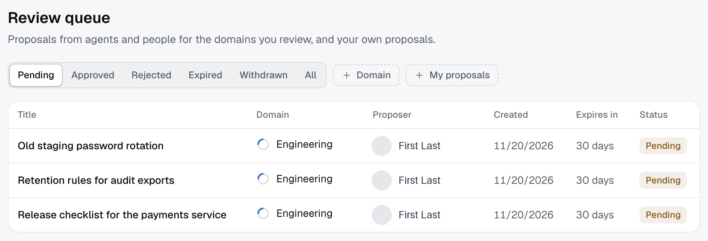
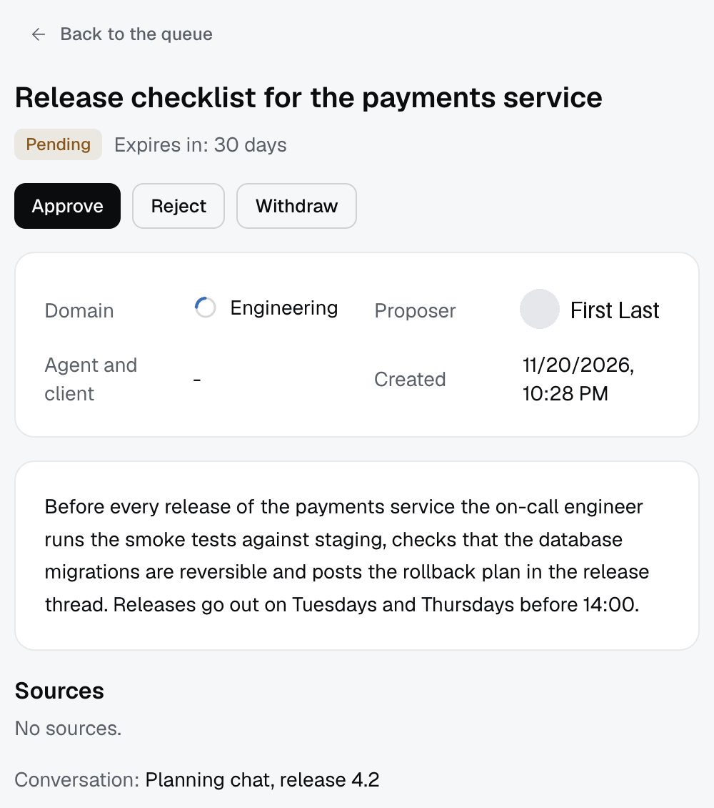
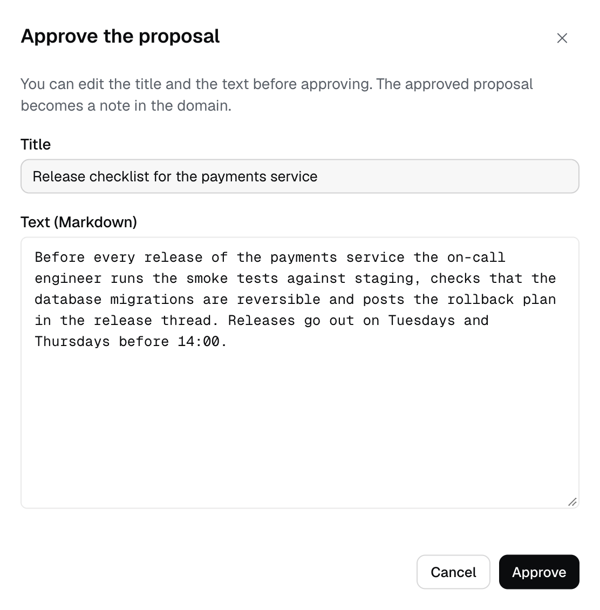
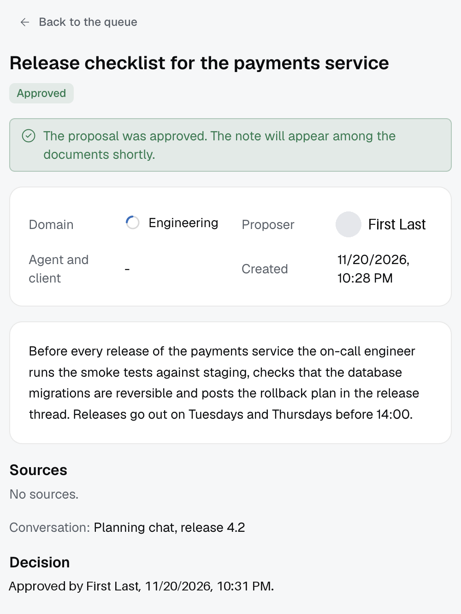
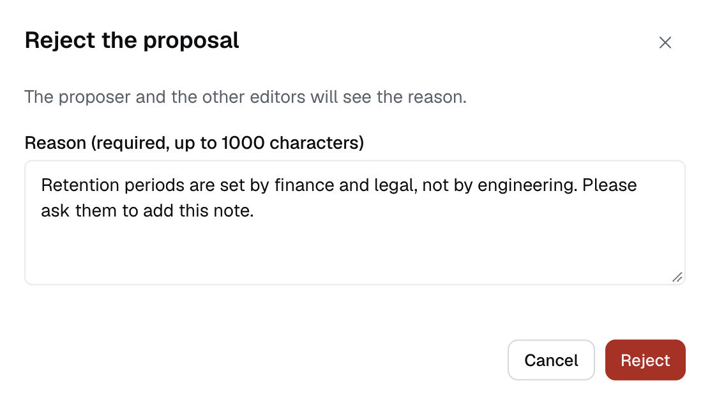
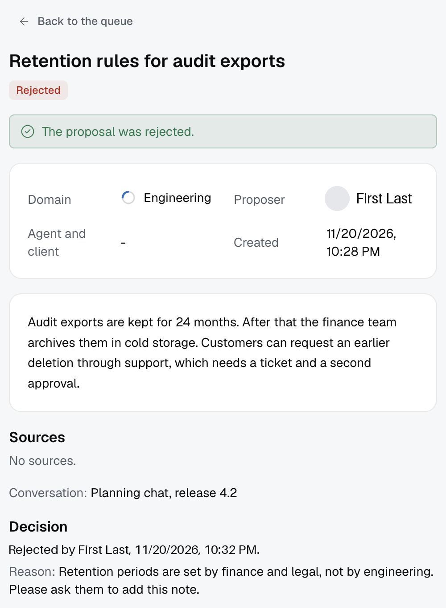
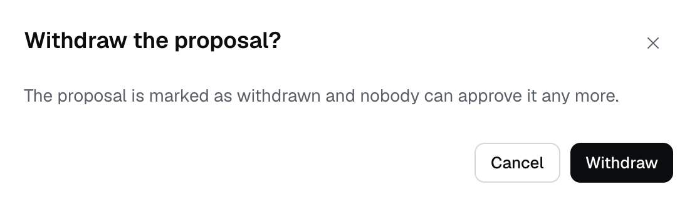
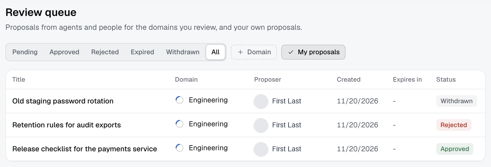
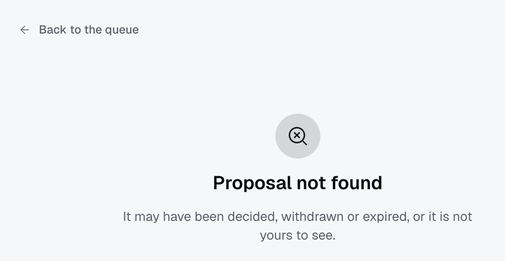

Checked on Izumi 0.5.7, 2026-11-20.

A proposal is a note that an AI tool (or a person through their token) suggests for one domain. The note is not searchable until an editor of that domain approves it. The **Review queue** is the list of all proposals: an editor decides in it, and a proposer follows their own proposals.

## Who does what

| Role | What they see in the **Review queue** | Buttons in the detail |
|---|---|---|
| Domain editor | proposals of their domains and their own proposals | **Approve**, **Reject**, and **Withdraw** if they are also the proposer |
| Member without an editor role and without proposals of their own | an empty queue; someone else's proposal opens **Proposal not found** | none |

- The **Review queue** is in the left menu for every member of the company.
- A company admin is not automatically an editor. Only an editor of a domain sees the proposals of that domain and decides on them.

## Review and decide

<Steps>
  <Step title="Open the queue">
    Click **Review queue**. The number next to the item shows how many proposals wait for your decision. At the top you pick a status: **Pending**, **Approved**, **Rejected**, **Expired**, **Withdrawn** or **All**. Extra filters are **Domain** and **My proposals**. The columns are **Title**, **Domain**, **Proposer**, **Created**, **Expires in** and **Status**.

    <Frame>
      
    </Frame>
  </Step>
  <Step title="Read the proposal">
    Click a row. You see the status and the deadline ("Expires in: 30 days"), then the details **Domain**, **Proposer**, **Agent and client** and **Created**. Below are **Proposal text**, **Sources** and **Conversation**.

    <Frame>
      
    </Frame>
  </Step>
  <Step title="Approve">
    Click **Approve**. The dialog has the fields **Title** (3 to 200 characters) and **Text (Markdown)** (20 to 20000 characters). The proposal gets the status **Approved**, and the note shortly appears in **Documents** with the **Note** label. The proposer is the author.

    <Frame>
      
    </Frame>
    <Frame>
      
    </Frame>
  </Step>
  <Step title="Or reject">
    Click **Reject**. A reason is required (up to 1000 characters), and the proposer sees it. No note is created and it never appears in search.

    <Frame>
      
    </Frame>
    <Frame>
      
    </Frame>
  </Step>
</Steps>

## Withdraw your own proposal

<Steps>
  <Step title="Click Withdraw">
    Open your proposal and click **Withdraw**. The dialog says the proposal will be marked as withdrawn and nobody can approve it any more.

    <Frame>
      
    </Frame>
  </Step>
  <Step title="Follow your proposals">
    Turn on **My proposals** and choose **All**. You see your proposals with their statuses and the reason for a rejection.

    <Frame>
      
    </Frame>
  </Step>
</Steps>

A withdrawn proposal stays visible to the proposer and the editor (through the link and through the status **Withdrawn** or **All**), but it can no longer be decided.

## When a proposal is not available

If you open a proposal you may not see, or one that does not exist, you see **Proposal not found**: "It may have been decided, withdrawn or expired, or it is not yours to see." This is normal behavior, not an error.

<Frame>
  
</Frame>

## Limits

- An approved proposal is searchable within a few minutes. A rejected or withdrawn proposal is never searchable.
- A proposal is valid for 30 days, and the deadline shows in the **Expires in** column.
- Izumi does not send email about proposals. An editor sees only the number next to **Review queue**, and the proposer sees the outcome when they open their proposal.
- An approved note cannot be deleted from the **Documents** list or from the document page.

## Troubleshooting

- _"There are no proposals for your domains."_ Nothing is pending, or you are not an editor of any domain and have no proposals of your own. Try **All** and **My proposals**.
- _"No proposal matches the filters."_ Remove the **Domain** filter or choose **All**.
- _Proposal not found._ The proposal was decided, withdrawn or expired, or it is not yours to review. Open it from the list with the status **All**, or ask the proposer.
- _"This proposal can no longer be decided."_ Someone already decided it, or the proposer withdrew it while your dialog was open. Refresh the list.
- _"The title needs 3 to 200 characters."_ and _"The text needs 20 to 20000 characters."_ Fix the fields in the **Approve the proposal** dialog.
- _"Enter a reason."_ In the **Reject the proposal** dialog a reason is required.
- _"The proposals could not be loaded."_ Refresh the page. If it keeps happening, tell your company admin.
- _An approved note is not found right away._ The message says "shortly". Wait a few minutes and search by words from the text.
