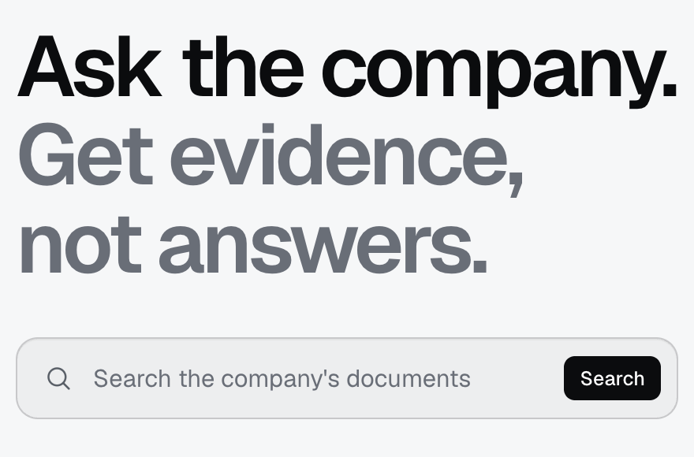
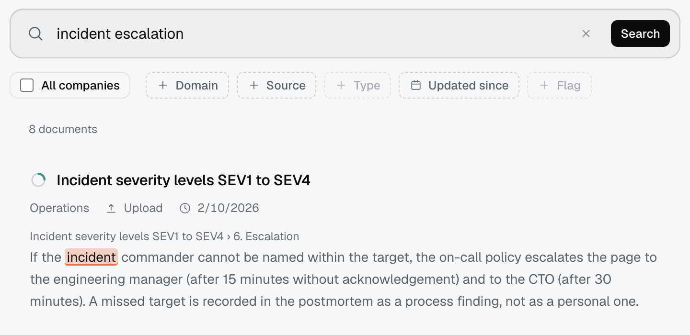
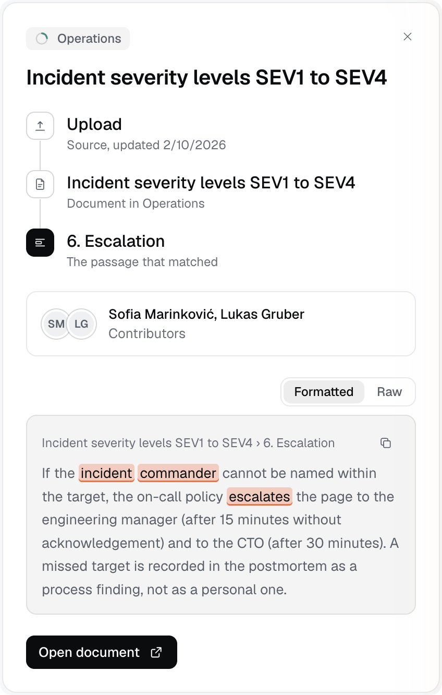
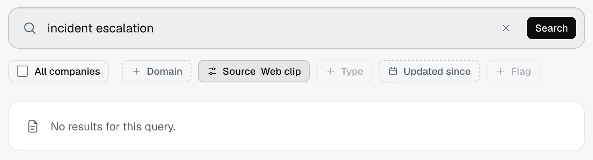

Checked on Izumi 0.5.7, 2026-11-20.

Search is the first screen in Izumi. You type a question, and Izumi returns the documents and passages that match, only from the domains where you have a role.

## Search from Home

<Steps>
  <Step title="Type a query">
    On **Home**, click the **Search the company's documents** field, type your query, and press Enter or **Search**. The query can be in English or Serbian, in Latin or Cyrillic script.

    <Frame>
      
    </Frame>
  </Step>
  <Step title="Read the results">
    **Documents** opens with your query and the number of documents found. Each result has a title, domain, source, date of last change, the path to the passage, and the passage itself. The words from your query are highlighted in orange.

    <Frame>
      
    </Frame>
  </Step>
  <Step title="Narrow the results">
    On the same screen you change the query and add filters: **Domain**, **Source**, **Type**, **Updated since**, **Flag**. **All companies** searches every company you belong to, and shows only when you are in more than one company.
  </Step>
  <Step title="Check the passage">
    Click the eye icon (**Preview**) on a result. A panel opens on the right with the path to the passage (source, document, passage), the contributors, and the passage with a copy icon (**Copy citation**). **Open document** takes you to the full page.

    <Frame>
      
    </Frame>
  </Step>
</Steps>

After an earlier search, **Home** shows a **Recent** list with a **Clear** button. It is kept only in your browser, not on the server.

## What you see when there are no results

If the filters exclude everything, you see "No results for this query." Remove the filters or change the query.

<Frame>
  
</Frame>

## Limits

- One search returns at most 8 documents. When the answer is too long, Izumi cuts it and shows _"The best results are shown; narrow the search with the filters."_ (checked live as a member).
- Search always returns the closest matches, even for a nonsense query. A result at the top does not mean it fits: read the passage.
- The query needs at least 2 characters.
- Highlighting follows the words in your query, not every related word.
- Diacritics do not get in the way: a query without č, ć, š, ž and đ returns the same results. A Cyrillic query finds Latin documents and the other way round, and an English query finds Serbian documents.
- You only see the domains where you have a role. What you may not see appears neither in the results nor in the count. The same holds for a company admin: they also see only the domains where they have a role.

## Troubleshooting

- _"No results for this query."_ Remove the filters or change the query. If that does not help, you may have no role in the domain that holds those documents.
- _"The query needs at least 2 characters."_ Type at least two characters.
- _"The search failed."_ Try again. If it keeps happening, tell your company admin.
- _The results are not what you were looking for._ Open the passage (eye icon) and check. Phrase the question the way the document does, or narrow it with the **Domain** filter.
- _You know a document exists, but you do not see it._ You have no role in its domain. Ask your company admin.
