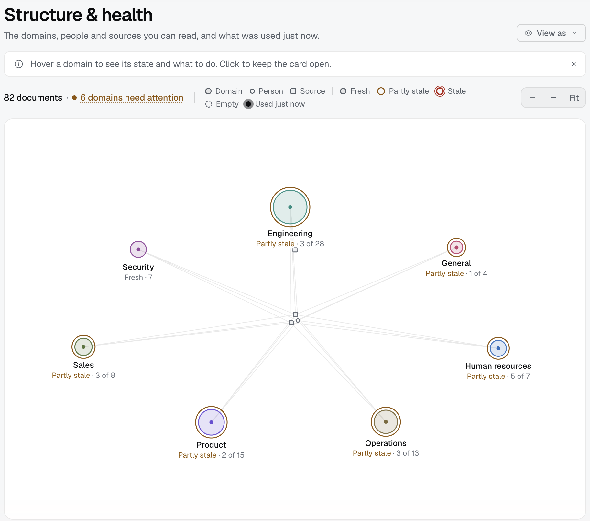
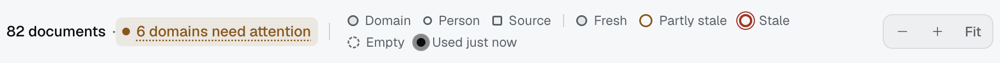
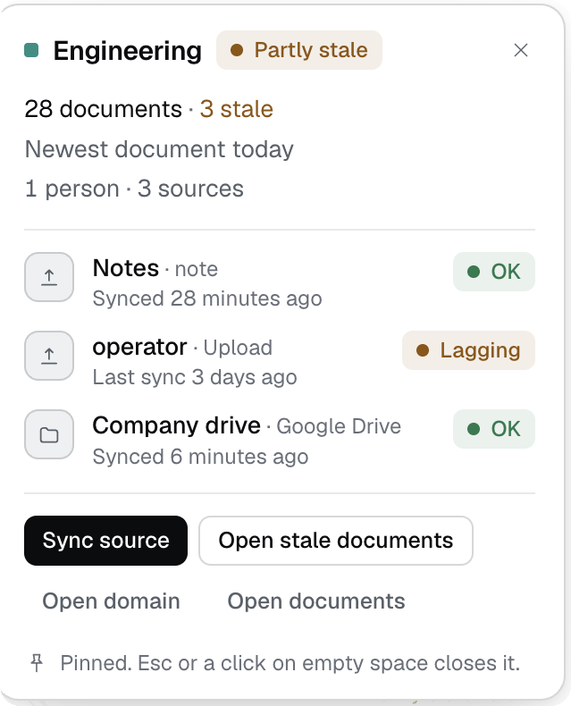
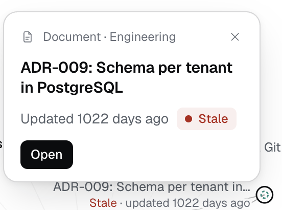
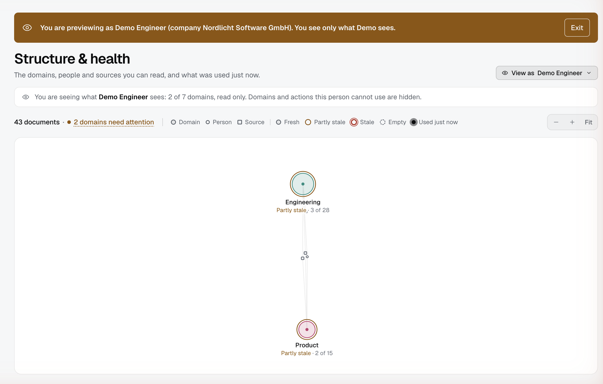

Checked on Izumi 0.5.7, 2026-11-20.

**Structure & health** is the map of your company. The circles are domains (areas of knowledge), the small dots are people and sources (Drive, uploads, notes), and the lines show who and what feeds which domain. The map answers the question "is the knowledge up to date and where does it come from". It does not show the content of documents, only their age and the state of their sources.

The screen is made for a computer. You only see the domains you may read.

## Read the map

<Steps>
  <Step title="Open the screen">
    Click **Structure & health** in the left menu. The first time, a hint appears: "Hover a domain to see its state and what to do. Click to keep the card open." Close it with the cross (**Dismiss hint**).

    <Frame>
      
    </Frame>
  </Step>
  <Step title="Read the strip above the map">
    The strip shows, for example, "82 documents · 6 domains need attention". The first number is all the documents you see, the second is the domains that need attention. When everything is fresh, it says everything is fresh.

    <Frame>
      
    </Frame>
  </Step>
  <Step title="Look at a domain card">
    Hover over a domain circle, then click so the card stays. The card shows the name and state, the number of documents and stale ones, when the newest document arrived, the number of people and sources, and the sources that feed the domain with their state.

    <Frame>
      
    </Frame>
  </Step>
  <Step title="Enter a domain and open a document">
    Click **Open domain**. The strip shows **Back to all domains** and the path to the domain. Hover over a document, then click so the card stays. The **Open** button takes you to the document page.

    <Frame>
      
    </Frame>
  </Step>
</Steps>

The **Zoom out**, **Zoom in** and **Fit** buttons zoom the map. **Fit** restores the overview. The map refreshes live.

## What "health" means

- A document is stale when more than 180 days have passed since its last review, change in the source, or import.
- A domain is **Fresh** (no document is stale), **Partly stale** (some are), **Stale** (all are) or **Empty** (no documents). The color of the ring follows the state.
- The "need attention" counter counts domains that are **Partly stale** or **Stale**. A click on "N domains need attention" highlights them, a second click turns the highlight off.
- A source has its own state: **OK**, **Lagging** (not synced for more than three intervals, at least 24 hours), **Paused** or **Error**.

## View as another member (company admin only)

<Steps>
  <Step title="Choose a person">
    In the screen header click **View as** and choose a person. The menu shows the name and roles of that person.
  </Step>
  <Step title="Read the map">
    The strip says you are viewing as that person and see only what they see. The map has only their domains, rearranged without gaps, and the actions for changes are hidden. **Exit** brings back your own view.

    <Frame>
      
    </Frame>
  </Step>
  <Step title="If there are no other members">
    The menu says "No other members to view as yet. Invite someone in Companies and members."
  </Step>
</Steps>

## What others see

| Who | What they see |
|---|---|
| Company admin | only the domains where they have a role, like every member, **View as**, the source buttons on the domain card |
| Domain editor (from the code) | only their own domains |
| Reader | only the domains where they have a role, with the buttons **Open domain** and **Open documents** |
| Member without a role (from the code) | an empty map |

## Limits

- The images show the state of the demo companies on the day of the check. Your map looks different, depending on the amount of data and on what you see.
- "Stale" is counted from the date of the last review, change in the source, or import, not from how much the document is read.
- The map shows no more than about 3000 nodes in one domain. For bigger domains it says "Showing N of M documents".
- The name of a source on the map is the one the admin gave it. In the images one name is replaced ("Company drive").
- Zoom and **Fit** apply only to the current view.

## Troubleshooting

- _"Structure & health did not load. The other screens still work."_ Refresh the page. The rest of Izumi works.
- _"The documents of this domain did not load."_ Click **Try again** in the strip or go back to all domains.
- _"There are no domains you can read yet."_ The company has no documents. The admin needs to add a source or upload documents.
- _"You have no role in any domain, so the view is empty."_ Your company admin needs to give you a role in a domain (**Companies and members**).
- _The map is empty in a narrow window._ The screen needs a wide window (by the code, at least 900 px). Widen the window.
- _A domain is stale, but its documents were updated recently._ Check the source on the domain card. If it is **Lagging**, **Paused** or **Error**, the new versions have not reached Izumi.
- _You do not see a domain that a colleague sees._ You have no role in that domain. Your company admin can check this through **View as**.
