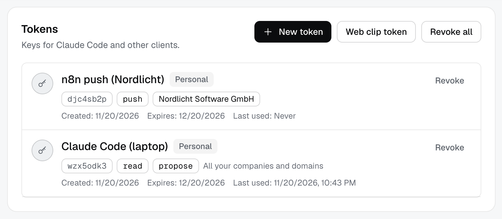
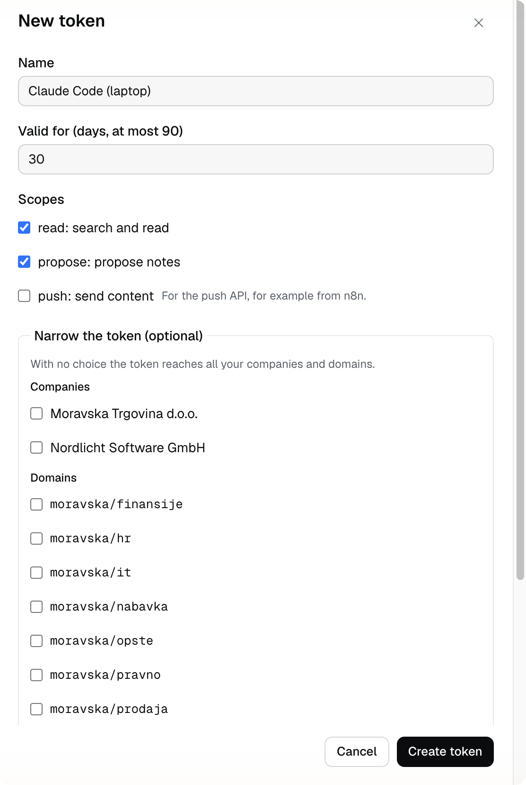
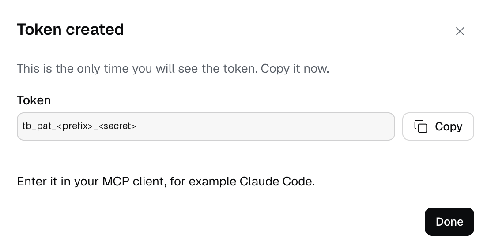
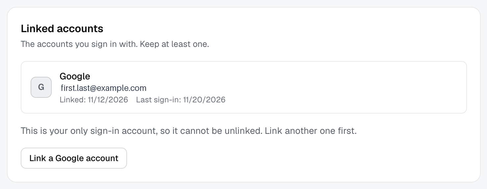
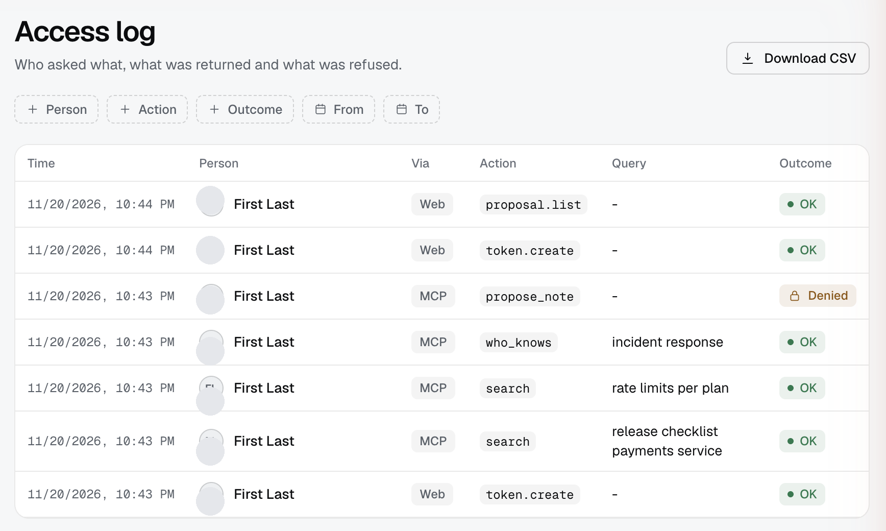
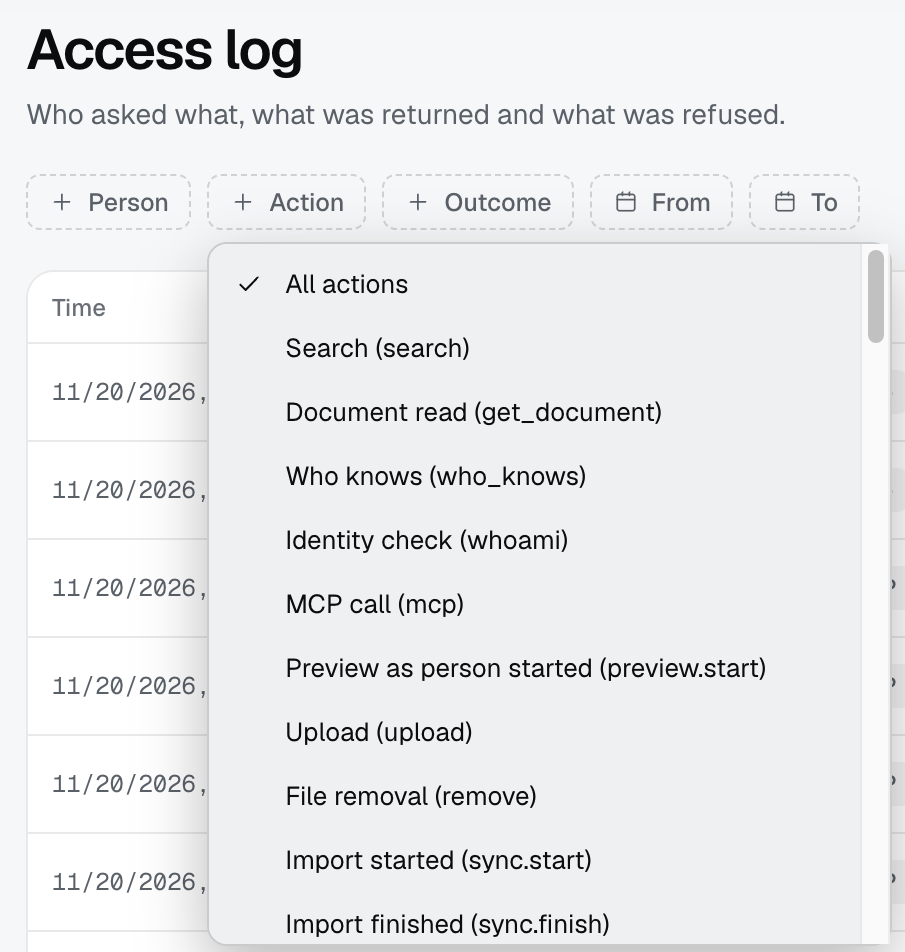

Checked on Izumi 0.5.7, 2026-11-20.

**My tokens and profile** and **Access log** are open to every member of the company. Tokens are the keys you give to AI tools (and to the web clip extension) so they work on your behalf. The log shows who asked what.

## Review your tokens

<Steps>
  <Step title="Open the Tokens section">
    Click **My tokens and profile** and switch to **Tokens**. For every token you see the name, the kind (**Personal**, **Agent**, **Web clip**, **Connected app**), the prefix (the first 8 characters, not a secret), the scopes, the narrowing, **Created**, **Expires** and **Last used**.

    <Frame>
      
    </Frame>
  </Step>
  <Step title="Revoke a token you do not use">
    Next to every token is **Revoke**. A revoked token stops working immediately ("The token was revoked."). Above the list there is also **Revoke all**.
  </Step>
</Steps>

## Create a new token

<Steps>
  <Step title="Click New token">
    Enter a **Name** (up to 80 characters) and **Valid for (days, at most 90)**: from 1 to 90 days, 30 by default.

    <Frame>
      
    </Frame>
  </Step>
  <Step title="Choose the scopes">
    `read` is search and reading, `propose` is note proposals, `push` is sending content (for example from an automation). At least one is required. If you like, turn on **Narrow the token (optional)** and choose companies and domains. With no choice, the token is valid for all your companies and domains.
  </Step>
  <Step title="Copy the token right away">
    Click **Create token**. **Token created** opens: "This is the only time you will see the token. Copy it now." Click **Copy**, paste the token into the settings of your AI tool, then click **Done**.

    <Frame>
      
    </Frame>
  </Step>
</Steps>

You create the token for the web clip extension with a separate button, **Web clip token**. See [Web clip](/en/using/web-clip).

## Linked accounts

In the **Linked accounts** section you see the accounts you sign in with: the provider, the account, the date it was linked and the last sign-ins. The **Link a Google account** button adds a second account. If you have only one, the link cannot be removed.

<Frame>
  
</Frame>

## Access log

<Steps>
  <Step title="Open the Access log">
    Click **Access log**. The columns are **Time**, **Person**, **Via**, **Action**, **Query**, **Results**, **Outcome** and **Duration**. **Via** says where the request came from (Web, MCP, Preview, Web clip, Connected app and others). **Outcome** is **OK**, **Denied** or **Error**. The screenshot leaves out the **Results** and **Duration** columns and the last column, so it stays readable.

    <Frame>
      
    </Frame>
  </Step>
  <Step title="Narrow the entries">
    The filters are **Person** (company admin only), **Action**, **Outcome**, **From** and **To**. **Download CSV** downloads the entries with the same filters, and **Load more** brings the next page.

    <Frame>
      
    </Frame>
  </Step>
  <Step title="Open the details">
    The arrow at the end of a row opens **Details**. For a search it shows **Documents in the answer** (the titles the AI tool received), and for a refused call it shows **Error code**.
  </Step>
</Steps>

## Limits

- At most 50 active tokens per person, and a validity of at most 90 days.
- A token belongs to a person, not to a company: the list is the same in all companies you belong to. The narrowing (companies and domains) limits what the token may do.
- A company admin sees the entries of everyone in the company. A member sees only their own entries (from the code).
- The **Action** column shows the technical name of the action (for example `search`), and the **Action** filter offers names in the language of the screen.
- Changing the language (**SR** or **EN** in the header) is saved in your profile and shows in the log as a profile change.
- A lost token cannot be shown again. Revoke it and create a new one.

## Troubleshooting

- _"Enter a name (up to 80 characters)."_, _"Enter a whole number of days from 1 to 90."_ and _"Choose at least one scope."_ Fix the field in the **New token** dialog.
- _"The narrowing is not allowed."_ You chose a company or domain that is not available to you. Remove the narrowing or choose others.
- _"You have 50 active tokens."_ Revoke one you do not use.
- _"Your profile could not be loaded."_ Refresh the page.
- _"The log did not load."_ or _"No entries."_ Refresh, or widen the **From** and **To** filters.
- _You cannot see a colleague's entry in the log._ That is expected if you are not a company admin.
