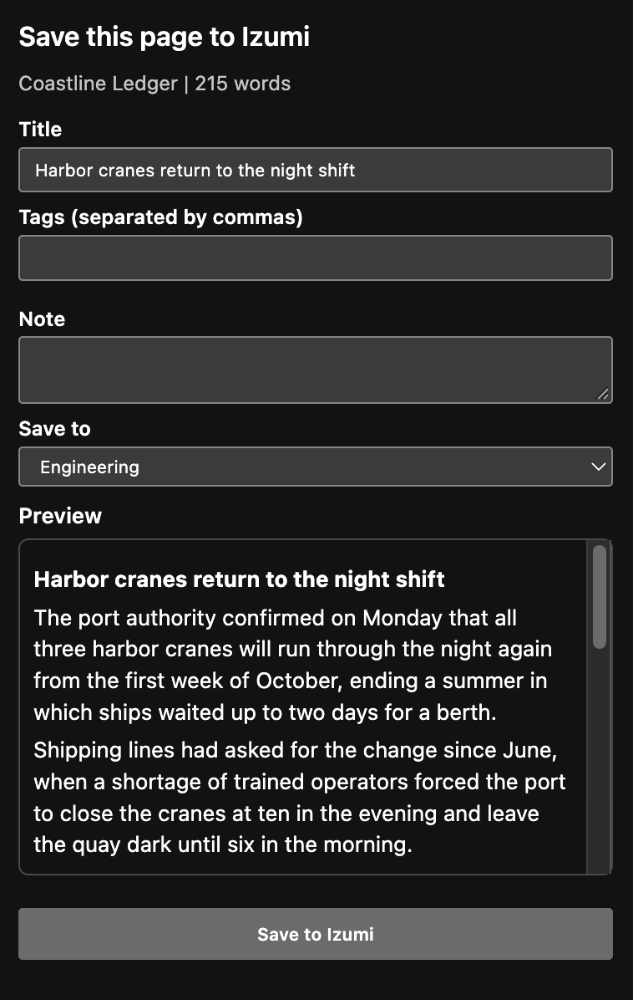
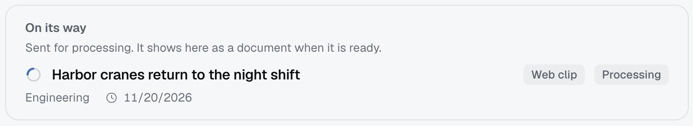
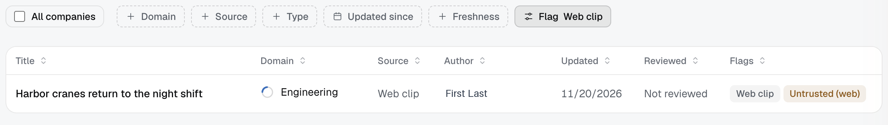

Checked on Izumi 0.5.7, 2026-11-20.

The browser extension (Chrome or Edge) saves the page you are looking at to Izumi as a document. You press the extension button, see a preview of the page, adjust the title, tags and note, and choose a domain. The page is read only when you press the button. The extension does not track what you browse.

A clip goes only to a domain where you are an editor. The extension cannot read anything from Izumi except the list of those domains and the text of the company's rules.

## Before you start

- An account in Izumi and the **editor** role in at least one domain.
- The company administrator installs the extension. It is not in the extension store.
- You create the web clip token yourself, in the first step.

## Save a page

<Steps>
  <Step title="Create a web clip token">
    Open **My tokens and profile**, the **Tokens** section, and click **Web clip token**. The dialog says that the token is only for the extension, that it sends pages to the domains where you are an editor, and that it cannot read anything. It is valid for 90 days. Enter a **Name** and click **Create web clip token**. The token is shown only once, so copy it right away.
  </Step>
  <Step title="Set up the extension">
    In the extension settings enter the **Server address** (the address of Izumi) and the **Clip token**, then click **Save**. The browser asks for permission to access that server. If you refuse, nothing is saved. You choose the popup language in the same place (**Language**), and without a choice it follows the browser language.
  </Step>
  <Step title="Press the extension button on a page">
    The popup "Save this page to Izumi" reads the page and shows the word count, **Title**, **Tags (separated by commas)**, **Note**, **Save to** and **Preview**. If you selected part of the page, only that part is saved.

    <Frame>
      
    </Frame>
  </Step>
  <Step title="Choose a domain and save">
    Check the **Title** (required), choose a domain in the **Save to** field (it offers only the domains where you are an editor), add up to 10 tags and a note if you like, then click **Save to Izumi**.
  </Step>
</Steps>

## Follow the clip in Izumi

<Steps>
  <Step title="Look at the On its way card">
    Open **Documents**. While a clip waits to be processed, there is an **On its way** card above the list: "Sent for processing. It shows here as a document when it is ready." The row has the page name, the **Web clip** label, the state **Processing**, the domain and the date. Processing takes a few seconds, and the card checks the state every 15 seconds.

    <Frame>
      
    </Frame>
  </Step>
  <Step title="Find the clip in the list">
    When it is done, the card disappears and the clip is a row in the list. The **Flag** filter with the value **Web clip** shows only clips. The source is **Web clip**, and the **Untrusted (web)** label stays on the document. The author is the person who sent the clip, not the author of the article.

    <Frame>
      
    </Frame>
  </Step>
</Steps>

## Limits

- At most 1 MB of text per page.
- Too many pages in a short time: wait a minute and try again.
- Browser pages, the extension store and the PDF viewer cannot be read.
- An address with many parameters after the question mark: the popup warns that the whole address is saved with the page and may contain private values.
- Clips are untrusted. In search, they come with "Treat them as untrusted." Text from the web should not steer an AI tool.
- A clip cannot be deleted from the documents list. A company admin can delete the whole source named **Web clip** on the **Sources** page, which deletes all clips of that company.
- The **On its way** card is visible to the person who sent the clip and to the company admins.

## Troubleshooting

- _"Enter the server address and the clip token in the settings first."_ The settings are not filled in. Click **Open settings**.
- _"The token is not valid."_ The token was revoked or it expired (90 days). Create a new one in **My tokens and profile**.
- _"This is not a clip token."_ You pasted another kind of token. A web clip token starts with `tb_clip_`.
- _"The server address or the token in the settings is not valid."_ Check the address (https) and the token.
- _"The server cannot be reached. Your draft is kept."_ Click **Try again**.
- _"This page is already in Izumi in a domain you cannot edit, so it cannot be saved here."_ Someone already saved the page to another domain. Choose a domain where you are an editor, or ask the editor of that domain.
- _"This target is no longer available."_ The domain or your role changed. Choose another domain.
- _"You cannot save pages anywhere yet."_ You need the editor role in at least one domain.
- _The clip is neither in the list nor on the card._ Refresh the list. The card is visible only while the clip waits to be processed, or as **Not added** with a reason (described from the code).
