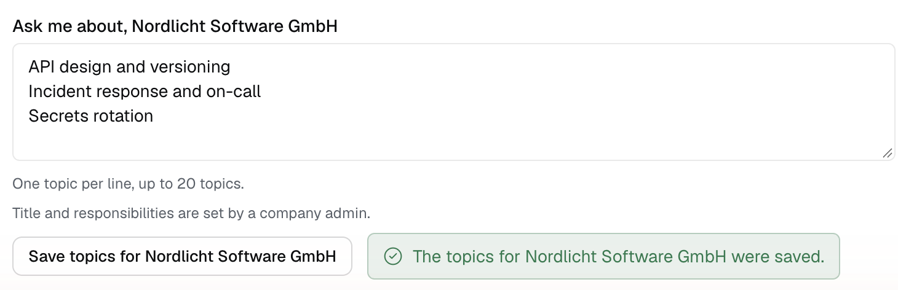
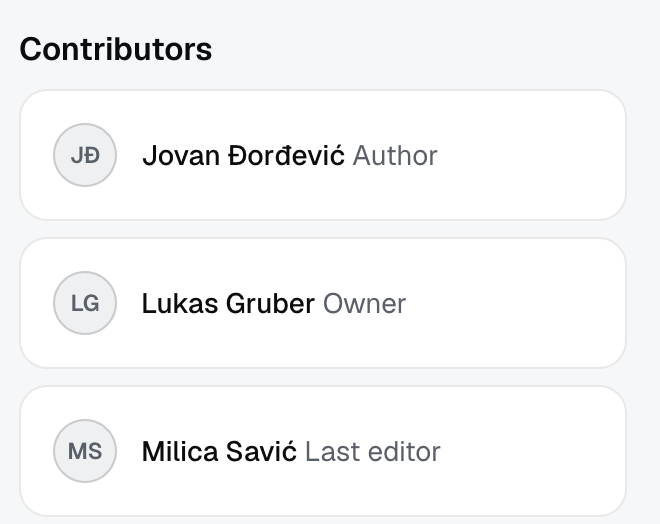

Checked on Izumi 0.5.7, 2026-11-20.

"Who knows" has no screen of its own in Izumi. It is a question you ask your AI tool ("Who at the company knows about retention periods?"), and Izumi answers with a list of colleagues. Here you see what you can set up about yourself and where Izumi takes the answer from.

## Set the topics you know about

<Steps>
  <Step title="Open your profile">
    Click **My tokens and profile**. The **Profile** section has an **Ask me about** field, one for every company you belong to.

    <Frame>
      
    </Frame>
  </Step>
  <Step title="Enter your topics">
    Enter the topics, one per line, up to 20, each up to 200 characters. Click the "Save topics for" button with the name of that company. A confirmation appears that the topics were saved. You do not enter your job title or responsibilities yourself: your company admin sets them.
  </Step>
</Steps>

## Where Izumi takes the answer from

- From the topics you entered in **Ask me about**.
- From **Contributors** on documents: the author, the owner, and the person who last changed the document. By the code, newer documents weigh more than old ones.

<Frame>
  
</Frame>

By the code, an answer has at most 5 people. Each comes with a reason and up to 2 documents as evidence. You ask through an AI tool, not through a web screen.

## Limits

- The result is a suggestion of whom to ask, not a guarantee that the person knows.
- A person with no topic in **Ask me about** and no documents where they are a contributor cannot appear.
- You can only ask within the companies you belong to.

## Troubleshooting

- _Your topic does not show in the answer._ Check that you clicked the "Save topics for" button under the right company. Topics are saved per company.
- _You cannot change your job title or responsibilities._ Your company admin sets them.
- _The AI tool returns nobody._ The topic may not be in the "Ask me about" field or in **Contributors** of any document you can see.
