Provereno na Izumi 0.5.7, 2026-11-21.

Izvor **Google Drive** čita foldere i fajlove sa Drive-a i uvozi ih u domene firme. Izumi samo čita (`drive.readonly`) i nikad ne menja fajlove. Vi birate šta se čita, šta se uvozi i u koji domen ide, i šta se izuzima. Pre prvog uvoza **Probni prolaz** pokazuje šta bi se uvezlo, bez ikakve izmene u Izumiju.

## Pre nego što počnete

- Morate biti admin firme. Stranice **Izvori** i **Izveštaj uvoza** vide samo admini.
- Firma mora imati bar jedan domen. Bez domena **Pravila uvoza** kažu: _"Firma nema nijedan aktivan domen. Napravite ga na ekranu Firme i članovi."_
- Google nalog kojim se povezujete mora da vidi foldere koje želite. Drvo pravila prikazuje ceo **Moj disk (My Drive)** tog naloga, ne samo ono što ćete uvesti. Povežite nalog sa kojeg se vidi samo ono što sme da se vidi.
- Promena deljenja u Drive-u ne menja pristup u Izumiju. Pristup određuju domeni i uloge.
- Ova instalacija ima sopstveni Google klijent, pa ne pravite ništa u Google Cloud-u. Ako vaša firma želi svoj klijent, unosi ga pod **Sopstveni OAuth klijent (napredno)** (iz koda).

## Povežite Drive

<Steps>
  <Step title="Dodajte izvor">
    Otvorite **Izvori** i kliknite **Dodaj izvor**. Ponuđeni tipovi su **Upload**, **Google Drive** i **SharePoint/OneDrive**.

    <Frame>
      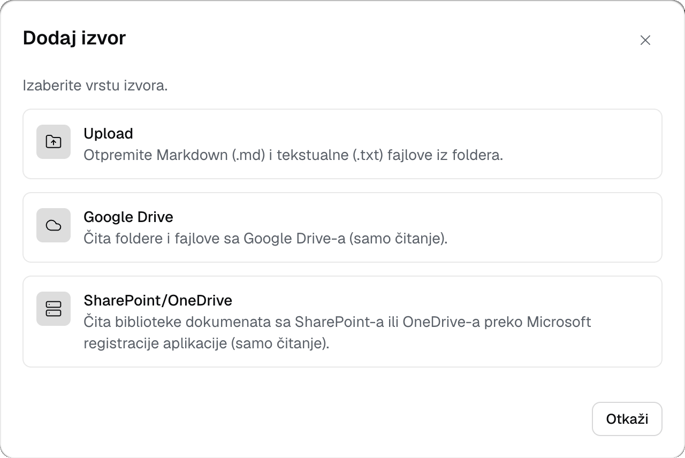
    </Frame>
  </Step>
  <Step title="Izaberite Google Drive">
    Dijalog **Povezivanje Google Drive-a** ima polje **Naziv izvora** i uvučeno **Sopstveni OAuth klijent (napredno)**. Upišite naziv i kliknite **Poveži Google Drive**.

    <Frame>
      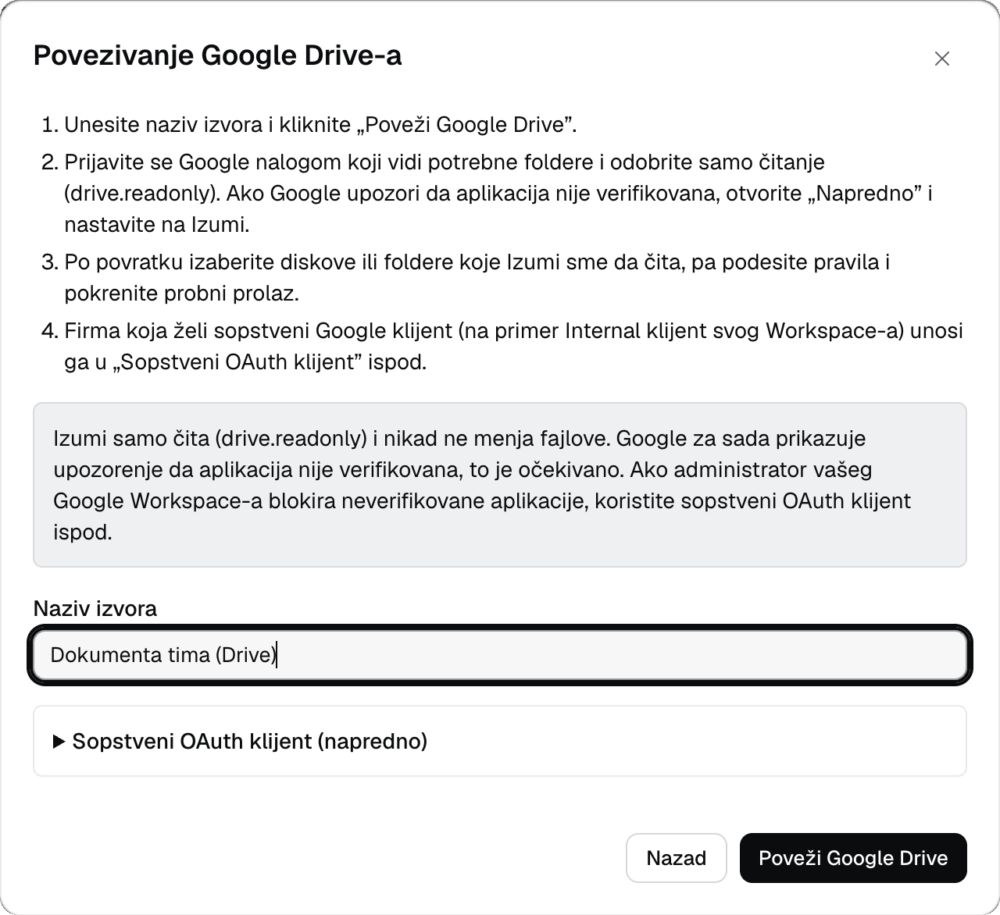
    </Frame>
  </Step>
  <Step title="Odobrite čitanje u Google-u">
    Google traži da izaberete nalog i odobrite samo čitanje. Google za sada prikazuje upozorenje da aplikacija nije verifikovana. To je očekivano: kliknite "Napredno" i nastavite ka Izumiju. Ove Google ekrane nismo snimili.
  </Step>
  <Step title="Izaberite šta Izumi sme da čita">
    Posle odobrenja vraćate se na **Izvori**. Nova kartica ima oznaku **Novo** i red **Povezano** sa adresom naloga. Pod **Šta Izumi sme da čita** označite **Moj disk (My Drive)** i kliknite **Sačuvaj opseg**. Ako ništa nije označeno, javlja _"Izaberite bar jedan koren."_

    <Frame>
      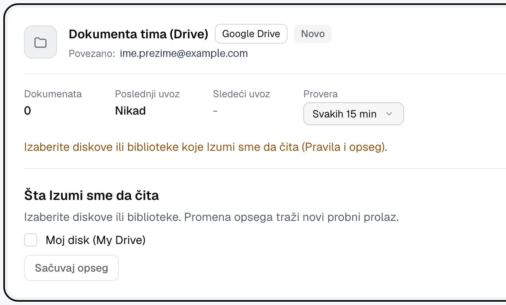
    </Frame>
  </Step>
</Steps>

## Podesite pravila uvoza

<Steps>
  <Step title="Izaberite foldere i domene">
    Pod **Pravila uvoza** otvorite korenski folder `My Drive` (ime vraća Google, na engleskom) i spuštajte se kroz foldere. Za svaki folder ili fajl postoji kvačica (uključi), meni domena (obavezno, nude se samo živi domeni firme), **Sa podfolderima** i **Isključi**. Ispod drveta je lista **Izabrano** sa **Ukloni**.

    <Frame>
      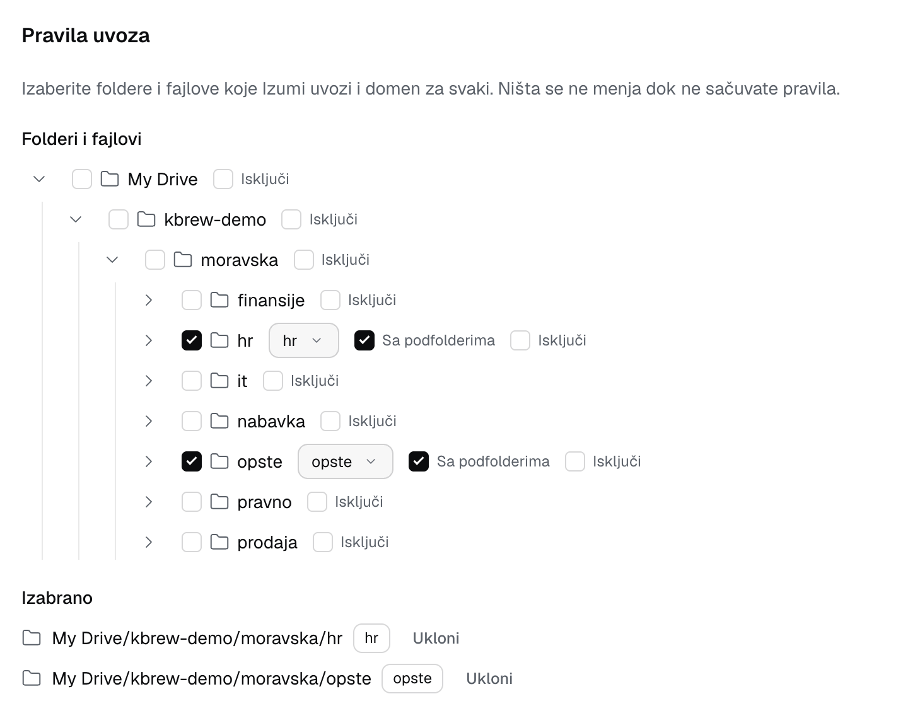
    </Frame>
  </Step>
  <Step title="Dodajte filtere (opciono)">
    - **Tipovi fajlova**: `doc`, `sheet`, `slides`, `docx`, `xlsx`, `csv`, `pdf`, `md`, `txt`. Ako ništa nije označeno, uvoze se svi podržani tipovi.
    - **Uključi imena (šabloni)** i **Isključi imena (šabloni)**: jedan šablon po redu, do 200 znakova, na primer `*.md`.
    - **Izmenjeno od (uključujući)** i **Izmenjeno do (isključujući)**. Prazan datum znači bez ograničenja.
  </Step>
  <Step title="Sačuvajte pravila">
    **Sačuvaj pravila** otvara potvrdu **Sačuvati pravila?** sa brojem: _"Sledeći uvoz uklanja 0 dokumenata iz Izumija i dodaje 5."_ Posle čuvanja javlja _"Pravila su sačuvana. Novi probni prolaz ih proverava pre uvoza."_

    <Frame>
      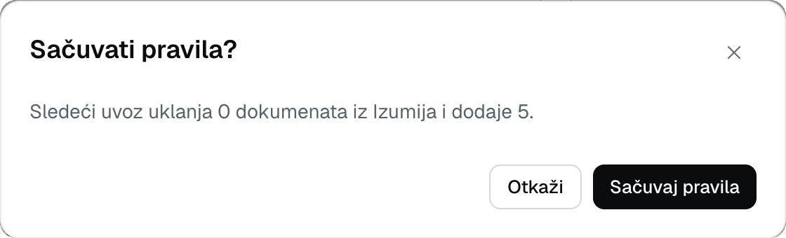
    </Frame>
  </Step>
</Steps>

Poruke koje možete da vidite pri čuvanju:

- _"Ništa nije izabrano, pa se ništa ne uvozi."_ Označite bar jedan folder ili fajl.
- _"Izaberite domen za svaki izabrani folder i fajl."_ Svaka izabrana stavka mora da ima domen.
- _"Početni datum mora biti pre krajnjeg."_ Ispravite datume.

## Probni prolaz i prvi uvoz

<Steps>
  <Step title="Sačekajte probni prolaz">
    Čim sačuvate opseg ili pravila, probni prolaz kreće sam. Kartica kaže **Probni prolaz u toku**: _"Probni prolaz čita izvor. U Izumiju se ništa ne menja."_ Drvo se popuni tek kad se probni prolaz završi.

    <Frame>
      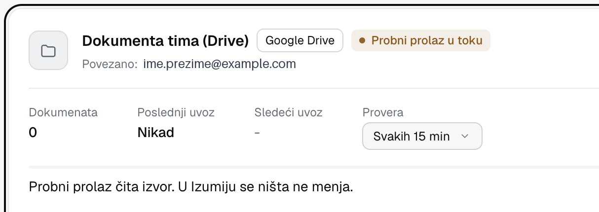
    </Frame>
  </Step>
  <Step title="Pročitajte rezultat">
    Odeljak **Probni prolaz** pokazuje vreme poslednjeg probnog prolaza, red "Za uvoz" (broj fajlova i veličina), tabele **Po domenu** i **Po tipu**, pa brojeve nepodržanih fajlova, prevelikih fajlova, fajlova isključenih pravilima i procenu trajanja uvoza. Kartica kaže **Probni prolaz spreman**.

    <Frame>
      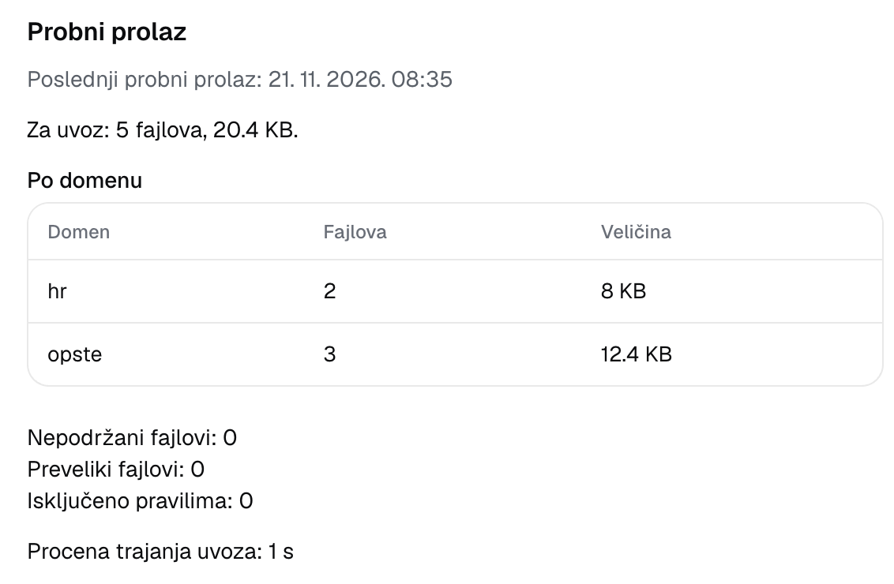
    </Frame>

    <Frame>
      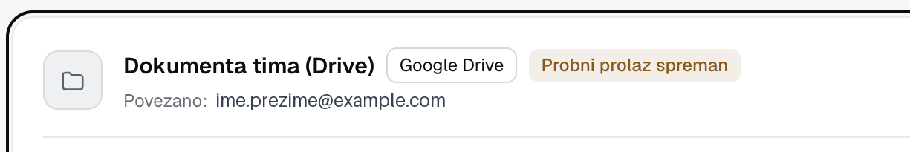
    </Frame>
  </Step>
  <Step title="Pokrenite uvoz">
    **Pokreni uvoz** je isključen dok se ne završi probni prolaz na trenutnim pravilima. Posle svake izmene pravila ili opsega odeljak kaže _"Pravila ili opseg su se promenili posle ovog probnog prolaza. Pokrenite novi pre uvoza."_ Kartica pokazuje **Uvoz u toku**, pa **U redu** i broj **Dokumenata**. U našim probama 5 do 6 dokumenata je trajalo oko minut.

    <Frame>
      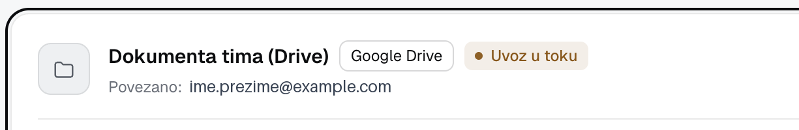
    </Frame>

    <Frame>
      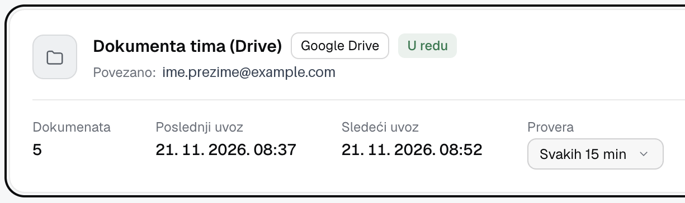
    </Frame>
  </Step>
  <Step title="Podesite proveru">
    Posle prvog uvoza dugme postaje **Uvezi sada**, a polje **Provera** određuje koliko često Izumi proverava Drive: 5, 15, 30, 60 minuta, 6 sati ili 24 sata, podrazumevano 15 minuta (iz koda). **Sledeći uvoz** pokazuje kada je sledeća provera.
  </Step>
</Steps>

## Radnje na kartici

<Steps>
  <Step title="Dugmad na kartici">
    Kartica ima **Probni prolaz**, **Uvezi sada**, **Pauziraj**, **Pravila i opseg** (otvara i zatvara pravila, **Zatvori pravila**) i meni sa tri tačke.

    <Frame>
      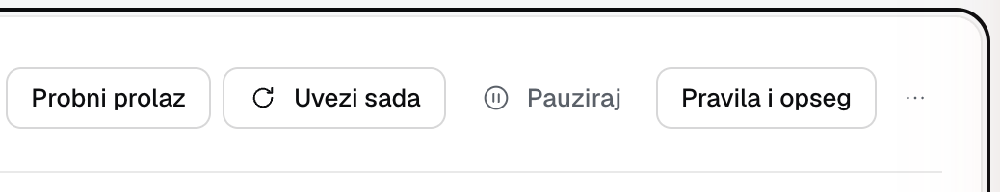
    </Frame>
  </Step>
  <Step title="Pauzirajte izvor">
    **Pauziraj** stavlja oznaku **Pauzirano**. **Probni prolaz** i **Uvezi sada** se gase, **Sledeći uvoz** je prazan, a dugme postaje **Nastavi**. **Nastavi** vraća stanje **U redu**.

    <Frame>
      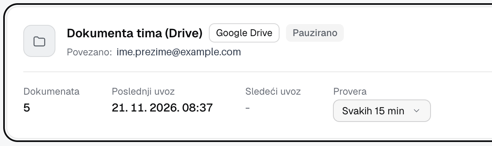
    </Frame>
  </Step>
  <Step title="Obrišite izvor">
    Meni sa tri tačke ima **Obriši izvor**. Potvrda **Obrisati izvor?** kaže: _"Izvor „…” i svi dokumenti koje je uvezao (N dokumenata) biće uklonjeni iz Izumija. Ovo se ne može poništiti."_ Kliknite **Obriši**. Poruka je _"Izvor je obrisan."_ Brisanje uklanja i redove tog izvora iz **Izveštaj uvoza**. Dok uvoz radi, brisanje se odbija (iz koda). Fajlovi na Drive-u ostaju netaknuti.

    <Frame>
      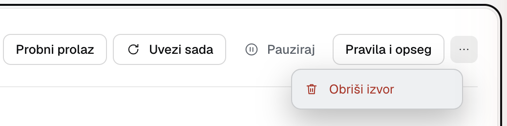
    </Frame>

    <Frame>
      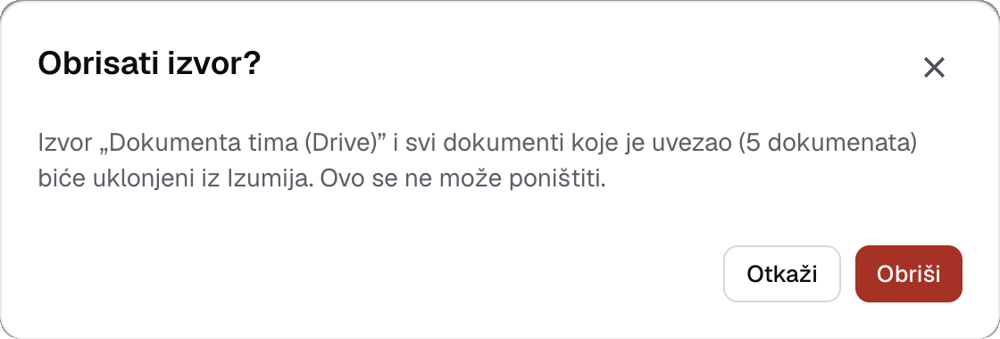
    </Frame>
  </Step>
</Steps>

## Izveštaj uvoza

<Steps>
  <Step title="Otvorite listu uvoza">
    Izaberite **Izveštaj uvoza** u levom meniju. Tabela ima kolone **Izvor**, **Vrsta** (**Zakazano**, **Ručno**, **Probni prolaz**, **Upload**), **Početak**, **Trajanje**, **Brojevi**, **Status** (**Završeno**, **U toku**, **Neuspešno**) i **Radnje**. Kad nema promena, piše **Nema šta da se uveze**. Zakazana provera dodaje po jedan red. Slika izostavlja kolonu **Radnje** da ostane čitljiva.

    <Frame>
      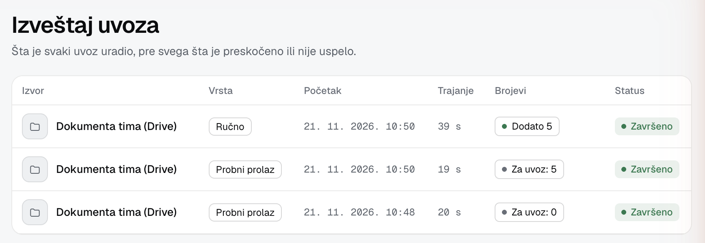
    </Frame>
  </Step>
  <Step title="Otvorite jedan uvoz">
    **Otvori** daje zbirne brojeve po ishodu, filter **Ishod**, **Preuzmi CSV** i tabelu **Putanja**, **Tip**, **Veličina**, **Domen**, **Ishod**, **Razlog**. Ishodi su **Dodato**, **Izmenjeno**, **Nepromenjeno**, **Uklonjeno**, **Isključeno**, **Preskočeno: nepodržan tip**, **Preskočeno: bez teksta**, **Preskočeno: preveliko** i **Neuspešno**. Uživo je viđeno samo **Dodato**, ostali ishodi su iz koda. **Nazad na uvoze** vraća na listu. Slika izostavlja kolonu **Razlog**.

    <Frame>
      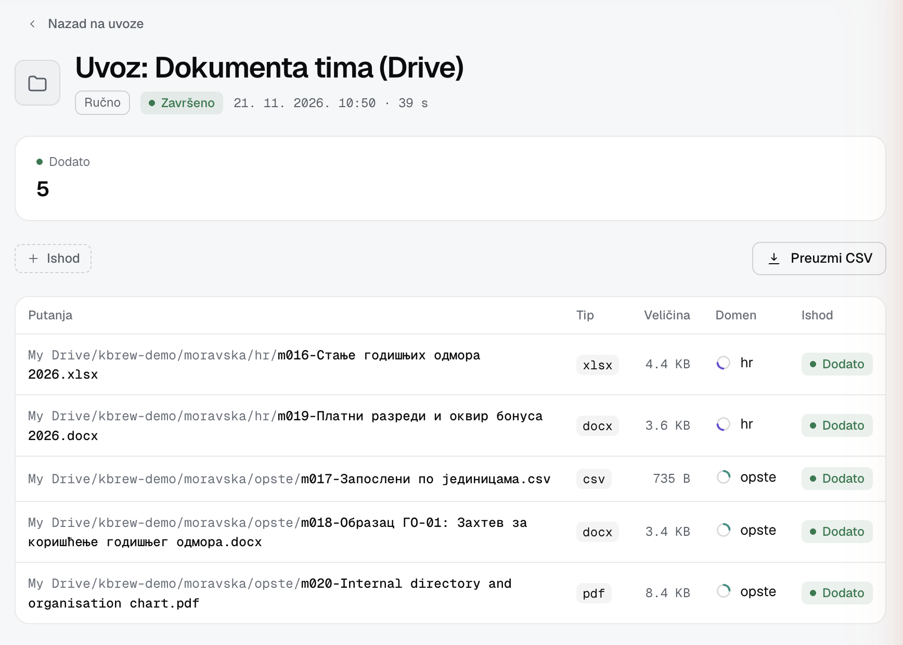
    </Frame>
  </Step>
</Steps>

## Ograničenja

- Samo čitanje. Izumi nikad ne menja fajlove na Drive-u.
- Fajl veći od 50 MB se preskače kao preveliki (iz koda).
- Uvoze se samo tipovi iz liste **Tipovi fajlova**. Ostalo se broji kao nepodržano.
- Proveren je samo **Moj disk (My Drive)**. Zajednički diskovi nisu provereni.
- Izvori u firmi mogu da dele isti Google nalog. Opoziv pristupa na Google nalogu gasi tokene svih izvora koji dele klijenta i nalog (ponašanje Google-a, nije provereno uživo).
- Dok je uvoz ili probni prolaz u toku, opseg, pravila i povezivanje se ne menjaju: _"Uvoz ili probni prolaz ovog izvora je već u toku. Kartica pokazuje kad se završi."_ (iz koda)

## Rešavanje problema

- _"Povezivanje je isteklo. Pokušajte ponovo."_ Prozor za odobrenje je predugo bio otvoren. Ponovite **Poveži Google Drive** (iz koda).
- _"Pristup je odbijen na Google ekranu."_ Odbili ste ili zatvorili Google ekran. Ponovite i odobrite čitanje (iz koda).
- _"Čitanje Drive-a nije odobreno. Odobrite ga i pokušajte ponovo."_ Na Google ekranu je ostalo neoznačeno čitanje Drive-a (iz koda).
- _"Google nije vratio trajnu dozvolu. Pokušajte ponovo."_ Ponovite povezivanje (iz koda).
- _"Povezivanje nije uspelo. Pokušajte ponovo."_ Opšta greška. Ako se ponavlja, najčešći uzrok je isključen Drive API u Google Cloud projektu sopstvenog OAuth klijenta (iz koda i vodiča za instalaciju).
- Oznaka **Potrebno ponovno povezivanje** sa porukom _"Povežite ponovo da bi se uvoz nastavio."_ Google je odbio sačuvani token (opoziv, istek, promena lozinke). Kliknite **Poveži ponovo** (iz koda).
- Oznaka **Greška** sa _Poslednja greška: …_ i _Sledeći pokušaj: …_ Prolazna greška, na primer Google nije dostupan. Izumi sam ponavlja (iz koda).
- **Pokreni uvoz** je siv. Probni prolaz na trenutnim pravilima nije gotov. Sačekajte ga ili kliknite **Probni prolaz**.
- Probni prolaz javlja 0 fajlova. Pravila su prazna ili tipovi i šabloni isključuju sve.
