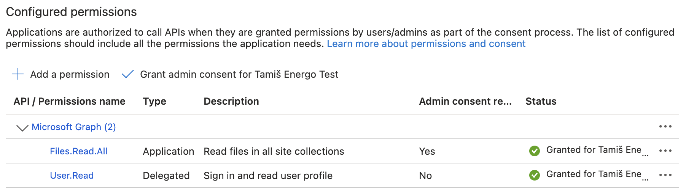
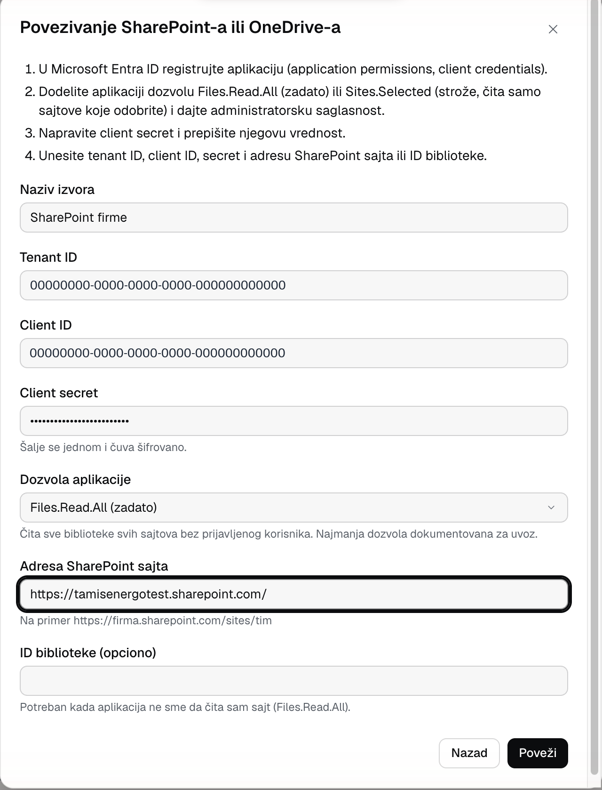
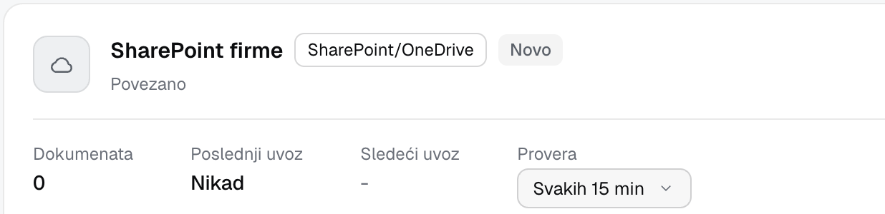
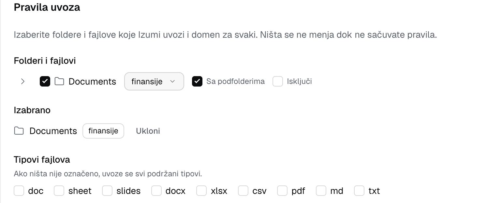
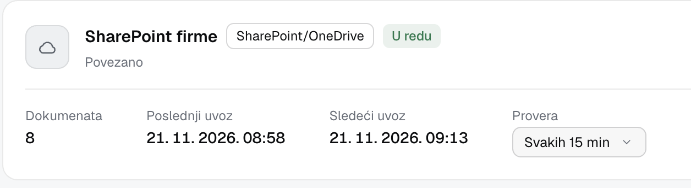
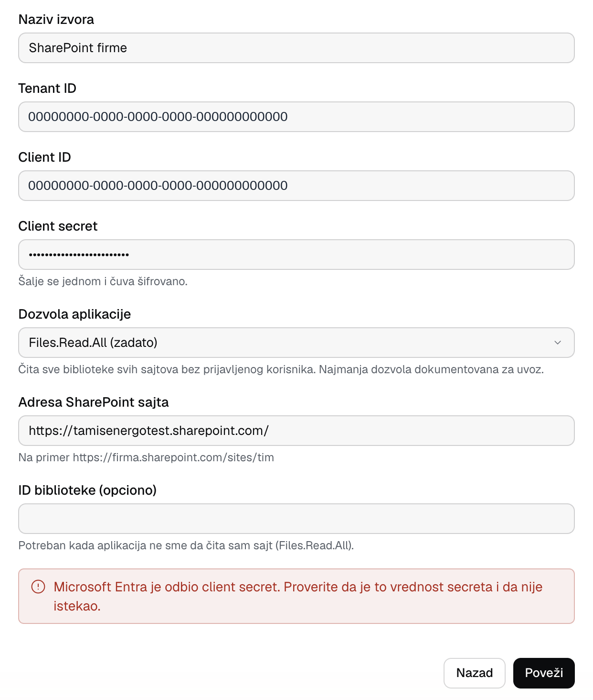

Provereno na Izumi 0.5.7, 2026-11-21.

Izvor **SharePoint/OneDrive** čita biblioteke dokumenata sa SharePoint-a preko Microsoft registracije aplikacije, samo čitanje. Izumi se prijavljuje kao aplikacija, ne kao neki korisnik. Pristup određuje dozvola aplikacije u vašem tenantu, a ne članstvo u sajtovima. Tok u Izumiju je isti kao kod [Google Drive](/sr/admin/izvori-drive) izvora: **Probni prolaz**, **Pravila uvoza**, **Pokreni uvoz**, pa **Uvezi sada**.

## Pre nego što počnete

- Morate biti admin firme u Izumiju.
- Treba vam Microsoft nalog koji sme da registruje aplikaciju i da da administratorsku saglasnost za Microsoft Graph (potrebne uloge su iz Microsoft dokumentacije, nije provereno).
- Firma mora imati bar jedan domen u Izumiju.
- Sa dozvolom `Files.Read.All` aplikacija vidi biblioteke svih sajtova u tenantu. Zato u Izumiju birate samo biblioteku i foldere koje želite i mapirate ih na domene. Sve van toga se ne uvozi.
- Dozvola `Sites.Selected` (strože, samo sajtovi koje administrator SharePoint-a odobri aplikaciji) je ponuđena u formi, ali forma sama kaže: _"Da uvoz radi pod ovom dozvolom još nije provereno."_ Nismo je probali uživo.
- Promena deljenja u SharePoint-u ne menja pristup u Izumiju. Pristup određuju domeni i uloge.

## Registrujte aplikaciju u Microsoft Entra ID

Ovi koraci se rade u Microsoft portalu, na engleskom. Ekran dozvola je snimljen uživo. Ostali koraci su iz vodiča za instalaciju i beleški iz našeg test tenanta.

<Steps>
  <Step title="Napravite registraciju">
    U Microsoft Entra ID otvorite `App registrations`, pa `New registration`. Ime je po izboru, tip naloga je `My organization only` (jedan tenant). Redirect URI nije potreban.
  </Step>
  <Step title="Dodajte dozvolu i saglasnost">
    U `API permissions` dodajte `Microsoft Graph`, tip `Application permissions`, dozvolu `Files.Read.All`. Kliknite `Grant admin consent for <vaš tenant>`. Posle toga se vidi `Files.Read.All`, tip `Application`, `Admin consent required: Yes` i status `Granted`. Dozvola `User.Read` dolazi sama uz novu registraciju i ne koristi se.

    <Frame>
      
    </Frame>
  </Step>
  <Step title="Napravite client secret">
    U `Certificates & secrets` napravite `New client secret` i odmah prepišite `Value`, ne `Secret ID`. Posle zatvaranja ekrana vrednost se ne može ponovo videti. Secret ima rok trajanja: zapišite datum isteka, jer posle toga uvoz staje dok ne unesete novi secret.
  </Step>
  <Step title="Prepišite identifikatore">
    Sa ekrana `Overview` prepišite `Application (client) ID` i `Directory (tenant) ID`.
  </Step>
</Steps>

Ako `Granted` ne ide odmah, sačekajte nekoliko minuta pa pokušajte ponovo. U našem test tenantu je prvi pokušaj pao zbog propagacije, a drugi je prošao.

## Povežite izvor u Izumiju

<Steps>
  <Step title="Izaberite tip izvora">
    Otvorite **Izvori** i kliknite **Dodaj izvor**. Izaberite **SharePoint/OneDrive**. Dijalog sa tri tipa izgleda kao na stranici o [Google Drive](/sr/admin/izvori-drive) izvoru.
  </Step>
  <Step title="Popunite formu">
    Dijalog **Povezivanje SharePoint-a ili OneDrive-a** ima polja **Naziv izvora**, **Tenant ID**, **Client ID**, **Client secret** (pod njim: _"Šalje se jednom i čuva šifrovano."_), **Dozvola aplikacije**, **Adresa SharePoint sajta** i **ID biblioteke (opciono)**. **Dozvola aplikacije** ima dve vrednosti, **Files.Read.All (zadato)** i **Sites.Selected (strože)**. Izaberite onu koju ste dali aplikaciji u Entri. Za koren tenanta adresa izgleda kao `https://firma.sharepoint.com/`, a za sajt ispod korena kao `https://firma.sharepoint.com/sites/tim`. Za sajt ispod korena Izumi će verovatno tražiti ID biblioteke (iz koda, nije provereno uživo).

    <Frame>
      
    </Frame>
  </Step>
  <Step title="Povežite">
    Kliknite **Poveži**. Izumi traži token od Microsofta i čita listu biblioteka. Uspeh javlja _"Povezano. Izaberite šta se čita u Pravilima i opsegu."_ Kartica ima oznaku **Novo** i red **Povezano**. Secret se šalje jednom i čuva šifrovano. Izumi ga ne može pročitati nazad, pa ga posle slanja nigde ne vidite.

    <Frame>
      
    </Frame>
  </Step>
</Steps>

## Opseg, pravila i uvoz

<Steps>
  <Step title="Izaberite biblioteke">
    Kliknite **Pravila i opseg**. Pod **Šta Izumi sme da čita** su biblioteke sajta (u našem testu jedna, `Documents`, već označena). **Sačuvaj opseg** je isključen dok ne promenite izbor. Promena opsega traži novi probni prolaz.
  </Step>
  <Step title="Pokrenite probni prolaz">
    Kliknite **Probni prolaz**. Kartica kaže **Probni prolaz u toku**, pa **Probni prolaz spreman**. U testu je to trajalo oko 10 sekundi. Probni prolaz ne menja ništa u Izumiju.
  </Step>
  <Step title="Mapirajte biblioteku na domen">
    Pod **Pravila uvoza** označite biblioteku, izaberite domen iz menija i ostavite **Sa podfolderima**. Pod **Izabrano** se vidi biblioteka sa domenom i dugmetom **Ukloni**. **Tipovi fajlova**, **Uključi imena (šabloni)**, **Isključi imena (šabloni)**, **Izmenjeno od (uključujući)** i **Izmenjeno do (isključujući)** rade isto kao kod Drive-a.

    <Frame>
      
    </Frame>
  </Step>
  <Step title="Sačuvajte pravila i pokrenite uvoz">
    **Sačuvaj pravila** traži potvrdu sa brojem dokumenata koje će sledeći uvoz dodati. Posle čuvanja probni prolaz se ponovo pokreće sam. Kad je spreman, **Pokreni uvoz** je uključen. Tokom uvoza kartica pokazuje tekuće brojeve. Na kraju kartica pokazuje **U redu**, broj **Dokumenata**, **Poslednji uvoz** i **Sledeći uvoz**.

    <Frame>
      
    </Frame>
  </Step>
  <Step title="Dalje isto kao kod Drive-a">
    Dugme postaje **Uvezi sada**, polje **Provera** je podrazumevano 15 minuta (iz koda), a **Pauziraj**, **Obriši izvor** i **Izveštaj uvoza** rade kao kod Drive-a. Brisanje uklanja izvor i sve što je uvezeno.
  </Step>
</Steps>

## Ako aplikacija ne sme da čita sajt (iz koda)

Ako aplikacija ne sme da pročita sam sajt, Izumi ne povezuje izvor i ništa ne čuva. Po kodu i vodiču za instalaciju to je očekivano sa samom dozvolom `Files.Read.All` (nema `Sites.Read.All`), naročito za sajt ispod korena. Za koren tenanta je u našem testu radilo bez ID-ja biblioteke. Javlja: _"Aplikacija ne sme da čita podatke sajta. Pronađite ID biblioteke sledećim Graph pozivima, unesite ga i pošaljite ponovo."_ Pod porukom stoje dva poziva:

- `GET https://graph.microsoft.com/v1.0/sites/<firma>.sharepoint.com:/sites/<naziv>?$select=id` vraća `id` sajta.
- `GET https://graph.microsoft.com/v1.0/sites/{site-id}/drives?$select=id,name` vraća listu biblioteka sa njihovim `id`.

Upišite `id` biblioteke u polje **ID biblioteke (opciono)** i ponovo kliknite **Poveži**.

## Ograničenja

- Samo čitanje.
- Izumi vidi samo ono što dozvola aplikacije dozvoljava. Sa `Files.Read.All` to su svi sajtovi tenanta, pa opseg i pravila u Izumiju određuju šta se uvozi.
- Client secret ističe. Forma ne prikazuje datum isteka ni upozorenje pre isteka (iz koda). Zapišite datum sami.
- Za koren tenanta sa `Files.Read.All` ID biblioteke nije bio potreban (provereno uživo).

## Rešavanje problema

- _"Microsoft Entra je odbio client secret. Proverite da je to vrednost secreta i da nije istekao."_ Najčešći uzrok je prepisan `Secret ID` umesto `Value`, ili je secret istekao. Greška se vidi u dijalogu i ništa se ne čuva dok povezivanje ne uspe.

    <Frame>
      
    </Frame>

- _"Unesite GUID (na primer 00000000-0000-0000-0000-000000000000)."_ **Tenant ID** ili **Client ID** nije GUID.
- _"Unesite client secret."_ Polje **Client secret** je prazno.
- _"Unesite adresu sajta ili ID biblioteke."_ Popunite **Adresa SharePoint sajta** ili **ID biblioteke (opciono)**.
- _"Microsoft Entra ne poznaje ovaj tenant. Proverite tenant ID."_ (proveri uživo)
- _"Tenant nema aplikaciju sa ovim client ID-jem."_ (proveri uživo)
- _"Microsoft Entra je odbio kredencijale."_ (iz koda)
- _"Microsoft Graph ne nalazi SharePoint sajt na ovoj adresi."_ Proverite **Adresa SharePoint sajta** (proveri uživo, sa ispravnom tajnom i sajtom koji ne postoji).
- _"Microsoft Graph ne nalazi biblioteku dokumenata sa ovim ID-jem."_ Proverite **ID biblioteke (opciono)** (proveri uživo).
- _"Aplikacija ne sme da čita ovu biblioteku. Dodelite joj Files.Read.All ili Sites.Selected sa pravom čitanja na sajtu."_ (iz koda)
- _"Microsoft Graph trenutno nije dostupan. Pokušajte kasnije."_ (iz koda)
- Oznaka **Potrebno ponovno povezivanje** na kartici izvora, sa dugmetom **Poveži ponovo** i crvenom linijom sa greškom `reconnect_required: the Entra token endpoint refused the client credentials (invalid_client)` i porukom _"Povežite ponovo da bi se uvoz nastavio."_ Ista greška se vidi i pod **Status instalacije**, **Poslednja greška po izvoru**. Secret je istekao ili obrisan posle povezivanja. Provereno uživo: povezali smo se privremenim secretom, obrisali ga u Entri, a stanje se pojavilo posle sledećeg probnog prolaza (prvi put kad Izumi ponovo koristi secret). **Poveži ponovo** otvara dijalog Ponovno povezivanje: naziv izvora sa porukom _"Unesite kredencijale aplikacije ponovo. Stari secret se nikada ne može pročitati."_ **Tenant ID** i **Client ID** su već popunjeni, unosite novi **Client secret** (i adresu sajta). Poruka na **Struktura i zdravlje** (_"Sinhronizacija sa SharePoint-om ne uspeva. Microsoft je odbio pristupni token."_) je iz koda, nije viđena uživo.
