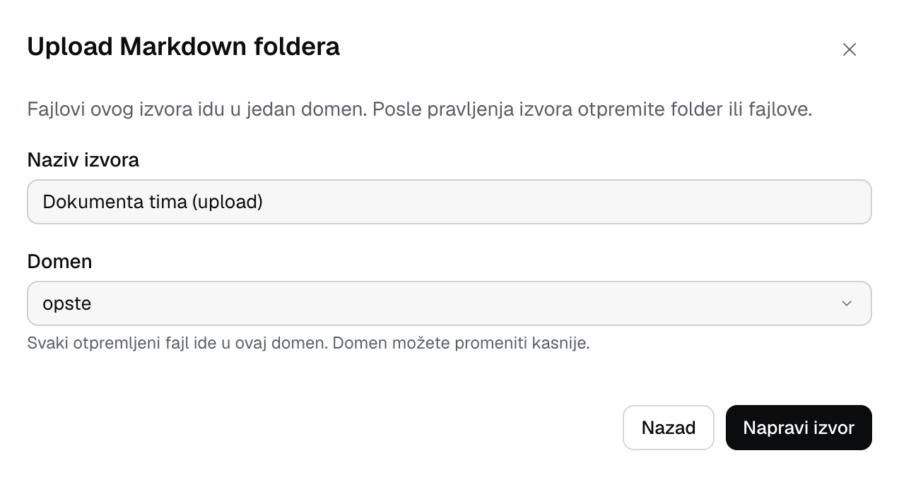
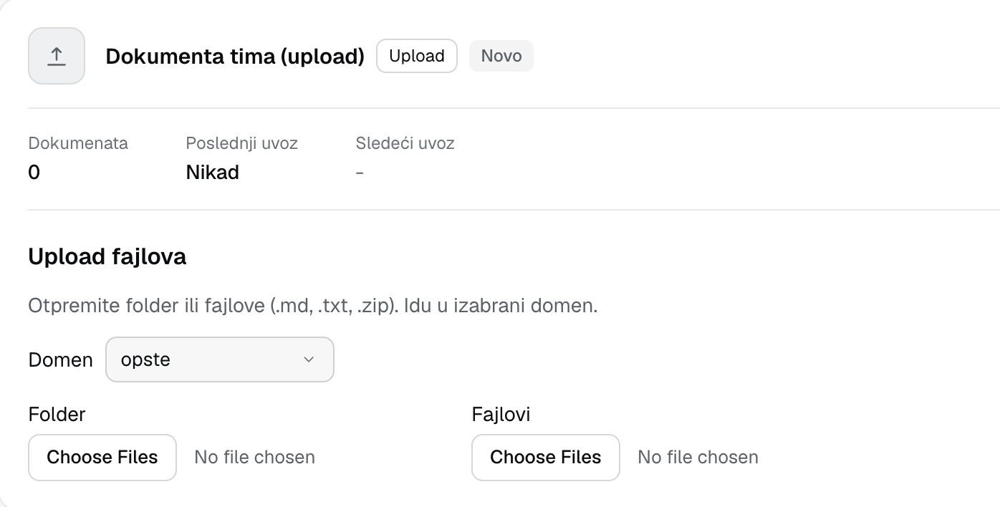
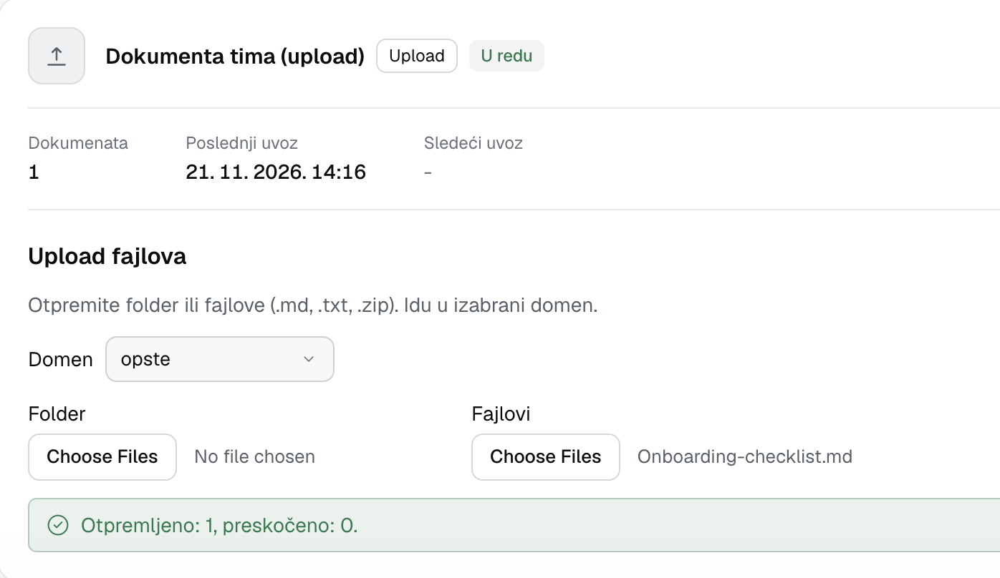
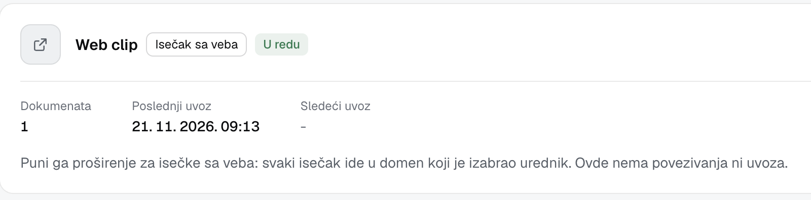
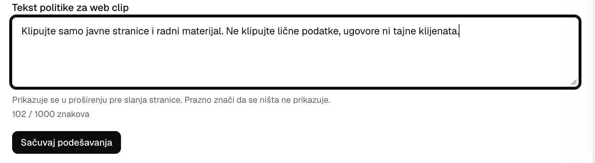

Provereno na Izumi 0.5.7, 2026-11-21.

Izvor **Upload** je za dokumente koje otpremate ručno, iz foldera ili kao fajlove, bez veze sa spoljnim sistemom. Ova stranica pokriva i izvor **Web clip**, instalaciju proširenja za web clip i tekst politike koji vaši ljudi vide u proširenju.

## Pre nego što počnete

- Morate biti admin firme.
- Firma mora imati bar jedan domen. Svaki otpremljeni fajl ide u domen koji izaberete.
- Prihvataju se `.md` i `.txt` fajlovi, ili `.zip` koji ih sadrži (iz koda).

## Napravite izvor Upload

<Steps>
  <Step title="Dodajte izvor">
    Otvorite **Izvori** i kliknite **Dodaj izvor**. Izaberite karticu **Upload** ("Otpremite Markdown (.md) i tekstualne (.txt) fajlove iz foldera."). Otvara se dijalog **Upload Markdown foldera**.

    <Frame>
      
    </Frame>
  </Step>
  <Step title="Upišite naziv i izaberite domen">
    **Naziv izvora** ima do 120 znakova, inače javlja _"Unesite naziv (do 120 znakova)."_ Lista **Domen** nudi domene firme: "Svaki otpremljeni fajl ide u ovaj domen. Domen možete promeniti kasnije." Kliknite **Napravi izvor**. Poruka je _"Izvor je napravljen. Fajlove dodajte u Pravila i opseg."_ Nova kartica ima oznaku **Novo**.
  </Step>
  <Step title="Otvorite Upload fajlova">
    Kliknite **Pravila i opseg**. Odeljak **Upload fajlova** ima polja **Domen**, **Folder** i **Fajlovi**. Dugmad za izbor fajla prikazuje pregledač, pa njihov tekst prati jezik pregledača, ne Izumija.

    <Frame>
      
    </Frame>
  </Step>
  <Step title="Otpremite">
    Izaberite folder ili fajlove. Otpremanje kreće odmah. Poruka je na primer _"Otpremljeno: 1, preskočeno: 0."_ Posle nekoliko sekundi kartica pokazuje broj **Dokumenata** i stanje **U redu**.

    <Frame>
      
    </Frame>
  </Step>
</Steps>

Isti fajl sa istom putanjom i izmenjenim sadržajem ažurira postojeći dokument, ne pravi novi (proveren uživo: broj dokumenata je ostao isti). Domen izvora menjate u listi **Domen** u odeljku **Upload fajlova**: _"Domen je sačuvan. Novi fajlovi idu u njega."_ Već otpremljeni fajlovi ostaju u starom domenu (iz koda).

### Brisanje izvora Upload

Meni sa tri tačke na kartici ima **Obriši izvor**. Dijalog **Obrisati izvor?** kaže da se brišu izvor i svi njegovi dokumenti i da se ovo ne može poništiti. Kliknite **Obriši**. Poruka je _"Izvor je obrisan."_ Izvor i dokumenti nestaju (provereno uživo).

## Izvor Web clip

Izvor **Web clip** se ne pravi ručno. Nastaje sam kad u firmu stigne prvi isečak sa veba, i tada se pojavi kartica.

<Steps>
  <Step title="Pogledajte karticu">
    Kartica ima naziv **Web clip**, oznaku vrste **Isečak sa veba** i stanje **U redu**, uz broj dokumenata. Tekst na kartici kaže da je puni proširenje i da se ovde ništa ne povezuje niti uvozi. Nema **Pravila i opseg**, samo meni sa tri tačke.

    <Frame>
      
    </Frame>
  </Step>
  <Step title="Obrišite izvor (ako treba)">
    **Obriši izvor** briše sve isečke firme, a dijalog navodi broj dokumenata. Pojedinačan isečak se ne briše iz liste dokumenata.
  </Step>
</Steps>

Kako ljudi šalju isečke, vidi [Web clip](/sr/koriscenje/web-clip).

## Tekst politike za web clip

Tekst politike je kratko pravilo firme koje proširenje prikazuje pre slanja stranice, na primer šta se sme slati.

<Steps>
  <Step title="Upišite tekst">
    Otvorite **Firme i članovi**, odeljak **Podešavanja**. Polje **Tekst politike za web clip** prima do 1000 znakova, a brojač je pored polja. Kliknite **Sačuvaj podešavanja**. Prazno polje znači da se ništa ne prikazuje.

    <Frame>
      
    </Frame>
  </Step>
  <Step title="Primer teksta">
    "Šaljite samo stranice koje vaš tim sme da čuva i koje nisu poverljive. Ne šaljite stranice sa ličnim podacima, lozinkama klijenata ili internim sistemima. Isečak čitaju svi koji mogu da čitaju domen koji izaberete."
  </Step>
</Steps>

Tekst se prikazuje kao običan tekst iznad izbora domena, svaki put kad osoba izabere tu firmu u proširenju (iz vodiča za instalaciju, nije provereno uživo). Podsetite ljude da je isečak kopija stranice kao tekst, da se vodi kao nepouzdan izvor i da ga rezultati pretrage označavaju kao isečak sa veba.

## Instalacija proširenja za web clip

Proširenje nije u prodavnici proširenja. Postavlja ga administrator, a svaka osoba pravi svoj token.

- Operator pakuje proširenje (CRX i `updates.xml`) i postavlja ga na bilo koji https statički host koji računari mogu da dosegnu. Izumi server ga ne hostuje. Fajlovi ne sadrže token ni adresu servera.
- Proširenje čita stranicu samo kad pritisnete njegovo dugme. Iz Izumija čita samo listu domena u kojima ste urednik i tekst politike firme.
- Prinudna instalacija van prodavnice radi samo na upravljanim računarima: Chrome na Windowsu u Active Directory domenu, Azure AD ili Chrome Enterprise Core, Chrome na macOS preko MDM-a ili Chrome Enterprise Core, Edge na macOS preko MDM-a, Edge na Windowsu samo u Active Directory domenu (van domena samo Edge Add-ons). Lični računar bez upravljanja ignoriše politiku.
- Chrome: politika `ExtensionSettings` sa `installation_mode` `force_installed`, `update_url` i `override_update_url` `true`. Provera na računaru: `chrome://policy` i `chrome://extensions`. Edge: ista struktura, provera `edge://policy` i `edge://extensions`.
- Rezerva za neupravljane računare: Chrome Web Store sa vidljivošću Unlisted. Svaka osoba instalira iz linka.
- Po osobi: napravite token za web clip (vidi [Web clip](/sr/koriscenje/web-clip)) i u podešavanjima proširenja unesite **Adresa servera** (https, http samo za `localhost`) i token. Adresa servera se ne popunjava unapred politikom, pa svako unosi jednom. Token važi najviše 90 dana.
- Uklanjanje: opozovite token osobe. Proširenje ostaje, ali je svako slanje odbijeno. Token za web clip prestaje da radi za domen čim osoba izgubi ulogu urednika tamo.

## Ograničenja

- Upload prima `.md`, `.txt` i `.zip` koji ih sadrži. Ostale vrste se preskaču i ulaze u broj "preskočeno" (iz koda).
- Najviše 50 MB po fajlu, 1000 fajlova po slanju, 10000 unosa iz zip fajlova i 256 MiB ukupno u jednom slanju (iz koda).
- Putanja fajla je njegov spoljni id u izvoru. Isti naziv sa istom putanjom ažurira dokument.
- Isečak sa veba se ne briše pojedinačno. Briše se ceo izvor **Web clip**.

## Rešavanje problema

- _"Upload je prevelik. Pošaljite manje fajlova ili fajlove manje veličine."_ Pošaljite manje fajlova odjednom (iz koda).
- _"Fajlovi se nisu mogli pročitati. Pošaljite .md, .txt ili .zip fajlove."_ Fajl nije u podržanom formatu (iz koda).
- _"Upload nije uspeo. Pokušajte ponovo."_ Opšta greška. Ponovite otpremanje.
- Kartica posle prvog otpremanja i dalje kaže **Novo** i 0 dokumenata. Jednom smo videli da se kartica nije osvežila skoro pola minuta, pa je pomogao tek drugi otpremljeni fajl. Da li je dovoljno ponovo učitati stranicu, nismo proverili.
- Izvor **Web clip** ne postoji. Pojavljuje se tek posle prvog isečka u firmi.
