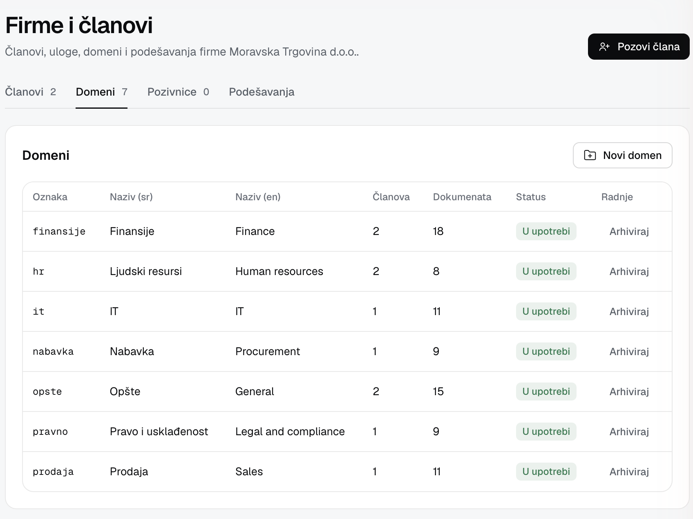
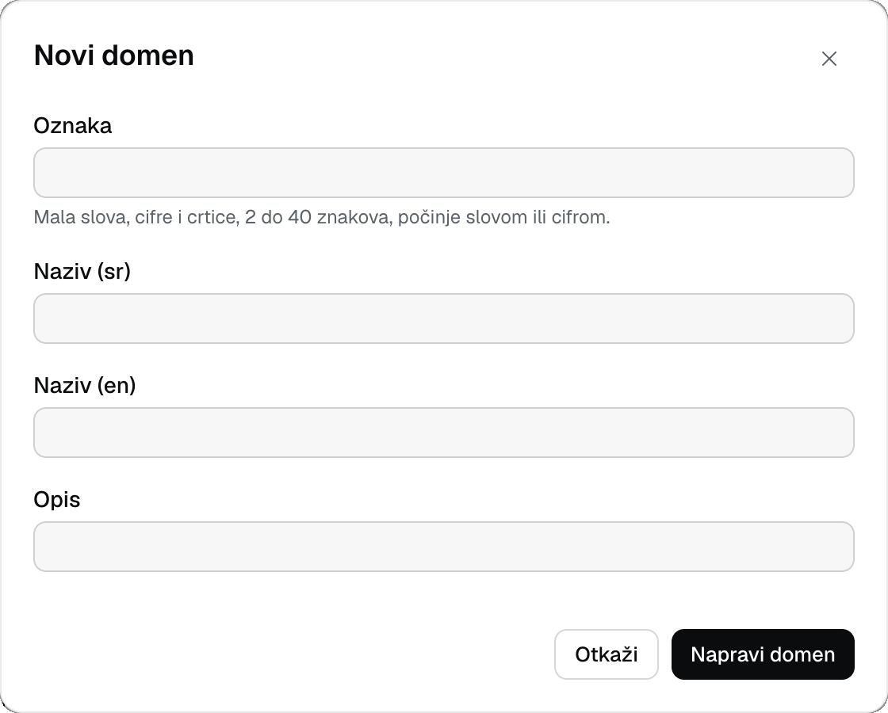
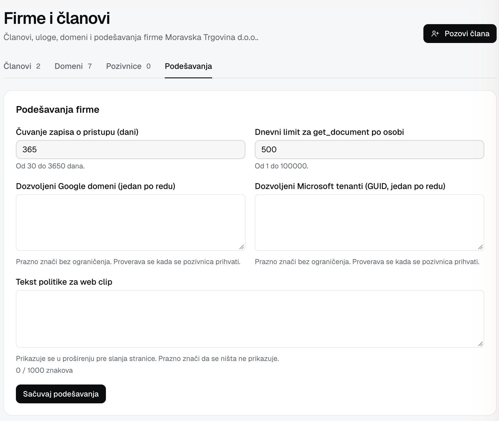
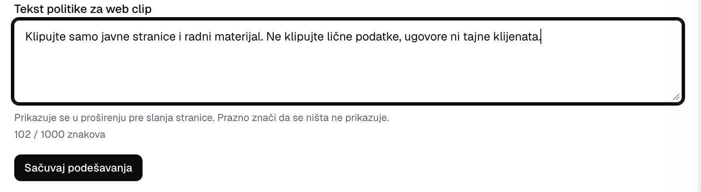

Provereno na Izumi 0.5.7, 2026-11-21.

U Izumiju je firma (kompanija) granica podataka. Unutar firme su domeni, oblasti znanja kao što su Finansije ili Kadrovska. Uloga vezuje osobu za jedan domen. Sve se podešava na strani **Firme i članovi**, u odeljcima **Domeni** i **Podešavanja**.

## Kako se to slaže

- Firma ima članove. Član vidi samo dokumente iz domena u kojima ima ulogu.
- **Čitalac** čita i pretražuje dokumente domena.
- **Urednik** čita isto što i čitalac, šalje web clip isečke u domen i odobrava ili odbija predložene beleške tog domena (vidi [Pregled predloga](/sr/admin/pregled-predloga)).
- **Admin firme** upravlja članovima, domenima, izvorima i podešavanjima. Admin nije automatski urednik nijednog domena. Ulogu urednika mu dajete kao i svakom drugom članu.
- Dokumenti, izvori i zapisi o pristupu pripadaju firmi. Druga firma ih ne vidi.

Firme se prave samo operatorskom komandom na serveru, ne iz web strane (iz vodiča za instalaciju). Ova strana radi nad firmom koja je izabrana u zaglavlju.

## Domeni

<Steps>
  <Step title="Otvorite odeljak Domeni">
    Tabela ima kolone **Oznaka**, **Naziv (sr)**, **Naziv (en)**, **Opis**, **Članova**, **Dokumenata**, **Status** i **Radnje**. Status je **U upotrebi** ili **Arhiviran**. Broj **Dokumenata** se računa samo za domene u kojima i vi imate ulogu. Za ostale piše _"Nemate ulogu u ovom domenu, pa se njegovi dokumenti ne broje za vas."_ Slika izostavlja kolonu **Opis**, da ostane čitljiva.

    <Frame>
      
    </Frame>
  </Step>
  <Step title="Napravite domen">
    Kliknite **Novi domen**. Polja su **Oznaka**, **Naziv (sr)**, **Naziv (en)** i **Opis**. Oznaka ima mala slova, cifre i crtice, 2 do 40 znakova, počinje slovom ili cifrom i mora biti jedinstvena u firmi. Oznaka se ne završava crticom i nema dve crtice zaredom. Naziv ima najviše 120 znakova. Kliknite **Napravi domen**.

    <Frame>
      
    </Frame>
  </Step>
  <Step title="Arhivirajte ili vratite domen">
    **Arhiviraj** u koloni **Radnje** skida domen iz upotrebe, **Vrati** ga vraća. Arhiviran domen ne briše dokumente, ali uloge u njemu više ne daju pristup i novi uvozi ne idu u njega (iz koda).
  </Step>
  <Step title="Dajte uloge">
    Uloge se daju u odeljku **Članovi** ili u dijalogu pozivnice. Koraci su na stranici [Korisnici i pozivnice](/sr/admin/korisnici).
  </Step>
</Steps>

## Podešavanja firme

Odeljak **Podešavanja** čuva sve vrednosti jednim klikom na **Sačuvaj podešavanja**.

<Steps>
  <Step title="Pogledajte podešavanja">
    - **Čuvanje zapisa o pristupu (dani)**: od 30 do 3650 dana. Posle tog roka stari zapisi se brišu, vidi [Brisanje i čuvanje](/sr/admin/brisanje).
    - **Dnevni limit za get_document po osobi**: od 1 do 100000. Toliko poziva `get_document` dnevno (UTC) prolazi po jednom tokenu ili povezanoj aplikaciji. Svaka strana dokumenta je jedan poziv (iz koda).
    - **Dozvoljeni Google domeni (jedan po redu)** i **Dozvoljeni Microsoft tenanti (GUID, jedan po redu)**: najviše 20 unosa u svakom polju.
    - **Tekst politike za web clip**: do 1000 znakova, brojač je pored polja.

    <Frame>
      
    </Frame>
  </Step>
  <Step title="Ograničite prijavu po organizaciji (opciono)">
    Kad je bar jedno od dva polja popunjeno, osoba koja prihvata pozivnicu mora da se prijavi nalogom iz te liste: Google nalogom sa dozvoljenim domenom ili Microsoft nalogom iz dozvoljenog tenanta. Prazna polja znače bez ograničenja. Provera se radi samo pri prihvatanju pozivnice. Provereno uživo na 0.5.8 sa Microsoft tenantom: sa pogrešnim GUID-om tenanta prihvatanje je odbijeno, a posle ispravke liste isti link pozivnice je radio (odbijeno prihvatanje ne troši pozivnicu).
  </Step>
  <Step title="Upišite tekst politike za web clip (opciono)">
    Tekst vidi svako ko koristi proširenje za web clip, pre slanja stranice. Prazno polje znači da se ništa ne prikazuje. Kako se tekst vidi u proširenju, vidi [Izvor: upload](/sr/admin/izvori-upload).

    <Frame>
      
    </Frame>
  </Step>
</Steps>

## Ograničenja

- Firmu ne možete da napravite ni obrišete iz web strane.
- Oznaka domena se ne menja posle pravljenja (iz koda: izmena domena menja nazive i opis).
- Najviše 20 Google domena i 20 Microsoft tenanata po firmi.
- Ako popunite samo Google domene, Microsoft nalozi ne mogu da prihvate pozivnicu, i obrnuto. Upišite oba ako vam trebaju oba (iz koda).
- Ograničenje po domenu ili tenantu ne proverava članove koji već imaju nalog, već samo prihvatanje nove pozivnice (iz koda).

## Rešavanje problema

- _"Domen sa ovom oznakom već postoji."_ Oznake su jedinstvene u firmi. Izaberite drugu.
- _"Koristite mala slova, cifre i crtice (2 do 40 znakova)."_ Oznaka ne sme da ima razmake, velika slova ni dijakritike.
- _"Nije ispravan naziv domena: …"_ ili _"Nije ispravan GUID: …"_ Jedan od unosa u Google domenima ili Microsoft tenantima nije ispravan. Ispravite ga ili ga obrišite.
- _"Najviše … unosa."_ Smanjite listu na 20 unosa.
- Pozvana osoba vidi _"Firma ne dozvoljava prijavu sa ovog naloga (dozvoljeni domeni ili tenanti). Obratite se administratoru firme."_ (proveri uživo) Proverite da li je njen Google domen ili Microsoft tenant u listi. Za prazne liste nema ograničenja.
