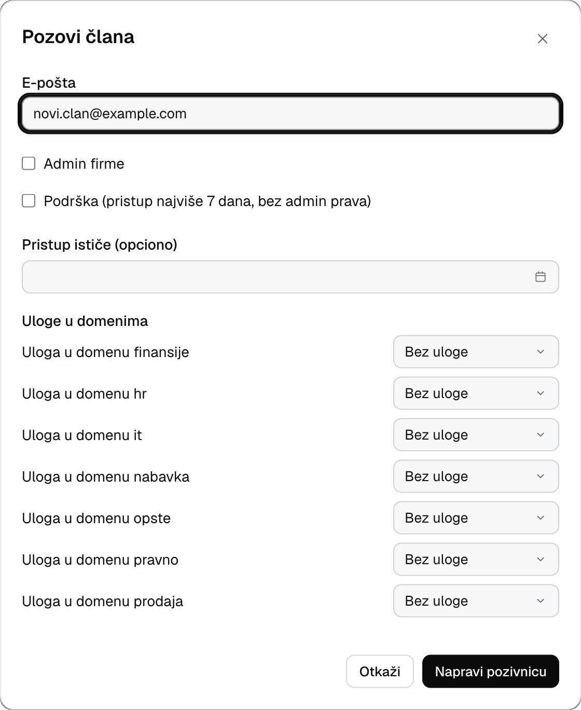
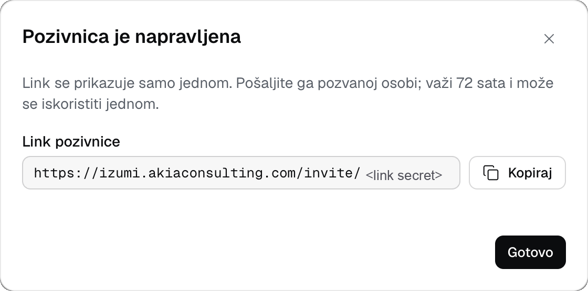
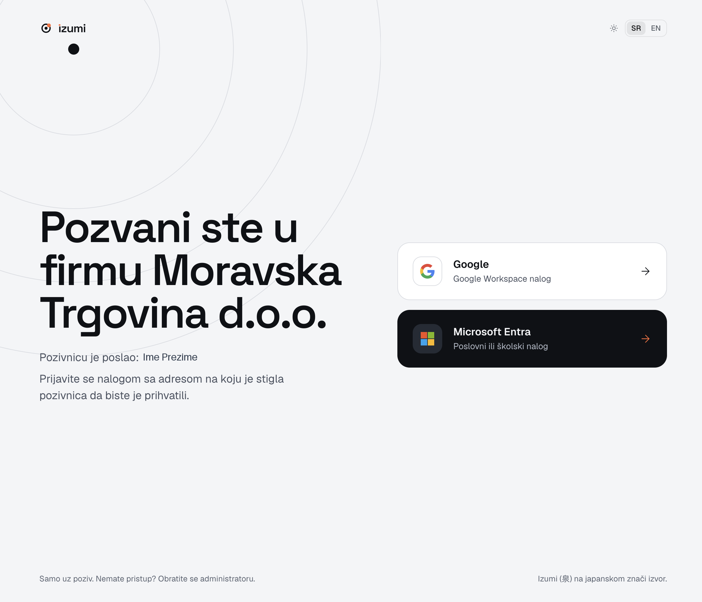
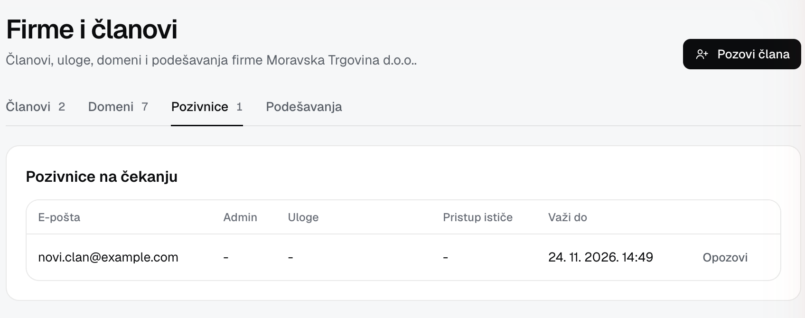
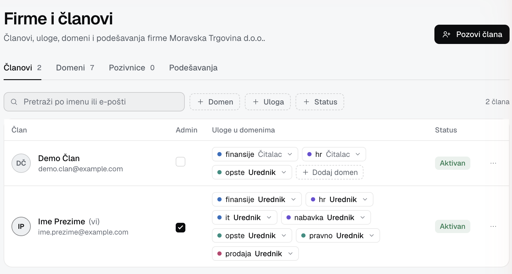
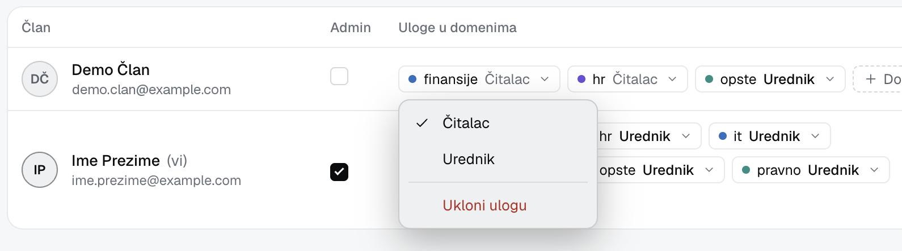
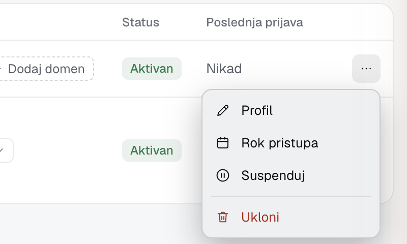
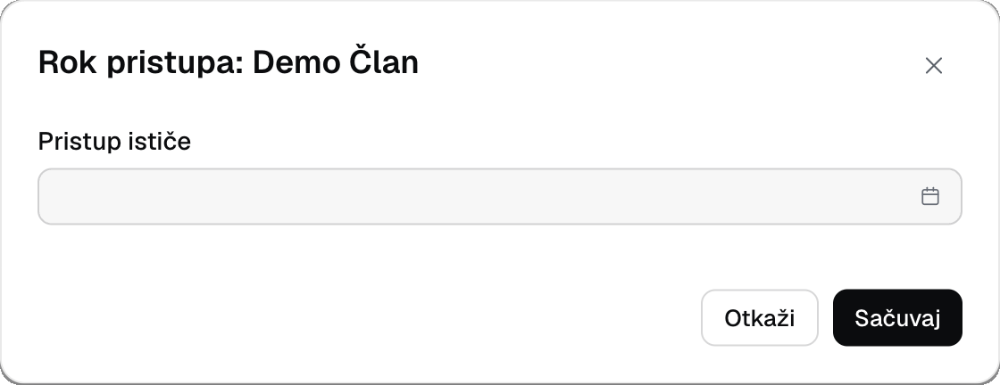
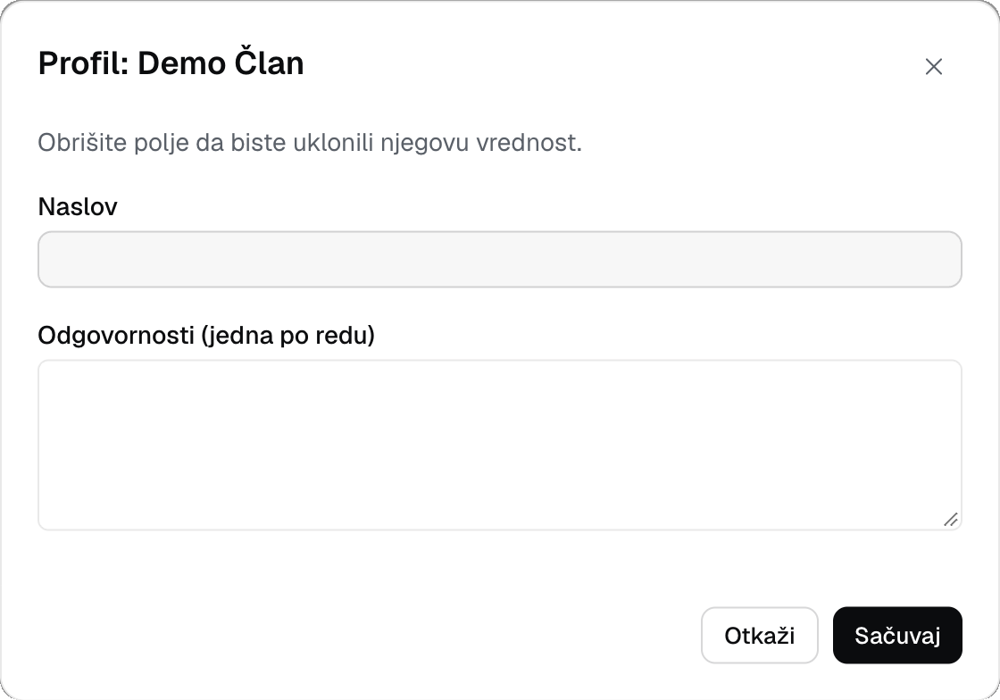
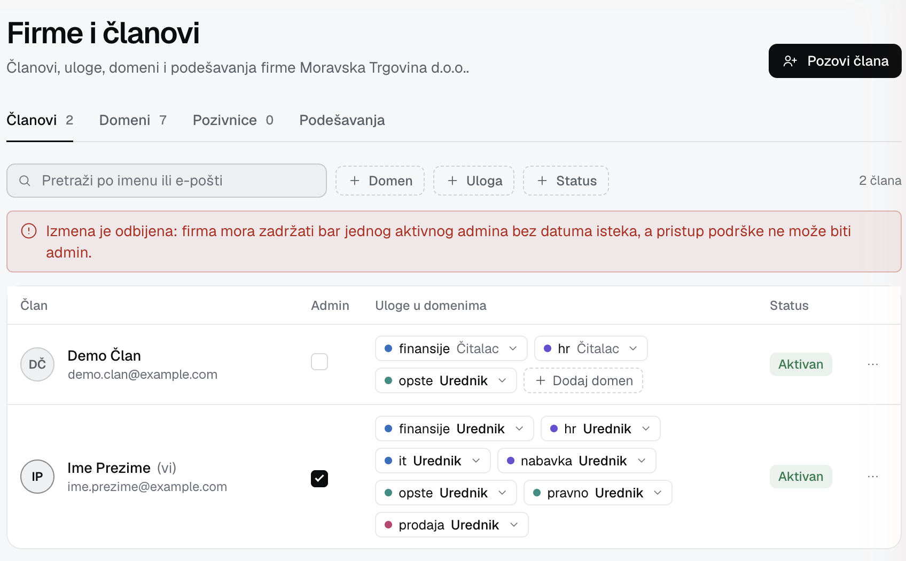

Provereno na Izumi 0.5.7, 2026-11-21.

Ljude pozivate i njima upravljate na strani **Firme i članovi**. Odeljci su **Članovi**, **Domeni**, **Pozivnice** i **Podešavanja**. Ova stranica pokriva **Članovi** i **Pozivnice**. Domeni i podešavanja su na stranici [Kompanije, domeni, uloge](/sr/admin/kompanije-domeni-uloge).

## Pre nego što počnete

- Morate biti admin firme. Stavke **Firme i članovi**, **Izvori** i **Izveštaj uvoza** vide samo admini (iz koda).
- Firma mora da postoji. Firme se prave samo operatorskom komandom na serveru (iz vodiča za instalaciju), ne iz ove strane. Strana radi nad firmom koja je izabrana u zaglavlju.
- Napravite bar jedan domen pre nego što dajete uloge. Bez domena dijalog pozivnice kaže _"Još nema domena. Napravite domen da biste dali uloge."_

## Pozovite novog člana

<Steps>
  <Step title="Otvorite dijalog">
    Kliknite **Pozovi člana** gore desno. Dijalog ima polja **E-pošta**, **Admin firme**, **Podrška (pristup najviše 7 dana, bez admin prava)** i **Pristup ističe (opciono)**. Ispod su redovi "Uloga u" sa nazivom domena, po jedan za svaki domen, sa izborom **Bez uloge**, **Čitalac** ili **Urednik**.

    <Frame>
      
    </Frame>
  </Step>
  <Step title="Napravite pozivnicu">
    Upišite adresu, izaberite uloge i kliknite **Napravi pozivnicu**. Izumi prikazuje **Link pozivnice** samo jednom: _"Link se prikazuje samo jednom. Pošaljite ga pozvanoj osobi; važi 72 sata i može se iskoristiti jednom."_ Kliknite **Kopiraj**, pa **Gotovo**.

    <Frame>
      
    </Frame>
  </Step>
  <Step title="Pošaljite link sami">
    Izumi ne šalje mejl (iz koda). Link šaljete vi, kroz kanal kojem verujete. Osoba otvara link, vidi poruku "Pozvani ste u firmu" sa nazivom firme i imenom osobe koja je pozvala, i prijavljuje se nalogom sa adresom iz pozivnice. Provereno uživo na 0.5.8 sa Microsoft nalogom.
    <Frame>
      
    </Frame>
  </Step>
  <Step title="Pratite pozivnice na čekanju">
    Odeljak **Pozivnice** (broj je pored naslova) pokazuje **Pozivnice na čekanju**: **E-pošta**, **Admin**, **Uloge**, **Pristup ističe** i **Važi do**. **Opozovi** poništava pozivnicu i javlja _"Pozivnica je opozvana."_

    <Frame>
      
    </Frame>
  </Step>
</Steps>

## Upravljajte članovima

<Steps>
  <Step title="Pogledajte listu">
    Odeljak **Članovi** je tabela sa kolonama **Član**, **Admin**, **Uloge u domenima**, **Status** i **Poslednja prijava**. Iznad je pretraga po imenu ili e-pošti i filteri **Domen**, **Uloga** i **Status**. Slika izostavlja kolonu **Poslednja prijava**, da ostane čitljiva.

    <Frame>
      
    </Frame>
  </Step>
  <Step title="Promenite ulogu u domenu">
    Svaka uloga je čip oblika `domen Uloga`. Klik na čip otvara meni sa **Čitalac**, **Urednik** i **Ukloni ulogu**. **Dodaj domen** dodaje ulogu u još jednom domenu.

    <Frame>
      
    </Frame>
  </Step>
  <Step title="Otvorite meni člana">
    Meni na kraju reda ima **Profil**, **Rok pristupa**, **Suspenduj** (posle toga **Aktiviraj**) i **Ukloni**.

    <Frame>
      
    </Frame>
  </Step>
  <Step title="Postavite rok pristupa">
    **Rok pristupa** otvara dijalog sa poljem **Pristup ističe**. Posle tog datuma član više nema pristup. Rok mora biti u budućnosti i najviše 365 dana unapred (iz koda).

    <Frame>
      
    </Frame>
  </Step>
  <Step title="Dopunite profil">
    **Profil** otvara polja **Naslov** i **Odgovornosti (jedna po redu)**: do 200 znakova po redu i do 20 redova. Podaci se čuvaju uz člana (iz koda). Gde se tačno prikazuju nije provereno uživo.

    <Frame>
      
    </Frame>
  </Step>
  <Step title="Postavite ili skinite admina">
    Polje **Admin** u redu daje ili skida admin pravo. Firma mora zadržati bar jednog aktivnog admina bez roka. Ako to pokušate da prekršite, server odbija izmenu i ništa se ne menja.

    <Frame>
      
    </Frame>
  </Step>
</Steps>

**Suspenduj** privremeno zaustavlja pristup, a **Aktiviraj** ga vraća. Suspendovana osoba koja se prijavi vidi na stranici prijave _"Ovaj nalog još nije pozvan."_ uz savet da zatraži poziv od administratora (proveri uživo), isto obaveštenje kao za nalog koji nikad nije pozvan. **Ukloni** pita _"Ukloniti člana …?"_ Dijalog kaže _"Osoba gubi pristup ovoj firmi i njene uloge ovde se brišu. Nalog ostaje."_ Proveri uživo: posle **Ukloni** član nestaje iz liste, a nova pozivnica za istu adresu (sa ulogom Čitalac) je potom prihvaćena, osoba se vraća kao novi član samo sa ulogama nove pozivnice.

## Ograničenja

- Admin firme nije automatski urednik domena. Ulogu urednika dajete posebno, po domenu.
- Pozivnica važi 72 sata i može se iskoristiti jednom. Link se prikazuje samo jednom.
- Nova pozivnica za istu adresu zamenjuje onu na čekanju (iz koda).
- Pristup podrške traje najviše 7 dana i ne može biti admin. **Poništi režim podrške (dozvoljava rok posle 7 dana)** u dijalogu roka skida to ograničenje (iz koda).
- Nalog koji pozvani koristi mora da ima adresu iz pozivnice. Ograničenje po Google domenu ili Microsoft tenantu proverava se pri prihvatanju pozivnice (iz koda, vidi [Kompanije, domeni, uloge](/sr/admin/kompanije-domeni-uloge)).

## Rešavanje problema

- _"Izmena je odbijena: firma mora zadržati bar jednog aktivnog admina bez datuma isteka, a pristup podrške ne može biti admin."_ Skidate admina sa jedinog admina, ili dajete admina nalogu podrške. Prvo napravite drugog admina.
- _"Pozivnica nije napravljena."_ Adresa nije ispravna ili je server odbio zahtev. Proverite **E-pošta** i rok.
- Pozvani kaže da link ne radi. Stranica prikazuje jednu od četiri poruke: _"Pozivnica je istekla. Zatražite novu od administratora firme."_ (prošlo je 72 sata), _"Pozivnica je već iskorišćena."_, _"Pozivnica je opozvana. Zatražite novu od administratora firme."_ (opozvali ste je ili ste napravili noviju za istu adresu) ili _"Pozivnica nije važeća."_ (link nije ceo ili nikad nije izdat). Napravite novu pozivnicu. Opozvani, zamenjeni i nevažeći linkovi provereni su uživo, ostala dva su iz koda.
- Pozvana osoba se prijavi pogrešnim nalogom. Vidi _"Ovaj nalog ne odgovara pozivnici. Prijavite se nalogom sa pozvanom adresom, pa ponovo otvorite link pozivnice."_ (proveri uživo). Pozivnica nije potrošena, pa isti link radi kad se osoba prijavi pravim nalogom.
- _"Još nema domena. Napravite domen da biste dali uloge."_ Napravite domen u odeljku **Domeni**.
