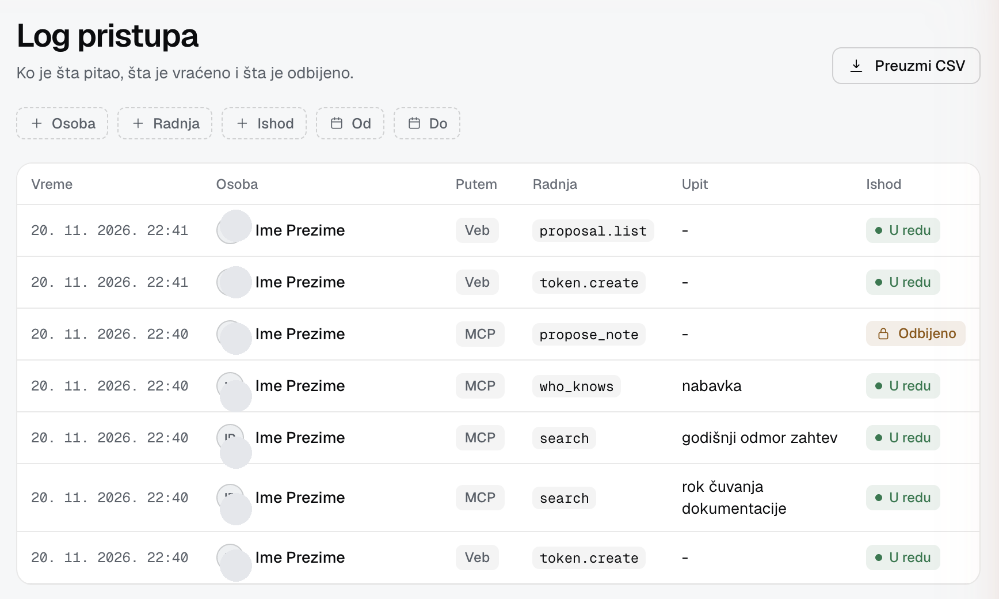
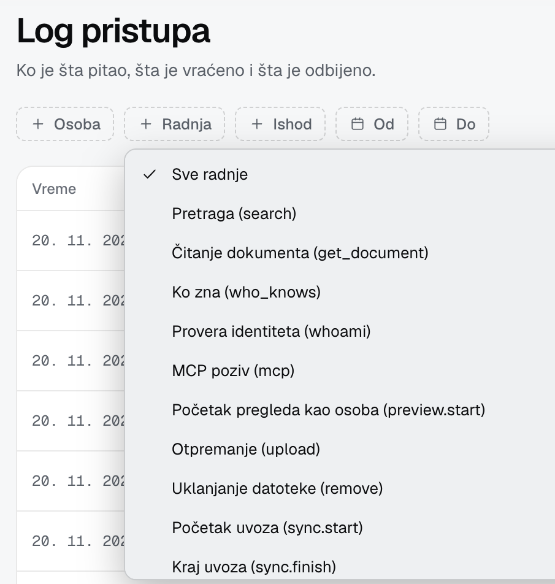

Provereno na Izumi 0.5.7, 2026-11-21.

**Log pristupa** beleži ko je šta pitao, šta je vraćeno i šta je odbijeno. Svaki poziv, iz veba, iz AI alata, iz web clip proširenja i kroz push API, upisuje jedan red. Admin firme ovde vidi sve što se dešava u njegovoj firmi, a svaki član vidi samo svoje.

## Pre nego što počnete

- Stavku **Log pristupa** u levom meniju vide svi članovi. Admin firme vidi zapise svih ljudi u firmi, član samo svoje (proveri uživo: član vidi samo svoje redove, nema filter **Osoba**, a **Preuzmi CSV** daje samo te redove).
- Red bez firme ne vidi niko na vebu, ni vlasnik tog reda. Vidi ga samo operator servera (iz koda).
- Koliko se zapisi čuvaju podešavate u **Podešavanja firme**.

## Pregledajte zapise

<Steps>
  <Step title="Otvorite log">
    Kliknite **Log pristupa**. Kolone su **Vreme**, **Osoba**, **Putem**, **Radnja**, **Upit**, **Rezultata**, **Ishod** i **Trajanje**. **Putem** kaže odakle je zahtev došao: **MCP**, **Veb**, **Pregled**, **Veb isečak**, **Povezana aplikacija (OAuth)**, **Slanje**, **Obrada**, **Sistem** ili **Održavanje**. **Ishod** je **U redu**, **Odbijeno** ili **Greška**. Poslednja kolona, **Radnje**, otvara detalje reda. Najnoviji red je prvi. Slika izostavlja kolone **Rezultata** i **Trajanje** i poslednju kolonu, da ostane čitljiva.

    <Frame>
      
    </Frame>
  </Step>
  <Step title="Suzite zapise">
    Filteri su **Osoba** (samo admin firme), **Radnja**, **Ishod**, **Od** i **Do**. **Preuzmi CSV** preuzima zapise sa istim filterima, sve strane, kao jedan UTF-8 fajl sa oznakom redosleda bajtova (BOM) da ga Excel ispravno otvori. Ima 16 kolona sa engleskim tehničkim nazivima (`id`, `at`, `company`, `person`, `acting_person`, `previewed_by`, `via`, `client`, `agent`, `action`, `query`, `result_count`, `outcome`, `error_code`, `duration_ms`, `hidden_refs`), a i vrednosti su tehničke (na primer `web`, `worker`, `ok`, `denied`). **Učitaj još** donosi sledeću stranu na ekranu (50 redova po strani).

    <Frame>
      
    </Frame>
  </Step>
  <Step title="Otvorite detalje">
    Strelica na kraju reda otvara **Detalji**. Za pretragu piše **Dokumenti u odgovoru**: naslovi koje je AI alat dobio. Za odbijen poziv piše **Šifra greške**. Naslov vidite samo za dokument koji i sami smete da čitate. Za ostale piše broj, na primer "2 dokumenta van vašeg pristupa".
  </Step>
</Steps>

## Podesite čuvanje

Zapisi se ne čuvaju večno. Rok podešavate u **Firme i članovi**, odeljak **Podešavanja**, polje **Čuvanje zapisa o pristupu (dani)**.

- Dozvoljeno je od 30 do 3650 dana. Podrazumevano je 365.
- Radnik jednom dnevno briše zapise starije od roka (iz vodiča za instalaciju).
- Zapisi obrisane firme ili osobe ostaju dok im ne istekne rok.
- Promena roka se beleži u logu kao izmena čuvanja zapisa.

Polje i dugme **Sačuvaj podešavanja** su opisani na stranici [Kompanije, domeni, uloge](/sr/admin/kompanije-domeni-uloge).

## Šta se ne upisuje

- Naslov i tekst dokumenta poslatog push API-jem se nikad ne upisuju. Upisuju se spoljni id, domen, izvor i broj bajtova (vidi [Push API](/sr/admin/push-api)).
- Detalji na vebu ne prikazuju naziv tokena ni putanju uklonjenog fajla, samo identifikatore i fiksne reči (iz koda).

## Ograničenja

- Kolona **Radnja** prikazuje tehnički naziv radnje (na primer `search`), a filter **Radnja** nudi nazive na jeziku ekrana.
- Admin vidi zapise firme, ne zapise drugih firmi u kojima nije admin.
- Uklanjanje dokumenata i brisanje izvora upisuje svoje redove. Šta se briše i kada, vidi [Brisanje i čuvanje](/sr/admin/brisanje).
- Izumi ne šalje obaveštenja na osnovu loga. Log je za pregled i izvoz.

## Rešavanje problema

- _"Log se nije učitao."_ Osvežite stranicu.
- _"Nema zapisa."_ Proširite filtere **Od** i **Do**. Ako to ne pomaže, rok čuvanja je možda prekratak i zapisi su već obrisani.
- Ne vidite zapis kolege. Niste admin firme.
- Ne vidite naslov dokumenta u detaljima. Dokument je van vašeg pristupa ili je uklonjen. Piše samo broj.
- Zapis starog poziva je nestao. Prošao je rok iz **Čuvanje zapisa o pristupu (dani)**. Povećajte rok za buduće zapise.
