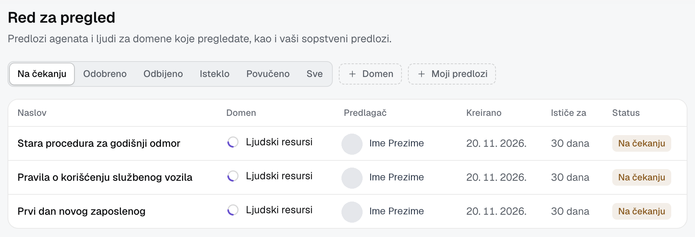
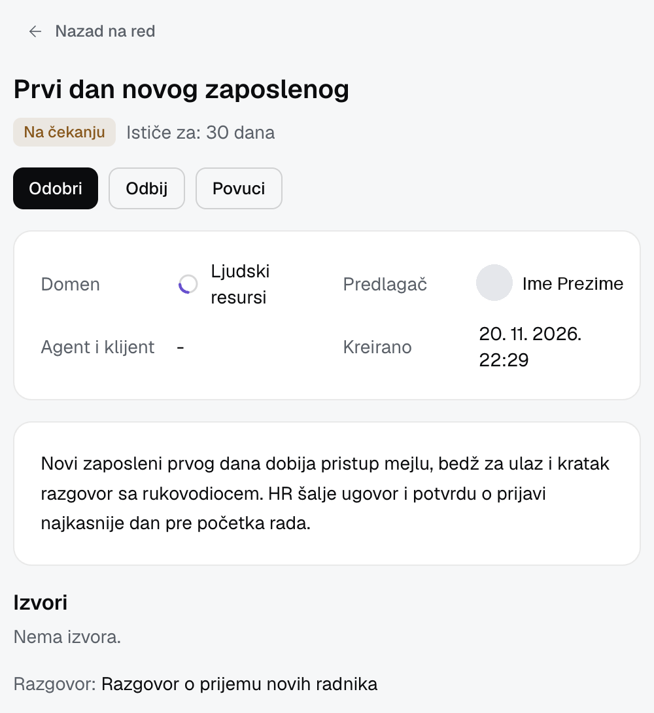

Provereno na Izumi 0.5.7, 2026-11-21.

Predlog je beleška koju AI alat (ili osoba kroz svoj token) predlaže za jedan domen. Dok je urednik tog domena ne odobri, beleška se ne pretražuje. Ova stranica je za admina: ko odlučuje, kako to podesiti i šta se dešava sa predlozima. Korak po korak za urednika je na stranici [Predlozi i pregled](/sr/koriscenje/predlozi).

## Ko odlučuje

- Odlučuje urednik domena na koji se predlog odnosi. U **Red za pregled** vidi predloge svojih domena i svoje predloge i ima dugmad **Odobri** i **Odbij**.
- Admin firme nije automatski urednik. Predloge domena vidi i o njima odlučuje samo ko ima ulogu **Urednik** u tom domenu (iz koda: pregled gleda samo ulogu urednika).
- Predlagač koji nije urednik vidi samo svoje predloge i može samo da ih povuče (**Povuci**), ne i da ih odobri (iz koda).
- Član bez uloge urednika i bez svojih predloga vidi prazan red. Tuđi predlog otvara **Predlog nije pronađen**.

<Info>
Admin firme koji nije urednik ne vidi predloge. Ako je domen bez urednika, predlozi tog domena čekaju dok ne isteknu. Dajte ulogu **Urednik** bar jednoj osobi u svakom domenu u koji AI alati mogu da predlažu.
</Info>

## Podesite pregled

<Steps>
  <Step title="Odredite urednike">
    Za svaki domen izaberite osobu koja zna sadržaj i dajte joj ulogu **Urednik**. Koraci su na stranici [Korisnici i pozivnice](/sr/admin/korisnici), a uloge i domeni su objašnjeni na stranici [Kompanije, domeni, uloge](/sr/admin/kompanije-domeni-uloge).
  </Step>
  <Step title="Pogledajte red kao urednik">
    Kliknite **Red za pregled** u levom meniju, koji vide svi članovi firme. Broj pored stavke pokazuje koliko predloga čeka vašu odluku. Kolone su **Naslov**, **Domen**, **Predlagač**, **Kreirano**, **Ističe za** i **Status**.

    <Frame>
      
    </Frame>
  </Step>
  <Step title="Odobrite ili odbijte">
    Otvorite predlog. Vidite **Domen**, **Predlagač**, **Agent i klijent**, **Kreirano**, pa tekst predloga, **Izvori** i **Razgovor**. **Odobri** otvara dijalog sa poljima **Naslov** i **Tekst (Markdown)** koje urednik sme da izmeni. **Odbij** traži razlog, koji predlagač vidi.

    <Frame>
      
    </Frame>
  </Step>
</Steps>

## Šta se dešava sa predlogom

- Odobren predlog: dobija status **Odobreno**. Beleška se za nekoliko minuta pojavljuje u **Dokumenti** sa oznakom **Beleška**, a autor je predlagač. Izumi je čuva kroz izvor kompanije za beleške.
- Odbijen predlog: beleška ne nastaje i ne pojavljuje se u pretrazi. Razlog vidi predlagač.
- Povučen predlog: predlagač je odustao. Niko ga više ne može odobriti.
- Istekao predlog: predlog važi 30 dana. Radnik jednom na sat postavlja status **Isteklo** predlozima kojima je istekao rok i za svaki upisuje red `proposal.expire` u [Log pristupa](/sr/admin/log-pristupa) (iz koda).

Odobreni i odbijeni predlozi ostaju vidljivi u redu pod statusima **Odobreno**, **Odbijeno** i **Sve**.

## Ograničenja

- Predlog važi 30 dana, rok se vidi u koloni **Ističe za**.
- Izumi ne šalje mejl o predlozima. Urednik vidi samo broj pored **Red za pregled**, a predlagač ishod vidi kad otvori svoj predlog (u kodu nema slanja pošte).
- Odobrena beleška ne može da se obriše iz liste **Dokumenti** ni sa stranice dokumenta. Obrisati se može samo ceo izvor beleški na stranici **Izvori**, što briše sve odobrene beleške firme (iz koda, vidi [Brisanje i čuvanje](/sr/admin/brisanje)).
- Predloge pravi AI alat kroz MCP alat `propose_note`, nema drugog načina da se predlog napravi.

## Rešavanje problema

- Predlog je poslat, a ne vidim ga u **Red za pregled**. Niste urednik tog domena. Admin firme nije automatski urednik, pa mu treba uloga **Urednik** u tom domenu.
- _"Nema predloga za vaše domene."_ Nema ničeg na čekanju, ili niste urednik nijednog domena i nemate svoje predloge. Probajte **Sve** i **Moji predlozi**.
- _"Ovaj predlog se više ne može odlučiti. Možda je već odlučen, povučen ili istekao."_ Neko je već odlučio ili ga je predlagač povukao dok ste imali otvoren dijalog. Osvežite listu.
- Predlozi jednog domena stalno ističu. Domen nema urednika. Dajte ulogu **Urednik**.
- Odobrena beleška se ne pronalazi odmah. Sačekajte nekoliko minuta i pretražite po rečima iz teksta.
