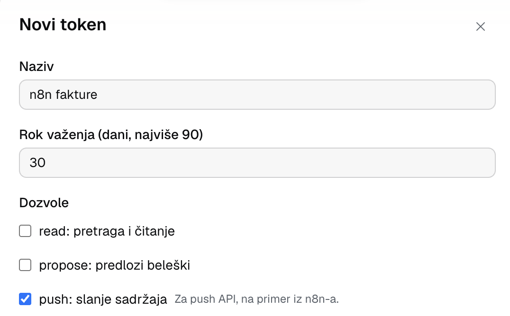
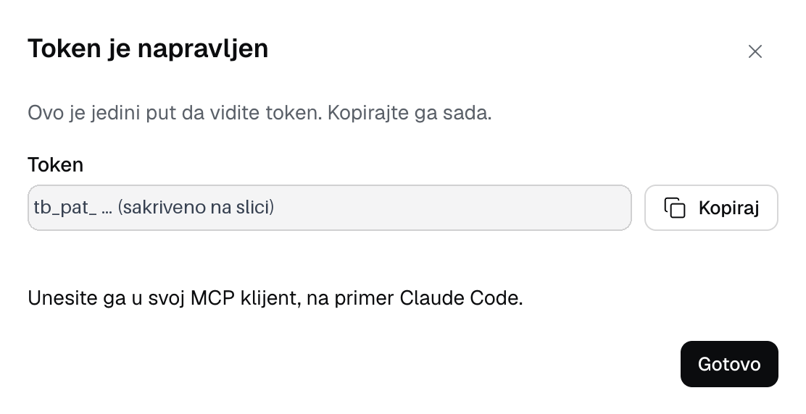
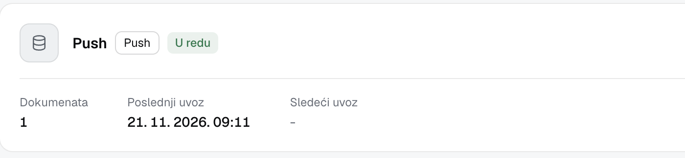

Provereno na Izumi 0.5.7, 2026-11-21.

Push API je za sistem ili osobu koja šalje svoje Markdown dokumente u Izumi spolja, na primer za n8n tok. Dokument ne ide u red za pregled. Radnik ga indeksira za nekoliko sekundi, autor je vlasnik tokena, nikad nije označen kao pregledan i nema oznaku beleške. Ko želi pregledanu belešku, koristi MCP alat `propose_note` (vidi [Pregled predloga](/sr/admin/pregled-predloga)).

Ova stranica je tehničkija od ostalih: ima pozive koje šaljete iz svog sistema.

## Pre nego što počnete

- Nalog u Izumiju i uloga **urednika** u domenu u koji šaljete dokumente.
- Izvor "Push" ne pravite sami. Nastaje sam pri prvom push pozivu u firmi, tačno jedan po firmi (iz koda).
- Token pravite u **Moji tokeni i profil**. Vrednost tokena se vidi samo jednom, pri pravljenju.

## Napravite push token

<Steps>
  <Step title="Otvorite dijalog">
    Otvorite **Moji tokeni i profil**, odeljak **Tokeni**, i kliknite **Novi token**. Dijalog ima **Naziv**, **Rok važenja (dani, najviše 90)** (podrazumevano 30) i **Dozvole**: `read` (pretraga i čitanje), `propose` (predlozi beleški) i `push` (slanje sadržaja).

    Podrazumevano su označeni read i propose, a push nije. Za push token označite samo `push`.

    <Frame>
      
    </Frame>
  </Step>
  <Step title="Ograničite token (opciono)">
    **Ograniči token (opciono)** ograničava token na izabrane firme i domene. Bez izbora token važi za sve vaše firme i domene.
  </Step>
  <Step title="Napravite i kopirajte token">
    Kliknite **Napravi token**. Dijalog kaže: "Ovo je jedini put da vidite token. Kopirajte ga sada." Token počinje sa `tb_pat_`.

    <Frame>
      
    </Frame>
  </Step>
</Steps>

Token ne stavljajte u kod ni u poruke. Opoziv radite u listi tokena, **Opozovi** u redu tokena. Nema potvrde: token odmah prestaje da važi i javlja _"Token je opozvan."_

## Pošaljite dokument

<Steps>
  <Step title="Pošaljite POST">
    `POST /v1/push/documents` sa zaglavljem `Authorization: Bearer <token>` i JSON telom (`Content-Type: application/json`). Obavezna polja su `company` (slug firme), `domain` (slug domena, morate biti urednik tog domena), `external_id` (vaš id dokumenta, 1 do 500 vidljivih ASCII znakova bez razmaka), `title` (1 do 300 znakova) i `markdown` (najmanje 1 znak, najviše 1 MiB UTF-8). Opciona polja su `url` (http ili https, do 2048 znakova), `updated_at` (ISO 8601 sa zonom) i `language` (`sr`, `en` ili `other`).

    ```
    curl -sS https://izumi.example.com/v1/push/documents \
      -H "Authorization: Bearer $IZUMI_TOKEN" -H "Content-Type: application/json" \
      -d '{"company":"moravska","domain":"finansije","external_id":"n8n:invoices:2026-11","title":"Fakture za novembar","markdown":"# Fakture za novembar\n","language":"sr"}'
    ```

    Adresa i slugovi u primeru su zamene.
  </Step>
  <Step title="Pročitajte odgovor">
    Uspeh je `202 Accepted`. `status` je `queued`, a `landing` je `created` (novi id u firmi), `updated` (isti id i domen, dokument se menja) ili `moved` (isti id, drugi domen u kome ste takođe urednik). `document_id` je `null` dok radnik ne indeksira dokument, nekoliko sekundi.
  </Step>
  <Step title="Proverite u Izumiju">
    Posle prvog poziva nastaje izvor "Push" na stranici **Izvori**: kartica ima naziv "Push", stanje **U redu**, broj dokumenata i vreme poslednjeg poziva. Dokument je u listi **Dokumenti**.

    <Frame>
      
    </Frame>
  </Step>
</Steps>

Spoljni id pripada osobi koja ga je prva poslala, po firmi. Isti id opet je ažuriranje, nema posebne rute za izmenu. Isti naslov i tekst se ne indeksiraju ponovo. Izumi sam piše zaglavlje dokumenta (naslov, jezik, autor, vreme, bez oznaka) ispred vašeg Markdowna. Ako vaš Markdown počinje blokom `---`, on ostaje običan tekst i ne može da postavi oznake ni drugog autora.

## Uklonite dokument

`DELETE /v1/push/documents/<external_id>?company=<slug firme>` bez tela. Id je URL-kodiran u putanji (`drive:abc/123` postaje `drive%3Aabc%2F123`). Odgovor je `202` sa `status` `queued`. Uklanja samo vlasnik id-a, dok je još urednik domena u kome je dokument.

## n8n

U n8n koristite HTTP Request čvor (iz vodiča za instalaciju, nije provereno uživo).

- Kredencijal tipa `Header Auth`: `Name` `Authorization`, `Value` `Bearer tb_pat_...`.
- Push: `Method` `POST`, `URL` `https://<adresa Izumija>/v1/push/documents`, uključen `Send Body`, JSON sa poljima iznad. Izostavite `url`, `updated_at` i `language` kad nemaju vrednost, jer se prazan string odbija.
- Brisanje: `Method` `DELETE`, URL `.../v1/push/documents/{{ encodeURIComponent($json.external_id) }}?company=<slug>`, bez tela.
- Čvor po defaultu zaustavlja tok na statusu 400 ili višem. Za granjanje po statusu postavite `On Error` na "Continue (using error output)", pa IF ili Switch.
- Držite spoljni id stabilnim za istu stavku (na primer id Drive fajla), da drugi prolaz ažurira dokument umesto da pravi kopiju.

## Šta se beleži

Svaki prihvaćen poziv piše jedan red u **Log pristupa**: radnja `push.upsert` ili `push.delete`, **Putem** `push`, spoljni id, `landing`, slug domena, izvor Push i broj bajtova Markdowna. Naslov i tekst se nikad ne upisuju. Odbijen poziv posle provere tokena piše red kao odbijen. Vidi [Log pristupa](/sr/admin/log-pristupa).

## Ograničenja

- Najviše 60 poziva u minutu po tokenu (ukupno za sve rute).
- Najviše 1 MiB Markdowna po dokumentu, celo telo najviše 1,5 MiB.
- Svaki drugi ključ u telu (na primer `flags`, `reviewed_at`, `approved_by`, `author`) daje `400 invalid_input`.
- Token za web clip (`tb_clip_`) i token bez dozvole push ne rade za push. Sesija pregledača nikad ne otvara push rute.
- Token važi najviše 90 dana. Posle toga napravite novi.
- Brisanje izvora "Push" briše sve pushovane dokumente firme.

## Rešavanje problema

Telo greške je `{"error": {"code": "...", "message": "..."}}`.

- `400 invalid_input`: telo nije JSON, polje fali ili je van granica, ili je ključ nepoznat. Kod DELETE id nije vidljiv ASCII ili fali `company`.
- `401 unauthenticated`, `token_expired` ili `token_revoked`: nema tokena, nepoznat je, istekao, opozvan, ili je poslata sesija umesto tokena. Napravite novi token.
- `403 forbidden_scope`: token nema dozvolu `push` (to je web clip token ili token samo za čitanje).
- `404 not_found`: ista poruka za svaku metu koju ne smete da koristite, na primer firma ne postoji ili niste u njoj, domen ne postoji ili je arhiviran, imate samo ulogu čitaoca, ili je token suzen mimo domena. Za DELETE i id koji ne postoji ili nije vaš. Izumi ne razlikuje slučajeve. Popravite slug ili ulogu.
- `409 push_conflict`: id već postoji u firmi, a vi ga ne smete menjati (poslao ga je neko drugi, ili je u domenu u kome niste urednik). Ništa nije stavljeno u red. Ne ponavljajte poziv, koristite drugi id ili pitajte admina.
- `413 too_large`: više od 1 MiB Markdowna ili telo preko 1,5 MiB.
- `429 rate_limited`: više od 60 poziva u minutu. Sačekajte `retry_after_s` iz odgovora.
- Kartica izvora piše sirov ključ `sources.kind.push` umesto "Push". To je greška prikaza u Izumiju do 0.5.7, izvor radi normalno. Od 0.5.8 kartica piše "Push" (Beleške i izvori iz AIOS aplikacije takođe imaju svoje nazive).
