Provereno na Izumi 0.5.7, 2026-11-20 (ChatGPT plan Free, web).

Povezujete ChatGPT sa Izumi preko OAuth-a. Ne kopirate token i ne unosite ID klijenta.

## Šta dobijate

- Pitate Izumi iz ChatGPT-a. ChatGPT zove Izumi alate i odgovara sa izvorom i linkom na dokument.
- Vidite samo ono što vi smete da vidite u Izumi, u svim vašim firmama.
- Opciono: ChatGPT može da predloži belešku. Beleška ide u **Red za pregled**, a urednik domena je odobrava ili odbija.
- Veza traje 90 dana. Opozivate je sami na ekranu **Moji tokeni i profil**.

## Pre nego što počnete

- Nalog u Izumi, pozvan na adresu kojom se prijavljujete.
- ChatGPT nalog. Proveren je plan **Free**.
- Adresa servera: `https://izumi.akiaconsulting.com/mcp`. Za firmu sa sopstvenom instalacijom to je adresa njihovog Izumija sa `/mcp` na kraju.

## Povezivanje

<Info>
ChatGPT često menja nazive menija. Na dan provere (2026-11-20) konektori se zovu **Plugins**. Ako vaš meni drugačije izgleda, tražite stavku za dodavanje sopstvenog MCP servera.
</Info>

<Steps>
  <Step title="Dodajte MCP server">
    U levom meniju ChatGPT-a kliknite **Plugins**. Gore desno kliknite **Add**, pa **Add custom MCP server**. Isti put vodi i preko **Settings**, **Plugins**, **Browse directory**.

    <Frame>
      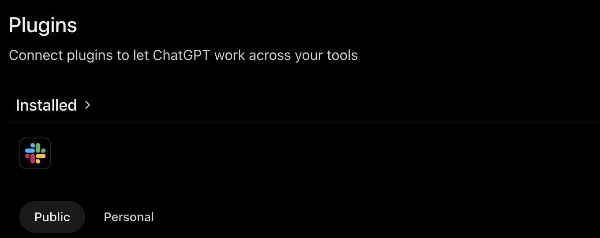
    </Frame>
    <Frame>
      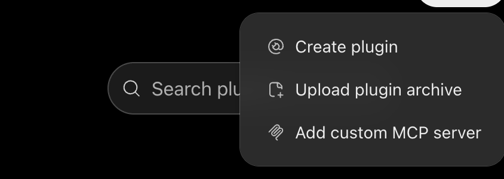
    </Frame>
  </Step>
  <Step title="Popunite formu">
    - **Name**: `Izumi`.
    - **Server URL**: `https://izumi.akiaconsulting.com/mcp`.
    - **Authentication**: **OAuth**. Ne otvarajte **Advanced OAuth settings**, polja ostaju prazna.
    - Štiklirajte **I understand and want to continue** i kliknite **Create as a plugin**.

    <Frame>
      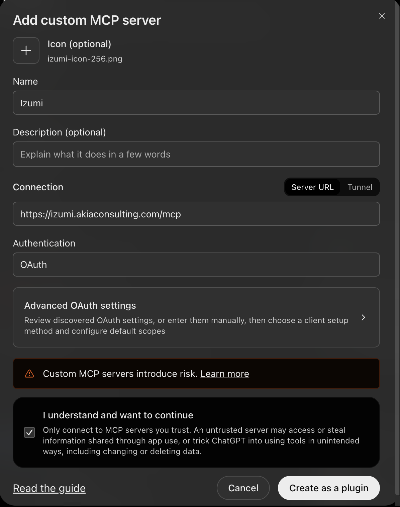
    </Frame>
  </Step>
  <Step title="Kliknite Connect Izumi">
    ChatGPT pravi plugin i otvara prozor sa imenom Izumi. Kliknite **Connect Izumi**.

    <Frame>
      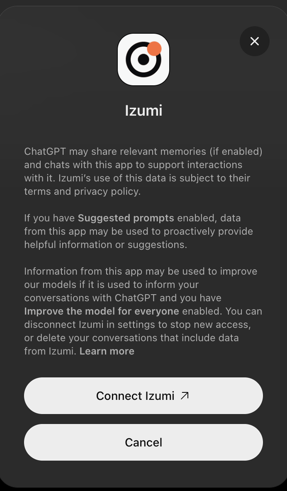
    </Frame>
  </Step>
  <Step title="Odobrite vezu u Izumi">
    Otvara se Izumi. Ako niste prijavljeni, prvo se prijavite. Zatim stiže stranica "Poveži ChatGPT sa Izumijem".

    - Proverite da piše **Provereno: chatgpt.com**. Ako piše nešto drugo, ne odobravajte.
    - Prvo pravo, **čita dokumente koje vi možete da čitate, u svim vašim firmama**, je uvek uključeno.
    - Drugo pravo, **predlaže beleške koje pregleda urednik**, je unapred štiklirano. Skinite kvačicu ako ChatGPT ne treba da predlaže beleške.
    - Kliknite **Odobri**.

    <Frame>
      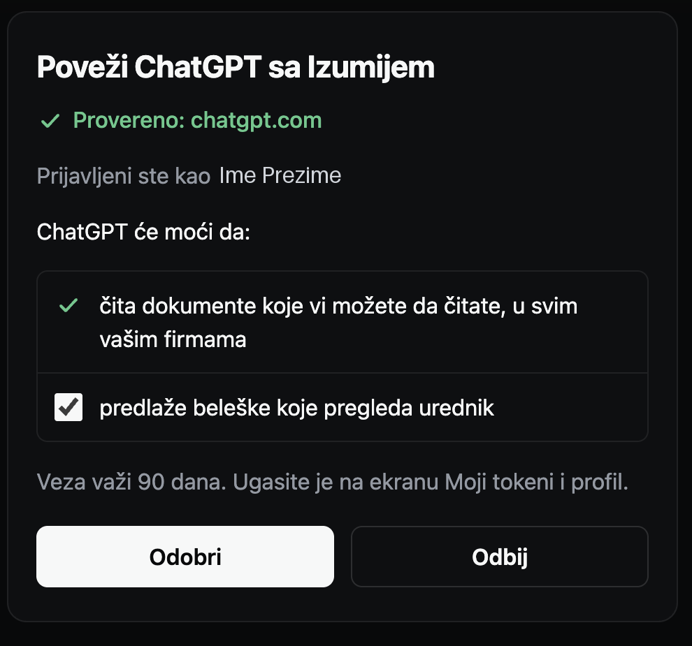
    </Frame>
  </Step>
  <Step title="Uključite Izumi u chatu">
    Vraćate se u ChatGPT i plugin je u listi **Installed**. Otvorite novi chat, kliknite **+** u polju za poruku i izaberite **Izumi**. Time uključujete Izumi za taj chat.

    <Frame>
      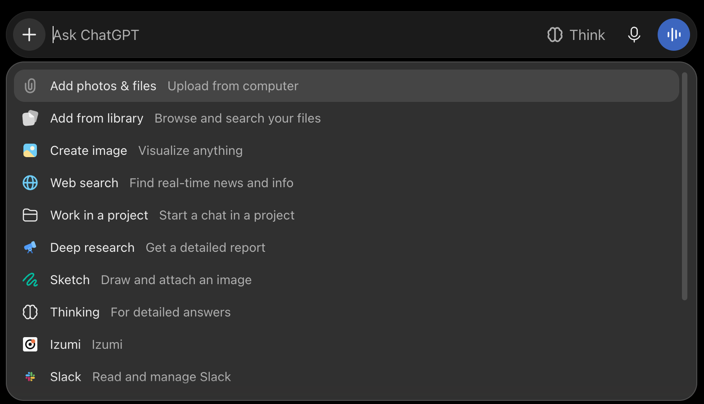
    </Frame>
  </Step>
  <Step title="Proverite vezu">
    Pitajte: "Pozovi Izumi alat whoami i reci mi ko sam i šta smem." ChatGPT vraća vaše ime, ime veze (`ChatGPT`), prava (`read`, `propose`), rok (90 dana od odobravanja) i domene u kojima ste urednik.

    <Frame>
      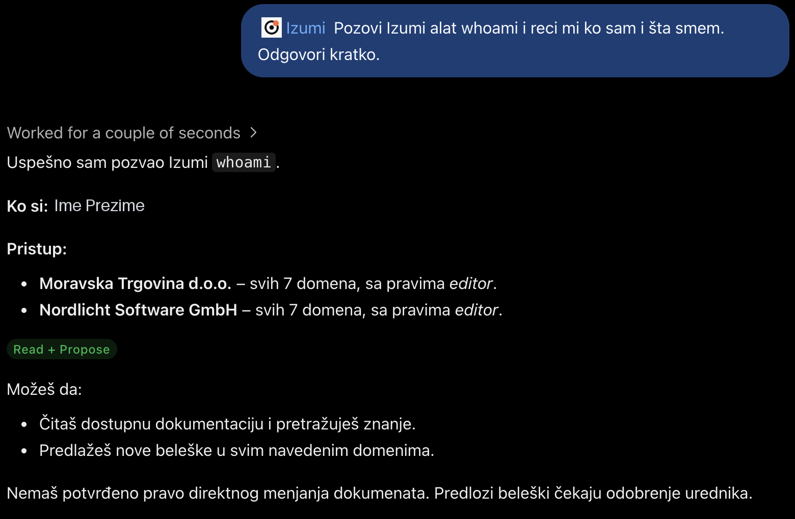
    </Frame>
  </Step>
  <Step title="Pitajte nešto iz dokumenata">
    Na primer: "Pozovi Izumi alat search: koliko dugo čuvamo dokumentaciju u Moravska Trgovina? Zatim pozovi get_document za najbolji pogodak i navedi izvor." ChatGPT zove `search`, pa `get_document`, odgovara i daje link na izvorni dokument na Google Drive-u.

    <Frame>
      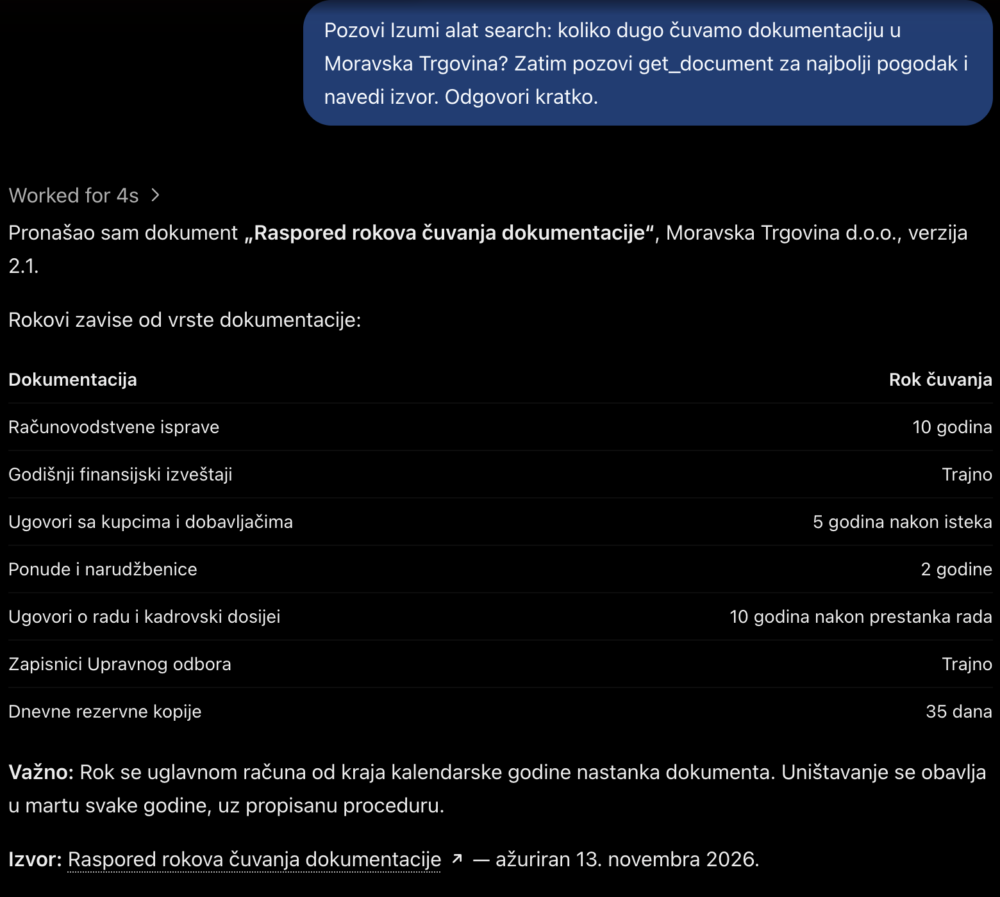
    </Frame>
  </Step>
  <Step title="Predložite belešku (opciono)">
    Na primer: "Pozovi Izumi alat who_knows za temu rokovi čuvanja. Zatim pozovi propose_note u domenu …". Odgovor vraća ID predloga i rok od 30 dana.

    Za alate koji nešto upisuju ChatGPT može da pita "Allow ChatGPT to use Izumi?" sa izborom **Always allow**, **Deny** i **Allow once**. Izaberite po potrebi.

    <Frame>
      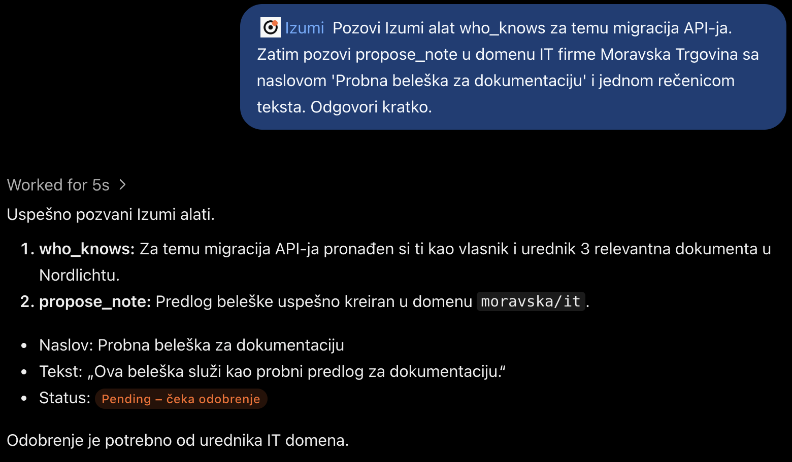
    </Frame>
  </Step>
  <Step title="Proverite predlog u Izumi">
    Otvorite **Red za pregled**, kartica **Na čekanju**. U redu piše ko je predložio i klijent (**ChatGPT**). Urednik domena bira **Odobri** ili **Odbij**. Ako je predlog vaš, možete da ga povučete dugmetom **Povuci**.

    <Frame>
      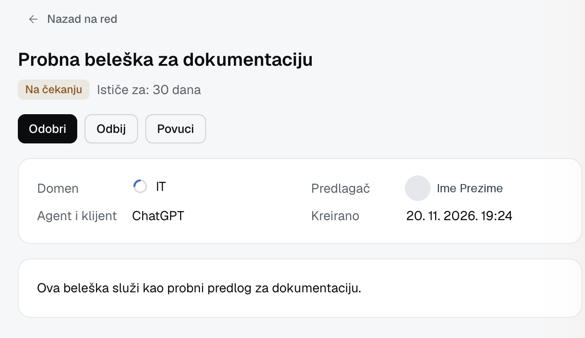
    </Frame>
  </Step>
</Steps>

## Pregled i opoziv veze

U Izumi otvorite **Moji tokeni i profil**. Veza je red sa oznakom **Povezana aplikacija**, imenom **ChatGPT**, adresom `chatgpt.com`, pravima, firmama i datumima. Kliknite **Opozovi**. Veza prestaje odmah, bez potvrde.

<Frame>
  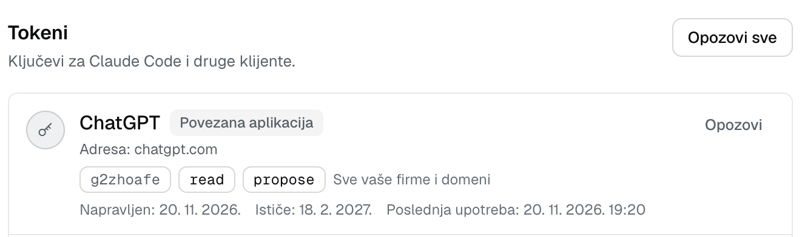
</Frame>

Posle opoziva, pri sledećem pozivu ChatGPT piše "Reconnect Izumi: Your Izumi connection has expired. Reconnect it before ChatGPT can use it for this request." sa dugmadima **Not now** i **Reconnect**. **Reconnect** otvara isti prozor **Connect Izumi** i istu stranicu za odobravanje. Posle novog odobravanja `whoami` radi bez ikakvog drugog podešavanja.

<Frame>
  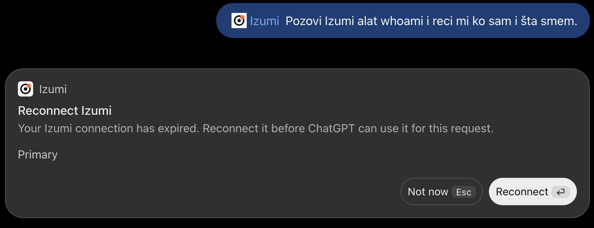
</Frame>

## Uklanjanje konektora iz ChatGPT-a

1. U Izumi opozovite vezu (gore).
2. U ChatGPT-u: **Plugins**, **Installed**, otvorite **Izumi**, meni **...** (tri tačke), **Delete plugin** i potvrdite ("Permanently delete Izumi and its connections? This can't be undone").

## Ograničenja

- Proveren je plan **Free**. Na njemu radi sve: `whoami`, `search`, `get_document`, `who_knows` i `propose_note`.
- Dozvola za alate koji upisuju: u jednom toku ChatGPT je pozvao `propose_note` bez pitanja, u drugom je tražio **Allow once**. ChatGPT pita po sopstvenoj proceni rizika. Ne oslanjajte se na jedno ili drugo ponašanje.
- Veza traje 90 dana od poslednjeg odobravanja. Posle toga ChatGPT traži **Reconnect**.
- Ograničenje brzine je 60 poziva u minuti (`rate_limited`).
- Stranica za odobravanje pokazuje pod kojim imenom ste prijavljeni u Izumi. Ako to nije vaš nalog, ne odobravajte.

## Rešavanje problema

- **Provereno: chatgpt.com** ne piše, ili piše da klijent nije proveren: server ne može da potvrdi identitet klijenta. Odobravajte samo ako ime i adresa odgovaraju onome što očekujete.
- "Reconnect Izumi" usred chata: veza je opozvana, istekla ili ukinuta u Izumi. Kliknite **Reconnect**, pa **Odobri**.
- U meniju **+** nema stavke **Izumi**: plugin nije uključen ili je obrisan. Proverite **Plugins**, **Installed**.
- `forbidden_scope` pri `propose_note`: veza je napravljena bez prava `propose`. Opozovite je i povežite ponovo sa uključenim pravom **predlaže beleške koje pregleda urednik**. Ova greška je proverena uživo samo u Claude Code-u, ne u ChatGPT-u.
- `search` ne nalazi dokument: ChatGPT vidi samo ono što vi smete da vidite. Proverite da li dokument vidite u **Dokumenti**.
- Posle brisanja plugina u ChatGPT-u proverite **Moji tokeni i profil** i opozovite ostatak veze.
