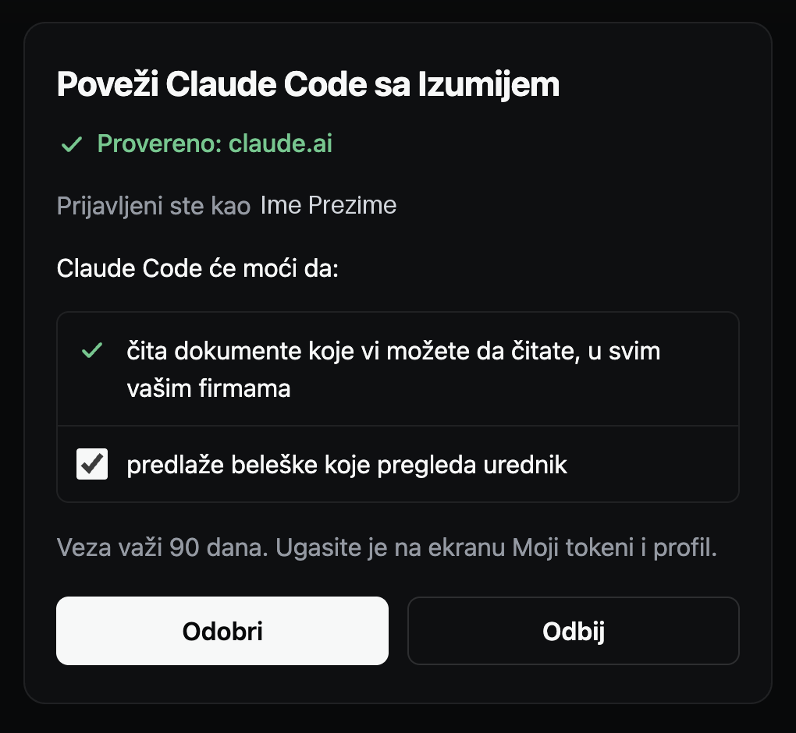
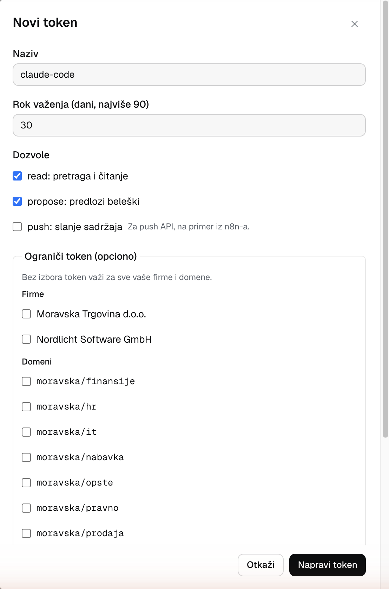

Provereno na Izumi 0.5.7, 2026-11-20 (Claude Code 2.1.287, macOS).

Claude Code se povezuje na dva načina. Oba su proverena do kraja.

- OAuth: samo adresa servera, prijava u browseru. Veza traje 90 dana.
- Lični token: zaglavlje `Authorization: Bearer <token>`. Rok i prava birate sami, najviše 90 dana.

## Šta dobijate

- Pitate Izumi iz Claude Code-a, u terminalu ili editoru. Claude Code zove Izumi alate i odgovara sa izvorom.
- Vidite samo ono što vi smete da vidite u Izumi, u svim vašim firmama. Lični token možete da suzite na neke firme i domene.

## Pre nego što počnete

- Nalog u Izumi, pozvan na adresu kojom se prijavljujete.
- Claude Code (komanda `claude`). Proveren je 2.1.287.
- Adresa servera: `https://izumi.akiaconsulting.com/mcp`.

## Putanja 1: OAuth

<Steps>
  <Step title="Dodajte server">
    U terminalu:

    ```
    claude mcp add --transport http izumi https://izumi.akiaconsulting.com/mcp
    ```

    `claude mcp list` pored servera piše **Needs authentication**.
  </Step>
  <Step title="Prijavite se kroz /mcp">
    Pokrenite `claude`, unesite `/mcp` i izaberite `izumi` (sa oznakom "needs authentication"). Izaberite prijavu (**Authenticate**). Claude Code piše "A browser window will open for authentication" i ispisuje adresu koju možete da kopirate ako se browser ne otvori.
  </Step>
  <Step title="Odobrite vezu u Izumi">
    U browseru se otvara Izumi (prijava ako niste prijavljeni), pa stranica "Poveži Claude Code sa Izumijem".

    - Piše **Provereno: claude.ai**. Claude Code koristi objavljen identitet, pa nema upozorenja da klijent nije proveren.
    - Pravo **čita dokumente koje vi možete da čitate, u svim vašim firmama** je uvek uključeno. **predlaže beleške koje pregleda urednik** je podrazumevano uključeno.
    - Kliknite **Odobri** jednom.

    <Frame>
      
    </Frame>
  </Step>
  <Step title="Zatvorite karticu">
    Browser se vraća na adresu na vašem računaru (`localhost`, port se menja) i piše **Authentication successful**, "You can close this tab and return to Claude Code." Zatvorite karticu.
  </Step>
  <Step title="Proverite vezu">
    U terminalu `/mcp` piše "Authentication successful. Connected to izumi." `claude mcp list` pokazuje **Connected**. Pitajte: "Pozovi alat whoami sa servera izumi." Odgovor ima `token.kind` `oauth`, `name` `Claude Code`, `expires_at` (90 dana od odobravanja), `scopes` (`read`, `propose`) i firme i domene sa ulogom.
  </Step>
  <Step title="Opozovite vezu kad vam ne treba">
    U Izumi otvorite **Moji tokeni i profil**. Veza je red **Claude Code** sa oznakom **Povezana aplikacija**, adresom `claude.ai`, prefiksom i pravima. Kliknite **Opozovi**.

    Posle toga `claude mcp list` piše **Needs authentication**, a poziv alata ne uspeva uz poruku da je potrebna prijava. Za novu vezu ponovite korak 2.
  </Step>
  <Step title="Uklonite server iz Claude Code-a">
    ```
    claude mcp remove izumi
    ```
  </Step>
</Steps>

## Putanja 2: lični token

<Steps>
  <Step title="Napravite token">
    U Izumi otvorite **Moji tokeni i profil**, odeljak **Tokeni**, dugme **Novi token**.

    <Frame>
      
    </Frame>
  </Step>
  <Step title="Popunite prozor Novi token">
    - **Naziv**: na primer `claude-code`.
    - **Rok važenja (dani, najviše 90)**: podrazumevano je 30.
    - **Dozvole**: **read: pretraga i čitanje** je uključeno. **propose: predlozi beleški** je podrazumevano uključeno. Skinite kvačicu ako Claude Code treba samo da čita. **push: slanje sadržaja** je za push API i ovde ne treba.
    - **Ograniči token (opciono)**: bez izbora token važi za sve vaše firme i domene. Možete da izaberete firme i domene.
    - Kliknite **Napravi token**.
  </Step>
  <Step title="Sačuvajte token">
    Izumi pokazuje token jednom: "Ovo je jedini put da vidite token. Kopirajte ga sada." Kliknite **Kopiraj** i sačuvajte ga na bezbedno mesto. Ne šaljite ga u chat i ne stavljajte ga u repozitorijum.
  </Step>
  <Step title="Dodajte server">
    U terminalu (zamenite `<token>`):

    ```
    claude mcp add --scope user --transport http izumi https://izumi.akiaconsulting.com/mcp --header "Authorization: Bearer <token>"
    ```

    Claude Code odgovara "Added HTTP MCP server izumi ... to user config" i ispisuje zaglavlje sa vrednošću `[REDACTED]`.

    - `--scope user` važi u svim folderima. Bez njega server važi samo za folder u kojem ste.
    - Ne koristite `--scope project` sa tokenom: po dokumentaciji Claude Code-a to upisuje `.mcp.json` u repozitorijum (nije proveravano).
  </Step>
  <Step title="Proverite vezu">
    ```
    claude mcp list
    ```

    Pored servera piše **Connected**. Zatim pitajte Claude Code: "Pozovi alat whoami sa servera izumi." Odgovor je JSON sa vašim imenom, tokenom (`kind` `pat`, `name`, `prefix`, `expires_at`, `scopes`) i firmama i domenima sa ulogom. Za token sa pravom `read` u `scopes` piše samo `read`.
  </Step>
  <Step title="Uklonite server i opozovite token">
    ```
    claude mcp remove izumi --scope user
    ```

    Zatim u Izumi, **Moji tokeni i profil**, kod tokena kliknite **Opozovi**. Opoziv deluje odmah, bez potvrde.
  </Step>
</Steps>

## Šta radi token bez prava propose

- `propose_note` sa nevalidnim unosom (naslov kraći od 3 znaka) vraća `invalid_input`, "The title field is missing or invalid." Unos se proverava pre prava.
- `propose_note` sa ispravnim naslovom i tekstom vraća `forbidden_scope`, "The token does not have the scope for this call." Predlog se ne pravi.

## Ograničenja

- Token se vidi samo jednom, pri pravljenju. Izgubljeni token se ne može povratiti: opozovite ga i napravite novi.
- Token ističe po roku koji ste izabrali (najviše 90 dana). OAuth veza traje 90 dana od odobravanja.
- Token sa pravom `read` ne može da predlaže beleške. `propose_note` vraća `forbidden_scope`.
- Pozivi su ograničeni na 60 u minuti (`rate_limited`).
- Da li Claude Code pita za dozvolu pre poziva alata zavisi od njegovih podešavanja i nije deo povezivanja sa Izumi.

## Rešavanje problema

- `claude mcp list` ne pokazuje **Connected**: proverite adresu (`/mcp` na kraju), da token nije istekao ni opozvan i da zaglavlje glasi tačno `Authorization: Bearer <token>`.
- `forbidden_scope`: veza nema potrebno pravo (na primer `propose`). Napravite novi token sa tim pravom ili povežite OAuth sa uključenim **predlaže beleške koje pregleda urednik**.
- `invalid_input`: unos alata ne zadovoljava šemu (na primer prekratak naslov). Poruka imenuje polje.
- Opozvana OAuth veza: poziv ne uspeva, a `claude mcp list` piše **Needs authentication**. Prijavite se ponovo kroz `/mcp`.
- Opozvan token: poziv više ne radi. Napravite novi token. Šta tada piše `claude mcp list` nije proveravano.
