Provereno na Izumi 0.5.7, 2026-11-20 (claude.ai plan Pro, web; Claude Desktop 6.6395.1 na macOS-u, plan Pro).

claude.ai i Claude Desktop su isti nalog i isti konektor. Dodate ga jednom u claude.ai, a Desktop ga vidi sam. Povezivanje je preko OAuth-a, bez tokena.

## Šta dobijate

- Pitate Izumi iz Claude chata. Claude zove Izumi alate i odgovara sa izvorom.
- Vidite samo ono što vi smete da vidite u Izumi, u svim vašim firmama.
- Opciono: Claude može da predloži belešku. Beleška ide u **Red za pregled**, a urednik domena je odobrava ili odbija.
- Veza traje 90 dana. Opozivate je sami na ekranu **Moji tokeni i profil**.

## Pre nego što počnete

- Nalog u Izumi, pozvan na adresu kojom se prijavljujete.
- Claude nalog. Proveren je plan **Pro**.
- Adresa servera: `https://izumi.akiaconsulting.com/mcp`.

## Povezivanje u claude.ai

<Info>
Meniji claude.ai se često menjaju. Na dan provere (2026-11-20) konektori su pod **Plugins**, uz filter **Connectors**. Ranije se to mesto zvalo **Customize**.
</Info>

<Steps>
  <Step title="Dodajte custom konektor">
    U levom meniju kliknite **Plugins**, pa iznad liste izaberite filter **Connectors**. Gore desno kliknite **Add**, pa **Add custom connector**.

    <Frame>
      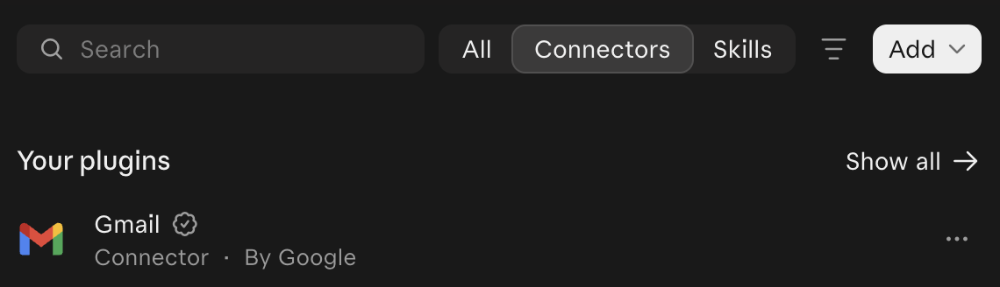
    </Frame>
    <Frame>
      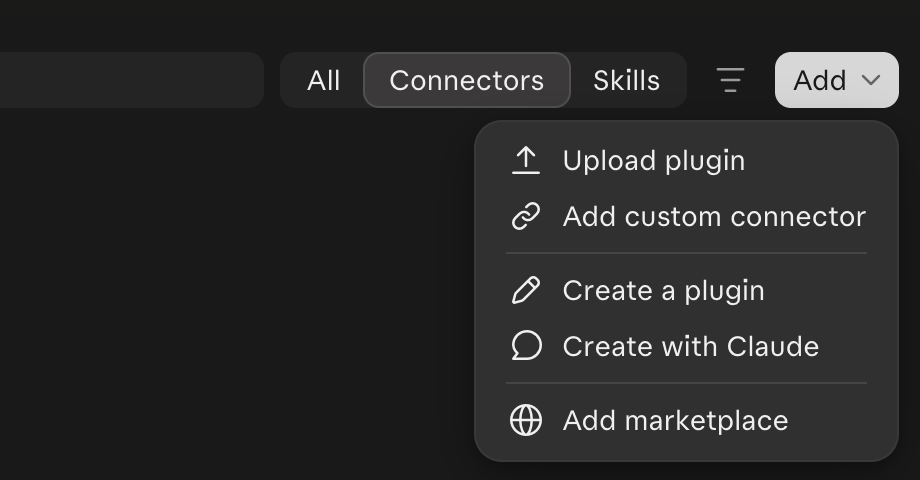
    </Frame>
  </Step>
  <Step title="Upišite ime i adresu">
    U prozoru **Add custom connector** upišite **Name** `Izumi` i **MCP server URL** `https://izumi.akiaconsulting.com/mcp`, pa kliknite **Continue**.

    <Frame>
      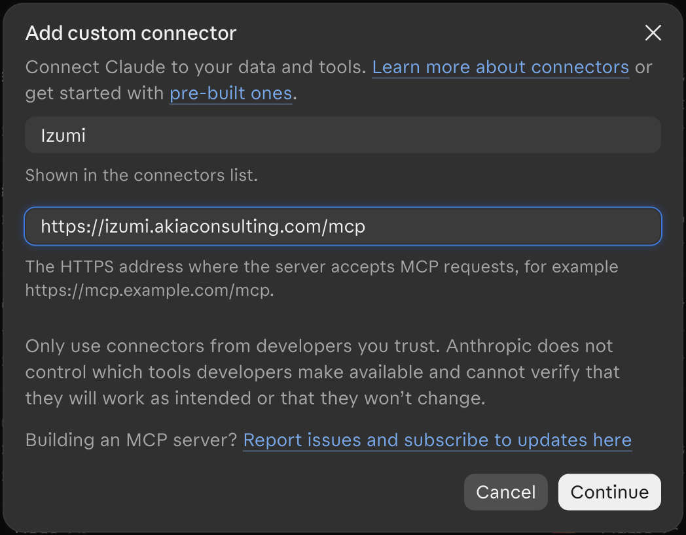
    </Frame>
  </Step>
  <Step title="Ostavite prepoznata podešavanja">
    Claude proverava server i sam prepoznaje podešavanja. Ostavite ih kakva jesu:

    - **Authentication**: **Sign in now** (oznaka **Detected**).
    - **OAuth client**: **Use Claude's published identity** (oznaka **Detected**).
    - **Request headers** i **Advanced** ostaju prazni.

    Kliknite **Add**. Odmah se otvara Izumi, bez dodatnog klika na **Connect**.

    <Frame>
      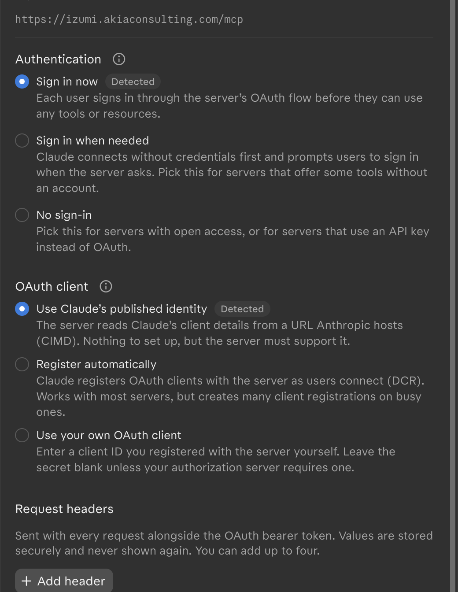
    </Frame>
  </Step>
  <Step title="Odobrite vezu u Izumi">
    Otvara se Izumi. Ako niste prijavljeni, prvo se prijavite. Zatim stiže stranica "Poveži Claude sa Izumijem".

    - Proverite da piše **Provereno: claude.ai**. Ako piše nešto drugo, ne odobravajte.
    - Prvo pravo, **čita dokumente koje vi možete da čitate, u svim vašim firmama**, je uvek uključeno.
    - Drugo pravo, **predlaže beleške koje pregleda urednik**, je unapred štiklirano. Skinite kvačicu ako Claude ne treba da predlaže beleške.
    - Kliknite **Odobri**.

    <Frame>
      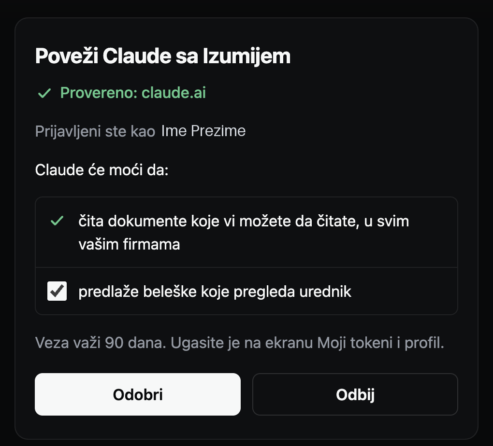
    </Frame>
  </Step>
  <Step title="Pogledajte dozvole alata">
    Vraćate se u claude.ai uz poruku **Connected to Izumi.** Otvorite konektor (**Plugins**, **Izumi**) i karticu **Permissions** (pored **Overview**). Tu je lista alata u dve grupe: **Read-only tools** (**Get document**, **Search**, **Who knows**, **Whoami**) i **Write/delete tools** (**Propose note**). Svaka grupa ima podešavanje, podrazumevano **Needs approval**, a svaki alat ima tri izbora: dozvoli, traži odobrenje, blokiraj.

    <Frame>
      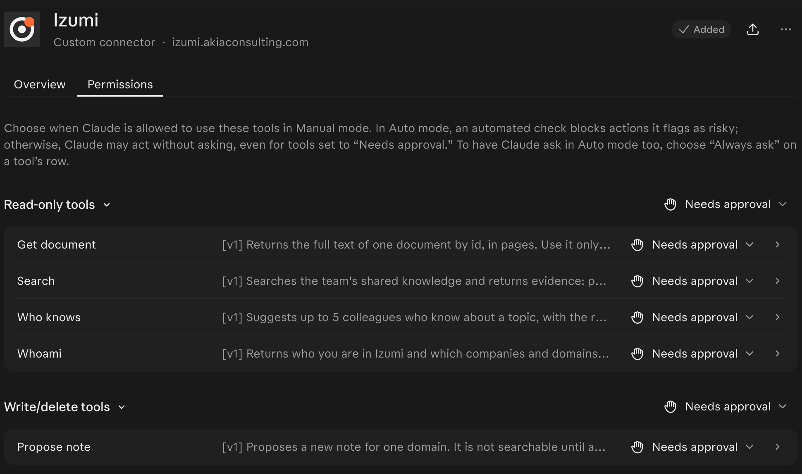
    </Frame>
  </Step>
  <Step title="Uključite Izumi u chatu">
    Otvorite novi chat. Kliknite **+** u polju za poruku, pa **Plugins**. Otvara se lista sa prekidačima. **Izumi** je već uključen. Ako nije, uključite ga.

    <Frame>
      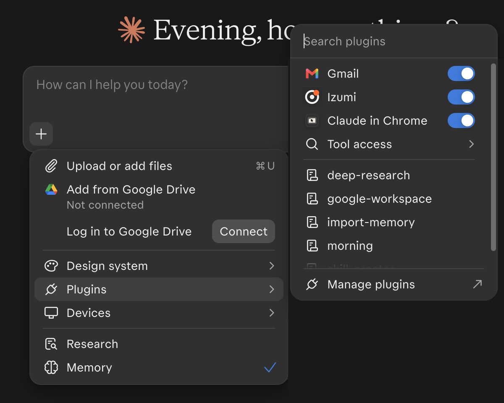
    </Frame>
  </Step>
  <Step title="Proverite vezu">
    Pitajte: "Pozovi Izumi alat whoami i reci mi ko sam." Pre svakog poziva Claude pita "Claude wants to use Whoami from Izumi" sa dugmadima **Decline**, **Always allow** i **Allow once**. Izaberite **Allow once**. Odgovor vraća vaše ime, firme, domene u kojima ste urednik, prava (`read`, `propose`) i kada veza ističe.

    <Frame>
      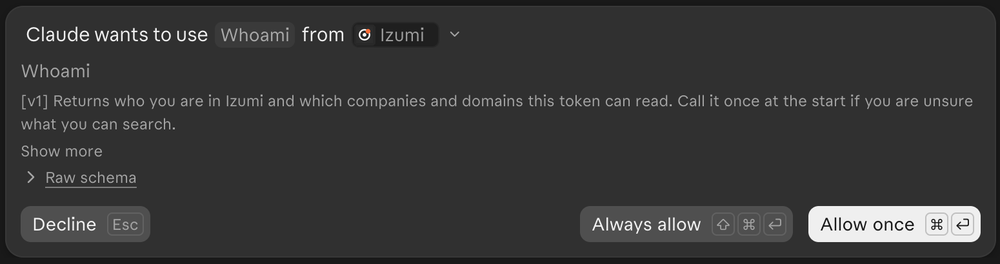
    </Frame>
    <Frame>
      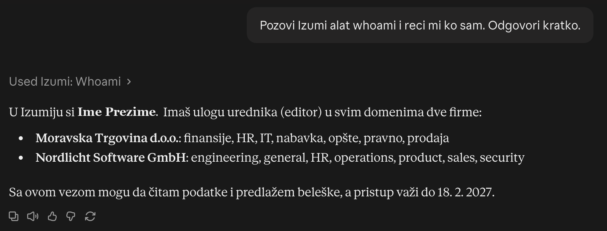
    </Frame>
  </Step>
  <Step title="Pitajte nešto iz dokumenata i predložite belešku (opciono)">
    Na primer: "Pozovi search: koliko dugo čuvamo dokumentaciju u Moravska Trgovina, pa get_document za najbolji pogodak. Zatim who_knows za temu rokovi čuvanja, pa propose_note u domenu Pravo i usklađenost." Za svaki alat odobrite poziv. Kod `propose_note` pregledajte domen, naslov i tekst pre nego što kliknete **Allow once**.

    <Frame>
      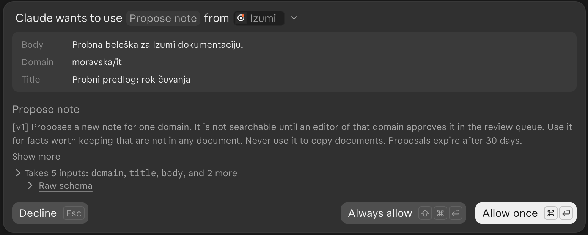
    </Frame>
    <Frame>
      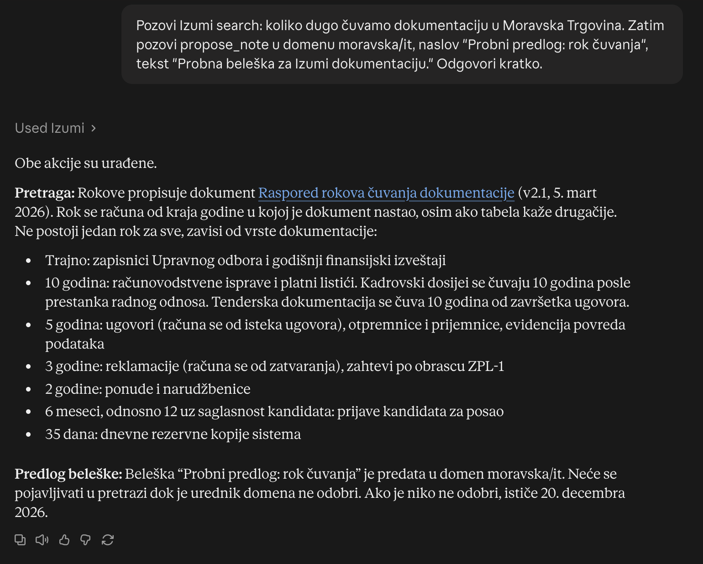
    </Frame>
  </Step>
  <Step title="Proverite predlog u Izumi">
    Otvorite **Red za pregled**, kartica **Na čekanju**. U redu piše ko je predložio i klijent (**Claude**). Urednik domena bira **Odobri** ili **Odbij**. Ako je predlog vaš, možete da ga povučete dugmetom **Povuci**.

    <Frame>
      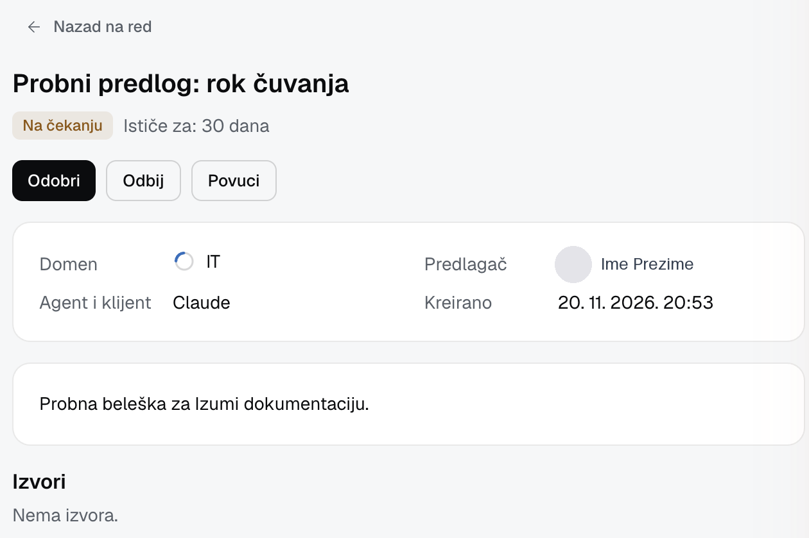
    </Frame>
  </Step>
</Steps>

## Claude Desktop

Desktop je isti nalog i isti konektor kao claude.ai. Ništa ne dodajete: konektor koji ste dodali u claude.ai pojavio se u Desktop-u sam, zajedno sa starim chatovima. Isti su Izumi alati, ista stranica odobravanja i ista veza od 90 dana.

<Info>
Slike u ovom odeljku su sa srpskog toka (Izumi na srpskom, firma Moravska Trgovina). Claude Desktop ekrani su na engleskom.
</Info>

### Gde je konektor

1. U levom meniju kliknite **Plugins**.
2. **Izumi** je na listi **Your plugins**, sa oznakom **Custom connector** i adresom izumi.akiaconsulting.com.

   <Frame>
     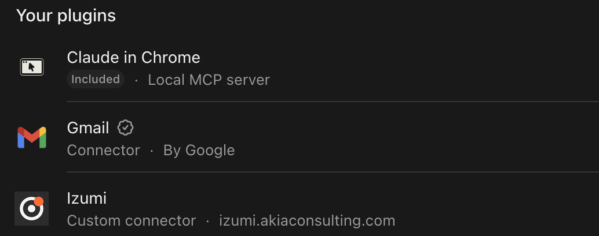
   </Frame>

3. Klik na red **Izumi** otvara detalje: oznaku **Added** i meni **...**. Kartica **Permissions** (pored **Overview**) objašnjava režime. U režimu **Manual** vi birate kada Claude sme da koristi alate. U režimu **Auto** automatska provera blokira radnje koje označi kao rizične, a inače Claude može da radi bez pitanja, čak i za alate na **Needs approval**. Svi alati Izumija su podrazumevano na **Needs approval**. Na slici je **Whoami** na **Always allow**, a grupa piše **Mixed**: **Always allow** se pamti po alatu, pa je ostao od ranijeg klika u pitanju za dozvolu.

   <Frame>
     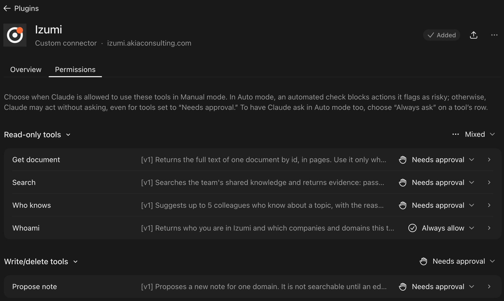
   </Frame>

### Poziv alata u Desktop-u

1. Otvorite novi chat (**New**) i proverite da je Izumi uključen (**+**, **Plugins**).
2. Pitajte, na primer: "Call the Izumi tool whoami and tell me who I am. Then call search: how long do we keep documentation in Moravska Trgovina?"
3. U režimu **Manual** Desktop traži dozvolu za svaki alat posebno (osim za one na **Always allow**): "Claude wants to use Search from Izumi", sa dugmadima **Decline**, **Always allow** i **Allow once**. Dok čeka, chat pokazuje **Needs your input**.

   <Frame>
     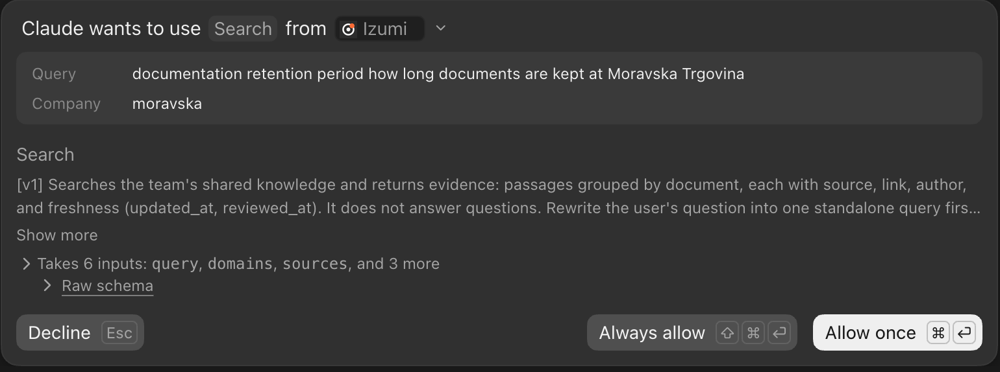
   </Frame>

4. `whoami` pokazuje vaše ime, veze (prava `read` i `propose`, rok 90 dana) i firme i domene sa ulogom. `search` vraća odgovor sa izvorima i linkovima na dokumente.

   <Frame>
     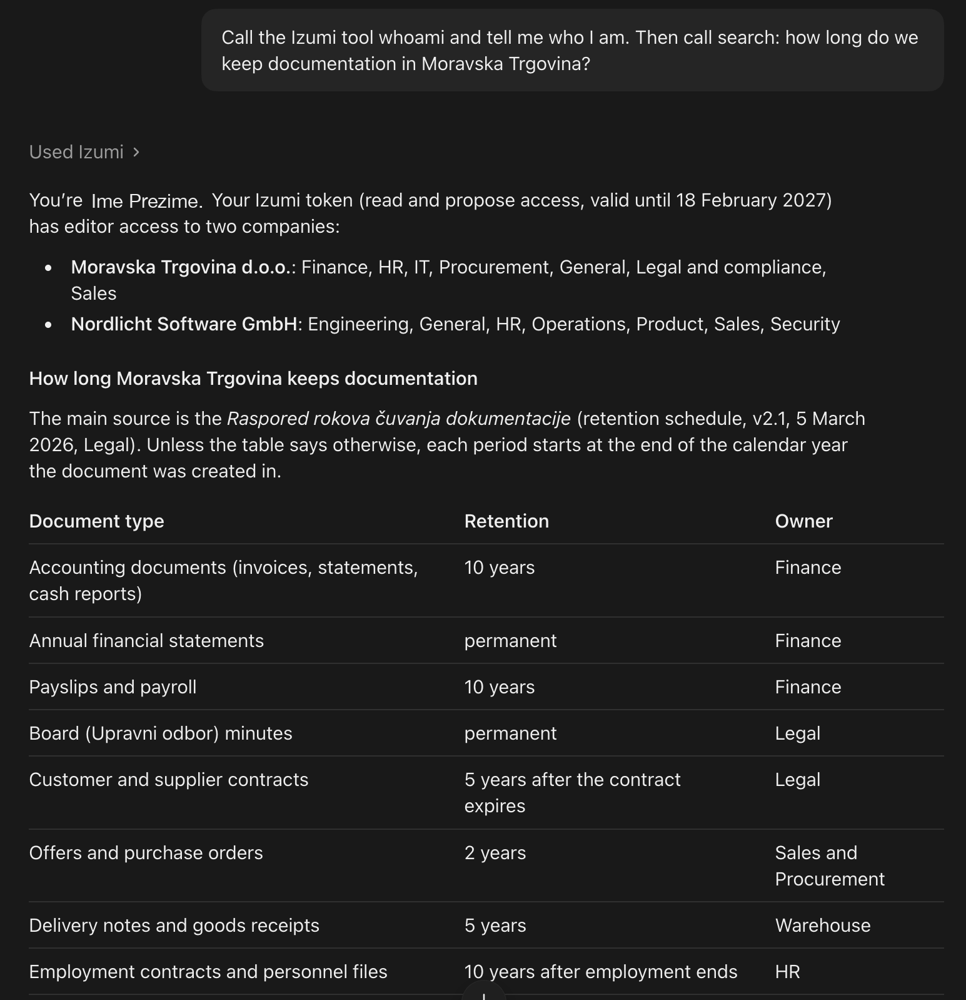
   </Frame>

## Pregled i opoziv veze

U Izumi otvorite **Moji tokeni i profil**. Veza je red sa oznakom **Povezana aplikacija**, imenom **Claude** i adresom `claude.ai`. Kliknite **Opozovi**. Veza prestaje odmah, bez potvrde.

<Frame>
  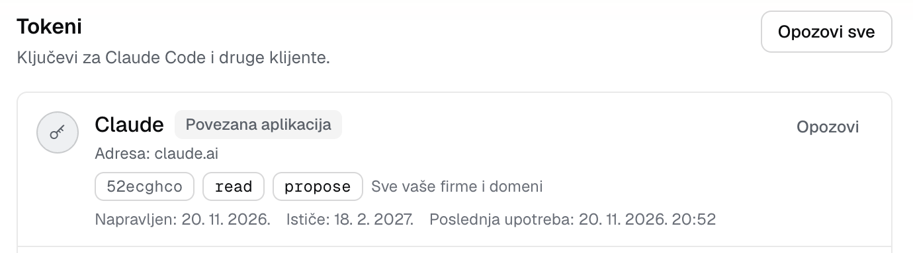
</Frame>

## Ponovno povezivanje posle opoziva

U claude.ai:

- Pri sledećem pozivu Claude ponovo traži odobrenje za alat, pa javlja da nije uspeo ("Couldn't use Izumi: Whoami"). Izumi traži novu prijavu.
- Ispod polja za poruku je kartica "Reconnect a connector to keep using it" sa dugmadima **Not now** i **Reconnect**.
- U **Plugins**, **Izumi** piše **Sign-in expired** i "Connection has expired. You can reconnect to re-authenticate." uz dugme **Reconnect** (gore desno i u redu konektora). **Disconnect** je u meniju **...**. **Reconnect** vodi na istu stranicu za odobravanje. Posle odobravanja svi pozivi opet rade.

<Frame>
  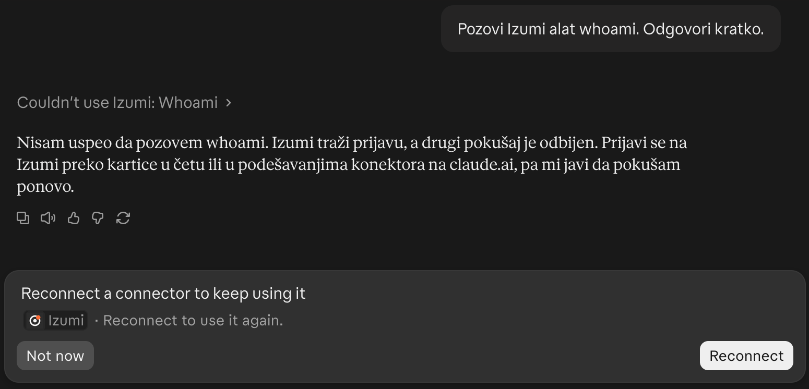
</Frame>
<Frame>
  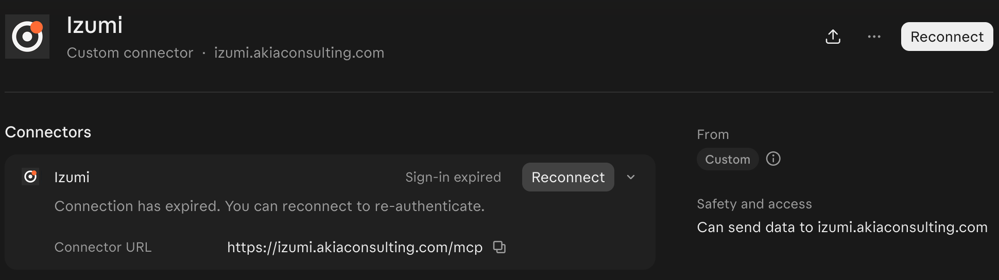
</Frame>

U Claude Desktop-u:

- Isti poziv ne uspe. Claude pokuša dvaput, kaže da je potrebna nova prijava, a ispod chata stiže ista kartica sa **Reconnect**.

  <Frame>
    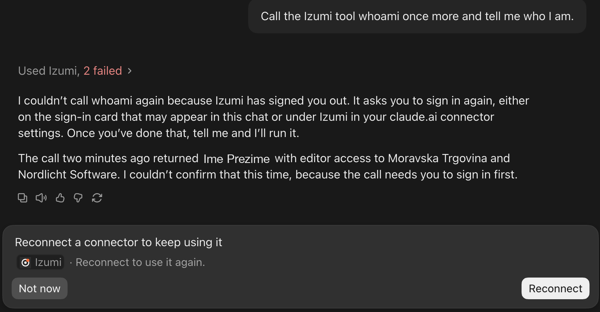
  </Frame>

- **Reconnect** otvara browser, ne prozor u aplikaciji. Prvo se pojavljuje stranica claude.ai "Finish connecting a connector?". Nastavite samo ako ste povezivanje pokrenuli iz Claude Desktop-a. Dugme **Continue connecting** je u prvi mah sivo.

  <Frame>
    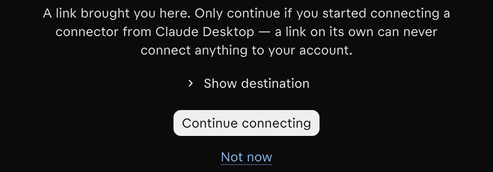
  </Frame>

- Zatim stiže Izumi stranica "Poveži Claude sa Izumijem" sa **Provereno: claude.ai** i dugmadima **Odobri** i **Odbij**.

  <Frame>
    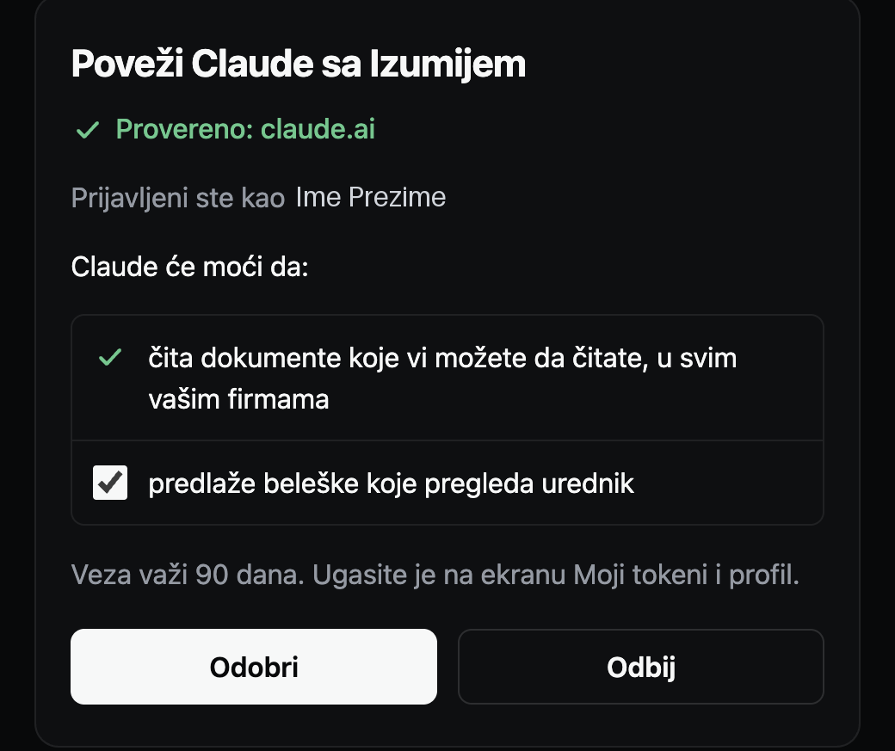
  </Frame>

- Posle **Odobri** vratite se u Desktop. U istom chatu `whoami` radi, uz novu vezu (promenjen prefiks i rok).

## Uklanjanje konektora

1. U Izumi opozovite vezu (gore).
2. U claude.ai: **Plugins**, **Izumi**, meni **...** (ima i **Refresh tools list** i **Disconnect**), **Remove**, pa potvrda "Delete Izumi?" dugmetom **Delete**. Dijalog podseća da vam treba adresa servera da ga dodate ponovo.

Uklanjanje u Desktop-u je provereno: posle njega Izumi više nije na listi konektora.

## Ograničenja

- Proveren plan: **Pro**. Custom konektor se dodaje bez dodatnih koraka i radi svih pet alata, uključujući `propose_note`.
- Na dan provere režim je bio **Manual**: svaki poziv alata traži odobrenje (**Allow once**), osim alata koje ste stavili na **Always allow**. Izbor **Always allow** se pamti po alatu.
- claude.ai povremeno nudi "Switch to Auto mode?" (**Stay in Manual** ili **Switch to Auto**). U režimu **Auto** automatska provera blokira rizične radnje, a ostalo Claude radi bez pitanja. To menja podešavanje vašeg Claude naloga i nije deo povezivanja sa Izumi.
- Veza traje 90 dana od poslednjeg odobravanja. Posle toga claude.ai pokazuje **Sign-in expired** i traži **Reconnect**.
- Stranica za odobravanje pokazuje pod kojim imenom ste prijavljeni u Izumi. Ako to nije vaš nalog, ne odobravajte.

## Rešavanje problema

- **Provereno: claude.ai** ne piše, ili piše da klijent nije proveren: server ne može da potvrdi identitet klijenta. Odobravajte samo ako ime i adresa odgovaraju onome što očekujete.
- **Sign-in expired** ili "Connection has expired": veza je opozvana, istekla ili ukinuta u Izumi. Idite na **Plugins**, **Izumi**, **Reconnect**, pa **Odobri**.
- Posle **Odobri** piše "Zahtev je istekao / Pokrenite povezivanje ponovo iz aplikacije." (u proveri se pojavila engleska verzija stranice, "The request expired"). Proverite pre nego što počnete ispočetka: veza je verovatno već uspela. U jednoj proveri je server izdao pristup, a drugo slanje istog obrasca je odbijeno. Uzrok nije utvrđen.
- Posle opoziva prozor sa odobrenjem alata se pojavi dvaput pre poruke da poziv nije uspeo. Kliknite **Decline**, pa se pojavljuje kartica **Reconnect**.
- Ikonica konektora je slovo "A" umesto znaka Izumi. To je poznata greška, uzrok još nije utvrđen.
- Izumi nije na listi u meniju **+**, **Plugins**: konektor je uklonjen ili isključen. Dodajte ga ponovo ili uključite prekidač.
- `forbidden_scope` pri `propose_note`: veza je napravljena bez prava `propose`. Opozovite je i povežite ponovo sa uključenim pravom **predlaže beleške koje pregleda urednik**. Ova greška je proverena uživo samo u Claude Code-u.
- `search` ne nalazi dokument: Claude vidi samo ono što vi smete da vidite. Proverite da li dokument vidite u **Dokumenti**.
- Posle uklanjanja konektora proverite **Moji tokeni i profil** i opozovite ostatak veze.
