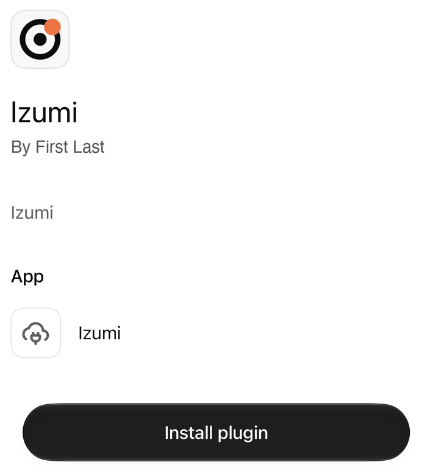
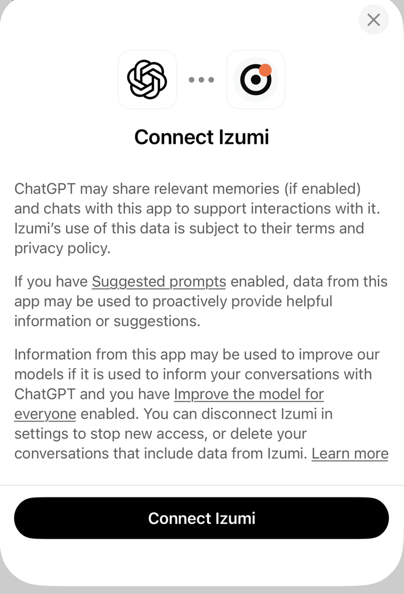

Provereno na Izumi 0.5.7, 2026-11-20.

MCP (Model Context Protocol) je način da AI alat pozove Izumi. Vi i dalje pitate svoj alat, na primer ChatGPT ili Claude. Alat pozove Izumi, dobije odlomke iz dokumenata vaše firme i odgovori sa izvorom.

## Šta dobijate

- Pitate Izumi iz alata koji već koristite. Ne otvarate posebnu aplikaciju.
- Alat vidi samo ono što vi smete da vidite u Izumi, u svim vašim firmama. Veza nosi vaša prava, ne više od toga.
- Izumi ne piše odgovor umesto alata. Izumi vraća odlomke sa izvorom, linkom, autorom i svežinom, a odgovor sastavlja AI alat.
- Opciono: alat može da predloži belešku. Beleška ide u **Red za pregled**, a urednik domena je odobrava ili odbija. Dok je ne odobri, niko je ne može pronaći pretragom.

## Dva načina povezivanja

| Način | Šta unosite | Za koje alate |
|---|---|---|
| OAuth | Samo adresu servera. Prijavljujete se u Izumi u browseru i odobravate vezu. Veza traje 90 dana. | ChatGPT, Claude (claude.ai i Claude Desktop), Claude Code, Slackbot (kod Slackbota administrator prvo registruje klijenta, vidi stranicu Slack) |
| Lični token | Adresu servera i zaglavlje `Authorization: Bearer <token>`. Token pravite sami, rok je najviše 90 dana. | Claude Code i svaki drugi klijent koji govori MCP preko Streamable HTTP-a |

Adresa servera je adresa vašeg Izumija sa `/mcp` na kraju. Na demo instalaciji (samo uz poziv) to je `https://izumi.akiaconsulting.com/mcp`.

Mobilne aplikacije ChatGPT-a i Claudea koriste vezu koju ste podesili na vebu. U Claudeu se konektor sam pojavi pod **Connectors**. U ChatGPT-u se pojavi kao plugin: dodirnite **Install plugin**, pa **Connect Izumi**.

<Frame>
  
</Frame>
<Frame>
  
</Frame>

<Info>
Za OAuth server mora da ima uključen OAuth. Administrator to podešava jednom, vidi tab **Instalacija**.
</Info>

## Prava veze

- `read`: pretraga i čitanje dokumenata. Uvek uključeno.
- `propose`: predlaganje beleški koje pregleda urednik. Na stranici za odobravanje je unapred štiklirano, a možete da je isključite. Token sa pravom `read` može da pretražuje, ali ne može da predlaže.
- `push` postoji za push API i preko MCP-a se ne koristi.

## Izaberite svoj alat

<CardGroup cols={2}>
  <Card title="ChatGPT" href="/sr/ai-alati/chatgpt">
    Dodajete Izumi kao plugin, OAuth, bez tokena.
  </Card>
  <Card title="Claude" href="/sr/ai-alati/claude">
    claude.ai i Claude Desktop, isti konektor i isti nalog.
  </Card>
  <Card title="Slack" href="/sr/ai-alati/slack">
    Izumi u Slackbotu. Korake dele Izumi administrator, Slack administrator i svaki korisnik.
  </Card>
  <Card title="Claude Code" href="/sr/ai-alati/claude-code">
    Terminal i editor. OAuth ili lični token.
  </Card>
  <Card title="Ostali klijenti" href="/sr/ai-alati/ostali-klijenti">
    Adresa i zaglavlje za bilo koji MCP klijent. Nije proveravano uživo.
  </Card>
  <Card title="Alati i primeri pitanja" href="/sr/ai-alati/alati">
    Pet alata koje AI vidi, greške i primeri pitanja.
  </Card>
</CardGroup>

## Gde vidite i opozivate veze

- U Izumi otvorite **Moji tokeni i profil**. Sve veze i tokeni su u odeljku **Tokeni**. OAuth veza je red sa oznakom **Povezana aplikacija**, sa imenom klijenta i adresom.
- Dugme **Opozovi** prekida vezu odmah, bez potvrde. Klijent zatim traži novo povezivanje. Izuzetak je Slackbot, vidi stranicu Slack.
- Pozivi klijenta se vide u **Log pristupa**.

## Ograničenja

- 60 poziva u minuti po tokenu. Posle toga alat vraća grešku `rate_limited`.
- Samo Streamable HTTP. Klijent koji podržava samo lokalne (stdio) servere ne radi.
- Veza traje najviše 90 dana. Posle toga klijent traži novo povezivanje.

## Rešavanje problema

- Alat kaže da nema Izumi alata: veza nije uključena u tom chatu ili je istekla. Vidi stranicu svog alata.
- Alat vraća grešku: vidi tabelu grešaka na stranici **Alati i primeri pitanja**.
- Veza je opozvana, a alat ne nudi ponovno povezivanje: povežite ga ponovo po uputstvu na stranici tog alata.
