Provereno na Izumi 0.5.2 (razgovor sa Slackbotom, 2026-11-19) i na Izumi 0.5.7 (ekrani Izumija, 2026-11-20). Slack workspace na Free planu, Slackbot u Preview fazi.

Slackbot može da pita Izumi umesto korisnika. Svaka osoba povezuje svoj Izumi nalog, pa Slackbot vidi samo ono što ta osoba sme da vidi.

## Šta dobijate

- Pretraga dokumenata, čitanje dokumenta i "ko šta zna" iz Slackbota.
- Alati u Slackbotu: **Whoami**, **Search**, **Get document** i **Who knows**, a uz pravo `propose` i predlaganje beleške (`propose_note`).
- Dokument otpremljen u Izumi (upload, beleška) dobija link na svoju stranicu u Izumi. Dokument iz Google Drive-a zadržava link na originalni izvor.


## Ko šta radi

| Uloga | Koraci | Koliko puta |
|---|---|---|
| Izumi administrator | Korak 1 | Jednom po instalaciji Izumija |
| Slack administrator | Koraci 2 do 5 | Jednom po workspace-u |
| Svaki korisnik | Korak 6 | Jednom po osobi |

## Pre nego što počnete

- Izumi 0.5.2 ili noviji sa uključenim OAuth-om (administrator to podešava na serveru, vidi tab **Instalacija**).
- Administrator Izumija sa pristupom serveru.
- Slack workspace u kojem možete da pravite aplikacije. Free plan je dovoljan. Slackbot MCP je u Preview fazi.
- Slack nalog koji sme da instalira aplikaciju: vlasnik ili administrator workspace-a, ili uz odobrenje administratora.
- Adresa Izumija. U ovom uputstvu je `https://izumi.akiaconsulting.com`.

## Korak 1: registrujte Slack kao klijenta u Izumi (Izumi administrator)

Slack ne može sam da se registruje u Izumi (automatska registracija ne radi, vidi "Ograničenja"). Zato administrator jednom ručno pravi javnog klijenta. Na serveru, u folderu Izumija:

```
./tb admin oauth client add --label "Slackbot (naziv vašeg workspace-a)" --redirect-uri https://oauth2.slack.com/external/auth/callback
```

- Komanda ispiše `client_id`. Sačuvajte ga, treba vam u koraku 3.
- Ovo je javni klijent: nema `client secret`. Zaštitu daje PKCE.
- Redirect adresa mora biti tačno `https://oauth2.slack.com/external/auth/callback`.
- Provera: `./tb admin oauth client list` prikazuje klijenta. `./tb admin oauth client remove <client_id>` ga uklanja.

## Koraci 2 do 5 (Slack administrator)

### Korak 2: napravite Slack aplikaciju

Preporuka: posebna aplikacija samo za Izumi, da ne deli bot token sa drugim alatima.

<Steps>
  <Step title="Otvorite Create New App">
    Otvorite `https://api.slack.com/apps` i kliknite **Create New App**. U prozoru pod **From scratch** izaberite **Pick features**.

    <Frame>
      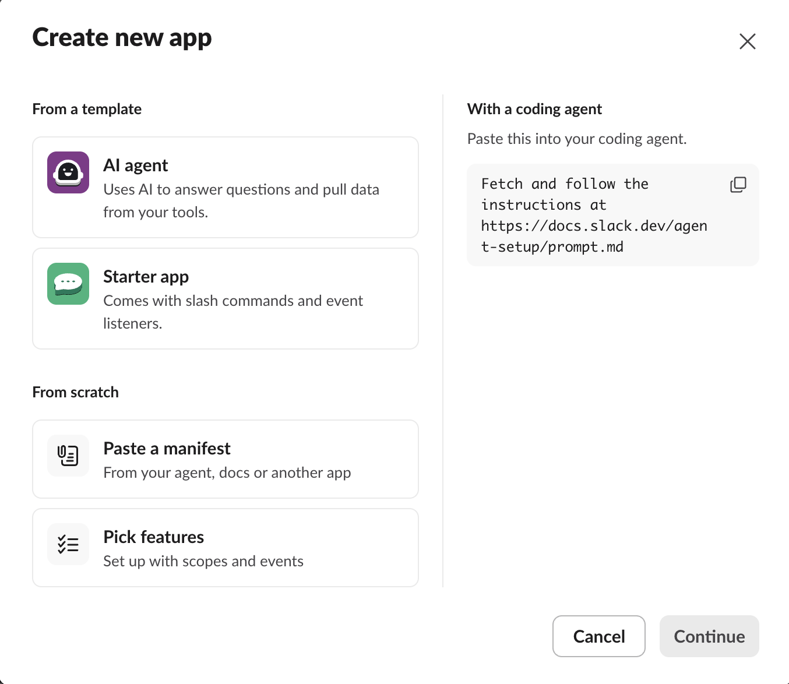
    </Frame>
  </Step>
  <Step title="Ime i workspace">
    Upišite ime (na primer `Izumi`), izaberite workspace i kliknite **Continue**.

    <Frame>
      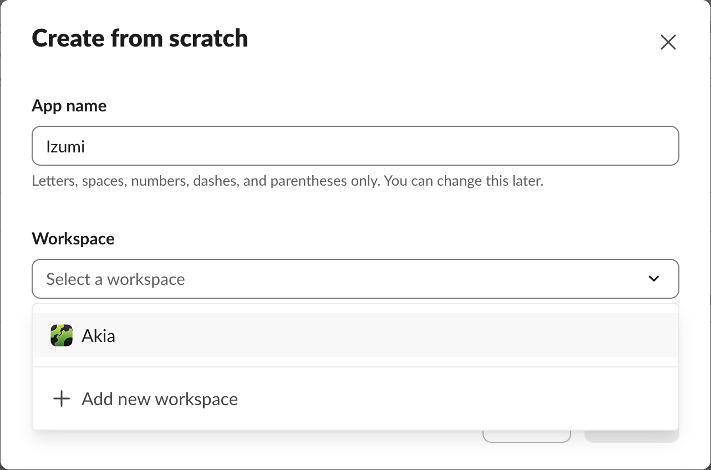
    </Frame>
  </Step>
  <Step title="Dodajte scope mcp:connect">
    U koraku "What it can do in Slack" u pretragu upišite `mcp:connect` i izaberite ga kao **bot scope**. To je jedini scope koji treba.

    <Frame>
      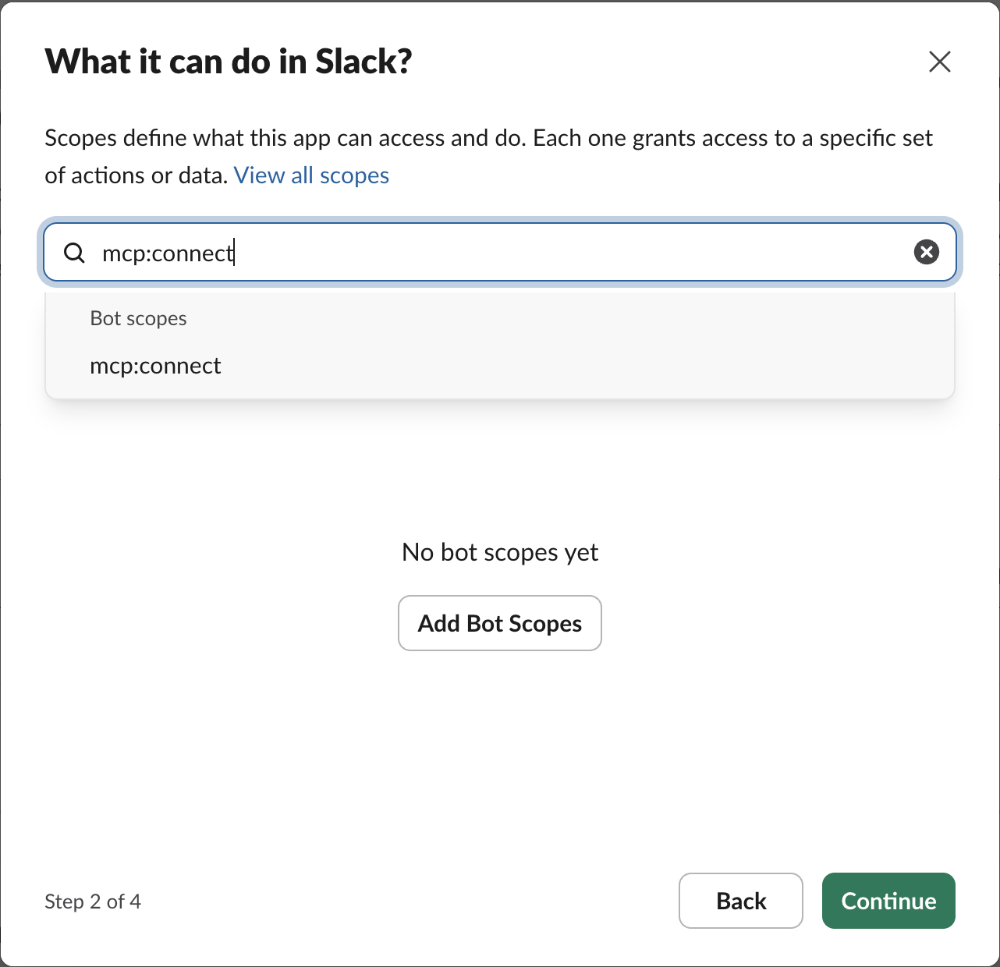
    </Frame>
    <Frame>
      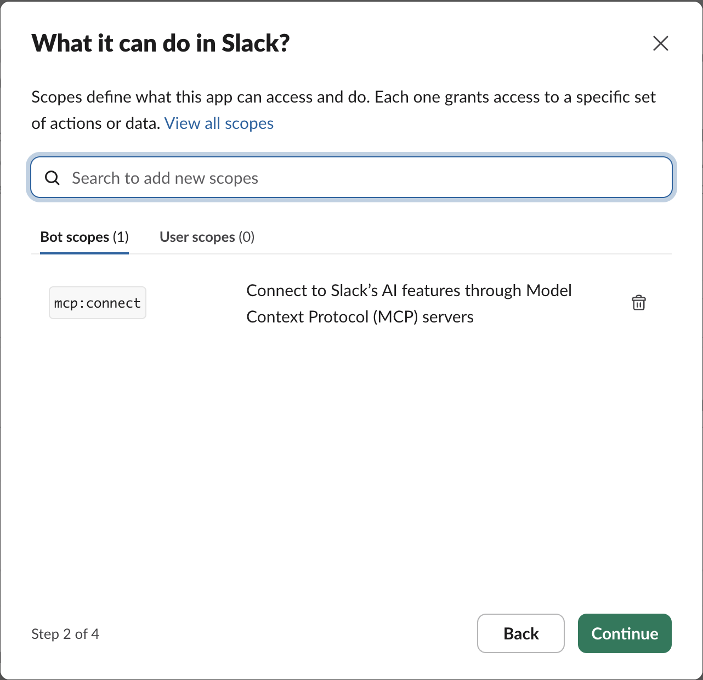
    </Frame>
  </Step>
  <Step title="Završite pravljenje">
    U koraku "What it can respond to" ništa ne dodajete, kliknite **Continue**. U pregledu piše **What it can do in Slack (1)**. Kliknite **Create and Install**.

    <Frame>
      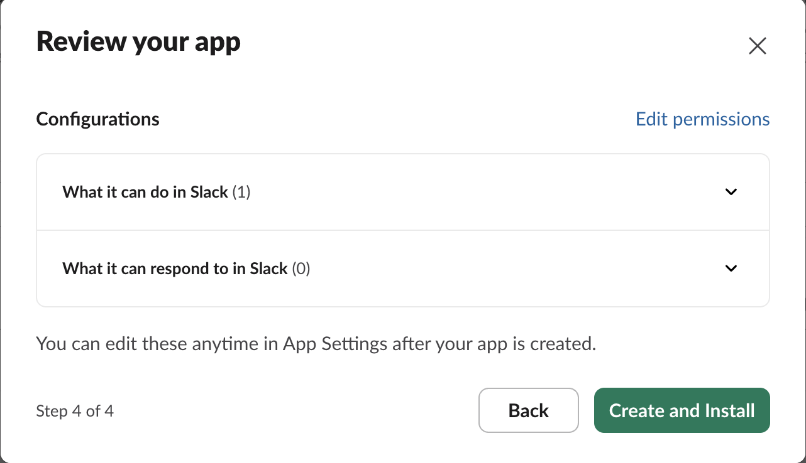
    </Frame>

    Ako dugme ostane sivo duže od očekivanog, otvorite `https://api.slack.com/apps`. Aplikacija je verovatno već napravljena.
  </Step>
</Steps>

### Korak 3: dodajte Izumi kao MCP server u aplikaciji

<Steps>
  <Step title="Otvorite MCP Servers">
    U aplikaciji otvorite **MCP Servers** u levom meniju i kliknite **Get Started** (ili **Add MCP Server** ako već postoji neki).

    <Frame>
      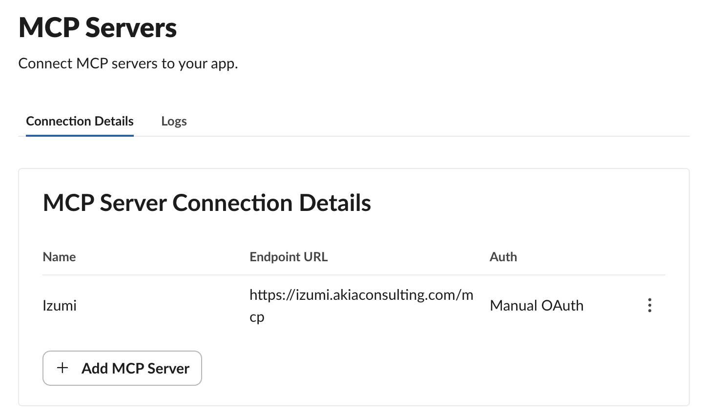
    </Frame>
  </Step>
  <Step title="Popunite formu">
    Slack automatski dodaje bot scope `mcp:connect`.

    | Polje | Vrednost |
    |---|---|
    | Name | `Izumi` |
    | URL | `https://izumi.akiaconsulting.com/mcp` |
    | Auth type | **Manual OAuth** (ne "Dynamic Client Registration") |
    | Client ID | `client_id` iz koraka 1 |
    | Client Secret | prazno |
    | Authorization URL | `https://izumi.akiaconsulting.com/oauth/authorize` |
    | Token request URL | `https://izumi.akiaconsulting.com/oauth/token` |
    | Use HTTP Basic Authentication | isključeno |
    | Use PKCE | uključeno (obavezno) |
    | OAuth scopes | `read` i `propose` (svaki potvrdite sa Enter) |
    | Identity URL, Account Identifier, Custom headers | prazno |

    <Frame>
      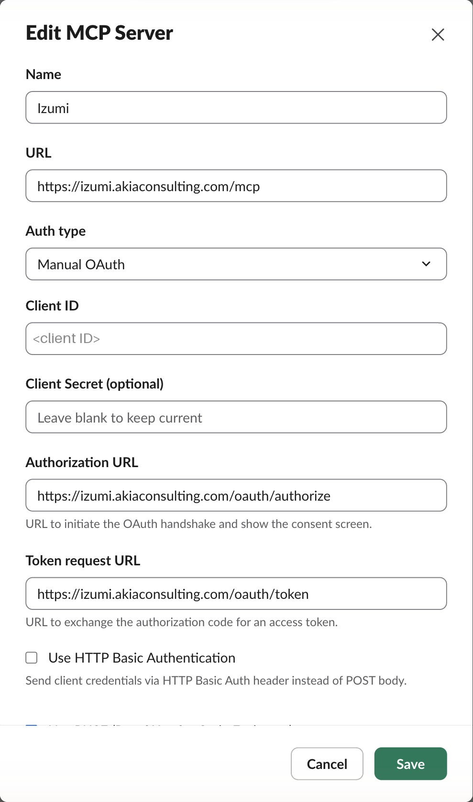
    </Frame>
    <Frame>
      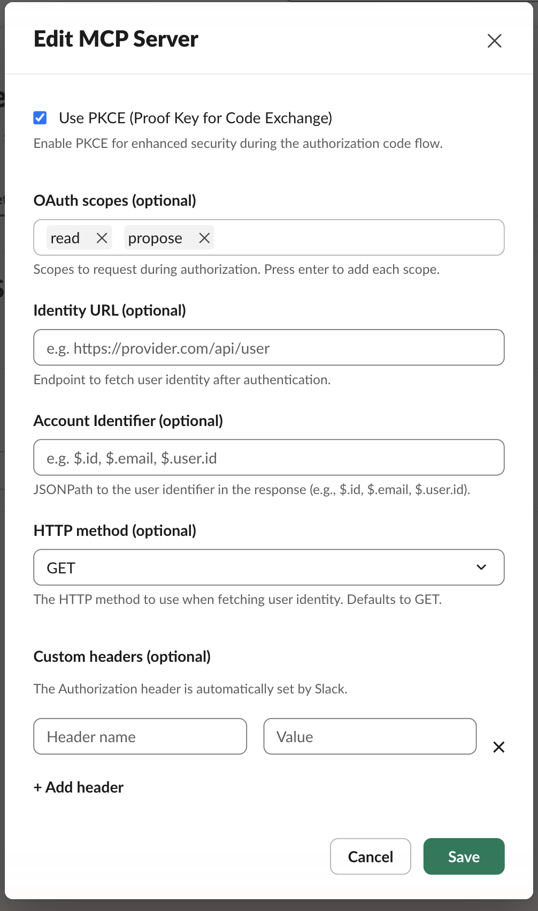
    </Frame>

    `read` je čitanje (pretraga, dokumenti), `propose` omogućava predlaganje beleški na pregled. Ako `propose` ne treba, ostavite samo `read`.
  </Step>
  <Step title="Sačuvajte">
    Kliknite **Save**. Pojavljuje se žuta traka "reinstall your app". To je sledeći korak.
  </Step>
</Steps>

### Korak 4: instalirajte aplikaciju (ponovo) u workspace

<Steps>
  <Step title="Reinstall">
    Kliknite **reinstall your app** u žutoj traci, ili otvorite **Install App** i kliknite **Reinstall to** (ime workspace-a).
  </Step>
  <Step title="Dozvolite">
    Slack prikazuje "Allow Izumi to access Slack" sa porukom "Perform actions in your workspace". Kliknite **Allow**. Posle toga se **Izumi** pojavljuje u Slacku pod **Apps** u levom meniju.

    <Frame>
      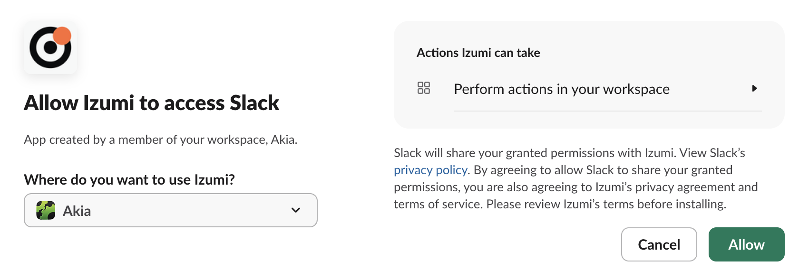
    </Frame>
  </Step>
</Steps>

Svaka izmena MCP servera traži novo **Reinstall**. Stranica **Install App** prikazuje bot token (počinje sa `xoxb`). To je tajna: ne delite je i ne stavljajte je u slike ni u uputstva. Na slici je token prekriven.

<Frame>
  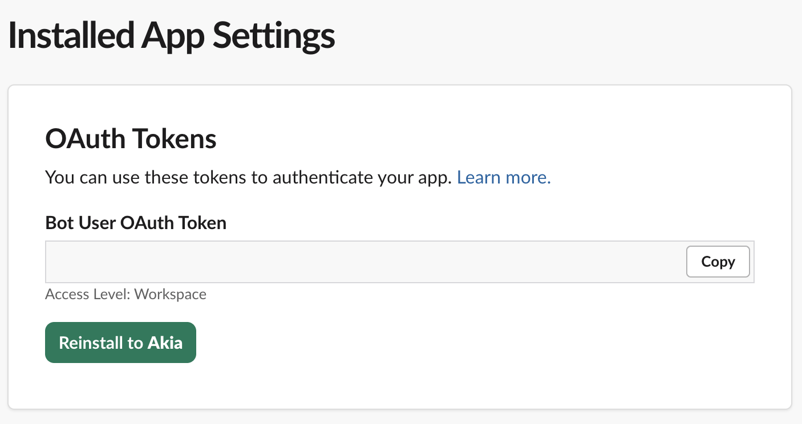
</Frame>

### Korak 5: izgled aplikacije (opciono)

U **Basic Information**, odeljak **Display Information**: ime, kratak opis (na primer "Izumi team knowledge base for Slackbot"), ikona (znak sa orbitom, PNG 512 px ili veći) i boja pozadine. Ikona se vidi u Slackbotu kad traži dozvolu.

<Frame>
  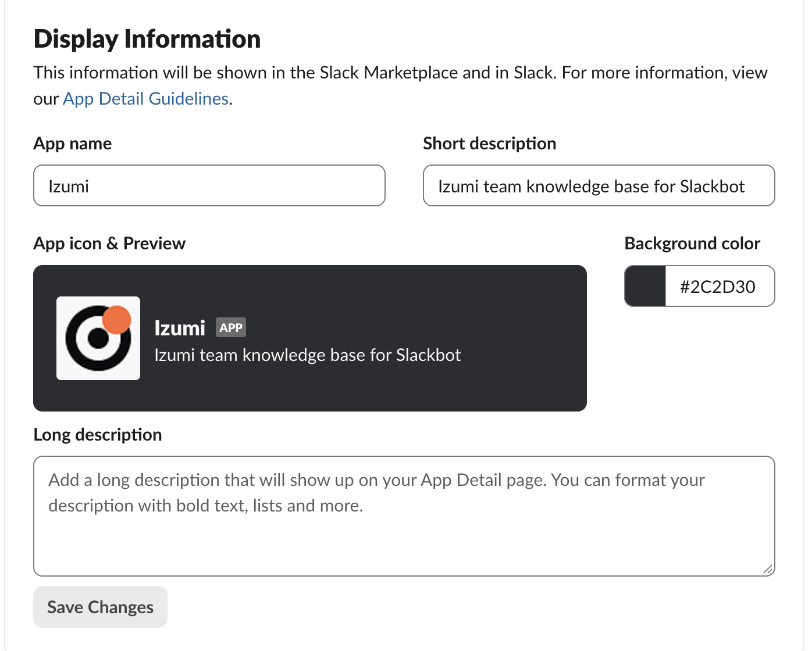
</Frame>

## Korak 6: svaki korisnik povezuje svoj Izumi nalog

Svaka osoba ovo radi jednom.

<Steps>
  <Step title="Pitajte Slackbot nešto o Izumi">
    U panelu Slackbot postavite pitanje koje pominje Izumi, na primer: "Preko Izumija: ko sam ja i kojim kompanijama imam pristup?"
  </Step>
  <Step title="Kliknite Connect">
    Slackbot prikazuje karticu "Connect your Izumi account to continue" sa dugmadima **Don't ask again**, **Not now** i **Connect**. Kliknite **Connect**.

    <Frame>
      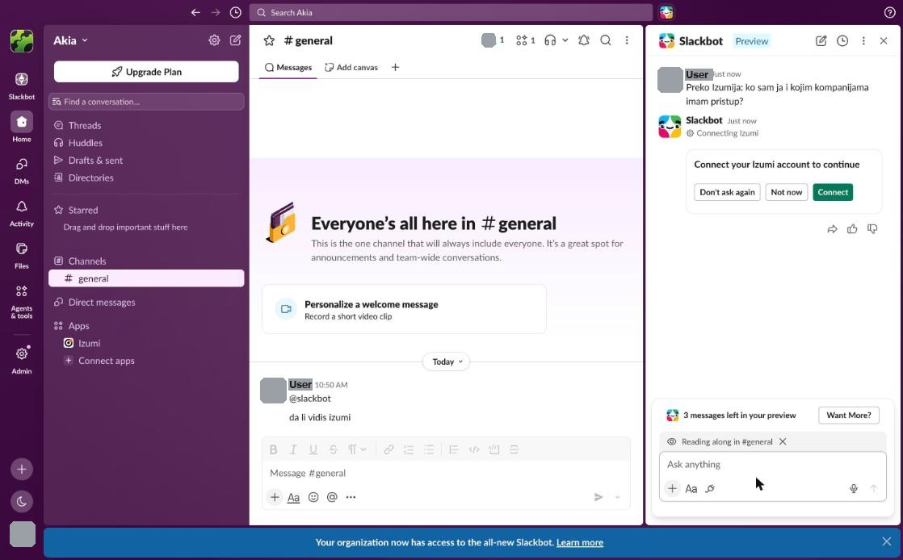
    </Frame>
  </Step>
  <Step title="Nastavite ka Izumi">
    Otvara se nova kartica: "You are about to connect to an external service", sa vašim Slack nalogom. Kliknite **Continue to Izumi**.

    <Frame>
      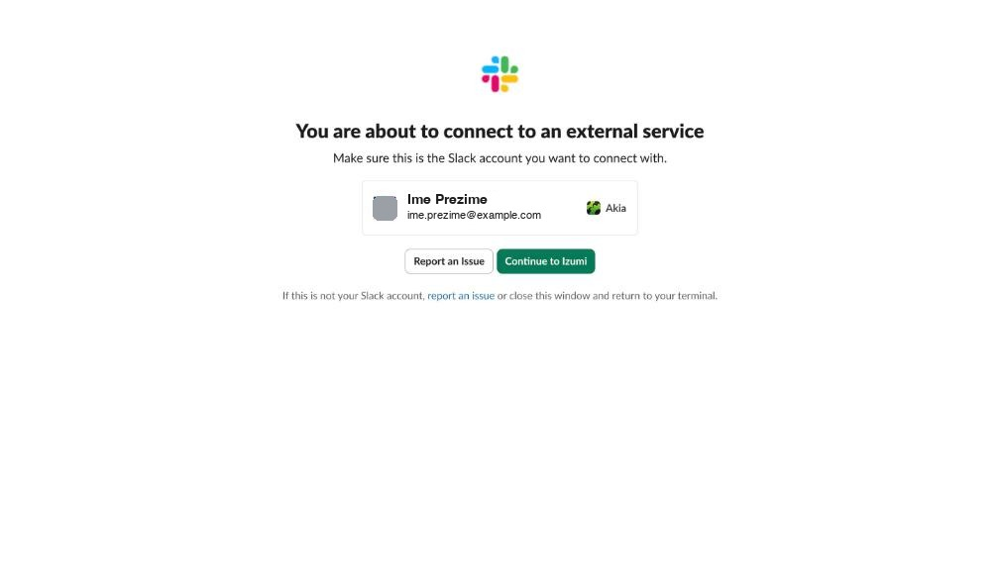
    </Frame>
  </Step>
  <Step title="Prijavite se u Izumi">
    Ako niste prijavljeni, Izumi prvo prikazuje prijavu. Prijavite se nalogom kojim se inače prijavljujete.

    <Frame>
      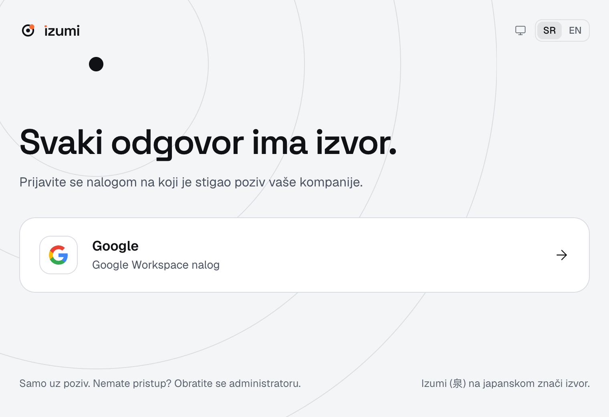
    </Frame>
  </Step>
  <Step title="Odobrite vezu">
    Izumi prikazuje stranicu "Poveži (naziv klijenta) sa Izumijem". Naziv je onaj koji je administrator dao klijentu u koraku 1.

    - Upozorenje da ime aplikacije dolazi iz same aplikacije i nije potvrđeno, i da se posle odobravanja vraćate na `oauth2.slack.com`.
    - **čita dokumente koje vi možete da čitate, u svim vašim firmama** (uvek uključeno) i **predlaže beleške koje pregleda urednik** (kvačica, možete da je isključite).
    - Veza traje 90 dana.
    - Kliknite **Odobri**.

    <Frame>
      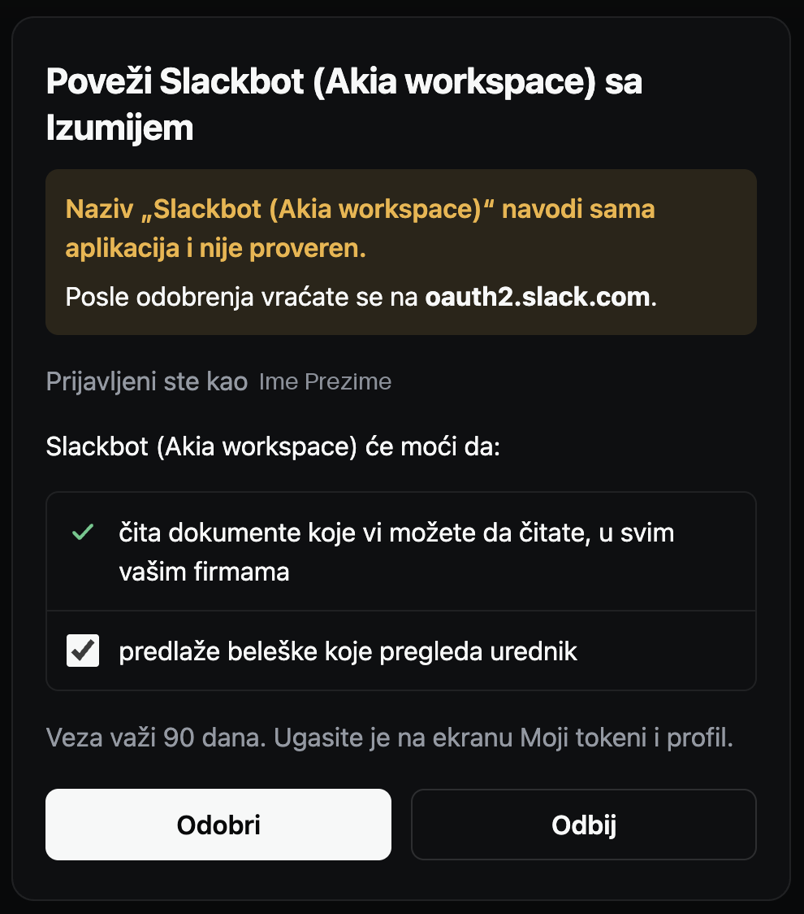
    </Frame>
  </Step>
  <Step title="Dozvolite alat">
    Kartica se zatvara, vraćate se u Slack i pitanje se nastavlja. Pri prvom pozivu alata Slackbot traži dozvolu (**Whoami**, **Search**): **Allow Once** (samo ovaj put), **Always Allow** ili **Don't Allow**. Za početak izaberite **Allow Once**.

    <Frame>
      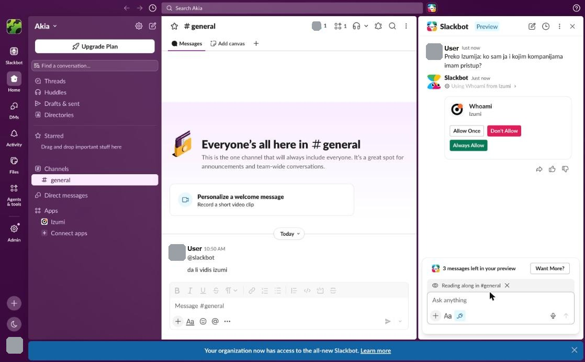
    </Frame>
  </Step>
  <Step title="Pročitajte odgovor">
    Slackbot odgovara sa linkom na dokument u Izumi.

    <Frame>
      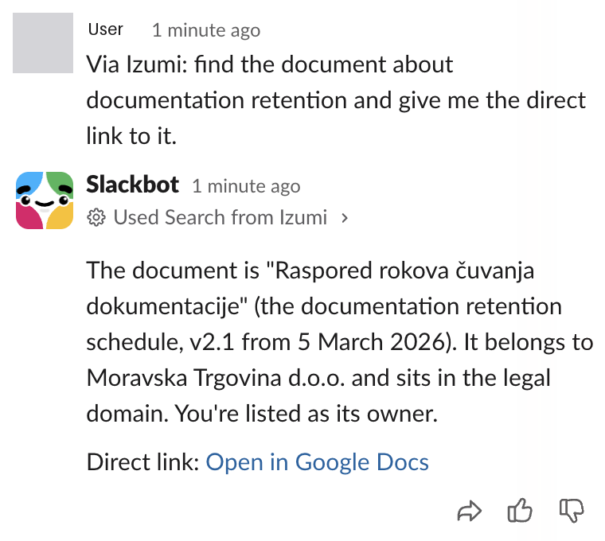
    </Frame>
  </Step>
</Steps>

Primeri pitanja:

- "Preko Izumija: pronađi dokument o (tema) i daj mi link."
- "Preko Izumija: ko u firmi zna o (tema)?"
- "Preko Izumija: predloži belešku u domen (domen) sa naslovom (naslov) i tekstom (tekst)."

### Predlog beleške iz Slackbota

Predlaganje je proveravano uživo (Izumi 0.5.2, 2026-11-19). Predlog se pojavio u **Red za pregled**, sa klijentom čiji je naziv onaj iz koraka 1, i urednik domena ga je odbio sa razlogom. Za odobravanje i odbijanje vidi stranicu ChatGPT, odeljak o predlogu u Izumi.

## Pregled i opoziv

U Izumi otvorite **Moji tokeni i profil**, odeljak **Tokeni**. Povezana aplikacija je red **Povezana aplikacija** sa pravima (`read`, `propose`), datumom isteka i poslednjom upotrebom. **Opozovi** prekida vezu.

<Frame>
  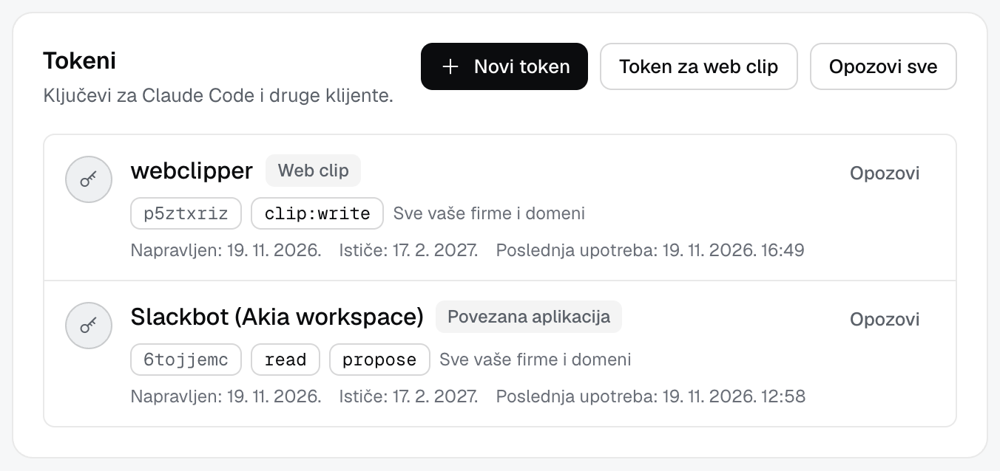
</Frame>

## Ograničenja

| Šta | Detalji |
|---|---|
| Automatska registracija ne radi | Slack šalje `token_endpoint_auth_method=client_secret_post`. Izumi prihvata samo `none` i `private_key_jwt`, pa Slack javlja "Automatic registration did not go through". Zato je klijent ručni (korak 1). |
| Slackbot Preview ima limit poruka | Panel prikazuje "N messages left in your preview". Odgovoren upit troši jednu poruku, zahtev za povezivanje ne. Šta se dešava kad se potroše nije potvrđeno. |
| Link na otpremljeni dokument traži prijavu | Link se otvara u Izumi posle prijave. Slackbot ne može da ga otvori umesto korisnika. |
| Ograničeni dokumenti | Slackbot vidi samo ono što korisnik sme. Za dokument sa oznakom ograničenja (na primer HR) odgovor kaže ko sme da ga čita. |
| Dokument sa izvorom | Link je izvorni link (na primer Drive). Ako korisnik nema pristup izvoru, link mu ne vredi. Izumi stranica je tada alternativa. |
| Svaka izmena MCP servera | Traži novo **Reinstall**. |

## Rešavanje problema

| Simptom | Uzrok i rešenje |
|---|---|
| Slackbot ne pominje Izumi alate | Aplikacija nije reinstalirana posle izmene MCP servera (korak 4). Proverite da je **Izumi** pod **Apps**. |
| "Connect" otvara grešku o redirect adresi | Redirect klijenta u Izumi nije `https://oauth2.slack.com/external/auth/callback` (korak 1). |
| Izumi odbija `client_id` | Pogrešan ili uklonjen klijent. `./tb admin oauth client list`. |
| Greška pri razmeni koda (token) | Isključite "Use HTTP Basic Authentication", uključite PKCE, ostavite Client Secret prazan. |
| Alati rade, ali nema dokumenata | Korisnik nema pristup kompaniji ili domenu u Izumi. `whoami` pokazuje kompanije i uloge. |
| Dugo nema odgovora | Proverite `https://izumi.akiaconsulting.com/readyz`. Administrator na serveru gleda log aplikacije. |
| Slack javlja "Something went wrong" pri pravljenju aplikacije | Sačekajte i probajte ponovo. Ako traži "creating apps too quickly", sačekajte. |
| Cancel na ekranu "Allow Izumi to access Slack" | Slack prikazuje "Something went wrong when authorizing". To je normalno ponašanje odbijanja, postojeća instalacija se ne menja. |
