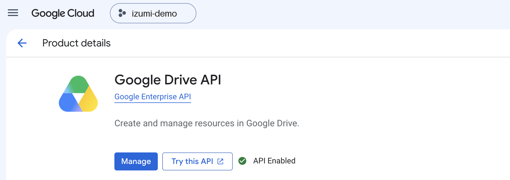
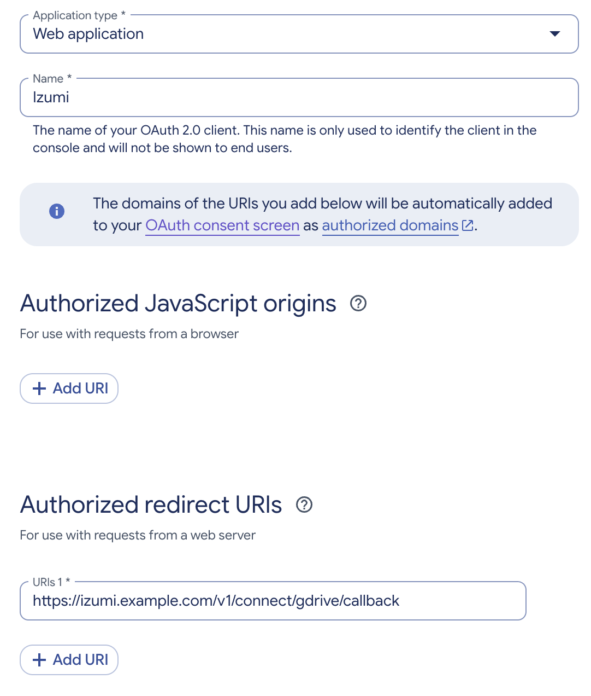
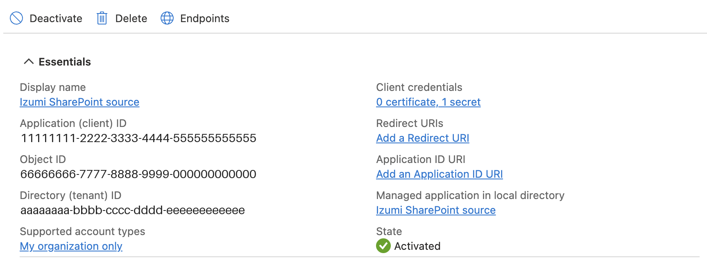
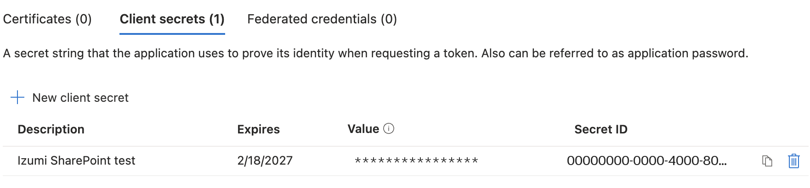
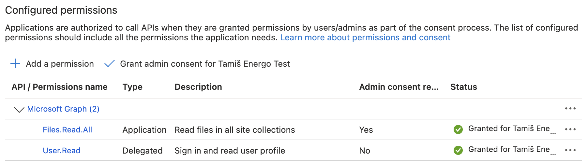

Provereno na Izumi 0.5.7, 2026-11-21 (kod i produkcija, samo čitanje).

Konektori puštaju Izumi da čita dokumente iz Google Drive-a i SharePoint-a. Ova stranica opisuje stranu operatora i servera: Google Cloud klijent, Microsoft registraciju aplikacije i promenljive u `.env`. Dijalog u Izumiju, gde admin firme povezuje izvor, je u kartici Administracija: [Google Drive](/sr/admin/izvori-drive) i [Microsoft 365](/sr/admin/izvori-microsoft).

## Šta važi za oba konektora

- Izumi samo čita. Nikad ne menja fajlove.
- Podaci za prijavu konektora (refresh token, client secret) se čuvaju šifrovani ključem firme, koji je obmotan sa `TB_MASTER_KEY`. Nikad se ne prikazuju ponovo.
- Izvor se povezuje u aplikaciji: napravi se, poveže, izaberu se koreni i pravila, urade se probni prolaz i prva sinhronizacija.
- Serveru trebaju spoljni hostovi tog konektora, vidi tabelu u [Rad bez interneta](/sr/instalacija/bez-interneta).

## Google Drive

`drive.readonly` je ograničen (restricted) opseg. Serverska aplikacija koja čuva takve podatke traži Google verifikaciju i godišnju bezbednosnu proveru, osim ako je interna za jednu organizaciju. Zato postoje dva načina.

### Instalacioni klijent (podrazumevano)

Jedan OAuth klijent cele instalacije. Admin firme povezuje Drive samo imenom izvora.

<Steps>
  <Step title="Upišite klijent u .env">
    `TB_GDRIVE_CLIENT_ID` i `TB_GDRIVE_CLIENT_SECRET`, oba ili nijedan. Čitaju ih i `app` i `worker`.
  </Step>
  <Step title="Primenite izmenu">
    ```
    docker compose up -d app worker
    ```
  </Step>
  <Step title="Proverite da ga aplikacija vidi">
    Odgovor `GET /v1/status` ima `connectors.gdrive_instance_client` kao `true` ili `false`, nikad ID ni secret, ali ga vidi samo prijavljeni admin firme (ostali dobijaju 404), pa običan `curl` sa servera ne pomaže. Provera u aplikaciji: bez klijenta forma Drive izvora otvara odeljak sa sopstvenim klijentom i traži ga.
  </Step>
</Steps>

Šta očekivati dok Google nije verifikovao aplikaciju:

- Pristanak pokazuje upozorenje da Google nije verifikovao aplikaciju. Korisnik bira `Advanced`, pa nastavlja.
- Najviše 100 Google naloga ikad može da da pristanak.
- Administrator Google Workspace-a može da blokira neverifikovane aplikacije. Ta firma tada koristi sopstveni klijent (ispod).
- Verifikaciju i godišnju bezbednosnu proveru planirajte pre trećeg klijenta koji plaća ili kad se približite granici od 100 naloga.
- Promena secreta klijenta ne traži ponovno povezivanje (worker ga čita pri svakom osvežavanju). Promena samog ID-a klijenta traži ponovno povezivanje svakog izvora na njemu.
- Izvor koji je povezan sa sopstvenim `client_id` jednakim ID-u instalacije čuvao je secret tog klijenta uz token: ostavite stari secret uključen dok se taj izvor ne poveže ponovo.

### Sopstveni klijent firme (Internal, bez upozorenja)

Za firmu sa Google Workspace-om, u projektu koji pripada njenoj organizaciji. Nema verifikacije, nema granice od 100 naloga.

<Steps>
  <Step title="Napravite projekat">
    U Workspace organizaciji klijenta napravite Google Cloud projekat (administrator klijenta ili neko ko sme da pravi projekte).
  </Step>
  <Step title="Uključite Drive API">
    `APIs and Services`, `Library`, uključite `Google Drive API`.

    <Frame>
      
    </Frame>
  </Step>
  <Step title="Podesite ekran pristanka">
    `OAuth consent screen`: tip korisnika `Internal`, opseg `https://www.googleapis.com/auth/drive.readonly` i ništa drugo.
  </Step>
  <Step title="Napravite OAuth klijent">
    `Credentials`, `Create credentials`, `OAuth client ID`, tip `Web application`, adresa za povratak tačno `<TB_PUBLIC_URL>/v1/connect/gdrive/callback`.

    <Frame>
      
    </Frame>
  </Step>
  <Step title="Dajte klijent adminu firme">
    Admin firme u Izumiju pravi izvor i u odeljku **Sopstveni OAuth klijent (napredno)** upisuje client ID. Client secret upisuje jednom pri povezivanju: čuva se šifrovan uz token. Dijalog je opisan u [Google Drive](/sr/admin/izvori-drive).
  </Step>
</Steps>

Ako povezivanje završi greškom, a u zapisu o pristupu red `source.connect` kaže `discovery_failed`, najverovatnije Drive API nije uključen u projektu tog klijenta (korak 2). Log aplikacije ima red `gdrive connect: discovery failed` sa HTTP statusom.

Ako nalog opozove aplikaciju (`myaccount.google.com/permissions`), izvor pokazuje **Potrebno ponovno povezivanje**. Ništa se ne briše i ponovno povezivanje nastavlja bez novog embedovanja svega. Izvor na instalacionom klijentu se ponovo povezuje jednim klikom, a onaj sa sopstvenim klijentom opet traži njegov secret.

## SharePoint i OneDrive: Microsoft Graph

IT firme registruje aplikaciju u svom Entra tenantu. Ceo postupak sa slikama je u [Microsoft 365](/sr/admin/izvori-microsoft). Ukratko, za operatora:

- Tip aplikacije: jedan tenant, bez adrese za povratak.
- Dozvola: `Microsoft Graph`, `Application permissions`, `Files.Read.All` (podrazumevana), pa `Grant admin consent`.
- Client secret ima rok trajanja: zapišite ga. Kad istekne, izvor pokazuje **Potrebno ponovno povezivanje**.
- U Izumiju admin firme unosi ID tenanta, ID aplikacije, secret i biblioteku (adresa sajta ili ID diska).

<Frame>
  
</Frame>

<Frame>
  
</Frame>

<Frame>
  
</Frame>

- Na slici je uz `Files.Read.All` i `User.Read` (Delegated): Entra ga dodaje novoj registraciji sama i može da ostane.
- Sa `Files.Read.All` aplikacija vidi biblioteke svih sajtova u tenantu. Izumi uvozi samo biblioteku i foldere koje admin izabere.
- Na probnom tenantu `Files.Read.All` je našao koren sajta i bez ID-a biblioteke. Za sajt ispod korena forma traži ID diska (iz koda).
- Dozvola `Sites.Selected` nije proverena sa uvozom. Koristite `Files.Read.All`.

## Ograničenja

- Pristup u Izumiju određuju domeni i uloge, ne deljenje u Drive-u ili SharePoint-u.
- Instalacioni Google klijent ima granicu od 100 naloga i upozorenje dok se ne verifikuje.
- Forma Microsoft izvora ne prikazuje rok isteka client secreta.

## Rešavanje problema

| Šta vidite | Šta proveriti |
|---|---|
| Povezivanje sa Google-om ne uspeva, `source.connect` kaže `discovery_failed` | Drive API nije uključen u projektu OAuth klijenta. |
| Forma Drive izvora traži sopstveni klijent | Odgovor `GET /v1/status` (admin firme, prijavljen) kaže `gdrive_instance_client: false`: `TB_GDRIVE_CLIENT_ID` i `TB_GDRIVE_CLIENT_SECRET` nisu postavljeni ili niste pokrenuli `docker compose up -d app worker`. |
| Google kaže da aplikacija nije verifikovana | Očekivano za instalacioni klijent. Korisnik bira `Advanced` i nastavlja, ili firma koristi sopstveni klijent. |
| Microsoft izvor pokazuje **Potrebno ponovno povezivanje** | Client secret je istekao ili je opozvan: napravite novi i unesite ga u izvor. |
| `Grant admin consent` ne prolazi odmah | Sačekajte nekoliko minuta (propagacija) i probajte ponovo. |
