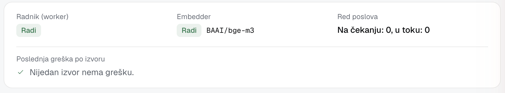

Provereno na Izumi 0.5.7, 2026-11-21: `./tb status` i `/metrics` uživo na probnom steku, a `/healthz`, `/readyz` i `/metrics` bez tokena i na produkciji.

Izumi ima dve javne provere zdravlja, listu mera za Prometheus, komandu `./tb status` i blok sa stanjem u aplikaciji. Ništa se ne šalje van servera.

## Provere zdravlja

- `GET /healthz`: proces radi. Odgovara 200.
- `GET /readyz`: 200 kad je baza dostupna, migracije su aktuelne, embedder odgovara, a otkucaj workera je mlađi od 2 minuta. Inače 503. Telo ima `checks` za `db`, `schema`, `embedder` i `worker`.

```
curl -s https://brain.example.com/healthz
curl -s https://brain.example.com/readyz
```

Na produkciji: `/healthz` vraća 200, a `/readyz` vraća `{"ok":true,"checks":{"db":true,"schema":true,"embedder":true,"worker":true}}`.

## Mere (/metrics)

`GET /metrics` vraća Prometheus tekst uz zaglavlje `Authorization: Bearer <TB_METRICS_TOKEN>`.

- Bez postavljenog `TB_METRICS_TOKEN`: 404 (isto kao nepoznata adresa).
- Bez zaglavlja ili sa pogrešnim tokenom: 401, i to se računa kao neuspela provera tokena (`tb_auth_failures_total`). Kad je kapija puna, odgovor je 429.
- Produkcija ima token: poziv bez zaglavlja vraća 401.
- Odgovor ne nosi ime firme, osobe, naslov ni putanju.

Neke od mera:

- `tb_http_request_duration_seconds`, `tb_mcp_tool_duration_seconds`, `tb_embed_duration_seconds`
- `tb_ingest_queue_depth`, `tb_jobs`, `tb_source_errors`
- `tb_auth_failures_total`, `tb_audit_rows_last_minute`
- `tb_oauth_cimd_fetch_total` (po hostu i ishodu, vidi [OAuth](/sr/instalacija/oauth))

## Komanda ./tb status

```
./tb status
```

Prikazuje kontejnere (`docker compose ps`), spremnost (`readyz: ready` ili `readyz: not ready`), aktivni model embeddera (`active embed model: ...`) i starost poslednjeg backupa (`last backup: <fajl> (<n> h ago)`). Alarm podesite na backup stariji od jednog dana.

## Stanje u aplikaciji

Admin firme vidi blok sa stanjem na vrhu strane **Izvori**: da li worker i embedder rade, koliko poslova čeka i radi, i poslednju grešku po izvoru.

<Frame>
  
</Frame>

## Logovi i disk

- `docker compose logs app worker`: logovi su JSON redovi, nivo određuje `TB_LOG_LEVEL`. Nijedna tajna se ne upisuje u log.
- Disk: `df -h` i `sudo du -sh backups`.

## Ograničenja

- `/metrics` nije dostupan bez `TB_METRICS_TOKEN`.
- Izumi ne šalje alarme: alarme podešavate u svom alatu za nadzor.

## Rešavanje problema

| Šta vidite | Šta proveriti |
|---|---|
| `/readyz` 503 | Telo kaže koji `checks` je `false`. `docker compose ps`, pa `docker compose logs` tog servisa. |
| `/metrics` odgovara 404 | `TB_METRICS_TOKEN` nije postavljen u `.env`. |
| `/metrics` odgovara 401 | Zaglavlje `Authorization: Bearer ...` nedostaje ili token nije tačan. |
| `worker` je `false` u `/readyz` | Otkucaj workera stariji od 2 minuta: `docker compose logs worker`. |
