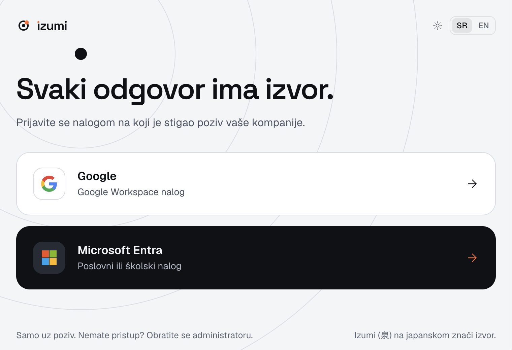
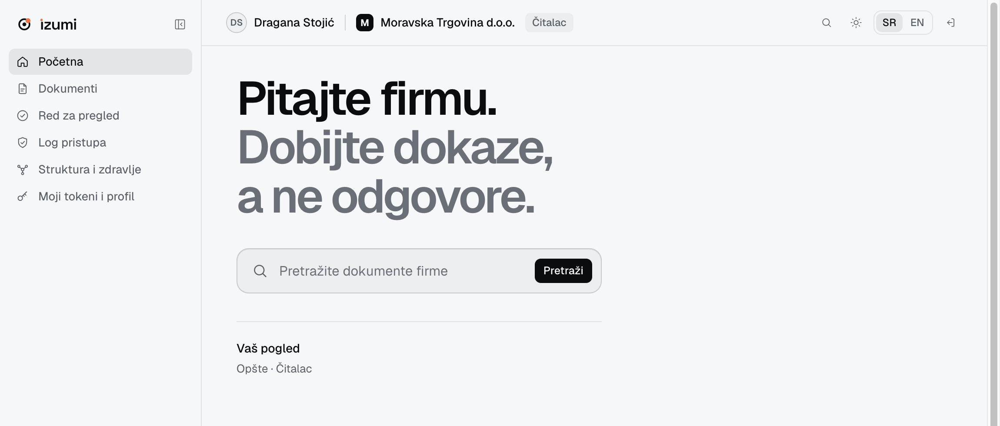
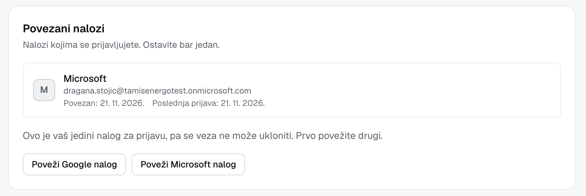

Provereno na Izumi 0.5.7, 2026-11-21 (kod i produkcija, samo čitanje).

Izumi nema lozinke. Ljudi se prijavljuju Google ili Microsoft (Entra ID) nalogom. Ovde podešavate te dve prijave na serveru. Prijava za čitanje dokumenata iz Drive-a ili SharePoint-a je druga stvar: nju podešavate u [Konektorima](/sr/instalacija/konektori).

## Kako radi

- Provajder se pojavljuje na stranici prijave samo kad su postavljeni i njegov client ID i njegov secret. ID bez secreta (ili obrnuto) zaustavlja aplikaciju pri startu.
- Adrese za povratak (redirect URI) su tačno `<TB_PUBLIC_URL>/v1/auth/google/callback` i `<TB_PUBLIC_URL>/v1/auth/entra/callback`, bez kose crte na kraju.
- Posle svake izmene `.env` pokrenite `docker compose up -d app`.
- Kad nijedan provajder nije podešen, stranica prijave kaže _"Prijava još nije podešena. Obratite se administratoru ove instalacije."_

<Frame>
  
</Frame>

Slika je stranica prijave produkcije, gde su podešeni Google i Microsoft Entra. Microsoft pločica je namerno tamna.

## Google

<Steps>
  <Step title="Napravite OAuth klijent">
    U Google Cloud konzoli otvorite `APIs and Services`, `Credentials`, `Create credentials`, `OAuth client ID`, tip `Web application`.
  </Step>
  <Step title="Dodajte adresu za povratak">
    U `Authorized redirect URIs` dodajte `<TB_PUBLIC_URL>/v1/auth/google/callback`.
  </Step>
  <Step title="Upišite ID i secret u .env">
    Client ID ide u `TB_OIDC_GOOGLE_CLIENT_ID`, a secret u `TB_OIDC_GOOGLE_CLIENT_SECRET`. Zatim `docker compose up -d app`.
  </Step>
</Steps>

- Opsezi su `openid email profile`.
- Izumi veruje samo adresama koje je Google potvrdio.

## Microsoft (Entra ID)

<Steps>
  <Step title="Napravite registraciju aplikacije">
    U Entra admin centru otvorite `App registrations`, `New registration`. Za podrazumevano `TB_OIDC_ENTRA_TENANT=organizations` izaberite `Accounts in any organizational directory`. Za jedan tenant izaberite jedan tenant i u `TB_OIDC_ENTRA_TENANT` upišite njegov GUID. Lični Microsoft nalozi se odbijaju.
  </Step>
  <Step title="Dodajte adresu za povratak">
    U `Authentication` dodajte platformu `Web` sa adresom `<TB_PUBLIC_URL>/v1/auth/entra/callback`.
  </Step>
  <Step title="Napravite client secret">
    U `Certificates & secrets` napravite client secret. U `TB_OIDC_ENTRA_CLIENT_SECRET` ide njegov `Value` (ne `Secret ID`), a `Application (client) ID` ide u `TB_OIDC_ENTRA_CLIENT_ID`. Zapišite datum isteka secreta.
  </Step>
  <Step title="Dodajte opcioni podatak email">
    U `Token configuration` dodajte opcioni podatak `email` u ID token. Bez njega Izumi poredi `preferred_username` sa pozivnicom, a to može biti drugačije od pozvane adrese.
  </Step>
  <Step title="Pokrenite aplikaciju ponovo">
    `docker compose up -d app`. Na stranici prijave se pojavljuje dugme za Microsoft.
  </Step>
</Steps>

Ova aplikacija služi samo za prijavu ljudi. Registracija aplikacije za čitanje SharePoint-a je odvojena i ima druge dozvole: vidi [Konektori](/sr/instalacija/konektori).

## Ko sme da se prijavi

- Prijava traži pozivnicu. Pozivnice pravi admin firme u aplikaciji, vidi [Korisnici i pozivnice](/sr/admin/korisnici).
- Svaka firma može da ograniči ko sme da prihvati pozivnicu (dozvoljeni Google domeni, dozvoljeni Microsoft tenanti) u svojim podešavanjima, vidi [Kompanije, domeni, uloge](/sr/admin/kompanije-domeni-uloge).

## Kako izgleda prijava Microsoft nalogom
Kad se osoba prijavi Microsoft nalogom (i prođe korak višefaktorske provere koji traži vaš tenant), Izumi joj otvara stranicu **Početna**. Slike su sa probnog tenanta, od člana sa ulogom Čitalac u jednom domenu.
<Frame>
  
</Frame>
Na **Moji tokeni i profil** odeljak **Povezani nalozi** prikazuje Microsoft nalog sa datumom povezivanja i poslednje prijave. Osoba sa jednim nalogom ne može da ga ukloni; prvo može da poveže Google ili Microsoft nalog.
<Frame>
  
</Frame>
## Ograničenja

- Prijava Microsoft nalogom je proverena uživo na Izumiju 0.5.8, 2026-11-21, na probnom tenantu sa registracijom aplikacije za jedan tenant: admin i dva člana su se prijavili iz pozivnica, kasnija pozivnica je radila, a odjava vraća na stranicu za prijavu. Nije proveravano uživo: podrazumevano podešavanje `organizations` i odbijanje ličnog Microsoft naloga (pravilo samog Microsofta za radne naloge). Prođite tok jednom na svom tenantu pre nego što ga ponudite firmi.
- Odjava iz Izumija ne odjavljuje vas sa Microsofta. Od Izumija 0.5.9 dugme Microsoft uvek otvara Microsoftov izbor naloga ("Pick an account"), pa se poslednji nalog više ne prijavljuje tiho. Proveravano uživo na 0.5.9, 2026-11-21: posle odjave iz Izumija dugme je prikazalo izbor naloga, a nalog je i dalje bio označen kao "Signed in". Na deljenom računaru sledeća osoba bira ili dodaje svoj nalog; da biste završili samu Microsoft sesiju, odjavite se i sa Microsofta ili koristite privatni prozor.
- Aplikacija nema prijavu lozinkom ni drugi provajder.

## Rešavanje problema

| Šta vidite | Šta proveriti |
|---|---|
| Aplikacija staje pri startu | Postavljen je ID bez secreta ili secret bez ID-a za Google ili Entra. Oba ili nijedan. |
| Provajder se ne pojavljuje na stranici prijave | Nije postavljeno nijedno od dva polja ili niste pokrenuli `docker compose up -d app` posle izmene. |
| Provajder vraća grešku o adresi za povratak (Google: `redirect_uri_mismatch`) | Adresa u Google ili Entra aplikaciji nije tačno `<TB_PUBLIC_URL>/v1/auth/<provajder>/callback`, bez kose crte na kraju. |
| Pozvana osoba vidi _"Firma ne dozvoljava prijavu sa ovog naloga (dozvoljeni domeni ili tenanti). Obratite se administratoru firme."_ | Njen Google domen ili Microsoft tenant nije na listi u podešavanjima firme. |
| Pozvana osoba vidi _"Ovaj nalog ne odgovara pozivnici. Ponovo otvorite link pozivnice i prijavite se pozvanim nalogom."_ (ili isto sa adresom) | Prijavila se nalogom čija adresa nije pozvana. Kod Microsofta proverite i da li nedostaje opcioni podatak `email`: dodajte ga u `Token configuration`. |
