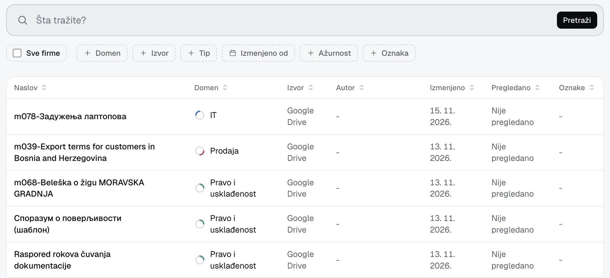
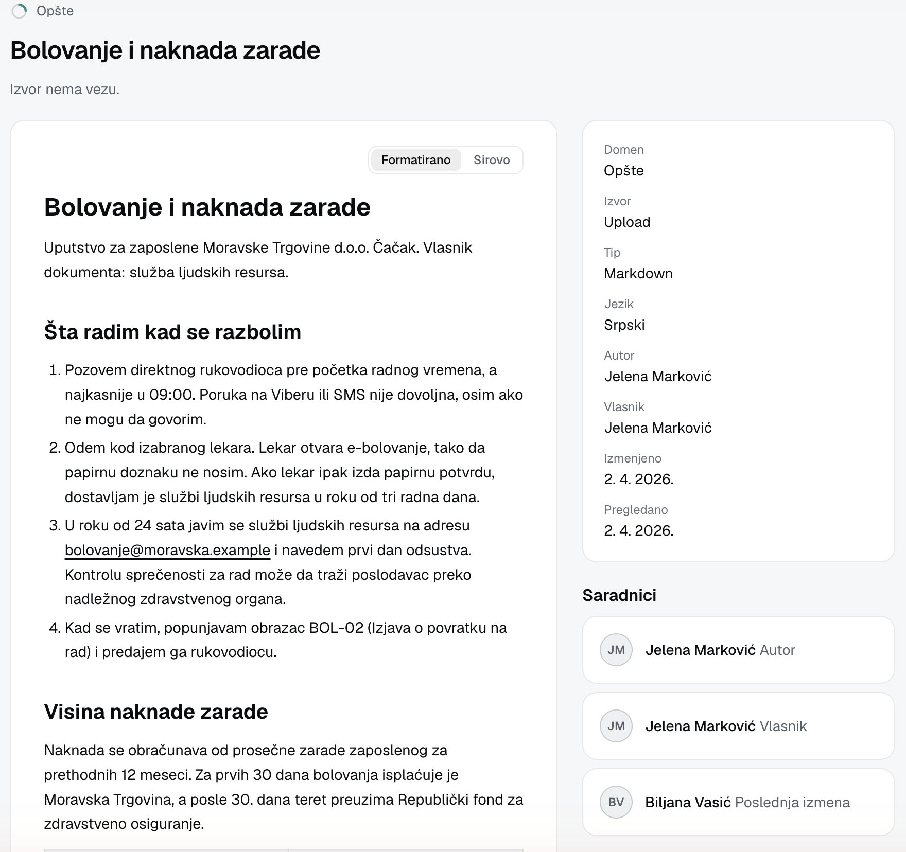
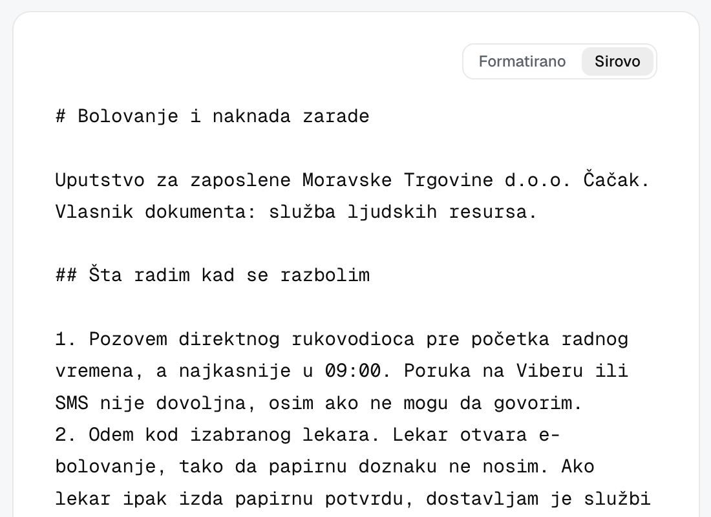

Provereno na Izumi 0.5.7, 2026-11-20.

**Dokumenti** je lista svih dokumenata koje smete da vidite, sa filterima i sortiranjem. Odavde otvarate dokument i čitate njegov tekst.

## Pregledajte listu

<Steps>
  <Step title="Otvorite Dokumenti">
    Kliknite **Dokumenti** u levom meniju. Kolone su **Naslov**, **Domen**, **Izvor**, **Autor**, **Izmenjeno**, **Pregledano** i **Oznake**. Podrazumevano ide najnovije prvo.

    <Frame>
      
    </Frame>
  </Step>
  <Step title="Sortirajte i filtrirajte">
    Klik na naziv kolone sortira listu. Filteri iznad liste su isti kao u pretrazi, plus **Ažurnost** (zastareo je dokument stariji od 180 dana). Lista učitava po 50 redova, ostalo dolazi preko **Učitaj još**.
  </Step>
  <Step title="Otvorite dokument">
    Kliknite naslov. Vidite naslov, domen i **Otvori izvor** (veza ka izvoru, na primer Google Drive; ako izvor nema vezu, piše "Izvor nema vezu."). Desno su podaci: **Domen**, **Izvor**, **Tip**, **Jezik**, **Autor**, **Vlasnik**, **Izmenjeno**, **Pregledano** i **Saradnici**.

    <Frame>
      
    </Frame>
  </Step>
  <Step title="Izaberite način čitanja">
    Prekidač **Formatirano** prikazuje naslove, liste i tabele. **Sirovo** prikazuje isti tekst sa oznakama (`#`, `|`), kako ga Izumi čuva i pretražuje. Za čitanje koristite **Formatirano**. **Nazad na dokumente** vraća na listu.

    <Frame>
      
    </Frame>
  </Step>
</Steps>

## Ograničenja

- Vidite samo dokumente iz domena u kojima imate ulogu. Isto važi za admina firme. Admin može da pregleda listu kao drugi član (**Pregledaj**).
- Krug ispred domena je samo oznaka domena u boji, ne indikator učitavanja.
- Levi meni običnog člana (proveri uživo) ima **Početna**, **Dokumenti**, **Red za pregled**, **Log pristupa**, **Struktura i zdravlje** i **Moji tokeni i profil**, a lista sadrži samo domene u kojima ima ulogu.
- Tabela unutar PDF-a prikazuje se kao tabela u prikazu **Formatirano** (proveri uživo kao član, na PDF-u sa spiskom zaposlenih).
- Isečci sa veba imaju oznake **Isečak sa veba** i **Nepouzdano (veb)**. Tretirajte ih kao nepouzdane.
- Obični član ne vidi **Izvori**, **Izveštaj uvoza** i **Firme i članovi**.

## Rešavanje problema

- _"Dokument nije pronađen."_ Dokument je uklonjen ili nemate pristup domenu.
- _"Dokument nema tekst."_ Izvor je prazan ili Izumi nije mogao da pročita tekst. Admin firme to vidi u **Izveštaj uvoza**.
- _"Nemate ulogu ni u jednom domenu."_ Zamolite admina firme da vam dodeli ulogu.
- _Dokument koji znate da postoji nije u listi._ Nemate ulogu u njegovom domenu, ili je neki filter uključen. Uklonite filtere.
