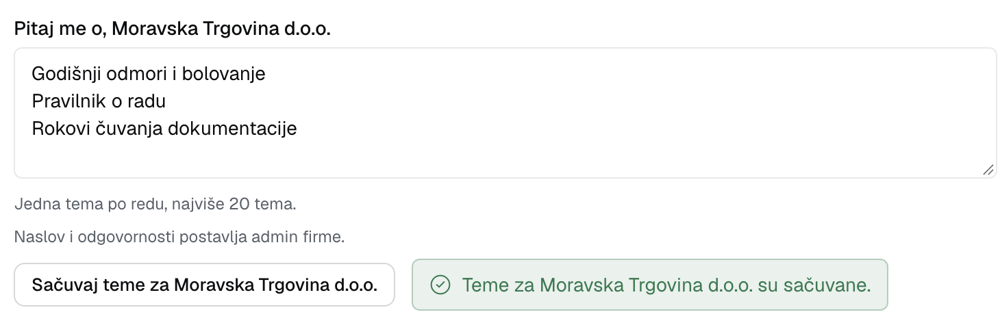
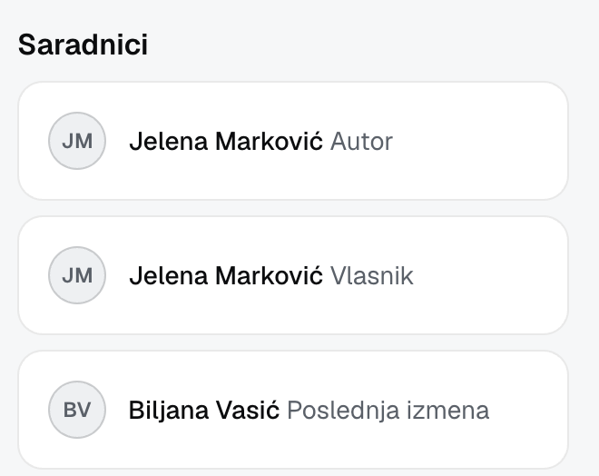

Provereno na Izumi 0.5.7, 2026-11-20.

"Ko zna" nema svoj ekran u Izumiju. To je pitanje koje postavljate svom AI alatu ("Ko u firmi zna o rokovima čuvanja?"), a Izumi odgovara listom kolega. Ovde vidite šta vi možete da podesite o sebi i odakle Izumi uzima odgovor.

## Podesite teme o kojima znate

<Steps>
  <Step title="Otvorite profil">
    Kliknite **Moji tokeni i profil**. U odeljku **Profil** nalazi se polje **Pitaj me o**, po jedno za svaku firmu u kojoj ste.

    <Frame>
      
    </Frame>
  </Step>
  <Step title="Upišite teme">
    Upišite teme, jednu po redu, najviše 20, svaka do 200 znakova. Kliknite dugme "Sačuvaj teme za" i naziv te firme. Pojavljuje se potvrda da su teme sačuvane. Naslov i odgovornosti ne unosite sami: postavlja ih admin firme.
  </Step>
</Steps>

## Odakle Izumi uzima odgovor

- Iz tema koje ste upisali u **Pitaj me o**.
- Iz **Saradnici** na dokumentima: autor, vlasnik i osoba koja je poslednja menjala dokument. Po kodu, noviji dokumenti imaju veću težinu od starih.

<Frame>
  
</Frame>

Po kodu, odgovor ima najviše 5 osoba. Svaka dolazi sa razlogom i do 2 dokumenta kao dokazom. Pitate preko AI alata, ne preko web ekrana.

## Ograničenja

- Rezultat je predlog koga da pitate, ne garancija da ta osoba zna.
- Osoba bez teme u **Pitaj me o** i bez dokumenata na kojima je saradnik ne može da se pojavi.
- Pitate samo u okviru firmi u kojima ste.

## Rešavanje problema

- _Vaša tema se ne vidi u odgovoru._ Proverite da ste kliknuli dugme "Sačuvaj teme za" pod pravom firmom. Teme se čuvaju po firmi.
- _Ne možete da promenite naslov ili odgovornosti._ Postavlja ih admin firme.
- _AI alat ne vraća nikoga._ Tema možda nije u polju "Pitaj me o" ni u **Saradnici** nijednog dokumenta koji vidite.
