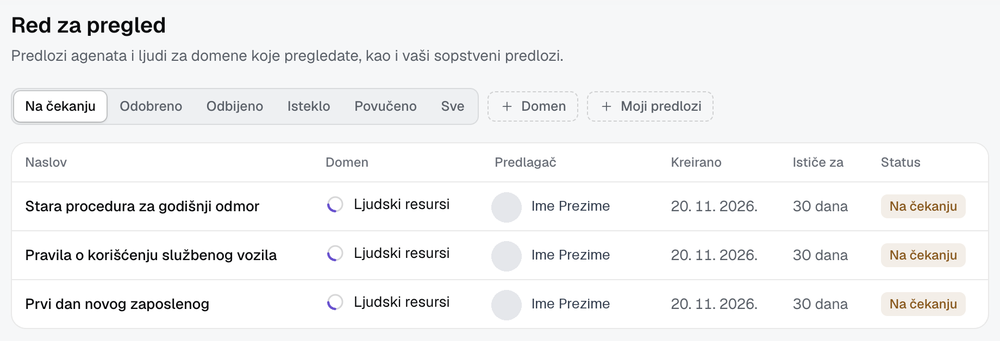
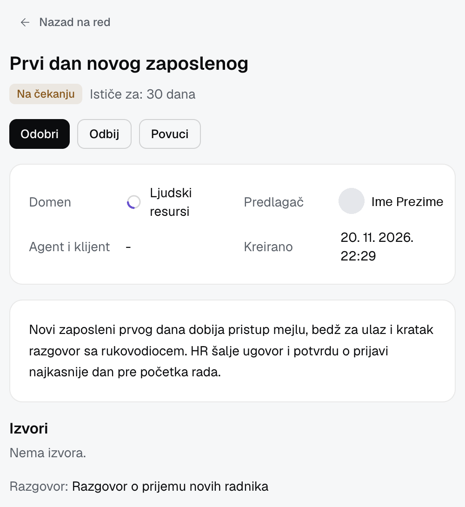
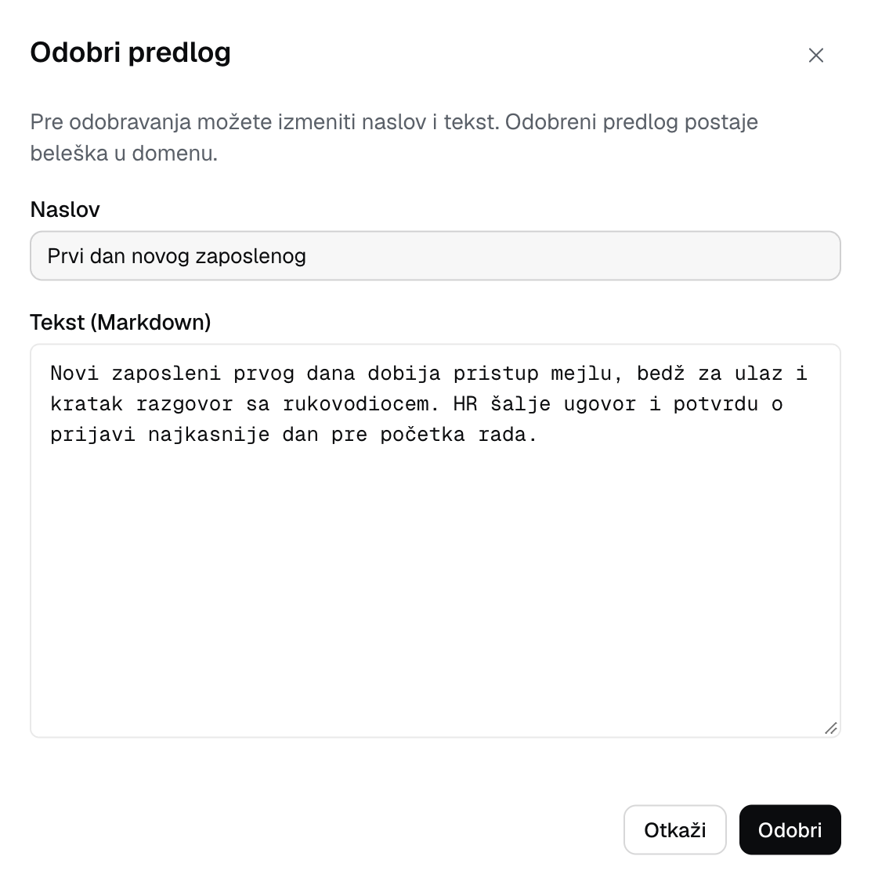
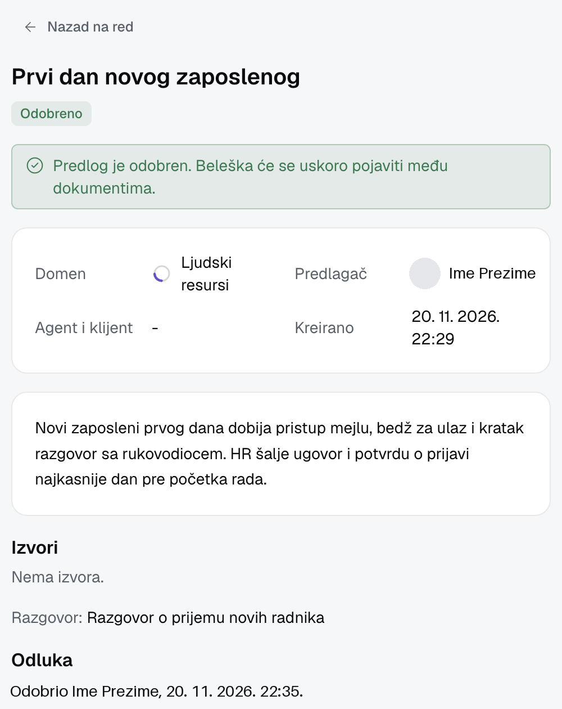
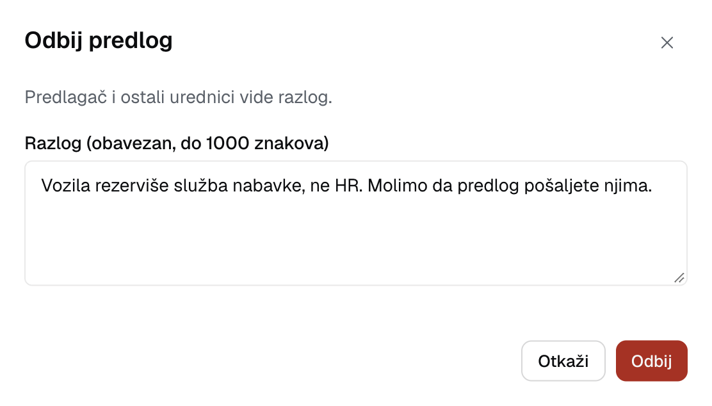
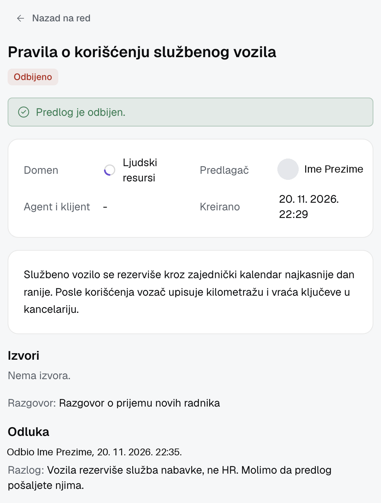
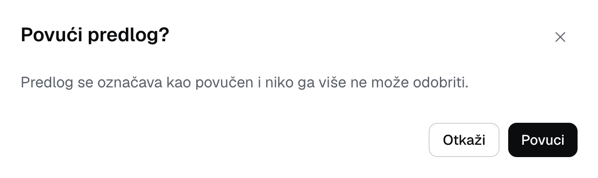
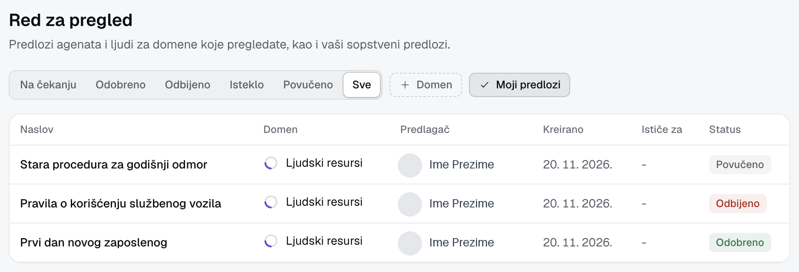
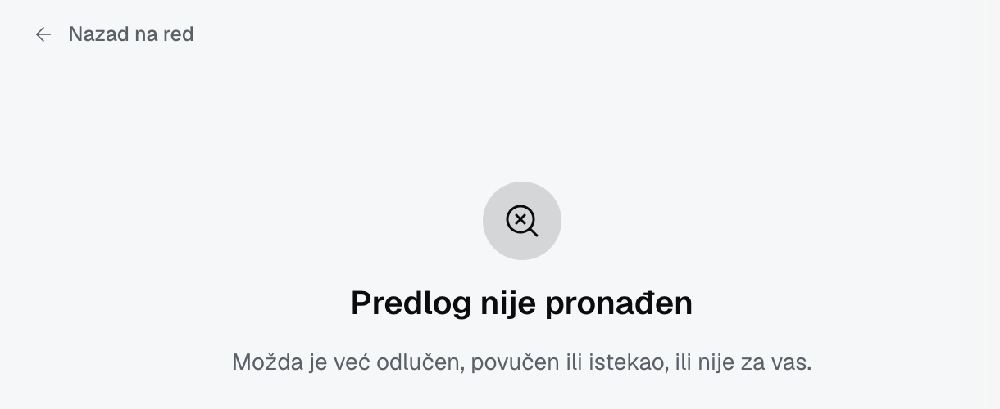

Provereno na Izumi 0.5.7, 2026-11-20.

Predlog je beleška koju AI alat (ili osoba kroz svoj token) predlaže za jedan domen. Beleška se ne pretražuje dok je urednik tog domena ne odobri. **Red za pregled** je lista svih predloga: urednik u njemu odlučuje, a predlagač prati svoje predloge.

## Ko šta radi

| Uloga | Šta vidi u **Red za pregled** | Dugmad u detalju |
|---|---|---|
| Urednik domena | predloge svojih domena i svoje predloge | **Odobri**, **Odbij**, a **Povuci** ako je i predlagač |
| Član bez uloge urednika i bez svojih predloga | prazan red; tuđi predlog otvara **Predlog nije pronađen** | nema |

- **Red za pregled** je u levom meniju svakom članu firme.
- Admin firme nije automatski urednik. Predloge domena vidi i o njima odlučuje samo ko je urednik tog domena.

## Pregledajte i odlučite

<Steps>
  <Step title="Otvorite red">
    Kliknite **Red za pregled**. Broj pored stavke pokazuje koliko predloga čeka vašu odluku. Na vrhu birate status: **Na čekanju**, **Odobreno**, **Odbijeno**, **Isteklo**, **Povučeno** ili **Sve**. Dodatni filteri su **Domen** i **Moji predlozi**. Kolone su **Naslov**, **Domen**, **Predlagač**, **Kreirano**, **Ističe za** i **Status**.

    <Frame>
      
    </Frame>
  </Step>
  <Step title="Pročitajte predlog">
    Kliknite red. Vidite status i rok ("Ističe za: 30 dana"), pa podatke **Domen**, **Predlagač**, **Agent i klijent** i **Kreirano**. Ispod su **Tekst predloga**, **Izvori** i **Razgovor**.

    <Frame>
      
    </Frame>
  </Step>
  <Step title="Odobrite">
    Kliknite **Odobri**. Dijalog ima polja **Naslov** (3 do 200 znakova) i **Tekst (Markdown)** (20 do 20000 znakova). Predlog dobija status **Odobreno**, a beleška se uskoro pojavljuje u **Dokumenti** sa oznakom **Beleška**. Autor je predlagač.

    <Frame>
      
    </Frame>
    <Frame>
      
    </Frame>
  </Step>
  <Step title="Ili odbijte">
    Kliknite **Odbij**. Razlog je obavezan (do 1000 znakova), a predlagač ga vidi. Beleška ne nastaje i ne pojavljuje se u pretrazi.

    <Frame>
      
    </Frame>
    <Frame>
      
    </Frame>
  </Step>
</Steps>

## Povucite svoj predlog

<Steps>
  <Step title="Kliknite Povuci">
    Otvorite svoj predlog i kliknite **Povuci**. Dijalog kaže da se predlog označava kao povučen i da ga niko više ne može odobriti.

    <Frame>
      
    </Frame>
  </Step>
  <Step title="Pratite svoje predloge">
    Uključite **Moji predlozi** i izaberite **Sve**. Vidite svoje predloge sa statusima i razlogom odbijanja.

    <Frame>
      
    </Frame>
  </Step>
</Steps>

Povučen predlog ostaje vidljiv predlagaču i uredniku (preko linka i preko statusa **Povučeno** ili **Sve**), ali se više ne može odlučiti.

## Kad predlog nije dostupan

Ako otvorite predlog koji ne smete da vidite ili koji ne postoji, vidite **Predlog nije pronađen**: "Možda je već odlučen, povučen ili istekao, ili nije za vas." To je normalno ponašanje, nije greška.

<Frame>
  
</Frame>

## Ograničenja

- Odobren predlog je u pretrazi za nekoliko minuta. Odbijen i povučen predlog nikad nisu u pretrazi.
- Predlog važi 30 dana, rok se vidi u koloni **Ističe za**.
- Izumi ne šalje mejl o predlozima. Urednik vidi samo broj pored **Red za pregled**, a predlagač ishod vidi kad otvori svoj predlog.
- Odobrena beleška ne može da se obriše iz liste **Dokumenti** ni sa stranice dokumenta.

## Rešavanje problema

- _"Nema predloga za vaše domene."_ Nema ničeg na čekanju, ili niste urednik nijednog domena i nemate svoje predloge. Probajte **Sve** i **Moji predlozi**.
- _"Nijedan predlog ne odgovara filterima."_ Skinite filter **Domen** ili izaberite **Sve**.
- _Predlog nije pronađen._ Predlog je odlučen, povučen ili istekao, ili nije za vaš pregled. Otvorite ga iz liste sa statusom **Sve** ili pitajte predlagača.
- _"Ovaj predlog se više ne može odlučiti."_ Neko je već odlučio ili ga je predlagač povukao dok ste imali otvoren dijalog. Osvežite listu.
- _"Naslov mora imati od 3 do 200 znakova."_ i _"Tekst mora imati od 20 do 20000 znakova."_ Ispravite polja u dijalogu **Odobri predlog**.
- _"Unesite razlog."_ U dijalogu **Odbij predlog** razlog je obavezan.
- _"Predlozi se nisu učitali."_ Osvežite stranicu. Ako se ponovi, javite adminu firme.
- _Odobrena beleška se ne pronalazi odmah._ Poruka kaže "uskoro". Sačekajte nekoliko minuta i pretražite po rečima iz teksta.
