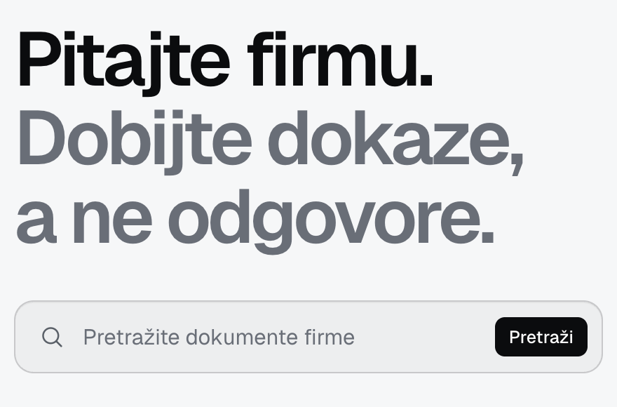
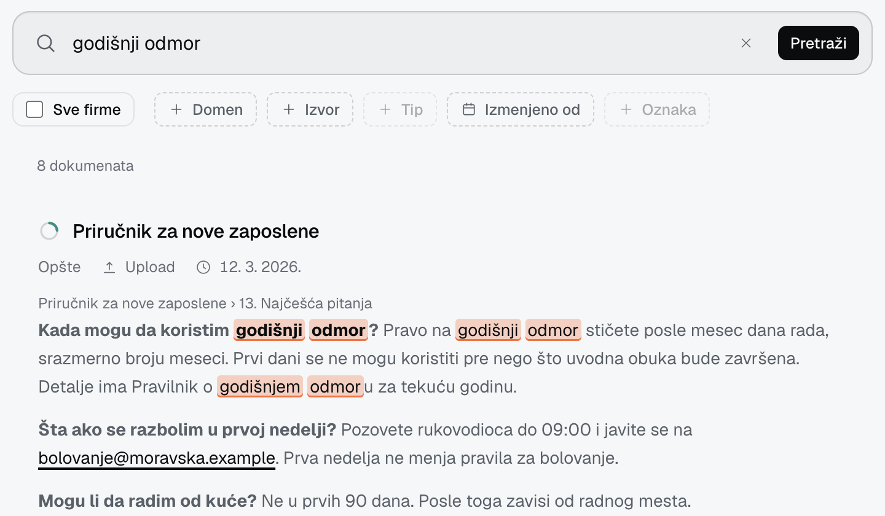
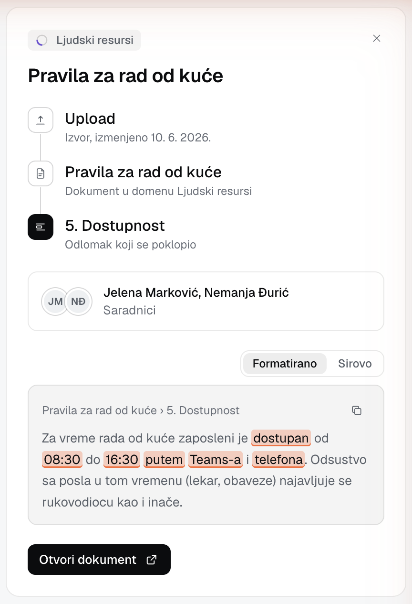
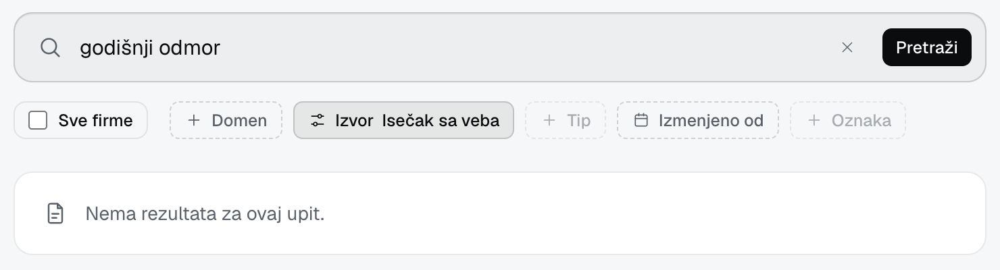

Provereno na Izumi 0.5.7, 2026-11-20.

Pretraga je prvi ekran u Izumiju. Pišete pitanje, a Izumi vraća dokumente i odlomke koji se poklapaju, samo iz domena u kojima imate ulogu.

## Pretražite sa Početne

<Steps>
  <Step title="Upišite upit">
    Na **Početna** kliknite polje **Pretražite dokumente firme**, upišite upit i pritisnite Enter ili **Pretraži**. Upit može biti na srpskom ili engleskom, latinicom ili ćirilicom.

    <Frame>
      
    </Frame>
  </Step>
  <Step title="Pročitajte rezultate">
    Otvara se **Dokumenti** sa vašim upitom i brojem pronađenih dokumenata. Svaki rezultat ima naslov, domen, izvor, datum izmene, putanju do odlomka i sam odlomak. Reči iz upita su obeležene narandžasto.

    <Frame>
      
    </Frame>
  </Step>
  <Step title="Suzite rezultate">
    Na istom ekranu menjate upit i dodajete filtere: **Domen**, **Izvor**, **Tip**, **Izmenjeno od**, **Oznaka**. **Sve firme** pretražuje sve firme u kojima ste, i vidi se samo kad ste u više firmi.
  </Step>
  <Step title="Proverite odlomak">
    Kliknite ikonu oka (**Pregled**) na rezultatu. Desno se otvara panel sa putem do odlomka (izvor, dokument, odlomak), saradnicima i odlomkom sa ikonom za kopiranje (**Kopiraj citat**). **Otvori dokument** vodi na punu stranicu.

    <Frame>
      
    </Frame>
  </Step>
</Steps>

Posle ranije pretrage **Početna** pokazuje listu **Nedavno** sa dugmetom **Očisti**. Ona se čuva samo u vašem pregledaču, ne na serveru.

## Šta vidite kad nema rezultata

Ako filteri isključe sve, piše "Nema rezultata za ovaj upit." Uklonite filtere ili promenite upit.

<Frame>
  
</Frame>

## Ograničenja

- Jedna pretraga vraća najviše 8 dokumenata. Kad je odgovor predug, Izumi ga skraćuje i prikazuje _"Prikazani su najbolji rezultati; suzite pretragu filterima."_ (proveri uživo kao član).
- Pretraga uvek vraća najbliže rezultate, čak i za besmislen upit. Rezultat na vrhu zato ne znači da odgovara: pročitajte odlomak.
- Upit mora imati bar 2 znaka.
- Obeležavanje prati reči iz upita, ne svaku srodnu reč.
- Slova č, ć, š, ž i đ ne smetaju: upit bez kvačica daje iste rezultate. Upit na ćirilici nalazi dokumente na latinici i obrnuto, a upit na engleskom nalazi srpske dokumente.
- Vidite samo domene u kojima imate ulogu. Ono što ne smete da vidite ne dolazi ni u rezultate ni u broj. Isto važi za admina firme: i on vidi samo domene u kojima ima ulogu.

## Rešavanje problema

- _"Nema rezultata za ovaj upit."_ Uklonite filtere ili promenite upit. Ako ni to ne pomogne, možda nemate ulogu u domenu sa tim dokumentima.
- _"Upit mora imati bar 2 znaka."_ Upišite bar dva znaka.
- _"Pretraga nije uspela."_ Pokušajte ponovo. Ako se ponavlja, javite adminu firme.
- _Rezultati nisu ono što ste tražili._ Otvorite odlomak (ikona oka) i proverite. Formulišite pitanje kao u dokumentu ili suzite filterom **Domen**.
- _Znate da dokument postoji, a ne vidite ga._ Nemate ulogu u njegovom domenu. Zamolite admina firme.
