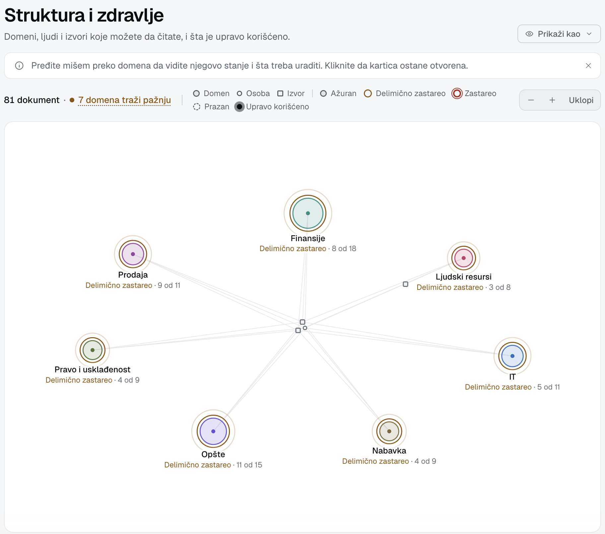
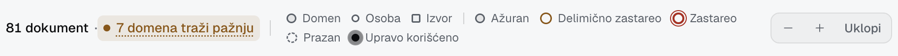
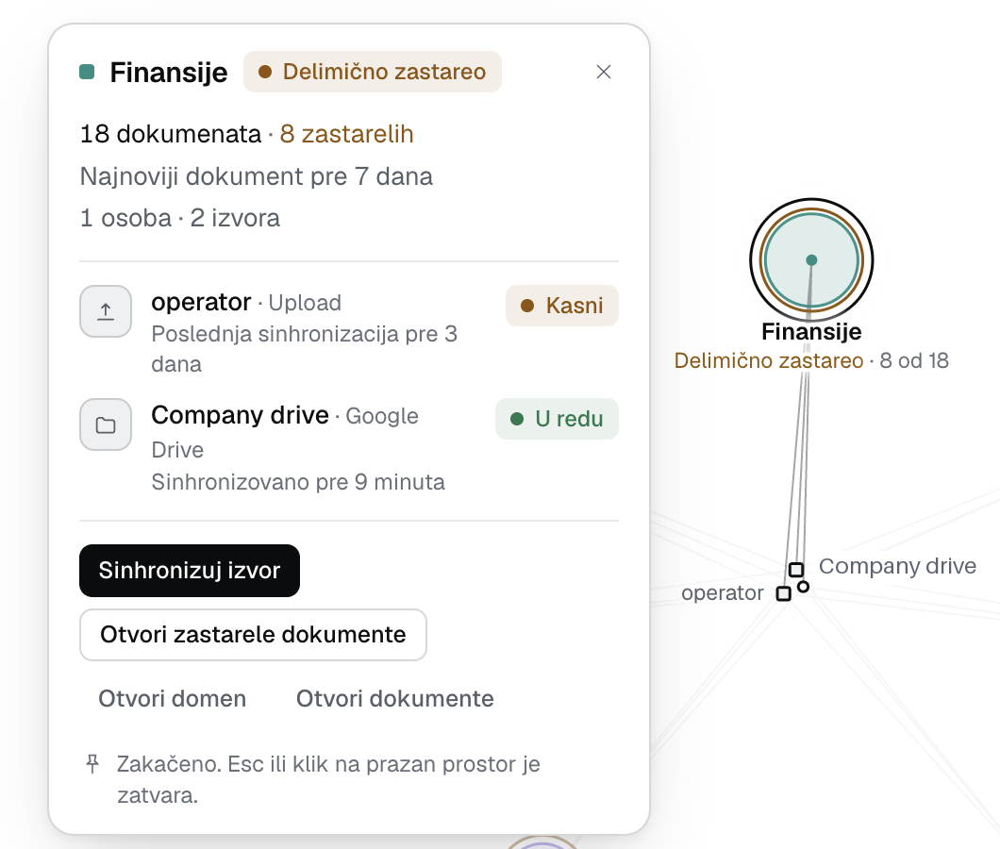
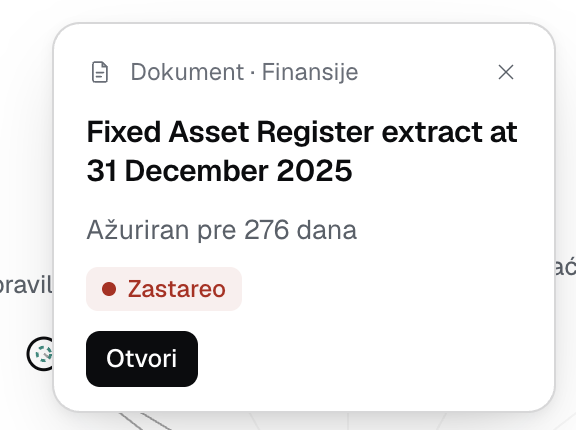
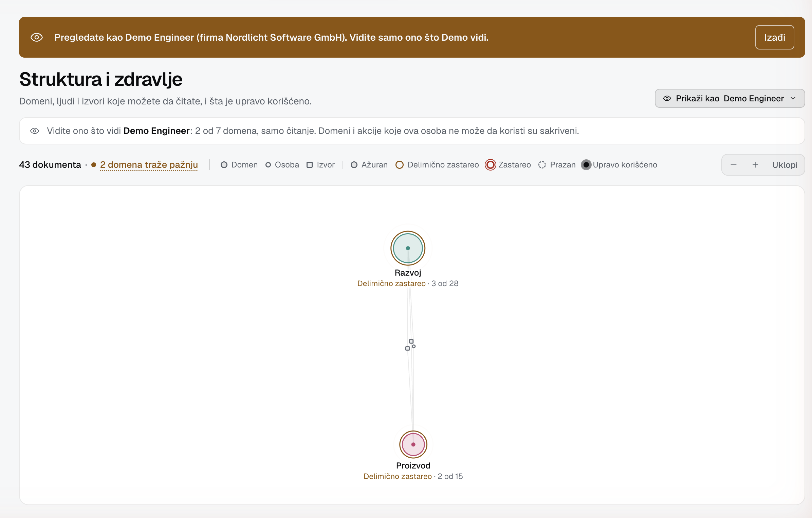
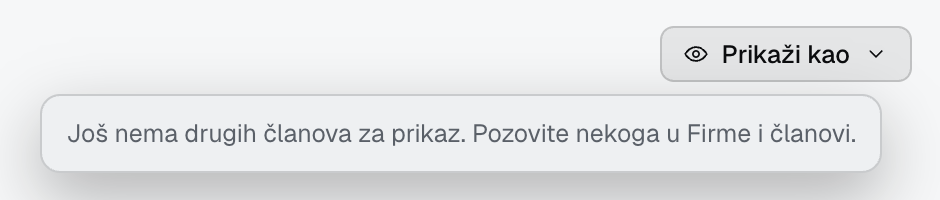

Provereno na Izumi 0.5.7, 2026-11-20.

**Struktura i zdravlje** je mapa vaše firme. Krugovi su domeni (oblasti znanja), male tačke su osobe i izvori (Drive, otpremanje, beleške), a linije pokazuju ko i šta hrani koji domen. Mapa odgovara na pitanje "je li znanje ažurno i odakle dolazi". Ne pokazuje sadržaj dokumenata, već njihovu starost i stanje izvora.

Ekran je napravljen za računar. Vidite samo domene koje smete da čitate.

## Pročitajte mapu

<Steps>
  <Step title="Otvorite ekran">
    Kliknite **Struktura i zdravlje** u levom meniju. Prvi put se pojavljuje savet "Pređite mišem preko domena da vidite njegovo stanje i šta treba uraditi. Kliknite da kartica ostane otvorena." Zatvara se krstićem (**Sakrij savet**).

    <Frame>
      
    </Frame>
  </Step>
  <Step title="Pročitajte traku iznad mape">
    Traka pokazuje, na primer, "81 dokument · 7 domena traži pažnju". Prvi broj su svi dokumenti koje vidite, drugi su domeni koji traže pažnju. Kad je sve sveže, piše da je sve ažurno.

    <Frame>
      
    </Frame>
  </Step>
  <Step title="Pogledajte karticu domena">
    Pređite mišem preko kruga domena, pa kliknite da kartica ostane. Kartica pokazuje naziv i stanje, broj dokumenata i zastarelih, kad je stigao najnoviji dokument, broj osoba i izvora, i izvore koji hrane domen sa njihovim stanjem.

    <Frame>
      
    </Frame>
  </Step>
  <Step title="Uđite u domen i otvorite dokument">
    Kliknite **Otvori domen**. Traka pokazuje **Nazad na sve domene** i putanju do domena. Pređite mišem preko dokumenta, pa kliknite da kartica ostane. Dugme **Otvori** vodi na stranicu dokumenta.

    <Frame>
      
    </Frame>
  </Step>
</Steps>

Dugmad **Umanji**, **Uvećaj** i **Uklopi** zumiraju mapu. **Uklopi** vraća pregled. Mapa se osvežava uživo.

## Šta znači "zdravlje"

- Dokument je zastareo kad je prošlo više od 180 dana od poslednjeg pregleda, izmene u izvoru ili uvoza.
- Domen je **Ažuran** (nijedan dokument nije zastareo), **Delimično zastareo** (neki jesu), **Zastareo** (svi jesu) ili **Prazan** (nema dokumenata). Boja prstena prati stanje.
- Brojač "traži pažnju" broji domene koji su **Delimično zastareo** ili **Zastareo**. Klik na "N domena traži pažnju" ih istakne, drugi klik gasi isticanje.
- Izvor ima svoje stanje: **U redu**, **Kasni** (nije sinhronizovan duže od tri intervala, najmanje 24 sata), **Pauziran** ili **Greška**.

## Pogledajte kao drugi član (samo admin firme)

<Steps>
  <Step title="Izaberite osobu">
    U zaglavlju ekrana kliknite **Prikaži kao** i izaberite osobu. Meni pokazuje ime i uloge te osobe.
  </Step>
  <Step title="Pročitajte mapu">
    Traka kaže da pregledate kao ta osoba i da vidite samo ono što ona vidi. Mapa ima samo njene domene, preraspoređene bez rupa, a akcije za izmenu su skrivene. **Izađi** vraća vaš pregled.

    <Frame>
      
    </Frame>
  </Step>
  <Step title="Ako nema drugih članova">
    Meni kaže "Još nema drugih članova za prikaz. Pozovite nekoga u Firme i članovi."

    <Frame>
      
    </Frame>
  </Step>
</Steps>

## Šta vide ostali

| Ko | Šta vidi |
|---|---|
| Admin firme | samo domene u kojima ima ulogu, kao svaki član, **Prikaži kao**, dugmad za izvore na kartici domena |
| Urednik domena (iz koda) | samo svoje domene |
| Čitalac | samo domene u kojima ima ulogu, sa dugmadima **Otvori domen** i **Otvori dokumente** |
| Član bez uloge (iz koda) | prazna mapa |

## Ograničenja

- Slike pokazuju stanje demo firmi na dan provere. Vaša mapa izgleda drugačije, zavisno od količine podataka i onoga što vidite.
- "Zastareo" se računa po datumu poslednjeg pregleda, izmene u izvoru ili uvoza, ne po tome koliko se dokument čita.
- Mapa ne prikazuje više od oko 3000 čvorova u jednom domenu. Za veće domene piše "Prikazano N od M dokumenata".
- Naziv izvora na mapi je onaj koji je admin dao izvoru. Na slikama je jedan naziv zamenjen ("Company drive").
- Zumiranje i **Uklopi** važe samo za tekući prikaz.

## Rešavanje problema

- _"Ekran Struktura i zdravlje se nije učitao. Ostali ekrani i dalje rade."_ Osvežite stranicu. Ostatak Izumija radi.
- _"Dokumenti ovog domena se nisu učitali."_ Kliknite **Pokušaj ponovo** u traci ili se vratite na sve domene.
- _"Još nema domena koje možete da čitate."_ Firma nema dokumenata. Admin treba da doda izvor ili otpremi dokumente.
- _"Nemate ulogu ni u jednom domenu, pa je prikaz prazan."_ Admin firme treba da vam dodeli ulogu u domenu (**Firme i članovi**).
- _Mapa je prazna u uskom prozoru._ Ekran traži širok prozor (po kodu najmanje 900 px). Proširite prozor.
- _Domen je zastareo, a dokumenti su skoro ažurirani._ Proverite izvor na kartici domena. Ako je **Kasni**, **Pauziran** ili **Greška**, nove verzije nisu stigle u Izumi.
- _Ne vidite domen koji kolega vidi._ Nemate ulogu u tom domenu. Admin firme to može da proveri kroz **Prikaži kao**.
