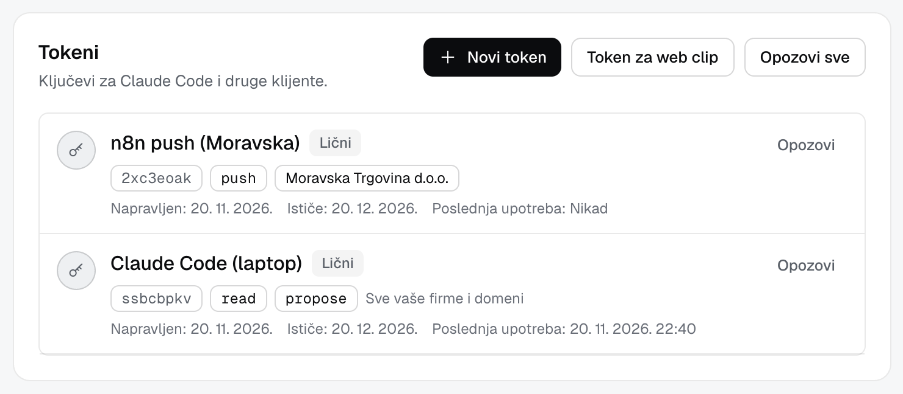
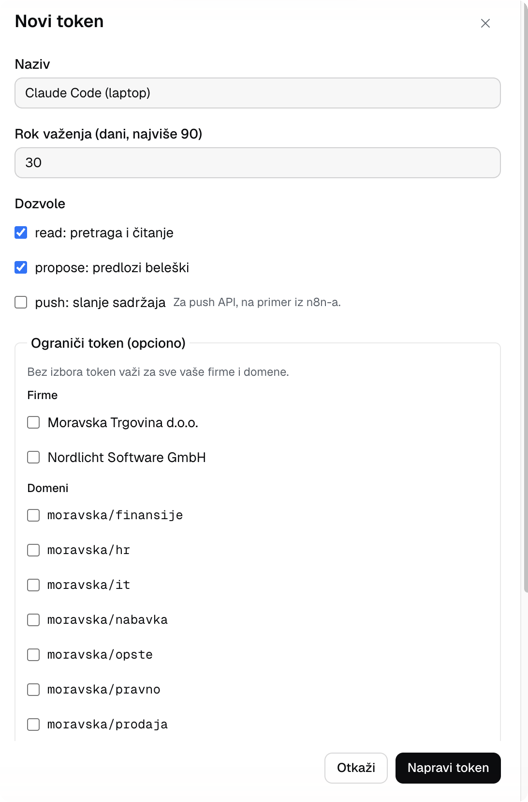
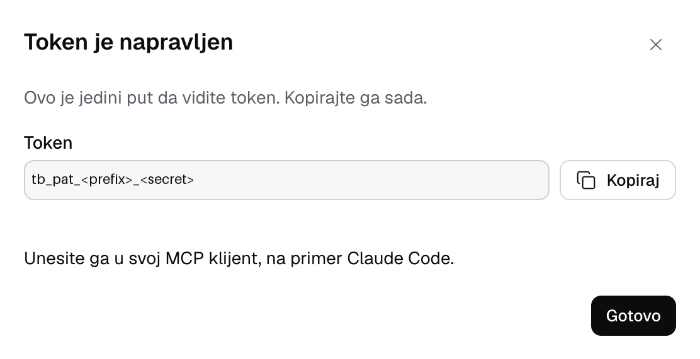
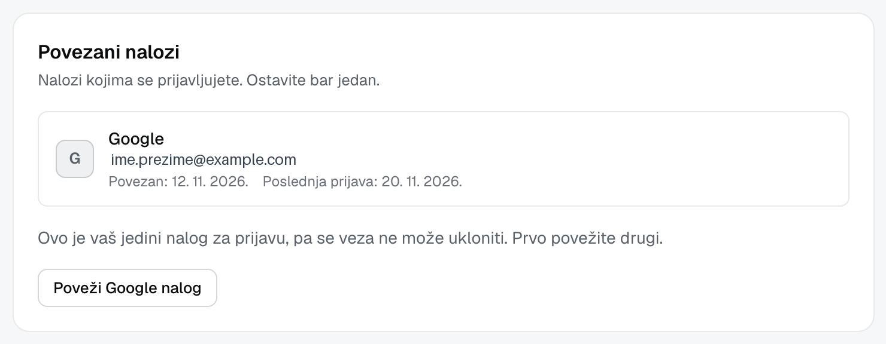
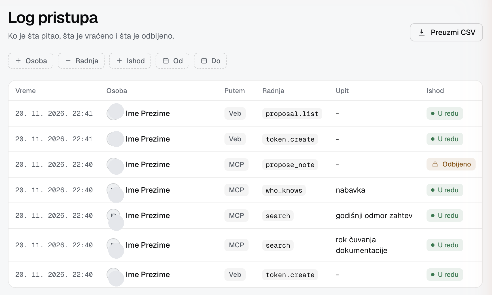
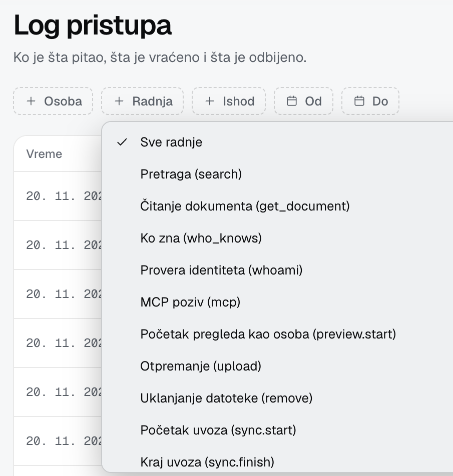

Provereno na Izumi 0.5.7, 2026-11-20.

**Moji tokeni i profil** i **Log pristupa** su otvoreni svakom članu firme. Tokeni su ključevi koje dajete AI alatima (i proširenju za web clip) da rade u vaše ime. Log pokazuje ko je šta pitao.

## Pregledajte svoje tokene

<Steps>
  <Step title="Otvorite odeljak Tokeni">
    Kliknite **Moji tokeni i profil** i pređite na **Tokeni**. Za svaki token vidite naziv, vrstu (**Lični**, **Agent**, **Web clip**, **Povezana aplikacija**), prefiks (prvih 8 znakova, nije tajna), dozvole, ograničenje, **Napravljen**, **Ističe** i **Poslednja upotreba**.

    <Frame>
      
    </Frame>
  </Step>
  <Step title="Opozovite token koji ne koristite">
    Pored svakog tokena je **Opozovi**. Opozvan token odmah prestaje da radi ("Token je opozvan."). Iznad liste je i **Opozovi sve**.
  </Step>
</Steps>

## Napravite novi token

<Steps>
  <Step title="Kliknite Novi token">
    Upišite **Naziv** (do 80 znakova) i **Rok važenja (dani, najviše 90)**: od 1 do 90 dana, podrazumevano 30.

    <Frame>
      
    </Frame>
  </Step>
  <Step title="Izaberite dozvole">
    `read` je pretraga i čitanje, `propose` su predlozi beleški, `push` je slanje sadržaja (na primer iz automatizacije). Bar jedna je obavezna. Po želji uključite **Ograniči token (opciono)** i izaberite firme i domene. Bez izbora token važi za sve vaše firme i domene.
  </Step>
  <Step title="Kopirajte token odmah">
    Kliknite **Napravi token**. Otvara se **Token je napravljen**: "Ovo je jedini put da vidite token. Kopirajte ga sada." Kliknite **Kopiraj**, nalepite token u podešavanja svog AI alata, pa kliknite **Gotovo**.

    <Frame>
      
    </Frame>
  </Step>
</Steps>

Token za proširenje za web clip pravite posebnim dugmetom **Token za web clip**. Vidi [Web clip](/sr/koriscenje/web-clip).

## Povezani nalozi

U odeljku **Povezani nalozi** vidite naloge kojima se prijavljujete: davaoca, nalog, datum povezivanja i poslednje prijave. Dugme **Poveži Google nalog** dodaje drugi nalog. Ako imate samo jedan, veza se ne može ukloniti.

<Frame>
  
</Frame>

## Log pristupa

<Steps>
  <Step title="Otvorite Log pristupa">
    Kliknite **Log pristupa**. Kolone su **Vreme**, **Osoba**, **Putem**, **Radnja**, **Upit**, **Rezultata**, **Ishod** i **Trajanje**. **Putem** kaže odakle je zahtev došao (Veb, MCP, Pregled, Veb isečak, Povezana aplikacija i drugo). **Ishod** je **U redu**, **Odbijeno** ili **Greška**. Slika izostavlja kolone **Rezultata** i **Trajanje** i poslednju kolonu, da ostane čitljiva.

    <Frame>
      
    </Frame>
  </Step>
  <Step title="Suzite zapise">
    Filteri su **Osoba** (samo admin firme), **Radnja**, **Ishod**, **Od** i **Do**. **Preuzmi CSV** preuzima zapise sa istim filterima, a **Učitaj još** donosi sledeću stranu.

    <Frame>
      
    </Frame>
  </Step>
  <Step title="Otvorite detalje">
    Strelica na kraju reda otvara **Detalji**. Za pretragu piše **Dokumenti u odgovoru** (naslovi koje je AI alat dobio), a za odbijen poziv **Šifra greške**.
  </Step>
</Steps>

## Ograničenja

- Najviše 50 aktivnih tokena po osobi, rok važenja najviše 90 dana.
- Token pripada osobi, ne firmi: lista je ista u svim firmama kojima pripadate. Ograničenje (firme i domeni) sužava šta token sme.
- Admin firme vidi zapise svih ljudi u firmi. Član vidi samo svoje zapise (iz koda).
- Kolona **Radnja** prikazuje tehnički naziv radnje (na primer `search`), a filter **Radnja** nudi nazive na jeziku ekrana.
- Promena jezika (**SR** ili **EN** u zaglavlju) čuva se u profilu i vidi se u logu kao izmena profila.
- Izgubljen token se ne može ponovo videti. Opozovite ga i napravite novi.

## Rešavanje problema

- _"Unesite naziv (najviše 80 znakova)."_, _"Unesite ceo broj dana od 1 do 90."_ i _"Izaberite bar jednu dozvolu."_ Ispravite polje u dijalogu **Novi token**.
- _"Ograničenje nije dozvoljeno."_ Izabrali ste firmu ili domen koji vam nije dostupan. Skinite ograničenje ili izaberite druge.
- _"Imate 50 aktivnih tokena."_ Opozovite neki koji ne koristite.
- _"Profil se nije učitao."_ Osvežite stranicu.
- _"Log se nije učitao."_ ili _"Nema zapisa."_ Osvežite ili proširite filtere **Od** i **Do**.
- _Ne vidite zapis kolege u logu._ To je očekivano ako niste admin firme.
