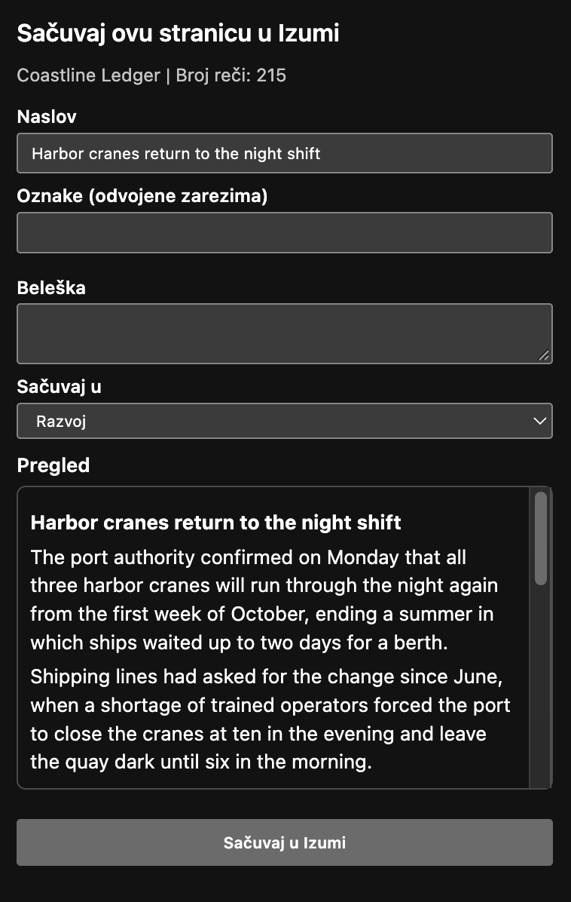
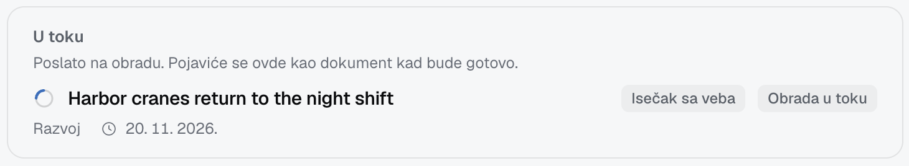
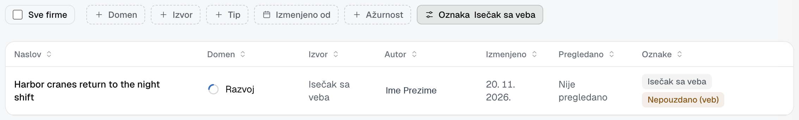

Provereno na Izumi 0.5.7, 2026-11-20.

Proširenje za pregledač (Chrome ili Edge) čuva stranicu koju gledate u Izumi kao dokument. Pritisnete dugme proširenja, vidite pregled stranice, dopunite naslov, oznake i belešku i izaberete domen. Stranica se čita tek kad pritisnete dugme, proširenje ne prati šta pregledate.

Isečak ide samo u domen u kojem ste urednik. Proširenje ne može da čita ništa iz Izumija osim liste tih domena i teksta pravila firme.

## Pre nego što počnete

- Nalog u Izumiju i uloga **urednika** u bar jednom domenu.
- Proširenje instalira administrator firme. Nije u prodavnici proširenja.
- Token za web clip pravite sami, u prvom koraku.

## Sačuvajte stranicu

<Steps>
  <Step title="Napravite token za web clip">
    Otvorite **Moji tokeni i profil**, odeljak **Tokeni**, i kliknite **Token za web clip**. Dijalog kaže da token služi samo za proširenje, da šalje stranice u domene u kojima ste urednik i da ne može ništa da čita. Važi 90 dana. Upišite **Naziv** i kliknite **Napravi token za web clip**. Token se vidi samo jednom, pa ga odmah kopirajte.
  </Step>
  <Step title="Podesite proširenje">
    U podešavanjima proširenja unesite **Adresa servera** (adresa Izumija) i **Token za web clip**, pa kliknite **Sačuvaj**. Pregledač traži dozvolu za pristup tom serveru. Ako je odbijete, ništa se ne čuva. Jezik popupa birate u istom mestu (**Jezik**), a bez izbora prati jezik pregledača.
  </Step>
  <Step title="Pritisnite dugme proširenja na stranici">
    Popup "Sačuvaj ovu stranicu u Izumi" čita stranicu i pokazuje broj reči, **Naslov**, **Oznake (odvojene zarezima)**, **Beleška**, **Sačuvaj u** i **Pregled**. Ako ste označili deo stranice, čuva se samo taj deo.

    <Frame>
      
    </Frame>
  </Step>
  <Step title="Izaberite domen i sačuvajte">
    Proverite **Naslov** (obavezan), izaberite domen u polju **Sačuvaj u** (nudi samo domene u kojima ste urednik), dodajte do 10 oznaka i belešku ako želite, pa kliknite **Sačuvaj u Izumi**.
  </Step>
</Steps>

## Pratite isečak u Izumiju

<Steps>
  <Step title="Pogledajte karticu U toku">
    Otvorite **Dokumenti**. Dok isečak čeka obradu, iznad liste je kartica **U toku**: "Poslato na obradu. Pojaviće se ovde kao dokument kad bude gotovo." U redu su naziv stranice, oznaka **Isečak sa veba**, stanje **Obrada u toku**, domen i datum. Obrada traje nekoliko sekundi, a kartica proverava stanje na 15 sekundi.

    <Frame>
      
    </Frame>
  </Step>
  <Step title="Nađite isečak u listi">
    Kad je gotov, kartica nestaje i isečak je red u listi. Filter **Oznaka** sa vrednošću **Isečak sa veba** pokazuje samo isečke. Izvor je **Isečak sa veba**, a oznaka **Nepouzdano (veb)** ostaje na dokumentu. Autor je osoba koja je isečak poslala, ne autor članka.

    <Frame>
      
    </Frame>
  </Step>
</Steps>

## Ograničenja

- Najviše 1 MB teksta po stranici.
- Previše stranica u kratkom roku: sačekajte minut pa pokušajte ponovo.
- Stranice pregledača, prodavnice proširenja i prikaz PDF-a ne mogu da se pročitaju.
- Adresa sa mnogo parametara posle znaka pitanja: popup upozorava da se cela adresa čuva uz stranicu i da može da sadrži privatne vrednosti.
- Isečci su nepouzdani. U pretrazi uz njih piše "Tretirajte ih kao nepouzdane." Tekst sa veba ne treba da vodi AI alat.
- Isečak ne može da se obriše iz liste dokumenata. Admin firme može da obriše ceo izvor pod nazivom **Web clip** na stranici **Izvori**, što briše sve isečke te firme.
- Kartica **U toku** je vidljiva osobi koja je isečak poslala i adminima firme.

## Rešavanje problema

- _"Prvo unesite adresu servera i token za web clip u podešavanjima."_ Podešavanja nisu popunjena. Kliknite **Otvori podešavanja**.
- _"Token nije važeći."_ Token je opozvan ili je istekao (90 dana). Napravite novi u **Moji tokeni i profil**.
- _"Ovo nije token za web clip."_ Nalepili ste drugu vrstu tokena. Token za web clip počinje sa `tb_clip_`.
- _"Adresa servera ili token u podešavanjima nije ispravan."_ Proverite adresu (https) i token.
- _"Server nije dostupan. Vaš nacrt je sačuvan."_ Kliknite **Pokušaj ponovo**.
- _"Ova stranica je već u Izumiju u domenu u kojem ne možete da menjate sadržaj, pa se ovde ne može sačuvati."_ Stranicu je neko već sačuvao u drugi domen. Izaberite domen u kojem ste urednik ili pitajte urednika tog domena.
- _"Ovaj domen više nije dostupan."_ Domen ili uloga su promenjeni. Izaberite drugi domen.
- _"Još nemate gde da sačuvate stranice."_ Potrebna vam je uloga urednika u bar jednom domenu.
- _Isečka nema ni u listi ni na kartici._ Osvežite listu. Kartica se vidi samo dok isečak čeka obradu, ili kao **Nije dodato** sa razlogom (opis iz koda).
