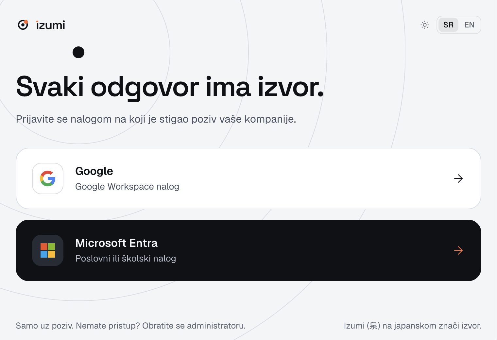
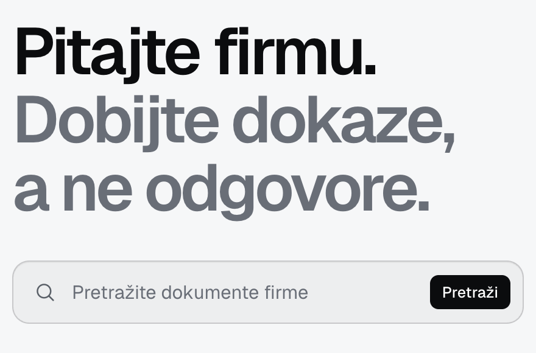

Provereno na Izumi 0.5.7, 2026-11-21.

Od pozivnice do prvog odgovora za nekoliko minuta. Ovo je put korisnika u firmi koja već ima Izumi. Instalaciju i prvu prijavu admina vodi tab [Instalacija](/sr/instalacija/zahtevi).

<Steps>
  <Step title="Primite pozivnicu">
    Admin firme pravi pozivnicu i šalje vam link. Važi 72 sata i može se iskoristiti jednom.
  </Step>
  <Step title="Prijavite se">
    Otvorite link i prijavite se Google ili Microsoft radnim nalogom sa adresom iz pozivnice.

    <Frame>
      
    </Frame>
  </Step>
  <Step title="Pretražite">
    Na **Početna** upišite pitanje i pritisnite Enter. Otvorite rezultat ikonom oka (**Pregled**): vidite odlomak i put do njega, a **Kopiraj citat** ga kopira. Detalji: [Pretraga](/sr/koriscenje/pretraga).

    <Frame>
      
    </Frame>
  </Step>
  <Step title="Povežite AI alat">
    Izaberite ChatGPT, Claude, Claude Code ili Slack na stranici [Pregled AI alata](/sr/ai-alati/pregled). Za ChatGPT, Claude i Claude Code unosite adresu servera (adresa Izumija sa `/mcp` na kraju), prijavljujete se u Izumi i odobravate vezu. U ChatGPT-u i Claude-u zatim uključite Izumi u chatu. Provereni su ChatGPT Free i Claude Pro. Slack je u Preview fazi i proveren je samo na Free workspace-u. Pre vas ga jednom podešavaju administrator Izumi servera i Slack administrator.
  </Step>
  <Step title="Pitajte iz alata">
    Pitate svoj AI alat, a on zove Izumi i odgovara sa izvorom. Primeri pitanja su na stranici [Alati i primeri pitanja](/sr/ai-alati/alati).
  </Step>
  <Step title="Proverite log">
    Otvorite **Log pristupa** i vidite šta je AI alat tražio u vaše ime. Detalji: [Moji tokeni i log](/sr/koriscenje/tokeni-i-log).
  </Step>
</Steps>

## Ograničenja

- AI alat sam bira koji Izumi alat da pozove. Rezultat je najbliži, ne dokazan: pročitajte odlomak.
- OAuth veza sa AI alatom traje 90 dana, posle čega alat traži novo povezivanje. Lični token traje najviše 90 dana.
- Cursor, Windsurf, Cline, VS Code, Zed i Continue nisu probani.

## Rešavanje problema

- Link pozivnice ne radi. Istekao je (72 sata), već je iskorišćen ili ga je admin opozvao ili zamenio novom pozivnicom (iz koda). Zamolite admina za novu pozivnicu.
- Znate da dokument postoji, a ne vidite ga. Nemate ulogu u njegovom domenu. Zamolite admina firme.
- AI alat kaže da nema Izumi alata ili traži novo povezivanje. Veza nije uključena u tom chatu, istekla je ili je opozvana. Uradite korake sa stranice tog alata. Slackbot posle opoziva ne traži novo povezivanje, vidi stranicu [Slack](/sr/ai-alati/slack).
- Problemi u Izumiju su na stranici [Problemi](/sr/koriscenje/problemi), a problemi sa AI alatom u odeljku Rešavanje problema na stranici tog alata ([Pregled AI alata](/sr/ai-alati/pregled)).

## Dalje

- [Pretraga](/sr/koriscenje/pretraga), [Moji tokeni i log](/sr/koriscenje/tokeni-i-log) i [Kako radi pristup](/sr/upoznaj/pristup).
